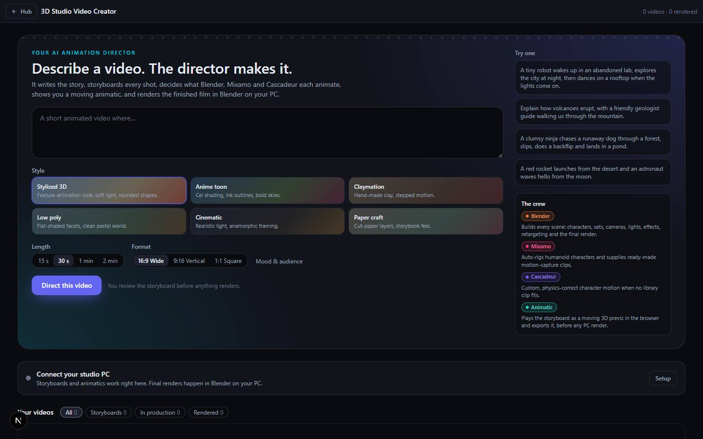

# 3D Studio Video Creator

`/apps/3d-studio` · Video · live · shows as: hub tile (not in any `plugins.ts` list)

> Describe a video → an AI animation director makes it

An AI animation director that turns a short prompt into a complete animated video. Pick a style,
length and format; the director writes the story beats, casts characters, scouts sets and
storyboards every shot with a camera move, lighting and timing, and decides for each piece of motion
whether Mixamo, Cascadeur or Blender should animate it — and says why. The storyboard plays at once
as a moving 3D animatic you can export; one click sends it to Blender on the owner's PC, where
Claude Code builds, animates and renders the finished film to watch and download.

## Features — every one of these must still exist after your change

The owner asked for each of these. Removing, hiding or "simplifying away" one is a regression,
even if the code looked unused. If a change needs one gone, ask first.

**Direct a video** (`src/components/studio3d/Studio3D.tsx`)

- **Prompt box** — "Describe a video. The director makes it."; Ctrl/⌘+Enter submits. `Studio3D.tsx`
- **Six styles as swatch cards** — Stylized 3D, Anime toon, Claymation, Low poly, Cinematic, Paper craft; each sets a Blender look and engine (EEVEE/CYCLES) and an animatic palette. `src/lib/studio3d/types.ts` (`STYLES`)
- **Length** 15 s · 30 s · 1 min · 2 min and **Format** 16:9 Wide · 9:16 Vertical · 1:1 Square. `Studio3D.tsx` (`Segmented`), `types.ts` (`LENGTHS`, `ASPECTS`)
- **Mood & audience** — optional fields behind a toggle. `Studio3D.tsx`
- **"Try one" examples** and **"The crew"** card listing the tools and their roles. `Studio3D.tsx`, `src/lib/studio3d/tools/registry.ts`
- **"The director is planning your video" overlay** — clapperboard animation and seven ticking steps (Reading your prompt … Timing every scene). `Studio3D.tsx` (`DIRECTING`)
- **AI director with an offline fallback** — uses the hub AI provider when a key is set, otherwise a built-in heuristic director; the plan says which ("AI director" / "Offline director"). `src/lib/studio3d/director/index.ts`, `director/llm.ts`, `director/heuristic.ts`, `director/normalize.ts`

**Your videos**

- **Gallery** — first look-dev still or a sky/ground poster, status pill, title, length, logline, tool chips, "N scenes · aspect · style", time ago; polls every 5 s while rendering, 20 s otherwise. `Studio3D.tsx` (`ProjectCard`)
- **Filters** — All · Storyboards · In production · Rendered, with counts. `Studio3D.tsx`

**One video** (`/apps/3d-studio/<id>`, `src/components/studio3d/ProjectPage.tsx`)

- **Pipeline strip** — Interpret · Storyboard · Tool plan · Build & animate · Render · Preview & export, with done/active states. `ProjectPage.tsx` (`STEPS`)
- **Screening room** — switch Final render ↔ Animatic; the final video plays with **Download video** and a line of resolution · fps · engine · size. `ProjectPage.tsx`
- **3D animatic** — the plan played as moving Three.js previz (sets, stand-in rigs, camera moves, title card, scene tag, narration subtitles, fades); play/pause, scrub bar, jump by scene. `src/components/studio3d/Animatic.tsx`, `src/lib/studio3d/animatic/engine.ts`
- **Export animatic** — records the canvas to WebM (or MP4) in the browser, then "Download". `Animatic.tsx`
- **Next-action bar** — Render in Blender / Render again / Try again; while queued "Take out of queue"; live note while the PC works. `ProjectPage.tsx` (`ActionBar`)
- **Storyboard tab** — scene cards with frame, title, summary, camera, duration and per-action tool chips; click a frame to play from that scene. `ProjectPage.tsx` (`Storyboard`)
- **Edit a scene** — title, what happens, narration, camera move (static, dolly in/out, orbit, pan, crane up, tracking, handheld), seconds. `ProjectPage.tsx` (`SceneEditor`), `PATCH src/app/api/studio3d/projects/[id]/route.ts`
- **Re-route motion** — click a tool chip to hand that motion to a different tool; scene lengths rebalance to keep the total length. `ProjectPage.tsx` (`cycleTool`)
- **"Give the director a note" → Another take** — re-plans the whole storyboard with your note. `ProjectPage.tsx`, `projects/[id]/route.ts` (`redirect`)
- **Storyboard locks while rendering**. `src/lib/studio3d/reducer.ts` (`canEdit`)
- **Production tab** — look-dev frames from Blender, render report (incl. "Changed or left out"), live production log. `ProjectPage.tsx` (`Production`)
- **Director's read** — logline, genre, tone, audience, length, pacing, look, music, sound. `ProjectPage.tsx`
- **Tool plan** — which tools this video uses and why, whether the PC is ready (Blender installed, Mixamo clips missing, Cascadeur or Blender fallback); planned tools shown greyed. `src/components/studio3d/ToolPlan.tsx`
- **Cast and Sets** lists. `ProjectPage.tsx`
- **Delete project** — confirms; files on the PC are kept. `ProjectPage.tsx`

**Connect your studio PC** (`src/components/studio3d/StudioSetup.tsx`)

- **Status + what the PC has** — Blender (version), Blender MCP, Mixamo library clip count, Cascadeur (+ MCP). `StudioSetup.tsx`
- **Setup steps** — studio token (shown once), `.env` lines incl. optional `BLENDER_PATH`, install commands (`winget` Blender + uv, `claude mcp add blender`), start command. `StudioSetup.tsx`, `src/app/api/studio3d/builder-token/route.ts`

**On the PC** (`tools/studio3d-builder/`, not deployed)

- **Studio builder** — claims queued videos, writes `job.json`, runs Claude Code with the `animation-director` skill, streams progress, look-dev stills and the final render back; one at a time. `npm run doctor` shows what the PC has. `tools/studio3d-builder/builder.mjs`, `lib/detect.mjs`, `lib/claude.mjs`, `lib/watch.mjs`
- **Large uploads in ≤ 8 MB chunks** (Next keeps only 10 MB of a body that passes through middleware). `src/app/api/studio3d/builder/media/route.ts`

## How it looks

- **Look:** DESIGN.md instrument panel with a film-studio accent; no design-skill record found.
- **Colours / type:** hub Tailwind tokens (`bg-panel`, `border-line`, `text-ink*`, indigo `bg-brand` buttons, cyan `text-accent` eyebrow). Tool chips have their own colours: Blender `#f5792a`, Mixamo `#ff3a7a`, Cascadeur `#7c5cff`, Animatic `#2dd4bf`, Voice `#60a5fa`, Music `#facc15`, Concept art `#f472b6`. Style swatches use each style's 3-colour palette. System sans; mono for durations and the log.
- **Layout:** laptop — hero splits form (left) and examples/crew (320 px right); gallery 4/3/2/1 columns; project page = main column + 380 px side column. Phone — everything stacks; pipeline strip scrolls sideways.
- **Signature pieces:** film-strip **sprocket** edge on the hero (`.s3d-sprockets`), brand+accent radial hero wash, sky/ground poster cards, clapperboard "directing" overlay, colour-dotted tool chips.
- **Motion:** clapper 1.1 s loop, active pipeline dot pulse, card hover lift; reduced motion stops the CSS animations (`studio3d.css`).

## Where the code is

| Part | Path |
|---|---|
| Page | `src/app/apps/3d-studio/page.tsx` · `src/app/apps/3d-studio/[id]/page.tsx` |
| UI | `src/components/studio3d/` |
| Logic + tests | `src/lib/studio3d/` (`types.ts`, `director/`, `animatic/engine.ts`, `tools/registry.ts`, `reducer.ts`, `store.ts`, `studio3d.test.ts`) |
| API | `src/app/api/studio3d/` — `projects`, `projects/[id]`, `media/[id]/[which]`, `builder-token`, `builder/{claim,progress,media,fail}` (token-auth, session-exempt in `src/middleware.ts`) |
| Saved data | `server_docs` row `studio3d` · Storage bucket `studio3d-media` (stills + final video) |
| PC helper | `tools/studio3d-builder/` (skill at `~/.claude/skills/animation-director`, override `STUDIO3D_SKILL_DIR`) |

## Owner's rules for this app

- The website never runs Blender: it keeps the record, shows the storyboard and plays an in-browser animatic so there is always something to preview and export.
- You review the storyboard before anything renders.
- Every production tool is declared once in `src/lib/studio3d/tools/registry.ts`; adding a tool (voice, music, concept art are reserved slots) is one entry there plus a reference file in the `animation-director` skill.
- Mixamo for everyday humanoid motion, Cascadeur for stunts/fights/creatures/physics, Blender for cameras, objects and effects — each choice comes with a reason.

## Described but not found in code

- None found.
