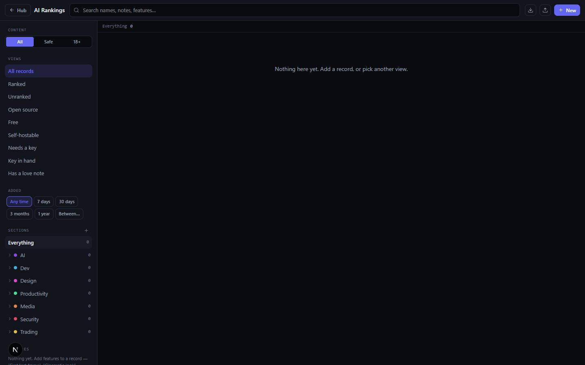

# AI Rankings

`/apps/ai-rankings` · AI · live · shows as: App plugins card (Jarvis › App plugins; `PLUGIN_SLUGS` in `src/lib/studio/plugins.ts`, so no hub tile)

> Your tool database

A private database of every tool worth remembering — AI models first, but also editors, design
apps, media tools, security and trading software. For each tool it keeps what it costs, whether it
is open source / runs on your own machine, and whether it needs an API key, plus your own notes and
a list of features marked love / good / missing / dealbreaker that explain why it holds its rank.
It reads like a database on purpose: sections down the left, a sortable table in the middle, the
full record on the right.

## Features — every one of these must still exist after your change

The owner asked for each of these. Removing, hiding or "simplifying away" one is a regression,
even if the code looked unused. If a change needs one gone, ask first.

**The board (three panes)**

- **Section tree** — groups › categories (AI, Dev, Design, Productivity, Media, Security, Trading to start) with a record count on each; add a new group or category in place, and it stays even while empty. `src/components/ai-rankings/Sidebar.tsx`, `src/lib/ai-rankings/seed.ts` (`SEED_TREE`), `src/lib/ai-rankings/store.ts` (`addGroup`, `addCategory`)
- **Starts empty** — a new board has the sections and no records (owner's own list, not someone else's 95 picks). `src/lib/ai-rankings/seed.ts`, `src/lib/ai-rankings/store.ts` (`buildSeed`)
- **Saved views** — one click for All records, Ranked, Unranked, Open source, Free, Self-hostable, Needs a key, Key in hand, Has a love note. `src/lib/ai-rankings/query.ts` (`VIEWS`), `Sidebar.tsx`
- **Content filter All / Safe / 18+** — Safe hides records rated suggestive or uncensored (unrated stay visible); 18+ shows only those. It runs before everything else, so hidden records can't leak through counts, search or select-all; shows "(N hidden)". Remembered per device, never synced, and survives "reset". `src/lib/ai-rankings/query.ts` (`CONTENT_FILTERS`, `applyContentFilter`), `src/lib/ai-rankings/store.ts` (`CONTENT_FILTER_KEY`), `src/components/ai-rankings/AiRankings.tsx`
- **"Added" window** — Any time, 7 days, 30 days, 3 months, 1 year, or Between two dates; picking one switches the sort to Newest. `src/lib/ai-rankings/query.ts` (`ADDED_PRESETS`), `Sidebar.tsx`, `AiRankings.tsx`
- **Features index** — every feature written on the records in view, with counts (top 12, "+N more"); click one to show only tools that do it. `Sidebar.tsx`, `src/lib/ai-rankings/query.ts` (`featureIndex`)
- **Search** names, notes and features from the top bar. `src/components/ai-rankings/AiRankings.tsx`, `src/lib/ai-rankings/query.ts` (`filterTools`)
- **Tag filter** — click a tag on a record to filter by it (stackable). `src/components/ai-rankings/AiRankings.tsx` (`onTag`), `src/components/ai-rankings/chips.tsx` (`TagPill`)
- **Status strip** — where you are, active filters, "shown/total", a reset link, and "drag rows to rank" when one category is open. `src/components/ai-rankings/AiRankings.tsx`
- **Sortable table** — columns Name, Section, Cost (free green / free tier amber / paid red), Source (open/closed), Runs (web / local / web+local), Rank, Added; click a header to sort, again to flip. `src/components/ai-rankings/ToolTable.tsx`, `src/lib/ai-rankings/query.ts` (`sortTools`)
- **NEW badge and ★ love count** on rows — NEW for records added in the last 30 days; ★ shows how many "Why I keep it" features a tool has; 18+/soft badge for adult-rated tools. `src/components/ai-rankings/ToolTable.tsx`, `src/lib/ai-rankings/types.ts` (`isNew`, `NEW_DAYS`), `chips.tsx` (`ContentBadge`)

**Ranking**

- **A leaderboard per category** — rank a tool, move it up/down with arrows from any view (within its own category), or unrank it. `src/components/ai-rankings/ToolTable.tsx`, `src/components/ai-rankings/DetailPanel.tsx` (`RankRow`), `src/lib/ai-rankings/store.ts` (`rankTool`, `moveToPosition`, `unrankTool`)
- **Drag rows to rank** when a single category is open. `src/components/ai-rankings/ToolTable.tsx` (`draggable`, `drop`)

**The record panel**

- **Edit every field in place** — name, link (with open-in-new-tab), filed under group › category, what it is, cost to you (Free / Free tier / Paid), where it runs (Website / Self-host / Both), API key (Required / Optional / None), Open source toggle, "I have the key" toggle, pricing note, notes, tags. `src/components/ai-rankings/DetailPanel.tsx`
- **Content rating** per record — Unrated / Filtered / Suggestive / Uncensored. `DetailPanel.tsx`, `src/lib/ai-rankings/types.ts` (`ContentRating`, `CONTENT_LABEL`)
- **Features & verdicts** — add notes marked ★ Why I keep it / + Good / − Missing / ✕ Dealbreaker; click a verdict to change it; remove one. "The case for its rank." `DetailPanel.tsx`, `chips.tsx` (`VERDICT_STYLE`), `src/lib/ai-rankings/store.ts` (`addFeature`, `updateFeature`, `deleteFeature`)
- **Date stamp** — every record keeps when you added it (`addedAt`) and last changed it. `src/lib/ai-rankings/types.ts`, `src/lib/ai-rankings/store.ts`
- **Auto-file this** — reads the tool and proposes section, summary, tags, cost, openness, hosting, key, pricing, content rating and new features; you press **Apply filing** or **Discard**, and suggested features are chips you add one by one. With no AI key a keyword pass answers and says so. `DetailPanel.tsx` → `src/app/api/ai-rankings/classify/route.ts`, `src/lib/ai-rankings/classify.ts` (`heuristicSuggestion`, `coerceSuggestion`)
- **Delete a record** (two-press confirm). `DetailPanel.tsx`

**Adding and managing records**

- **New ▸ Analyze a link** — paste a URL and the whole entry is made: the page is read (blocked from private addresses), GitHub / Hugging Face / arXiv links are found (even ones a script-built page renders), their APIs give licence and stars, then it is filed like Auto-file and opened for review. The same link twice opens the existing record; a section name close to an existing one ("Images" vs "Image") reuses it. No AI key → offline heuristic entry. `src/components/ai-rankings/AnalyzeLink.tsx`, `AiRankings.tsx` (`addFromLink`) → `src/app/api/ai-rankings/analyze-url/route.ts`, `src/lib/ai-rankings/analyzeLink.ts`, `src/lib/ai-rankings/readSite.ts`
- **New ▸ Blank entry** — starts an "Untitled" record in the section you're viewing (rated Uncensored if you're in the 18+ view). `AiRankings.tsx` (`addRecord`)
- **Select rows + Delete selected** — checkboxes per row and a select-all that only covers rows on screen; two-press confirm. `AiRankings.tsx`, `ToolTable.tsx`
- **Clear all records** — keeps your sections and colours; the armed button disarms itself after 5 s. `AiRankings.tsx` (`clearAll`), `src/lib/ai-rankings/store.ts` (`clearTools`)
- **Export / Import JSON** — download `ai-rankings-<date>.json`; importing replaces the board. `AiRankings.tsx`, `src/lib/ai-rankings/store.ts` (`exportJson`, `importJson`)
- **Follows you between devices** — local-first in localStorage, synced through `app_state` (key `ai-rankings:v2`). `src/lib/ai-rankings/store.ts` (`saveSynced`), `AiRankings.tsx` (`useRemotePull`)

**Feeding the board from elsewhere in Jarvis**

- **"AI Rankings" folder → Sync button on each entry** — in Jarvis › Folders, any folder whose name contains "ai ranking(s)" (e.g. "ai rankings folder") and its sub-folders gets a Sync button per entry; pressing it files that one entry on the board, auto-categorised from its name/link/summary. Already-filed entries show a green chip naming the section, which opens the app. Nothing syncs by itself. `src/components/recall/RankingsSync.tsx`, `src/components/recall/FolderWorkspace.tsx`, `src/lib/ai-rankings/fromDashboard.ts` (`isRankingsName`, `inRankingsFolder`, `findOnBoard`, `syncToRankings`)
- **A link found from the name** — in that folder, a website saved with no URL gets one: the AI names the official site; with no key (or an unknown name) the server tries `<name>.com/.ai/.io/.app/.dev` and keeps the first that answers; otherwise a flagged `.com` guess. Always an editable suggestion. `src/components/recall/WebsitesSection.tsx`, `src/components/recall/rankingsFolder.tsx`, `src/lib/ai-rankings/siteUrl.ts` → `src/app/api/ai-rankings/site-url/route.ts`
- **"Find links for N entries"** — the folder header fills in links for every old linkless entry (folder + sub-folders), 3 at a time, never overwriting a typed link. `src/components/recall/FolderWorkspace.tsx`, `src/lib/ai-rankings/backfillUrls.ts`
- **Add a model from Jarvis › Toolbox › Armory › Models** — each model row has a button to file it on the board, or a green check (opens AI Rankings) if it's already there. `src/components/jarvis/ToolsTab.tsx` (`addToBoard` → `fileOnBoard`), mounted by `src/components/new-jarvis/ArmoryTab.tsx`

## How it looks

- **Look:** the hub's "Night Console" dark database chrome (see `DESIGN.md`); built as a dense three-pane database rather than a card grid (change log 2026-08-31). No app-specific design skill recorded.
- **Colours / type:** hub tokens — `bg-canvas` `#0a0b0f`, `bg-panel` `#12141c`, `bg-panel-2` `#181b25`, `bg-elevated` `#1d212d`, borders `line` `#262a38` / `line-soft` `#1e222e`, text `ink` `#e9ecf3` / `ink-muted` `#9aa3b5` / `ink-faint` `#6b7385`, accent `brand` `#6366f1`. Each group has its own hue (`GROUP_HUE` in `src/lib/ai-rankings/types.ts`: AI 265, Dev 200, Design 305, Productivity 155, Media 25, Security 350, Trading 45; invented groups get a stable hashed hue) used in the sidebar, rank badges and the record's colour stripe. State colours: emerald = free/open/love, amber = free tier/missing/soft, rose = paid/dealbreaker/18+, sky = good. System sans for text at 13px; JetBrains Mono for column headers, counts, status strip and badges (uppercase, wide tracking).
- **Layout:** laptop (`lg`+) — fixed-height app: top bar (Hub link, title, search, export/import/clear, New menu), 240px section sidebar, table filling the middle, 380px record panel on the right when a record is open. Phone — the sidebar is hidden behind a menu button and slides over as an overlay; the record panel opens full screen; the table drops columns by width (Section below `md`, Cost below `sm`, Source/Runs below `lg`, Added below `xl`) and export/import/clear are hidden below `sm`. Inside Jarvis (`embedded`) the Hub link is hidden and the height fits under Jarvis's header.
- **Signature pieces:** the dense table with sticky header and per-section rank badges, the coloured group stripe on the record panel, verdict pills (★ + − ✕), the 18+/soft content badge, the All/Safe/18+ switch, the green "on the board" chip in the Folders view.
- **Motion:** almost none — `animate-fade-in` on the New menu and flash messages, colour transitions on hover. Nothing to reduce.

## Where the code is

| Part | Path |
|---|---|
| Page | `src/app/apps/ai-rankings/page.tsx` |
| UI | `src/components/ai-rankings/` (`AiRankings.tsx`, `Sidebar.tsx`, `ToolTable.tsx`, `DetailPanel.tsx`, `AnalyzeLink.tsx`, `chips.tsx`) · folder hooks in `src/components/recall/` (`RankingsSync.tsx`, `rankingsFolder.tsx`, `FolderWorkspace.tsx`, `WebsitesSection.tsx`) · `src/components/jarvis/ToolsTab.tsx` |
| Logic + tests | `src/lib/ai-rankings/` (`store.ts`, `query.ts`, `types.ts`, `seed.ts`, `classify.ts`, `analyzeLink.ts`, `readSite.ts`, `siteUrl.ts`, `fromDashboard.ts`, `backfillUrls.ts`; tests `analyzeLink`, `backfillUrls`, `fromDashboard`, `nulkey`, `siteUrl`) |
| API | `src/app/api/ai-rankings/` (`classify`, `analyze-url`, `site-url`) — all use `src/lib/ai/provider.ts` with an offline fallback |
| Saved data | localStorage + `app_state` synced key `ai-rankings:v2` · per-device (not synced) `ai-rankings:content-filter` |

## Owner's rules for this app

- Cost, open source, hosting and content rating are **separate axes** — never collapse them into one field.
- An unrated record is "not checked", never "safe": Safe mode keeps unrated records visible, and the classifier leaves the rating "unknown" unless something says otherwise.
- The Safe/18+ filter describes the screen, not the data — it stays per device and is never synced; "reset" never turns it off.
- Filing is a suggestion you accept (Auto-file → Apply/Discard). Analyze a link writes the entry straight onto the board but opens it for review.
- The AI Rankings folder is a scratchpad: nothing goes to the board until Sync is pressed on that entry. "Already on the board" is worked out by name/link match, never stored on the folder item.
- Facts read from GitHub / Hugging Face (licence, stars) beat what the model says.
- Must work with no AI key (keyword fallback everywhere).

## Described but not found in code

- **"Seeded with ~95 real tools"** — catalog overview (`src/lib/catalog.ts`). The board now starts with sections and no records (`src/lib/ai-rankings/seed.ts`, change log 2026-09-06 "start it empty"); the catalog text is out of date.
- **AI Rankings as a tab in Jarvis's Toolbox** — change log 2026-09-21 ("Toolbox folds open in the rail to Skills, Tools and AI Rankings"). Today's Toolbox (`src/components/new-jarvis/NewJarvis.tsx` `GROUPS`) has no AI Rankings tab; `AiRankings` still accepts an `embedded` prop but nothing mounts it. It is reached as an App plugins card instead.
