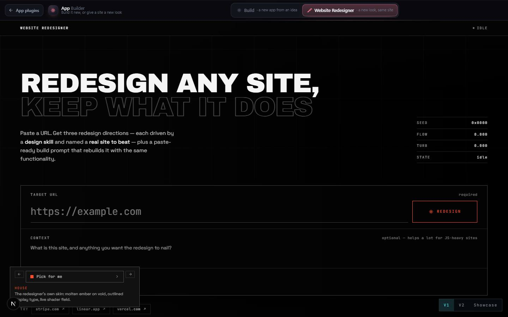

# App Builder

`/apps/app-builder` · AI · live · shows as: App plugins card

> Idea or screen recording → a commercial-grade app

Where every new app starts. The owner types an idea or drops a screen recording / screenshots of an
app or workflow; a "super agent" takes it apart, asks what the app is for, proposes features to
accept or deny, then hands the build to Claude Code with the owner's skill pipeline. It is also the
one home for building: a switcher holds **Build** (App Builder) and **Website Redesigner**
(see `docs/apps/website-redesigner.md`). Jarvis chat, Camera Autopilot and Client Review all send work here.

## Features — every one of these must still exist after your change

The owner asked for each of these. Removing, hiding or "simplifying away" one is a regression,
even if the code looked unused. If a change needs one gone, ask first.

**The home**
- **Build / Website Redesigner switcher** — StudioHome tabs, `?section=build|redesign`, last section remembered (`app-builder:section`). `src/components/app-builder/AppBuilderHome.tsx`, `src/lib/studio-home/builder.ts`
- **Framed inside Jarvis shows Build alone, no bar** (`framedSection="build"`). `src/components/app-builder/AppBuilderHome.tsx`
- **`/apps/website-redesigner` redirects in** keeping `?v=2` / `?v=showcase`. `src/app/apps/website-redesigner/page.tsx`

**1. The idea**
- **Idea box** — one line or a full brief, example chips, the backdrop Orbit charges up as you type. `src/components/app-builder/Stages.tsx` (`IdeaStage`)
- **Attach recordings and pictures** — paperclip, drag-and-drop or paste; videos read in the browser into evenly spaced frames + first 60 s of narration, kept under ~4.5 MB. `src/components/app-builder/Composer.tsx`, `src/lib/app-builder/media.ts`
- **`?idea=` prefill** — Website Redesigner › Showcase › "Use this idea" opens Build with the idea filled in. `src/components/app-builder/Stages.tsx`, `src/components/app-builder/AppBuilder.tsx`
- **Hand-offs wake up here** — projects from Jarvis chat / Camera Autopilot arrive `pending` with "From Jarvis chat" / "From Camera Autopilot" and a "Start the super agent" button; their media waits in IndexedDB. `src/components/app-builder/AppBuilder.tsx`, `src/lib/app-builder/fromChat.ts`, `src/lib/app-builder/inbox.ts`

**2. The purpose**
- **Recording teardown** — the agent watches frames + narration (`watch`) and shows screens, flow, behaviour, data. `src/components/app-builder/Blueprint.tsx` (`Recording`), `src/app/api/app-builder/route.ts`
- **Interview** — "What is it for?" questions with suggested answers (pick any, skip any), then "Design my features". `src/components/app-builder/Stages.tsx` (`Interview`)

**3. The features**
- **The Orbit** — features are bodies on a ring: drag into the core to accept (green), fling out to deny (red), tap to select; core ignites when all are decided. `src/components/app-builder/Orbit.tsx`
- **Feature table** — accept / deny / edit wording, "Add your own feature" (accepted as written), "edited" and "yours" marks. `src/components/app-builder/FeatureTable.tsx`
- **Agent chat** — typed commands work offline ("accept 1, 3", "deny the rest", "edit 2 to …", "accept all", help) via `parseCommand`; chips like "What would make people pay for this?"; client edits get their own chips. `src/components/app-builder/AgentChat.tsx`, `src/lib/app-builder/engine.ts`
- **Tally + top-bar Build it** — "in · open · out" count; once handed off the button becomes the live build phase. `src/components/app-builder/AppBuilder.tsx`
- **Project picker** — "＋ New app", every project tagged "from chat", "from camera" or "vN client edit"; delete with confirm. `src/components/app-builder/AppBuilder.tsx`
- **Phone panes** — Features / Agent / Build tabs replace the side panel on small screens. `src/components/app-builder/AppBuilder.tsx`

**Blueprint & build**
- **Pipeline strip** — the skills every build runs, in order (video-analyzer + rea for a recording, felix, prompt-enhancer, commercial at its depth, design skill, impeccable, software-factory, claude-security); client edits show Felix → Prompt enhancer → Match the site → Claude Security → Preview → client. `src/components/app-builder/Blueprint.tsx` (`Pipeline`), `src/lib/app-builder/engine.ts` (`pipeline`)
- **Blueprint** — app name (rename), purpose, end goal, "Beyond", design skill. `src/components/app-builder/Blueprint.tsx`
- **Build depth** — plain / commercial / commercial 2x. `src/components/app-builder/Blueprint.tsx`, `src/lib/app-builder/depth.ts`
- **Review link** — "Who's reviewing it? (optional)"; a Client Review link opens at hand-off and the build posts itself there; can be switched off (`noReview`). `src/lib/app-builder/review.ts`, `src/lib/app-builder/useAppBuilder.ts`
- **Build it = a real build on the PC** — the local bridge makes a project folder + repo under ~/Projects and runs Claude Code as a thread; it stops and asks before anything that leaves the machine. `src/lib/app-builder/build.ts`, `src/lib/app-builder/useBuild.ts`
- **"It's being built" screen** — where it lands, review link, "You can close this page"; Watch or start something else. `src/components/app-builder/BuildStarted.tsx`
- **Live build status** — what it is doing, what it read and changed, the question it is blocked on, Stop, Build it again, repo + live address at the end. `src/components/app-builder/BuildStatus.tsx`, `src/lib/app-builder/plan.ts`
- **File it for later** — In Queue folder `app:app-builder` (+ up to 4 key frames) when the PC is off; never the default; no duplicate filing. `src/lib/app-builder/useAppBuilder.ts` (`fileForLater`), `src/lib/app-builder/queue.ts`, `src/lib/app-builder/useBuildWatch.ts`
- **Send to board** — one Felix card per accepted feature, no duplicate cards. `src/lib/app-builder/useAppBuilder.ts` (`sendCards`), `src/lib/app-builder/engine.ts` (`featureTickets`)
- **Copy / View master prompt.** `src/components/app-builder/Blueprint.tsx`, `src/lib/app-builder/engine.ts` (`masterPrompt`, `queueText` ≤ 4000 chars)
- **Move into the hub / Retire the standalone** — moving in only adds (opens a PR); retiring deletes the GitHub repo only after the PR merged and the owner types the app's name. `src/components/app-builder/MoveIntoHub.tsx`, `src/lib/app-builder/absorb.ts`

**Client edits from Client Review**
- **Edit projects** — an approved batch arrives as an `edit` project at stage `features` with every request accepted; "Build edits →"; prompts switch to edit versions. `src/lib/app-builder/clientEdit.ts`, `src/lib/app-builder/fromClientReview.ts`

## How it looks

- **Look:** interactive-web-studio (hub default) — the hub's near-black instrument panel with one toy, the Orbit.
- **Colours / type:** `app-builder.css` maps to hub tokens (`--ab-bg #07080c`, panel `#12141c`, brand `#6366f1`); state only: accepted `#22c55e`, open `#f59e0b`, denied `#ef4444`. Syne for headlines (`--font-syne`), JetBrains Mono for ids (`--font-jbm`), both loaded in `page.tsx`.
- **Layout:** laptop — Orbit + table left, side panel right with Agent / Blueprint & build tabs. Phone — one pane at a time (Features / Agent / Build).
- **Signature pieces:** the Orbit (Canvas 2D, no library), pipeline strip, build status panel.
- **Motion:** bodies drift and dock, core brightens and ignites. Capped at 2× DPR, paused off screen; fully still under reduced motion (dragging still works).

## Where the code is

| Part | Path |
|---|---|
| Page | `src/app/apps/app-builder/page.tsx` |
| UI | `src/components/app-builder/` (Jarvis sheet: `src/components/new-jarvis/AppBuilderSheet.tsx`) |
| Logic + tests | `src/lib/app-builder/` (pure engine `engine.ts`, `build.ts`, `depth.ts`, `clientEdit.ts`, `absorb.ts`, `plan.ts`) |
| API | `src/app/api/app-builder/route.ts` — actions `interview`, `watch`, `features`, `chat` |
| Saved data | synced key `app-builder:v1` (`src/lib/sync/appState.ts`); recording frames in this browser's IndexedDB (`inbox.ts`) |

## Owner's rules for this app

- Every new app, website, tool, plugin or workflow is made through App Builder. Jarvis chat's hub tool `app_builder` (`src/lib/new-jarvis/agentTools.ts` → `NewJarvis.tsx` → `fromChat.ts`) carries the turn's photos/clips and **never just returns a link**: it pulls App Builder up over Jarvis (`AppBuilderSheet.tsx` — full screen on a phone, wide sheet on a laptop, shrinks to a pill while the agent keeps working; framed App Builder hides its own brand via `data-ab-embed`).
- Framed inside Jarvis, the home shows Build alone with no bar — keep it that way.
- The hand-off always writes the skill pipeline: video-analyzer → rea when there is a recording, then felix → prompt-enhancer → design skill → software-factory → claude-security, held to the build checklist.
- Depth: `commercial` is normal and stays free (billing wired, off); `commercial 2x` only when the owner asks to monetize.
- Retiring a standalone never happens on its own.

## Described but not found in code

- the old CLAUDE.md says "Build it = In Queue folder `app:app-builder` (+4 key frames)". In code, Build it now starts a real build on the PC through the bridge (`useBuild.ts`); In Queue is the "File it for later" path.
