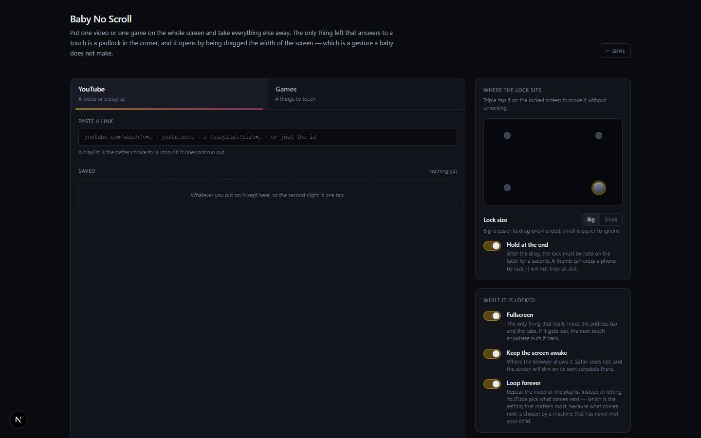

# Baby No Scroll

`/apps/baby-no-scroll` · Apps · live · shows as: App plugins card

> Hand over the screen, not the device

A child lock for a phone or tablet you are about to put in a small pair of hands. A parent picks one
YouTube video or playlist, or one of four baby games, presses **Hand it over**, and that one thing
fills the screen with everything else taken away. The only way out is a padlock that has to be
dragged the whole length of the screen and held — a gesture a baby cannot make by accident.

## Features — every one of these must still exist after your change

The owner asked for each of these. Removing, hiding or "simplifying away" one is a regression,
even if the code looked unused. If a change needs one gone, ask first.

**The parent's setup screen (the "console")**
- **Two tabs: YouTube / Games** — choose what the screen gets locked onto; the Games tab says how many games there are. `src/components/baby-no-scroll/BabyNoScroll.tsx`
- **Open on a tab from a link** — `?mode=games` or `?mode=youtube` opens the console on that tab (for Jarvis or a home-screen shortcut); otherwise it resumes last time. `src/app/apps/baby-no-scroll/page.tsx`
- **Paste any YouTube link** — watch, youtu.be, Shorts, live, playlist links or a bare id are all understood; a green tick names what was read, an amber line says when it is not a readable link. `src/lib/baby-no-scroll/youtube.ts` (`parseYouTube`)
- **Watch link + playlist keeps the playlist** — starts on the picked video but keeps the list going so it does not stop. `src/lib/baby-no-scroll/types.ts`, `src/lib/baby-no-scroll/youtube.ts`
- **Name it ("bedtime songs")** — optional name box; the show is saved automatically when it is handed over. `src/components/baby-no-scroll/BabyNoScroll.tsx`
- **Saved shows list** — everything ever put on is kept, most recent first, one tap to pick again, **Forget** to remove; the same link is never saved twice (it is renamed/bumped instead). `src/lib/baby-no-scroll/store.ts` (`upsertShow`, `sortedShows`, `removeShow`)
- **Game picker** — four games, each with a coloured swatch, a one-line description for the parent, a "from N months" age and an "on" badge. `src/lib/baby-no-scroll/games.ts`, `BabyNoScroll.tsx`
- **Where the lock sits** — a mini-screen picker for the four corners (default bottom-right). `BabyNoScroll.tsx`, `src/lib/baby-no-scroll/lock.ts` (`CORNERS`)
- **Lock size: Big / Small** — 92 px or 64 px puck. `BabyNoScroll.tsx`, `src/components/baby-no-scroll/Padlock.tsx`
- **Hold at the end** toggle (default on) — after the drag the lock must also be held on the latch. `Padlock.tsx`, `lock.ts` (`HOLD_MS` = 900 ms)
- **Fullscreen** toggle (default on), **Keep the screen awake** toggle (default on, Wake Lock where the browser allows), **Loop forever** toggle (default on — repeat the video/playlist instead of letting YouTube choose next). `BabyNoScroll.tsx`, `src/lib/baby-no-scroll/useScreenLock.ts`, `youtube.ts` (`embedParams`)
- **Hand it over button** — the one bright button; says "Paste a link first" and is disabled when there is nothing to play. `BabyNoScroll.tsx`
- **"What this cannot do" honesty note** — tells the parent a web page cannot block the home/power button or app-switch gesture, and to use Guided Access (iPhone/iPad) or Screen Pinning (Android) underneath. `BabyNoScroll.tsx`
- **← Jarvis link** back to Jarvis › App plugins. `BabyNoScroll.tsx`
- **Settings follow you to every device** — settings and saved shows sync, and refresh live when another device changes them (not while locked). `src/lib/baby-no-scroll/store.ts`, `BabyNoScroll.tsx` (`useRemotePull`)

**The locked screen (the "nursery")**
- **Everything taken away** — no scrolling, bounce, pull-to-refresh, pinch or double-tap zoom, text selection, long-press menus, image drag, back gesture (a sentinel history entry swallows it) or keyboard. `src/lib/baby-no-scroll/useScreenLock.ts`
- **Fullscreen repairs itself** — losing fullscreen is not an unlock; the next touch anywhere (usually the baby's) puts it back. `BabyNoScroll.tsx`, `useScreenLock.ts` (`restoreFullscreen`)
- **Locked YouTube player** — youtube-nocookie embed with no controls, no keyboard, no fullscreen button, no related-video wall, no annotations; a transparent shield covers the picture so a tap means "carry on". `src/components/baby-no-scroll/YouTubeStage.tsx`, `youtube.ts`
- **App presses Play itself** — loads YouTube's player script so a video that did not autoplay still starts; falls back to a plain autoplay iframe if the script cannot load. `YouTubeStage.tsx`, `youtube.ts` (`loadPlayerApi`)
- **Single-video loop that actually works** — names the video as its own playlist, which YouTube requires. `youtube.ts` (`embedParams`)

**The padlock (the only thing that answers to a touch)**
- **Tap → the rail lights up** along the longest edge of the screen (side to side on a tablet, top to bottom on a phone), hugging the edge so it never crosses the picture; hides again after 4 s idle. `Padlock.tsx`, `lock.ts` (`railFor`, `RAIL_IDLE_MS`)
- **Triple-tap → lock arcs to the next corner** without unlocking, and the new corner is saved. `Padlock.tsx`, `lock.ts` (`tapAction`, `nextCorner`)
- **Drag the full rail, then hold on the latch → shackle pops open**; a filling ring shows the hold. `Padlock.tsx`, `lock.ts` (`UNLOCK_AT` = 94 %)
- **Let go short → springs back with a "knock"** shake and a refuse sound; success plays an unlatch sound. `Padlock.tsx`, `src/lib/baby-no-scroll/audio.ts`
- **Keyboard route out** — focus the lock and hold Enter/Space for twice the hold time. `Padlock.tsx` (`KEY_HOLD_MS`)
- **Follows rotation and resize** using the real visible viewport. `Padlock.tsx`

**The four games** (no score, no failure, no timer, no text)
- **Balloon pop** (from 6 months) — fist-sized balloons drift up and burst wherever a palm lands. `src/components/baby-no-scroll/games/Balloons.tsx`
- **Baby piano** (from 9 months) — eight floor-to-ceiling bars on a pentatonic scale so nothing sounds wrong; holds while pressed; a dragged finger plays every key it crosses. `src/components/baby-no-scroll/games/Piano.tsx`, `audio.ts` (`SCALE`)
- **Finger paint** (from 6 months) — light follows the finger and slowly fades. `src/components/baby-no-scroll/games/Sparkle.tsx`
- **Hide and seek** (from 14 months) — six eggs, a shape (star, heart, flower, moon, fish, bird) under one; every egg cracks and gives something back, the prize egg is just louder. `src/components/baby-no-scroll/games/Eggs.tsx`
- **Every sound synthesised in the browser** — nothing to download, works offline. `src/lib/baby-no-scroll/audio.ts`
- **Each game has its own colour world** (hue drives the nursery background). `src/components/baby-no-scroll/GameStage.tsx`, `games.ts`

## How it looks

- **Look:** two deliberately opposite worlds in one sheet — the parent's console (the hub's dark instrument panel) and the child's nursery (warm, huge soft shapes, no text). No `.impeccable/surfaces/` record; design skill not recorded.
- **Colours / type:** console uses DESIGN.md tokens unchanged (`bg-canvas`, `bg-panel`, `text-ink*`, `border-line`, `text-core` green tick, `amber-400` for "on"/warnings). Additions: the **Hand it over** button is an amber→orange gradient `hsl(45 95% 58%) → hsl(28 92% 54%)` with dark text `#1a1206`; the active tab underline is amber→pink `hsl(45 95% 60%) → hsl(330 85% 62%)`. Nursery background `#0b0710` with two radial washes from `--bns-hue` (330 pink by default, per-game hue: balloons 330, piano 265, paint 190, eggs 35); video stage is plain `#000`. Padlock is cool machined steel (`#5d6478 → #363c4c → #22262f`, body `#e8ecf5`, shackle `#b7c0d4`); rail fill and hold ring are warm gold `hsl(45 95% 60%)`; open state glows green `hsl(140 70% 55%)`. Fonts: hub sans; mono for link readouts. All in `src/components/baby-no-scroll/baby-no-scroll.css`.
- **Layout:** laptop — max-width 6xl console, two columns (choose-what-plays panel left, 320 px lock/settings rail right). Phone — single column stacked. Locked — one full-screen stage plus the padlock in a corner.
- **Signature pieces:** the steel padlock puck with breathing glow and gold rail (`Padlock.tsx`); the corner-picker mini-screen (`.bns-corner-pick`); the balloons with knot and string; the pentatonic piano bars with a rising "bloom".
- **Motion:** rail shimmer travelling the way to drag, slow puck "breath", knock shake, shackle lift, balloon bursts, egg shake/bob, key blooms. Reduced motion (`@media (prefers-reduced-motion: reduce)`) removes the ambient loops (shimmer, breath, prize bob) and halves balloon speed in JS, but keeps every feedback animation.

## Where the code is

| Part | Path |
|---|---|
| Page | `src/app/apps/baby-no-scroll/page.tsx` |
| UI | `src/components/baby-no-scroll/` (`BabyNoScroll.tsx`, `Padlock.tsx`, `YouTubeStage.tsx`, `GameStage.tsx`, `games/`, `baby-no-scroll.css`) |
| Logic + tests | `src/lib/baby-no-scroll/` (`lock.ts` + `lock.test.ts`, `youtube.ts` + `youtube.test.ts`, `useScreenLock.ts`, `audio.ts`, `games.ts`, `store.ts`, `types.ts`) |
| API | none — no server routes, no keys |
| Saved data | synced key `baby-no-scroll:v1` (localStorage first, Supabase `app_state` as the optional second home) — settings + saved shows |

## Owner's rules for this app

- The lock is a **gesture, not a password**: full-length drag along the longest screen axis, then a hold. Do not add a PIN or a shorter shortcut.
- The padlock must stay **cool grey steel** — the brightest thing on the screen is always the game or video, never the way out.
- **No text, menu, switcher or button on the locked screen** except the padlock (a game switcher would be the first thing a baby finds).
- Games have **no score, no failure, no wrong answer** — every touch is correct; the piano stays pentatonic.
- Sounds stay **synthesised** — no audio files.
- Leaving fullscreen is **not** an unlock.
- Stay honest on the setup screen about what a web page cannot block (Guided Access / Screen Pinning).
- Listed with `noPreview: true` in `src/lib/catalog.ts` — the hub carousel must never frame it (a panel that asks for fullscreen and goes inert is not a preview).
- Shows as an App plugins card (`PLUGIN_SLUGS` in `src/lib/studio/plugins.ts`), so it is off the hub grid.

## Described but not found in code

- None found.
