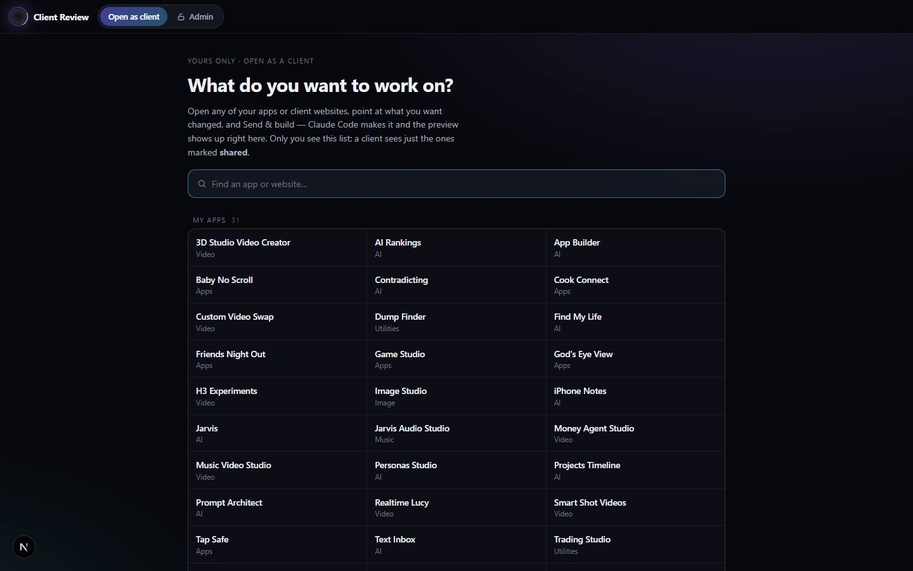

# Client Review

`/apps/client-review` · AI · live · shows as: App plugins card

> Send clients their site, collect edits, ship v2

One page for website clients and the owner. A client opens a private link, sees their website full
screen with a floating "Chat intake" on top, types edit requests (pinning the exact spot) and presses
Send to Jarvis. The owner approves, rewords or rejects the batch in the Admin tab; approved edits can
build themselves through App Builder and Claude Code, and the client gets a push notification when
the next version is ready. The owner also uses it to edit their own hub apps the same way.

## Features — every one of these must still exist after your change

The owner asked for each of these. Removing, hiding or "simplifying away" one is a regression,
even if the code looked unused. If a change needs one gone, ask first.

**The page and who sees what**
- **Two tabs on one page** — Client (called "My websites" for a client, "Open as client" for the owner) and Admin. `src/components/client-review/ClientReviewApp.tsx`
- **Admin tab locked for clients** — faded with a lock icon, disabled, "Admins only" flash; who is owner comes from `/api/client-review/portal/me`. `src/components/client-review/ClientReviewApp.tsx`, `src/app/api/client-review/portal/me/route.ts`
- **State lives in the address** — `?site=<secret>`, `?app=<slug>`, `?tab=admin`; Back button works. `src/components/client-review/ClientReviewApp.tsx`
- **Google sign-in gate** — a link asks the visitor to sign in with their Jarvis account; first account to open a link claims it; others see "This is someone else's link". `src/components/client-review/SignInGate.tsx`, `src/components/client-review/ClientPortal.tsx`
- **My websites list** — a client sees only the sites sent to them. `src/components/client-review/MyWebsites.tsx`, `src/app/api/client-review/portal/mine/route.ts`
- **Old links still work** — `/review/<secret>` and `/review` redirect into this page. `src/app/review/[token]/page.tsx`, `src/app/review/page.tsx`

**Client view (the site + Chat intake)**
- **Site fills the screen** with a Desktop / Phone preview switch and "Open the site in a new tab". `src/components/client-review/ClientPortal.tsx`
- **Version picker** — look at older versions; requests only open on the current one; "closed while Jarvis builds vN". `src/components/client-review/ClientPortal.tsx`
- **Chat intake console** — draggable, resizable glass panel that shrinks to an orb (with a badge of unsent requests); position remembered per device (`cr-intake-layout`). On phones it is a bottom sheet that snaps peek / half / full. `src/components/client-review/ClientPortal.tsx`
- **Many requests per batch** — add, edit, remove drafts; status per request (Not sent yet, With Jarvis, Approved, Not this round, Done). `src/components/client-review/ClientPortal.tsx`
- **"📍 Point at it"** — click the site to drop a numbered pin on the exact spot; Show/Hide pins. `src/components/client-review/ClientPortal.tsx`
- **Send to Jarvis** — requests fold into the orb and a "Received" reactor screen lists the next steps. `src/components/client-review/ClientPortal.tsx` (`SentScreen`)
- **Push notifications** — "Notify me when it's done"; iPhone gets Add-to-Home-Screen instructions; own manifest and service worker. `src/components/client-review/ClientPortal.tsx`, `src/app/apps/client-review/manifest.webmanifest/route.ts`, `public/client-review-sw.js`, `src/lib/client-review/push.ts`
- **Settings sheet** — notifications on/off, signed-in account, "Reset the intake position", Updates feed; toasts for new notices; refreshes every 30 s. `src/components/client-review/ClientPortal.tsx`

**Owner's own view**
- **Site picker** — searchable dropdown in place of the title plus a full list when nothing is open; every client website AND every hub app; `/` opens it, ↑ ↓ Enter Esc; each row says whether a client can reach it; last pick reopens (`cr-last-target`). `src/components/client-review/SitePicker.tsx`
- **Edit any hub app on the page** — `editableApps` = live catalog apps minus merged ones and Client Review; first open makes its project (`ensureApp`), framed same-origin at its route, repo `legacymiles/ultimate-assistant-os`. `src/lib/client-review/apps.ts`, `src/app/api/client-review/admin/route.ts`
- **Send & build** — the owner's Send approves on the spot and queues the build like Admin's Approve & build; a status screen shows Sent → Approved → Queued for Claude Code → preview. `src/components/client-review/ClientPortal.tsx` (`approveAndBuild`, `OwnerSent`)

**Admin console**
- **Project list** — search, sort (Newest, Oldest, A–Z, Z–A, Recently changed), pending counts, "Being created" tag; "Latest:" event strip with Clear. `src/components/client-review/ClientReviewAdmin.tsx`, `src/lib/client-review/list.ts`
- **New client project dialog** — name, client, model lane, linked Projects Timeline project, "Where the site lives". `src/components/client-review/ClientReviewAdmin.tsx` (`CreateDialog`)
- **Link controls** — Copy client link, New link (old one stops), Release a claim, "Only allow" one email, Send to the client / Take it back (an unsent project's link does not open). `src/components/client-review/ClientReviewAdmin.tsx`
- **Model lane for briefs** — Auto (Claude, then uncensored if it refuses), Standard, Uncensored. `src/components/client-review/ClientReviewAdmin.tsx`, `src/lib/client-review/routing.ts`
- **Content check** — each request sorted standard / uncensored / blocked (minors or non-consent are never sent to any model). `src/lib/client-review/contentCheck.ts`, `src/lib/client-review/contentCheckServer.ts`
- **Waiting on you batches** — reword each request ("What will actually be built"), ✦ Improve with AI into a build brief, Approve only / Approve → next version / Approve & build, Reject all with a note. `src/components/client-review/ClientReviewAdmin.tsx` (`BatchCard`, `RequestReviewRow`), `src/lib/client-review/brief.ts`
- **Approve & build** — with a GitHub repo set, the batch becomes an App Builder edit project queued to `app:app-builder`; `buildQueued` records it on the batch. `src/lib/app-builder/fromClientReview.ts`, `src/lib/app-builder/clientEdit.ts`, `src/lib/app-builder/queue.ts`
- **Versions timeline** — add a version, "Mark ready & notify client", build status per version, "Build in App Builder", "built by Claude Code" tag. `src/components/client-review/ClientReviewAdmin.tsx` (`VersionRow`, `AddVersion`, `BuildStatus`)
- **Preview comes back by itself** — Claude Code calls connector tool `client_review_preview` → `shipPreviewNow` (version ready + client push + `preview_sent` event). `src/lib/client-review/ship.ts`, `src/app/api/jarvis/memory/mcp/route.ts`
- **Linked Projects Timeline** — approved versions and briefs are written into the linked timeline project. `src/components/client-review/ClientReviewAdmin.tsx`
- **All requests table** and **Delete project**. `src/components/client-review/ClientReviewAdmin.tsx`

## How it looks

- **Look:** interactive-web-studio, "restrained end of the dial" — the client's site is the star; the console is a living glass panel with a slow aurora edge.
- **Colours / type:** own tokens in `client-review.css`: `--cr-bg #07080c`, glass `rgba(14,16,24,.78)`, ink `#eef1f8`, violet `#8b7bff`, cyan `#3fe0ff`, pink `#ff6fb5`, ok `#4ade80`, no `#fb7185`, warn `#fbbf24`; hub sans font. Admin uses the hub DESIGN.md tokens (Tailwind `ink`, `panel`, `brand`) as a dense table.
- **Layout:** laptop — site full screen, Chat intake floating bottom-right (420×620 default). Phone (≤640 px) — bottom sheet with a drag handle. Admin — project list left, detail right.
- **Signature pieces:** the orb (`cr-orb`), the numbered pins, the "reactor" Sent screen.
- **Motion:** requests fold into the orb on Send; reactor rings; ease `cubic-bezier(0.16,1,0.3,1)`. Reduced motion turns every animation into an instant change.

## Where the code is

| Part | Path |
|---|---|
| Page | `src/app/apps/client-review/page.tsx` (+ `manifest.webmanifest/route.ts`) |
| UI | `src/components/client-review/` |
| Logic + tests | `src/lib/client-review/` (`logic.ts` flow, `routing.ts`, `contentCheck.ts`, `apps.ts`, `ship.ts`, `push.ts`) |
| API | `src/app/api/client-review/` (`admin` owner-only, `portal/[token]`, `portal/me`, `portal/mine`) |
| Saved data | server_docs via `src/lib/client-review/store.ts`: `.client-review-index.json` + `.client-review-<id>.json`; VAPID keys `.client-review-vapid.json` (env `CLIENT_REVIEW_VAPID_PUBLIC_KEY`/`_PRIVATE_KEY`/`_SUBJECT` win) |

## Owner's rules for this app

- One page for clients and owner. `/api/client-review/admin` is owner-only in middleware (`routeAccess` in `src/lib/hubAccess.ts`), so forcing the tab open shows nothing.
- The owner's Client tab is named for what it does ("Open as client"), never "Client view" — the list of every app is not what a client sees.
- Claude Code builds on `jarvis/<site>-vN` (`branchFor`), opens a PR and **never merges**; the next build branches off the version on the client's screen (`baseBranchFor`). `branch`/`prUrl` are owner-only — `portalView` strips them.
- Content check is a word list on purpose (free, instant, no key); the owner chose not to put a decision model here.
- The service worker is scoped to `/apps/client-review` only and caches nothing.
- Claude Code's steps for a client edit: the `app-builder` skill, section 5.

## Described but not found in code

- None found.
