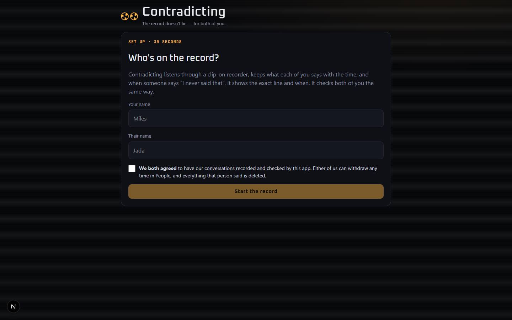

# Contradicting

`/apps/contradicting` · AI · live · shows as: App plugins card (Jarvis › App plugins, opens in its own tab)

> Receipts for “I never said that”

A clip-on recorder (the Omi pendant, or the Omi app on your phone) streams what was said, and Contradicting keeps each
person's words with the exact time. When someone says "I never called you that", it finds the line where they did and
answers on your phone ("Actually, at 3:47 PM… you did say…") with a replay of the lead-up. Consent-first and fair:
only people who agreed are recorded, and everyone — you included — is checked the same way.

## Features — every one of these must still exist after your change

The owner asked for each of these. Removing, hiding or "simplifying away" one is a regression,
even if the code looked unused. If a change needs one gone, ask first.

**Catching contradictions**
- **Denial detection + same-words match** — notices a denial ("I never called you a girl") and finds that person's earlier line by word match. `src/lib/contradicting/engine.ts` (`detectDenial`, `deniedWords`)
- **Same meaning in different words, with Claude** — when no word match is found, the AI reads that person's own earlier lines and may only point at a line that is really in the record (never invents a quote). `src/lib/contradicting/server/ai.ts` (via `src/lib/ai/provider.ts`)
- **Live receipt on your phone** — the Omi webhook answers with `{ message }` ("Actually, at <time> <name> did say: "…" Want the back-and-forth that led up to it?"), which Omi pops up. `src/app/api/contradicting/omi/route.ts`, `src/lib/contradicting/engine.ts` (`receiptText`)
- **Key points** — promises, always/never lines and name-calling are flagged (★). `src/lib/contradicting/engine.ts` (`isKeyPoint`)
- **Omi's summary per conversation** — the "Conversation created" webhook lays Omi's overview onto the conversation. `src/lib/contradicting/engine.ts` (`attachSummary`), `src/components/contradicting/RecordTab.tsx`

**Receipts tab**
- **Receipt cards** — denial time, the red→amber thread back to the original line, the **stamp**, original time, and a badge "Same words / Same meaning · NN%" (hover shows why). `src/components/contradicting/ReceiptsTab.tsx`
- **Stamp animation** for receipts that arrive while the page is open. `src/components/contradicting/ReceiptsTab.tsx`, `contradicting.css` (`cx-stamp`)
- **Replay lead-up, Copy, Not it** (dismiss; **Bring back** undoes) on every receipt; tapping the quote also opens the replay; **Show/Hide "not a contradiction"** list of dismissed ones. `src/components/contradicting/ReceiptsTab.tsx`
- **Try it without the pendant** — type a line someone said, pick who said it, and it runs through the same checks. `src/components/contradicting/ReceiptsTab.tsx`, `src/app/api/contradicting/route.ts` (`say`)
- **Empty state** "No receipts yet" with a tape strip. `src/components/contradicting/ReceiptsTab.tsx`

**Replay sheet**
- **The lead-up** — the back-and-forth before the original line, read back line by line, then "Later · <time>" the denial; **Copy receipt**. `src/components/contradicting/Replay.tsx`

**Record tab**
- **Search everything ever said** ("car payment"), filter by person, **★ Key points** only. `src/components/contradicting/RecordTab.tsx`
- **Who's this?** — voices waiting for a name (kept 2 days); assign each to a person. `src/components/contradicting/RecordTab.tsx`, `src/app/api/contradicting/route.ts` (`speaker.assign`)
- **Conversations** — expandable, with Omi's overview and every line (key points highlighted, unknown voices marked); **Delete conversation**. `src/components/contradicting/RecordTab.tsx`

**People tab**
- **Everyone on the record with their yes** — **Withdraw** (deletes everything they said, confirm), **They agreed** (re-consent), **Rename**, **Remove** (them and everything they said). `src/components/contradicting/PeopleTab.tsx`
- **Add someone** (a roommate, coworker, co-parent) with a "They agreed to be recorded" box — without it they're set up but nothing they say is kept. `src/components/contradicting/PeopleTab.tsx`

**Setup tab**
- **Your recorder link** — **Copy link**, **Test link**, **New link** (old one stops working); private-link warning. `src/components/contradicting/SetupTab.tsx`
- **Omi steps** — get the pendant, make the Omi app (External Integration → Real-time transcript + Conversation created), install it; how voices are matched. `src/components/contradicting/SetupTab.tsx`
- **Switches** — "Receipts on my phone, live"; "Auto-match the other voice" when only one other person is set up; times shown in your time zone. `src/components/contradicting/SetupTab.tsx`, `src/lib/contradicting/engine.ts`
- **Ground rules + Delete the whole record** (people and settings stay). `src/components/contradicting/SetupTab.tsx`

**Everywhere**
- **30-second onboarding** — your name, their name, "We both agreed" checkbox; shown until two people (one of them you) are set up. `src/components/contradicting/Onboard.tsx`
- **Fairness bar** under the title — receipts caught and key points per consenting person, in each person's hue, "You" included. `src/components/contradicting/ContradictingApp.tsx` (`Fairness`)
- **Tabs** Receipts (with live count) · Record · People · Setup; plain-English error banner. `src/components/contradicting/ContradictingApp.tsx`

## How it looks

- **Look:** "evidence-room HUD" from an interactive-web-studio pass — every conversation is a reel of tape; one signature moment (the stamp), everything else quiet and dense so it reads mid-argument on a phone. Does **not** use DESIGN.md's tokens; own variables on `.cx-root`.
- **Colours / type:** ink black `#07080b` with a faint amber radial glow, panels `#0e1016` / `#141720`, line `#232838`, text `#eceef4`, muted `#8d93a6`, **amber `#ffb547` for the record**, **red `#ff4d5e` for the denial**, each person in their own hue (`hsl(<hue> 85% 60%)`). Fixed film grain overlay. Fonts: Oxanium (500–800) display + JetBrains Mono, loaded in `page.tsx` as `--font-nj-display` / `--font-nj-mono`; body is system sans. Theme colour `#07080b`.
- **Layout:** one centred column (max 760px) on laptop and phone; the Replay is a bottom sheet on phone and a centred rounded sheet from 760px.
- **Signature pieces:** the spinning tape-reel logo, the red→amber thread on each receipt, the stamp, the fairness bar.
- **Motion:** stamp + shake, scan, entry (`cx-in`), sheet up (`cx-up`), reel spin; all off under `prefers-reduced-motion`.

## Where the code is

| Part | Path |
|---|---|
| Page | `src/app/apps/contradicting/page.tsx` |
| UI | `src/components/contradicting/` (`ContradictingApp.tsx`, `Onboard.tsx`, `ReceiptsTab.tsx`, `RecordTab.tsx`, `PeopleTab.tsx`, `SetupTab.tsx`, `Replay.tsx`, `useRecord.ts`, `contradicting.css`) |
| Logic + tests | `src/lib/contradicting/` (`engine.ts` + `engine.test.ts`, `server/ai.ts`, `server/run.ts`, `server/store.ts`) |
| API | `src/app/api/contradicting/route.ts` (person.*, speaker.assign, receipt.dismiss, convo.delete, settings, say, key.rotate, all.clear) · `src/app/api/contradicting/omi/route.ts` (Omi webhook) |
| Saved data | server_docs `.contradicting.<uid>.json` (people, lines, receipts, conversations, settings) + `.contradicting-keys.json` (webhook key → account) |

## Owner's rules for this app

- **Consent-first:** a line is kept only for a person who agreed; withdrawing deletes everything they said; voices nobody named are dropped after 48 hours (`LIMITS.unnamedHours`).
- **Fair:** every consenting person is checked the same way — the owner too.
- The AI may only point at a line that is really in the record — never generate a quote.
- Lives as a Jarvis **App plugins card** (`PLUGIN_SLUGS` in `src/lib/studio/plugins.ts`, with its own `WHY` blurb), not a hub tile.
- `/api/contradicting/omi` is session-exempt in `src/middleware.ts`, checked with the per-account key. In `UNPREVIEWABLE` in `src/lib/catalog.ts`; page is `noindex`.

## Described but not found in code

- None found.
