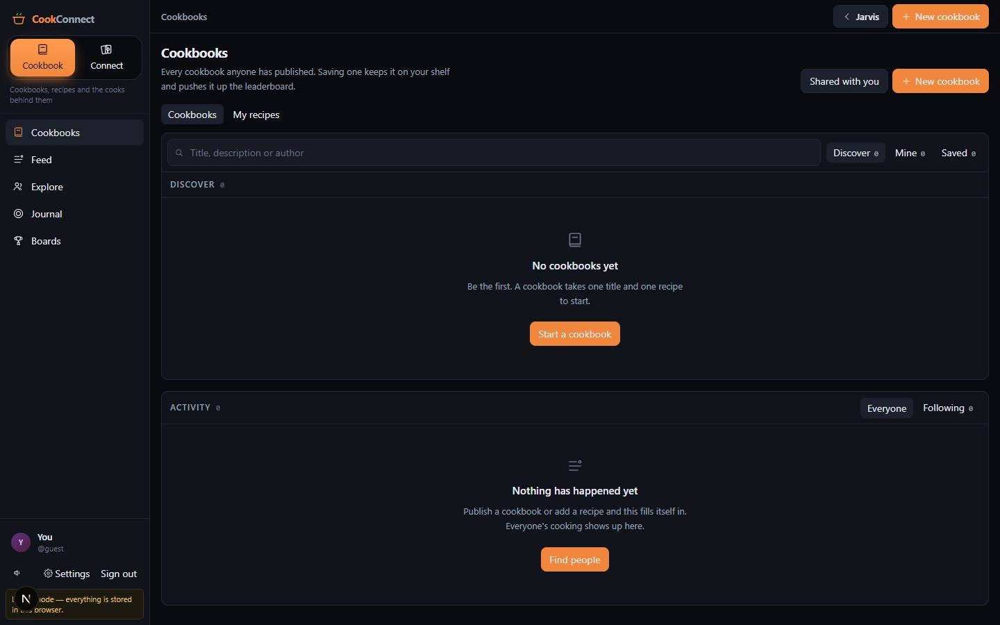

# Cook Connect

`/apps/cook-connect` · Apps · live · shows as: App plugins card (Jarvis › App plugins, `PLUGIN_SLUGS` in `src/lib/studio/plugins.ts`) — also starred by default on every account's Jarvis Dashboard (`DEFAULT_FAVORITES` in `src/lib/new-jarvis/launcher.ts`)

> Cook together, then play each other

Two apps in one account: **Cookbook** (publish and save cookbooks, write recipes from a link, photo, video or a sentence, keep a food journal, join cooking groups) and **Connect** (spades and chess against people or computer players, with chat and video at the table). One profile, one follow graph and one feed system cover both halves. It replaced Cookbook Genie and Pod Play Connect (merged Sep 2026) and runs on its own Supabase `cook` schema, or entirely in the browser with no keys.

## Features — every one of these must still exist after your change

The owner asked for each of these. Removing, hiding or "simplifying away" one is a regression,
even if the code looked unused. If a change needs one gone, ask first.

**The two halves (owner's rule, Oct 2026)**

- **Cookbook | Connect switch** — a big two-way switch: a tall tile at the top of the laptop rail, and the whole header on a phone; the app's accent colour follows it. `src/components/cook-connect/SideToggle.tsx`, placed by `src/components/cook-connect/CookShell.tsx`
- **Each side remembers where you were** — history steps carry their side; flipping lands where you last were on that side, tapping the side you are on goes to its home (Cookbook → Cookbooks, Connect → Play); last side remembered per device in localStorage `cook-connect:side`. `src/components/cook-connect/CookConnect.tsx` (`side`/`setSide`), rules + tests `src/lib/cook-connect/sides.ts` (`sideOfPage`, `HOME_PAGE`, `landingSide`)
- **Own nav per side** — Cookbook: Cookbooks, Feed, Explore, Journal, Boards. Connect: Play, Feed, Explore, Boards. Laptop: 216px left rail; phone: bottom tab bar. `NAV` in `src/components/cook-connect/CookShell.tsx`
- **Each side's main button in the top bar** — "New cookbook" on Cookbook, "Start a game" on Connect (hidden on a phone). `src/components/cook-connect/CookShell.tsx`
- **Back button and "Jarvis" link** — Back on detail screens; an arrow link to `/apps/jarvis` in the top bar. `src/components/cook-connect/CookShell.tsx`
- **Game catalogue** — `GAMES` (spades, chess): add a game there and it appears on the boards, Explore invites and "Plays most". `src/lib/cook-connect/sides.ts`

**Account and access**

- **Sign in / create account** — email + password, "Continue with Google" (through the hub's `/auth/callback`), "Check your email" confirmation; a profile is auto-created for any hub account that lacks one. `src/components/cook-connect/views/AuthView.tsx`, `ensureProfile` in `src/components/cook-connect/CookConnect.tsx`
- **Demo mode with no keys** — without Supabase everything runs in the browser (localStorage `cook_connect_local_db_v2`), and two tabs can really play, chat and see each other over a BroadcastChannel; the rail says "Demo mode — everything is stored in this browser." `src/lib/cook-connect/client.ts`, `src/lib/cook-connect/local/index.ts`, `src/lib/cook-connect/local/db.ts`, `src/lib/cook-connect/local/realtime.ts`
- **"One step left" screen** — when the `cook` schema is not exposed, explains the three setup steps instead of showing an empty app. `src/components/cook-connect/CookConnect.tsx`
- **Who is online** — app-wide presence drives green dots and the Play rail. `src/components/cook-connect/CookConnect.tsx` (`cook:presence` channel), `src/components/cook-connect/social/OnlineRail.tsx`
- **Sound effects** — synthesised with Web Audio (no audio files); mute toggle at the foot of the rail. `src/lib/cook-connect/sounds.ts`, `src/components/cook-connect/CookShell.tsx`

**Cookbooks and recipes (Cookbook side)**

- **Cookbooks page** — two views: Cookbooks (tabs Discover / Mine / Saved with counts, search by title, description or author) and My recipes; button to "Shared with you"; activity in the side rail. `src/components/cook-connect/views/CookbooksView.tsx`
- **New cookbook** — title, description, Public (in Discover, feeds and the leaderboard) or Private (only you). `src/components/cook-connect/views/NewCookbookView.tsx`
- **One cookbook** — its recipes, author, save count; "Save cookbook" (saving is what moves the leaderboard). `src/components/cook-connect/views/CookbookView.tsx`
- **Share a cookbook privately** — make a one-person link ("Read it" or "Read and copy", optional who-it's-for note), copied to clipboard, revocable; the link (`?share=<token>`) is claimed once and then opens under Shared with you. `src/components/cook-connect/views/CookbookView.tsx`, `src/lib/cook-connect/shares.ts`, claim in `src/components/cook-connect/CookConnect.tsx`
- **Shared with you** — cookbooks someone handed you directly (different from Saved). `src/components/cook-connect/views/SharedWithMeView.tsx`
- **Recipe page** — set in a serif for reading while cooking; scale servings up/down ("Scale to"), your 1–10 rank, "Change it in words" (e.g. "Make it vegan. Double it."), rewritten offline when no AI key; recipe photo from Pollinations when none was given. `src/components/cook-connect/views/RecipeView.tsx`, `src/components/cook-connect/imageGen.ts`, API `src/app/api/cook-connect/recipe/route.ts` (`draft` / `revise`)
- **Add a recipe — one composer** — a single tray for words + link(s) + up to 6 photos + up to 6 videos in any combination; each photo is marked as "The dish" (invent from it), "The writing" (transcribe it) or auto, flippable before anything is spent. `src/components/cook-connect/views/RecipeEditorView.tsx`, pure logic `src/lib/cook-connect/compose.ts` (`parseLinks`, `isBulk`, `jobsFor`, `MAX_IMAGES`, `MAX_VIDEOS`)
- **Reading a link or video** — `/api/cookbook/import-from-link` watches the video in full (visuals, speech, on-screen text), returns `recipes[]` (one per separate dish; parts of one dish stay one recipe; `recipe` = the first, for old callers). `src/app/api/cookbook/import-from-link/route.ts`
- **One video → several recipes; bulk links/videos** — a pasted list of links or several videos are each read on their own, two at a time. `src/lib/cook-connect/found.ts`, `src/components/cook-connect/views/RecipeEditorView.tsx`
- **"Recipes found" review tray** — every recipe found is Kept (saved, with Undo), Skipped (Bring back), or opened and edited by hand or "Change it in words" before keeping; "Keep all". Nothing is saved without the cook saying so. `src/components/cook-connect/views/RecipeEditorView.tsx`, `src/lib/cook-connect/found.ts`
- **Draft from a sentence** — words alone go to the cheaper draft route; a heuristic answers without a key. `src/app/api/cook-connect/recipe/route.ts`
- **Auto-tagging** — meal / protein / cuisine tags filled by a classifier instead of typed; meal chips in the editor. `src/app/api/cookbook/auto-tag-recipe/route.ts`, `src/components/cook-connect/views/RecipeEditorView.tsx`
- **Connect Facebook for login-only videos** — shown right under a "video is only for signed-in people" error; paste a cookies export or use the Record extension's "Connect Facebook & Instagram" button; re-runs the import itself once connected. `src/components/cook-connect/ConnectSitePanel.tsx`, `/api/social-import/cookies` (`src/lib/social-import/cookieStore.ts`), `/api/social-import/cookies/push`
- **Facebook share links** — `/share/r/…` links are followed to the real reel, then `facebook.ts` reads the embed/desktop/mobile/crawler pages, then yt-dlp. `src/lib/social-import/videoDownload.ts`
- **Recipe photo from Jarvis Dashboard** — a photo of a recipe card/page dropped in the Dashboard photo inbox becomes a Cook Connect recipe (named cookbook, else "From Photos"). `src/lib/dashboard/destinations/cookbook.ts`

**Finding recipes, ranks and filters (owner's ask, Oct 2026)**

- **Recipe browser** — used by Explore › Recipes (everyone's, default on the Cookbook side) and Cookbooks › My recipes: one search for name or ingredient, meal chips (Breakfast, Lunch, Dinner, Snacks, Desserts, Healthy, Fun food), main-ingredient chips (chicken, tuna, beef, steak, beans, rice, …), "My rank 4+ / 6+ / 8+". `src/components/cook-connect/social/RecipeBrowser.tsx`, `src/components/cook-connect/social/RecipeCard.tsx`, rules + tests `src/lib/cook-connect/categories.ts` (meal types from tags first, then title words)
- **Personal 1–10 recipe ranks** — private to you, set from the card or the recipe page, coloured cool→ember. `src/components/cook-connect/social/RankPicker.tsx`, stored in `src/lib/cook-connect/personal.ts`

**Social layer (owner's ask, Oct 2026)**

- **Feed on both sides** — Cookbook: recipes as big photo posts with saves, new cookbooks and follows between; Connect: wins, follows and who is online. Scroll-reveal, endless scroll, Following/Everyone scope (falls back to everyone when you follow nobody), "Cooks to follow" / "Players to follow", "Your top ranked". `src/components/cook-connect/views/FeedView.tsx`, `src/components/cook-connect/social/Reveal.tsx`, `src/components/cook-connect/social/ActivityFeed.tsx`, kinds in `FEED_KINDS` (`src/lib/cook-connect/sides.ts`)
- **Explore** — Cookbook side: Recipes / Cooks / Groups (cooks searchable by name, handle, city or what they cook, their cookbooks open in place); Connect side: players with online status, record, win %, "Plays most", and a game invite that reaches them as a message. Filters Everyone / Following / Followers / Friends / Online. `src/components/cook-connect/views/ExploreView.tsx`
- **Follow, followers, friends** — one follow graph for both sides; Friends = mutual follows. `src/lib/cook-connect/social.ts`
- **Profile** — cover, avatar, cookbooks and game record side by side (played, win rate, streak, per game: Spades, Chess; "Provisional" under the qualifier), tappable Followers/Following sheets, "Follows you"/"Follow back", direct message box ("Just between you two…"). `src/components/cook-connect/views/ProfileView.tsx`, `src/components/cook-connect/social/PeopleSheet.tsx`
- **Settings** — photo upload (centre-cropped square data URL in `profiles.avatar_url`), name/handle/bio/city, "Open the app on" (Last used / Cookbook / Connect), feed starts on Following/Everyone, Animations (Device/Full/Calm), game sounds, show my ranks on recipe cards, "Free plan" (no prices anywhere), Download my data, Delete my Cook Connect profile (hub login kept), Terms / Privacy links, Sign out. `src/components/cook-connect/views/SettingsView.tsx`, `src/lib/cook-connect/plan.ts` (`MONETIZATION_ENABLED=false`), `src/lib/cook-connect/account.ts`, `src/app/api/cook-connect/account/route.ts`
- **Groups** — browse and start groups; join/leave; members-only group chat and group video (enforced in the database by `cook.is_group_member`). `src/components/cook-connect/social/GroupsPanel.tsx`, `src/components/cook-connect/views/GroupView.tsx`, `src/lib/cook-connect/groups.ts`
- **Food journal** — Cities, Restaurants (with notes, rating, cuisine, private/shared) and Dishes (always private); cities and restaurants feed the city board. `src/components/cook-connect/views/JournalView.tsx`, `src/lib/cook-connect/journal.ts`
- **Chat everywhere** — one chat component for the lounge, a table, a group and a DM (rooms `lounge`, `match:<id>`, `dm:a:b`). `src/components/cook-connect/play/ChatPanel.tsx`, `src/lib/cook-connect/hooks/useMessages.ts`

**Leaderboards**

- **Boards with their own Cookbooks / Connect switch** — opens on your current side. Cookbooks: most-saved cookbooks, top cooks (saves across all their books), restaurants by city from everyone's journals. Connect: one board per game plus All games, with a top-3 podium. `src/components/cook-connect/views/LeaderboardsView.tsx`, `gameBoard` / `topCooks` in `src/lib/cook-connect/sides.ts`
- **Minimum-games qualifier** — under 5 games (`QUALIFYING_GAMES`) you rank below every qualified player and show as Provisional, so 3–0 cannot top 40–25. `src/lib/cook-connect/stats.ts`

**Play lobby (Connect side)**

- **Lobby** — your games (Resume), open tables with free seats, open a new spades or chess table; chess computer strength Casual / Steady / Sharp; online rail, lounge chat and activity in the side column. `src/components/cook-connect/views/PlayView.tsx`, `src/components/cook-connect/play/LoungeDock.tsx`, `src/lib/cook-connect/matches.ts`
- **Spades matchmaking** — "Play bots now" (you + computer partner vs two computers) or "Find real players" (joins the fullest waiting table or opens one); waiting players can chat and video; one person can start with bots at once, two or three must all agree ("Play with bots" / "Keep waiting instead"); two people play on opposite teams each with a computer partner; with three, the computer's partner rotates; a disconnected player's seat is held by a computer. `src/lib/cook-connect/lobby.ts` (+ tests), `src/lib/cook-connect/hooks/useSpades.ts`, `src/components/cook-connect/play/SpadesRoom.tsx`
- **Computer players** — fill empty seats and take over anyone who leaves mid-game; suggest a bid. `src/lib/cook-connect/spadesBot.ts`

**Spades table — owner's play rules (Oct–Nov 2026)**

- **Holo table** — tilted oval of WebGL felt over hidden circuitry; the pointer paints a fading trail that reveals it; the felt pulses from the trick winner; CSS felt fallback. `src/components/cook-connect/play/SpadesTable.tsx`, `src/components/cook-connect/play/holo-table.css`, `src/components/cook-connect/play/HoloFelt.tsx` (reuses `src/lib/viral-studio/trail.ts`)
- **Seats drawn relative to you** — you always at the bottom, partner across, opponents' hands as face-down fans, seat pods. `src/components/cook-connect/play/SpadesTable.tsx`
- **Your hand as a curved fan, sized to the screen** — sway/tilt/lift, no card ever clipped from a 360px phone up. `HandFan` in `src/components/cook-connect/play/SpadesTable.tsx`, geometry + tests `src/lib/cook-connect/handLayout.ts`
- **Four-colour deck** — ♠ black ♥ red ♦ blue ♣ green, from `theme.deck`, editable in Game Play Design Styling. `src/components/cook-connect/play/PlayingCard.tsx`, `FOUR_COLOR_DECK` in `src/lib/cook-connect/gameStyle.ts`
- **Real table order and dealing** — left of the dealer bids first and leads, dealer bids last, deal passes left each hand, dealer puck; phase `dealing` with "Shuffle" → "Stop & deal" on your deal ("<name> is dealing" otherwise; the table deals for a human dealer who idles 15 s, `HUMAN_DEAL_TIMEOUT_MS`). `src/components/cook-connect/play/SpadesDeal.tsx`, `src/lib/cook-connect/spades.ts`, `src/lib/cook-connect/hooks/useSpades.ts`
- **Bid wheel + Place Bid** — Nil…13, opens on the computer's suggested bid, arrow keys work, nothing is sent until **Place Bid**; bids pop up at each seat; shows your team's total bid. `src/components/cook-connect/play/SpadesTable.tsx`
- **Team bids, no bags** — partners are set only on the TEAM's combined bid (nil stays individual: +100 / −100); made = 10 × bid + 1 per overtrick, set = −10 × bid; no bag count or penalty (DB bag columns unused); first to 500, out at −200. `src/lib/cook-connect/spades.ts` (+ tests)
- **Two-step card play** — laptop: click to pick, click again to play; phone: tap + tap again, or swipe up; hit-testing by card boxes because the hand is 3D-tilted. `HandFan` in `src/components/cook-connect/play/SpadesTable.tsx`
- **Out-of-turn play** — allowed once the trick is led, after an "Are you sure?"; your own turn in that trick is skipped. Since Nov 2026 it is **not** a renig and nothing is recorded (old `turn` records are ignored). `src/components/cook-connect/play/SpadesTable.tsx`, `src/components/cook-connect/play/SpadesPopups.tsx`, `src/lib/cook-connect/renege.ts`
- **Renig (owner's rule)** — illegal cards are greyed out until you press "Renig", which unlocks your hand on your screen only; an illegal play (off-suit while holding the led suit, or an early spade lead) is recorded in secret; "Call renig" on an opponent ends the game — true → their team loses, wrong → the caller's team loses; computers never renig and have a 25% seeded chance per trick to catch one. `src/lib/cook-connect/renege.ts` (+ tests), `src/components/cook-connect/play/SpadesTable.tsx`, `src/components/cook-connect/play/SpadesRoom.tsx`
- **Cinematic moments** — every trick's winning card strikes with its suit's attack; trump steal; spades broken; nil shield; renig-call stamp (RENEGE! / WRONG CALL); set and Boston stamps; final-hand ribbon with what each side needs and an on-fire score (`theme.finalHand`). `src/components/cook-connect/play/SpadesFx.tsx`, `src/components/cook-connect/play/spades-fx.css`, `FinalHandRibbon` in `src/components/cook-connect/play/SpadesDeal.tsx`
- **Bot table talk** — speech bubbles at computer seats on some hands, seeded so every screen hears the same line; words from `theme.talk`. `src/lib/cook-connect/tableTalk.ts` (+ tests), `TalkBubble` in `src/components/cook-connect/play/SpadesDeal.tsx`
- **Show level per device** — Full / Quick / Off for the effects, stored locally (`cook-connect:fx-level:v1`). `src/components/cook-connect/play/SpadesTable.tsx`, `src/lib/cook-connect/hooks/useGameStyle.ts`
- **End-of-hand popup waits for Next hand** — bids vs tricks, points, set/nil, what each side needs; stops in phase `roundEnd` and deals only when every present human presses **Next hand** (`nextHand`, `state.ready`). Never auto-advance. `src/components/cook-connect/play/SpadesPopups.tsx`, `src/lib/cook-connect/hooks/useSpades.ts`
- **Game-over popup with leaderboard move** — winner, final score, how far you moved on the spades board, then waits for **Next game** (rematch votes). `src/components/cook-connect/play/SpadesPopups.tsx`, `src/lib/cook-connect/rankShift.ts` (+ tests)
- **Spectators** — "You are watching this table. Take a free seat to play." `src/components/cook-connect/play/SpadesTable.tsx`
- **Table chat** — chat beside the table. `src/components/cook-connect/play/SpadesRoom.tsx`
- **Table video** — one `useVideoCall` per table (WebRTC mesh, signalling only over realtime); each player on video shows live on their own seat (`SeatVideoBubble`); a gallery of all four seats with only ONE bigger (`VideoStage` + `GalleryTile`): tap a camera or seat to make it big, ✕ = all four the same size; laptop: side column, big on top, three under; phone: short strip above the table, big left, three stacked right, buttons on the big video — never over the felt; bots/open seats/people off video show as labelled tiles; every `<video>` muted, voices from one hidden `<audio>` each (`CallAudio`). `src/components/cook-connect/play/TableVideo.tsx`, `src/components/cook-connect/play/SpadesRoom.tsx`, rules + tests `src/lib/cook-connect/videoSeats.ts`, `src/lib/cook-connect/hooks/useVideoCall.ts`

**Game Play Design Styling (edited outside the app)**

- **Themes for every cinematic moment** — Classic plus Halloween, Christmas, Valentine's, Fourth of July, New Year presets; a date schedule switches holiday themes on by itself; every colour, word, suit attack and deck ink lives in the theme, never hard-coded in the table. Edited in Projects Timeline › Folders › Game Play Design Styling (live preview, duplicate/reset/delete). `src/lib/cook-connect/gameStyle.ts` (+ tests), `src/lib/cook-connect/hooks/useGameStyle.ts`, editor `src/components/GameStylingView.tsx`

**Chess**

- **Chess room** — hand-drawn board, click-then-click moves, move list, Resign, Offer a draw / accept, board chat and board video, spectators; computer opponent with alpha-beta search in a worker. `src/components/cook-connect/play/ChessRoom.tsx`, `src/components/cook-connect/play/ChessBoard.tsx`, `src/components/cook-connect/play/VideoPanel.tsx`, `src/lib/cook-connect/chessAi.ts`, `src/lib/cook-connect/chessAi.worker.ts`, `src/lib/cook-connect/hooks/useChess.ts`

## How it looks

- **Look:** "A dense ledger on the hub's dark canvas" for the app; the spades table is the "holo table" (taste-skill + webgl-trail-reveal).
- **Colours / type:** tokens are scoped under `.cc` in `src/app/apps/cook-connect/cook-connect.css` and fall back to DESIGN.md (`--cc-canvas #0a0b0f`, `--cc-panel #12141c`, `--cc-ink #e9ecf3`, `--cc-line #262a38`). Own accents: `--cc-ember` is the **side accent** — ember `#f0873c` on Cookbook, holo-blue `#7aa7ff` on Connect (set by `data-side`); `--cc-live #34d17a` (online / your turn), `--cc-loss #f4517b`, `--cc-gold #e8c26a` (demo notice). Figures in `.cc-num` monospace tabular numbers; recipes read in a serif (`.cc-prose`: Georgia, 16px, 68ch). Spades table: own vars in `holo-table.css` (`--hx-accent #46d9b8` default, overwritten by the theme; four-colour suit inks `--hx-suit-S/H/D/C`), graphite stage `#0d1015 → #0a0c10`.
- **Layout:** laptop — 216px sticky left rail (wordmark, Cookbook|Connect switch + blurb, side nav, profile, sound/Settings/Sign out) and a main column with an optional right rail (`Columns.tsx`). Phone — the switch is the header, the nav is a fixed bottom bar, side rails drop below the main column; spades video becomes a strip above the table.
- **Signature pieces:** `SideToggle.tsx`; photo-post `RecipeCard.tsx` with your rank on the photo; the holo table (`SpadesTable.tsx`, `HoloFelt.tsx`, `PlayingCard.tsx` with foil sheen); `SpadesFx.tsx` stamps and banners; floating tilt-to-pointer result cards in `SpadesPopups.tsx`; leaderboard podium.
- **Motion:** side switch hand-off (`.cc-side-enter`, slides ±10px by side); feed/grid scroll-reveal (`.cc-reveal`); `cc-rise`; won trick sweeps to the winner (`cc-trick-sweep`); shuffle/deal burst, felt trail and pulse, suit attacks. Reduced motion: OS setting or Settings › Animations "Calm" (`data-motion="reduced"`) turns them off; the felt falls back to CSS when WebGL is off or motion is reduced; table effects also obey Full/Quick/Off.

## Where the code is

| Part | Path |
|---|---|
| Page | `src/app/apps/cook-connect/page.tsx` (+ `cook-connect.css`) |
| UI | `src/components/cook-connect/` (`views/`, `social/`, `play/`) · Game Play Design Styling editor `src/components/GameStylingView.tsx` |
| Logic + tests | `src/lib/cook-connect/` (`hooks/`, `local/` demo backend) |
| API | `src/app/api/cook-connect/` (`recipe`, `account`) · `src/app/api/cookbook/` (`import-from-link`, `auto-tag-recipe`) · `src/app/api/social-import/cookies` |
| Saved data | Supabase schema `cook` (migrations `supabase/migrations/20260922000000_cook_connect.sql`, `20260922120000_cook_connect_journal_and_shares.sql`, `20260922180000_cook_connect_groups.sql`); demo mode localStorage `cook_connect_local_db_v2`; synced keys (app_state) `cook-connect:personal:v1` (ranks + settings) and `game-play-design-styling:v1`; per-device localStorage `cook-connect:side`, `cook-connect:fx-level:v1`; Facebook/Instagram session in server_docs via `src/lib/social-import/cookieStore.ts` |

## Owner's rules for this app

- Cook Connect is **two apps in one account**: Cookbook and Connect. One profile, one follow graph — following on either side is following on both. Explore and Boards exist on both sides and show that side's things.
- **Free, no money anywhere**: `MONETIZATION_ENABLED=false` in `src/lib/cook-connect/plan.ts` — no price, paywall, upgrade button or checkout may appear while it is false.
- Personal ranks and settings live in ONE synced blob (`cook-connect:personal:v1`) — no SQL tables for them.
- Add a recipe: a video with several dishes gives several recipes; a list of links or several videos are each read on their own (2 at a time); **nothing is saved without the cook saying so**.
- Spades: **never hard-code a colour, word or attack in the table** — add it to the theme (`gameStyle.ts`).
- Spades: four-colour deck; bid on a wheel and nothing is sent until Place Bid; two-step card play; **never auto-advance** — Next hand and Next game wait for the players.
- Spades: real table order, deal passes left; team bids; **no bags**.
- Spades renig: greyed-out cards until "Renig"; illegal plays recorded in secret; a call ends the game (true → their team loses, wrong → caller's team loses); bots never renig, 25% seeded catch chance per trick. Out-of-turn play is **not** a renig (Nov 2026).
- Table video: all four seats' cameras at once with only ONE bigger; never over the felt; every `<video>` muted, sound from hidden `<audio>`.
- Deleting a Cook Connect profile keeps the hub login.
- Facebook/Instagram login-only imports use a session the owner connects in-app; env `YTDLP_COOKIES_*` still wins.

## Described but not found in code

- the old CLAUDE.md says out-of-turn play is "recorded like a renig (kind `turn`)". Current code (`src/lib/cook-connect/renege.ts`, owner's rule Nov 2026, change log 2026-11-01) records nothing for it. The code is correct; the old CLAUDE.md wording is out of date.
- Change log 2026-10-20 "Renege house rule (on by default, switchable while bidding) … each one moves 3 tricks". There is no on/off switch and no 3-trick penalty in this checkout. The later owner's spec replaced it: a call ends the game (`renege.ts`; `gameStyle.test.ts` checks that no theme mentions a trick penalty).
