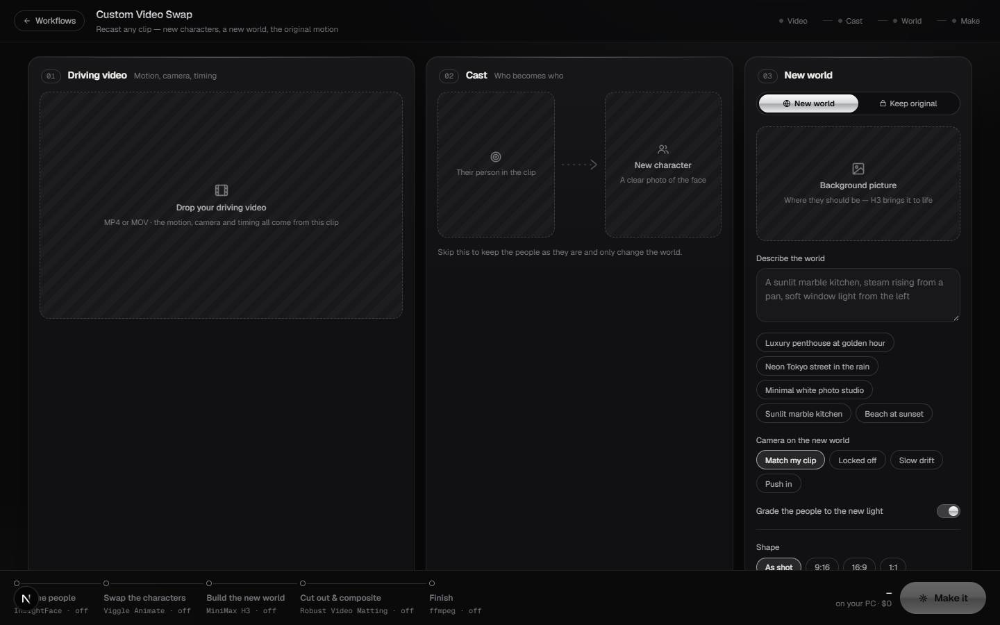

# Custom Video Swap

`/apps/custom-video-swap` · Video · live · shows as: App plugins card (in `PLUGIN_SLUGS`, not on the Studio wall) + a Studio card in Jarvis › Studio on the "Special skills" shelf (`WORKFLOWS` in `src/lib/studio/workflows.ts`)

> New characters, a new world, the original motion

Recast any clip. You drop the driving video, a face photo for each new character and a background
picture; each person in the clip sits next to who they become with an arrow between, you tap them
on the frame where faces are clearest, and the new world sits beside them. **Make it** sends the job
— clip included — to the owner's PC, where Viggle swaps the characters, MiniMax H3 turns the
background picture into a living plate and Robust Video Matting lays the people onto it. It comes
back as a before | after you drag across. Free, on the owner's own GPU.

## Features — every one of these must still exist after your change

The owner asked for each of these. Removing, hiding or "simplifying away" one is a regression,
even if the code looked unused. If a change needs one gone, ask first.

**Ways in**
- **Studio card** — pick "Custom Video Swap" in Jarvis › Studio (Special skills), drop the clip + face photos (+ a background picture) and type who becomes who in the composer, or name `@custom-video-swap` in the Studio chat; the screen opens with every upload already in its slot. `src/components/jarvis/StudioTab.tsx`, `src/components/jarvis/ChatTab.tsx` (`FLOW_SCREENS`), `src/lib/studio/video-swap/useVideoSwap.ts` (`startFromSeed`)
- **Uploads placed for you** — first clip = driving video; pictures = new characters in order; the LAST picture = background when the line mentions a background (the only picture, when the line is only about the background). `src/lib/studio/video-swap/plan.ts` (`placeUploads`)
- **Your words read** — the line sets the scene description, "keep the background", shape (vertical/TikTok → 9:16, YouTube → 16:9, square), quality (HD / draft) and camera (still, push in, drift). `src/lib/studio/video-swap/plan.ts` (`readPrompt`, `draftFromPrompt`)
- **Own page** — `/apps/custom-video-swap`, full height, "← Workflows" goes to `/apps/jarvis#studio`. `src/components/jarvis/video-swap/Pages.tsx` (`VideoSwapPage`)

**01 — Driving video**
- **Drop the clip** (MP4/MOV) into a slot; size, resolution and length shown. Clips stay on this device only — after a reload it asks you to add the same clip again. `src/components/jarvis/video-swap/ClipStage.tsx`, `src/lib/studio/video-swap/frame.ts` (`clipMeta`)
- **Mark people / Play** switch — Mark shows a still; tap each person to mark them (numbered chrome rings), tap near a mark to move it; hint line counts what's left. Play shows the clip looping inside the trim. `src/components/jarvis/video-swap/ClipStage.tsx` (`MarkLayer`), `src/lib/studio/video-swap/useVideoSwap.ts` (`tap`)
- **Crop of each tapped person** becomes the "Original" picture in the cast. `src/lib/studio/video-swap/frame.ts` (`cropAround`)
- **Filmstrip + trim** — 12 stills of the whole clip, two trim handles (greyed outside), "Using 0:02–0:09 (7.0 s)". `src/components/jarvis/video-swap/ClipStage.tsx`, `src/lib/studio/video-swap/frame.ts` (`filmstrip`)
- **Marking frame** — "Mark on" scrubber picks the frame where faces are clearest (pin on the strip). **Change clip** button. `src/components/jarvis/video-swap/ClipStage.tsx`, `src/lib/studio/video-swap/useVideoSwap.ts` (`markFrame`)

**02 — Cast (who becomes who)**
- **Original → arrow → new character** row per person, up to 3; the arrow lights up chrome with a moving spark when both sides are there. Unmark, remove, "Add a person". `src/components/jarvis/video-swap/CastPanel.tsx`, `src/lib/studio/video-swap/plan.ts` (`MAX_PEOPLE`)
- **Side label** ("on the left", …) from where you tapped, or "the main person in frame" with one person. `src/lib/studio/video-swap/plan.ts` (`sideOf`)
- **Note per person** — "in a red tracksuit", "keep his cap". `src/components/jarvis/video-swap/CastPanel.tsx`
- **Skip the cast** to keep the people and only change the world. `src/components/jarvis/video-swap/CastPanel.tsx`

**03 — New world**
- **New world / Keep original** switch. `src/components/jarvis/video-swap/WorldPanel.tsx`
- **Background picture** slot + "Describe the world" box with idea chips (penthouse, neon Tokyo, white studio, marble kitchen, beach). `src/components/jarvis/video-swap/WorldPanel.tsx`
- **Camera on the new world** — Match my clip · Locked off · Slow drift · Push in. **Grade the people to the new light** switch. `src/components/jarvis/video-swap/WorldPanel.tsx`
- **Shape** (As shot · 9:16 · 16:9 · 1:1), **Quality** (Draft · HD), **Keep the original sound**. `src/components/jarvis/video-swap/WorldPanel.tsx`
- **Every image slot** takes click, drag-and-drop or paste. `src/components/jarvis/video-swap/Slot.tsx`

**Make it**
- **Pipeline dock** — Find the people (InsightFace) · Swap the characters (Viggle Animate) · Build the new world (MiniMax H3) · Cut out & composite (Robust Video Matting) · Finish (ffmpeg), each lit when on, with honest minutes (≈60 min per 5 s of swap, ×1.6 for HD), total, "on your PC · $0". `src/components/jarvis/video-swap/PipelineDock.tsx`, `src/lib/studio/video-swap/plan.ts` (`pipeline`, `totalMinutes`)
- **Checks before it goes** — a clip, ≤ 60 s after trim, something to change, ≤ 3 people, every marked person has a picture, several people must each be tapped, ≤ 4 pictures in all. `src/lib/studio/video-swap/plan.ts` (`checkSwap`)
- **Make it** — files the job then uploads the clip with a live % bar (Filing → Uploading → Handing it to your PC); a failed upload takes the half-job back. `src/lib/studio/video-swap/useVideoSwap.ts` (`send`), `src/app/api/studio/video-swap/job/route.ts`
- **The brief** — plain steps a person can read, ending `SWAP JSON: {…}` (trim, marked frame, who becomes which picture, scene, camera, output); heads "Render with the custom-video-swap skill on this PC". `src/lib/studio/video-swap/plan.ts` (`briefText`, `jobOf`), `src/lib/studio/queueText.ts`

**The job and the result**
- **Job tracker** — Filed with your clip → Your PC picks it up → Swap · world · composite (latest agent note) → Back here; copy button for "work my Jarvis queue" and the expected minutes; the pictures sent. `src/components/jarvis/video-swap/SwapJob.tsx`
- **The original plays while you wait**, dimmed, from `watch?id=&input=1`. `src/components/jarvis/video-swap/SwapJob.tsx`
- **Before | after** — two players in lockstep with a chrome divider you drag (or ← → keys); Download; Change and make again; New swap (keeps the characters and world, clears the clip). `src/components/jarvis/video-swap/SwapJob.tsx` (`Compare`), `src/lib/studio/video-swap/useVideoSwap.ts` (`newSwap`)
- **Your swaps** menu — last 12 swaps: Queued / On your PC / Ready / Finished, newest first. `src/components/jarvis/video-swap/VideoSwap.tsx` (`SwapsMenu`)
- **Video → Cast → World → Make** progress dots in the top bar. `src/components/jarvis/video-swap/VideoSwap.tsx`

## How it looks

- **Look:** taste-skill "Cold Luxury" (design read at the top of `video-swap.css`: dials variance 7 · motion 6 · density 3) — the shared look for premium Studio flows; Workflow Maker reuses it. Not DESIGN.md; every rule is scoped under `.vs`.
- **Colours / type:** graphite `#09090a` background with faint radial glows; panels `#111113`, `#18181b`, raised `#1f1f23`; hairlines `rgba(255,255,255,.075)` / `.14`; ink `#f3f3f1`, `#b3b3b8`, `#75757c`; ONE accent, platinum `#e7e8ea` (`#b9bbc0`), plus a chrome gradient `#fbfbfa → #d9dadd → #a9abb0 → #eeeeef` used only for what acts (pressed pills, marks, Make it, the title); warning `#f2b37a`. Geist + Geist Mono (`fonts.ts`), mono for times, sizes and engines.
- **Layout:** laptop — 12-column grid: Driving video (5) · Cast (4) · New world (3), dock fixed at the bottom with the pipeline rail on the left and Make it on the right; job view is player (1.5) beside tracker (1). Phone — panels stack; the pipeline rail hides and Make it fills the dock width; portrait clips show 9:16 at up to 58% of the screen height. Shape lock: panels 18 px, slots 14 px, every button a full pill. Inside Jarvis the dock leaves room for the voice orb.
- **Signature pieces:** dashed striped upload slots; numbered chrome rings on the tapped frame; the lit original → new arrow with a travelling spark; the filmstrip with trim handles; the chrome before | after divider.
- **Motion:** panels rise in staggered, marks pop and pulse a ring, arrow spark, Make it light sweep, skeleton shimmer. `prefers-reduced-motion` turns every animation inside `.vs` off.

## Where the code is

| Part | Path |
|---|---|
| Page | `src/app/apps/custom-video-swap/page.tsx` → `VideoSwapPage` in `src/components/jarvis/video-swap/Pages.tsx` |
| UI | `src/components/jarvis/video-swap/` (`VideoSwap.tsx`, `ClipStage.tsx`, `CastPanel.tsx`, `WorldPanel.tsx`, `PipelineDock.tsx`, `SwapJob.tsx`, `Slot.tsx`, `fonts.ts`, `video-swap.css`) |
| Logic + tests | `src/lib/studio/video-swap/` (`plan.ts` + `plan.test.ts` pure; `useVideoSwap.ts` hook; `frame.ts` browser frames, crops, uploads) |
| API | `src/app/api/studio/video-swap/job/route.ts` (`start` → signed PUT of the clip, or local multipart → `ready`; `cancel`) |
| Saved data | localStorage `jarvis.video-swap.v1` (draft + marked frame; the clip file itself is not kept). The job is an In Queue request in folder `flow:custom-video-swap` with the pictures and an `input` clip in Storage at `inputKey(uid,id)` |

Also: Studio card in `src/lib/studio/workflows.ts`; Studio skill text `src/lib/studio/skills/custom-video-swap.md`; `PC_SKILLS` in `src/lib/studio/queueText.ts`; the PC agent's clip link `/api/new-jarvis/requests/input?id=` (connector token); the owner's "before" `/api/new-jarvis/requests/watch?id=&input=1`; "Test Custom Video Swap" task in `src/lib/new-jarvis/tasks.ts`.

## Owner's rules for this app

- The PC renders it with the `custom-video-swap` skill; this screen and Jarvis never render it themselves (`studio_queue`, never `studio_generate` — a video model would re-imagine the motion the clip already has right).
- The clip travels with the job: it goes straight to Storage through a one-time signed link (too big for a function body), and the job is not "ready" until the clip has landed.
- Free, on the owner's own GPU; minute estimates must stay honest.
- Max 60 s of clip, 3 people, 4 pictures per swap.
- The PC sends the MP4 back with `queue_video_link` and finishes with `queue_complete video: true`.

## Described but not found in code

- None found.
