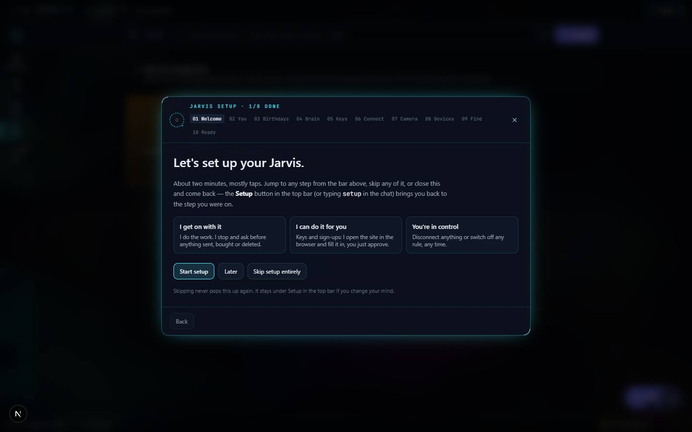

# Dashboard (was Recall)

`/apps/dashboard` · no catalog entry (removed — it is not in `PROJECTS` in `src/lib/catalog.ts`, only in `UNPREVIEWABLE`) · live · shows as: tabs inside Jarvis — the **Yours** group in Jarvis's rail (Folders, Photos, Lists, Calendar) + the Lists widget on Jarvis › Dashboard + Camera Autopilot on Jarvis's Deck

> No tag line — the app has no catalog entry. The unlock screen calls it "Your folders, photos, lists and assistant." (`src/app/recall-unlock/page.tsx`)

The owner's private "second brain": folders of notes, links, files, logins and websites; a camera roll that reads each photo with AI and proposes where it belongs; a calendar; and a family Lists board other people can join. It used to be its own page called Recall, then Dashboard; since 2026-09-21 it lives inside Jarvis, and `/apps/dashboard` is now only a redirect. Its storage keys, code folders and `/api/recall/*` routes deliberately keep the old `recall` name so nothing saved is orphaned.

## Features — every one of these must still exist after your change

The owner asked for each of these. Removing, hiding or "simplifying away" one is a regression,
even if the code looked unused. If a change needs one gone, ask first.

**Routes and how you get in**
- **Old links still land somewhere** — `/apps/dashboard` sends a family member to their Lists board and everyone else to Jarvis › Folders (`/apps/jarvis#folders`). `src/app/apps/dashboard/page.tsx`
- **Family Lists page on its own** — the only page a family member can reach; signed-out visitors go to the join screen. `src/app/apps/dashboard/lists/page.tsx`
- **Recall → Dashboard redirects** — `/apps/recall` → `/apps/dashboard`, `/apps/recall/lists` → `/apps/dashboard/lists`. `src/app/apps/recall/page.tsx`, `src/app/apps/recall/lists/page.tsx`
- **New Dashboard → Jarvis redirect** — `/apps/new-dashboard` is the AI-OS dashboard that became Jarvis on 2026-09-19; it is unrelated to this app and just redirects to `/apps/jarvis`. `src/app/apps/new-dashboard/page.tsx`
- **Mounted inside Jarvis** — Jarvis's rail group "Yours" shows Folders / Photos / Lists / Calendar; Folders and Photos mount `<Recall section=…>`, Lists mounts `<ListsBoard>`, Calendar mounts Jarvis's own `CalendarTab` (which reuses this app's calendar store and event dialog). `src/components/new-jarvis/NewJarvis.tsx`
- **One app password ("Unlock Jarvis")** — Jarvis sits behind the Dashboard password (`recall_auth` cookie); a family member is sent to Lists instead. `src/app/apps/jarvis/page.tsx`, `src/app/recall-unlock/page.tsx`, `src/app/api/recall-unlock/route.ts`
- **Password can be changed in the app** — stored as a salted PBKDF2 hash in a writable store; `RECALL_PASSWORD` env var is only the bootstrap. `src/lib/recall/gateStore.ts`, `src/lib/recall/passwords.ts`
- **Sign out of Dashboard** — button in the top bar when a password is set. `src/components/recall/Recall.tsx`

**Folders (the knowledge base)**
- **One search box over everything (⌘K / Ctrl+K, Esc clears)** — notes, to-dos, links, files, logins, websites, folder names and tags, including text read out of uploaded documents; saved passwords are never searched. `src/components/recall/SearchResults.tsx`, `src/lib/recall/search.ts`
- **Tag filter chips** — click a tag to filter, "Clear" to reset. `src/components/recall/Recall.tsx`
- **Folder home grid** — just folders, each a tinted tile with optional icon and one-line blurb; tints are stable per folder and never repeat next to each other. `src/components/recall/FolderHome.tsx`, `src/lib/recall/accents.ts`
- **Folder tree drawer** — toggled from the top bar, not permanent. `src/components/recall/FolderTree.tsx`
- **Create / edit a folder** (name, blurb, icon). `src/components/recall/FolderDialog.tsx`
- **Move a folder ("Move to…")** without asking the assistant; its own sub-folders are left out of the choices. `src/components/recall/MoveFolderDialog.tsx`
- **Delete a folder and everything inside** — the confirm names exactly how many sub-folders and items will go. `src/components/recall/Recall.tsx` (`folderDeleteImpact` in `src/lib/recall/store.ts`)
- **A folder is a page of typed sections** — starts empty; one + menu adds a section or another entry of an existing one; a section with items always shows and can only be removed when empty. `src/components/recall/FolderWorkspace.tsx`, `src/components/recall/AddSectionMenu.tsx`, `src/components/recall/Section.tsx`
- **Sub-folders as tiles inside the folder.** `src/components/recall/SubfolderGrid.tsx`
- **Notes & Ideas and To-Do sections** — add inline: type, Enter, done. `src/components/recall/SimpleSections.tsx`
- **Links & Resources** — URLs and files together; images, PDFs, docs and spreadsheets are read on the way in so search and the assistant can find what was inside; videos are stored and playable but not read. `src/components/recall/LinksSection.tsx`, `src/lib/recall/files.ts`, `src/app/api/recall/extract/route.ts`
- **Logins & Passwords** — as many per folder as you like; password revealable and copyable; copied passwords are cleared from the clipboard later. `src/components/recall/LoginsSection.tsx`, `src/lib/recall/clipboard.ts`
- **Websites section** — one fixed record shape (reads as a table), copy button on every value. `src/components/recall/WebsitesSection.tsx`, `src/lib/recall/schemas.ts`
- **Capture anything** — the Capture button takes text, links, files (and Google Drive picks), proposes a title, folder and tags to confirm; works offline with a keyword fallback. `src/components/recall/CaptureModal.tsx`, `src/lib/recall/classify.ts`, `src/lib/recall/media.ts`, `src/lib/recall/drive.ts`
- **Item detail** — open any item; edit, delete, "Ask" the assistant about it, and download the full-size original (falls back to the preview with a note when the original is on another device). `src/components/recall/ItemDetailModal.tsx`
- **AI Rankings folder: Sync button on every entry** — outlined "Sync" until sent; a green chip naming its section once on the AI Rankings board (opens that tab). Works for any folder named like "ai rankings" or inside it. `src/components/recall/RankingsSync.tsx`, `src/components/recall/rankingsFolder.tsx`, `src/components/recall/rowExtra.tsx`, `src/lib/ai-rankings/fromDashboard.ts`
- **Auto-found link for a website saved by name** (AI Rankings folder) and **"Find links for N entries"** to backfill old rows. `src/components/recall/WebsitesSection.tsx`, `src/components/recall/FolderWorkspace.tsx`, `src/lib/ai-rankings/siteUrl.ts`
- **The assistant ("Ask Jarvis" chat)** — answers from folders, calendar and the people list, and proposes actions (create/move/rename/merge/delete folders and items, tags, notes, calendar events, add a person) that the owner confirms; says plainly when AI is off. `src/components/recall/AgentChat.tsx`, `src/lib/recall/agent.ts`, `src/app/api/recall/route.ts`
- **Security dialog** — change the app password and see every saved login in one place (revealable, copyable) as the recovery path; also reachable from Jarvis › Settings. `src/components/recall/SecurityDialog.tsx`, `src/components/jarvis/SettingsTab.tsx`
- **Old encrypted vault still readable** — devices holding old AES-sealed passwords can still unlock them. `src/lib/recall/legacyVault.ts`
- **Back up Folders (and Photos) to Google Drive** — mirrors the folder tree under "Ultimate Assistant OS/" with the `drive.file` scope only; runs automatically while an approval from this visit is valid, otherwise asks for one tap. `src/components/recall/DriveBackupCard.tsx`, `src/lib/dashboard/driveBackup/`
- **Follows the account across devices without overwriting** — reads first, writes only after the remote pull, and merges devices that drifted apart. `src/components/recall/Recall.tsx`, `src/lib/recall/store.ts` (`mergeRecallData`, `SYNC_REPAIR_FLAG`)
- **Never deletes images of photos still waiting for review** when sweeping unused files. `src/lib/recall/referencedFiles.ts`

**Photos (camera roll)**
- **Photos board** — the "Photos" root folder with album sub-folders, in a warm palette used nowhere else; photos are ordinary Dashboard items so search and the assistant work on them. `src/components/recall/photos/PhotosBoard.tsx`
- **AI reads each photo** — one vision call decides information / event / people, who is in it (from a labelled contact sheet of reference faces), title, caption, any text, folder, tags and event time. `src/app/api/recall/photos/route.ts`, `src/lib/recall/photos/vision.ts`, `src/lib/recall/photos/pipeline.ts`
- **Nothing is filed without a yes — review queue grouped by destination**, biggest group first, approve a whole group at once; fix single photos one click deeper. `src/components/recall/photos/ReviewQueue.tsx`
- **Enlarge a photo in review** from the original file (thumbnail first, X / Esc to close). `src/components/recall/photos/ReviewQueue.tsx` (`Lightbox`)
- **"Tell the agent what to do with this photo"** — and with a whole upload; the instruction is followed, not weighed; **Re-read** re-runs it. `src/components/recall/photos/ReviewQueue.tsx`, `src/components/recall/photos/PhotosBoard.tsx`
- **"+ New album" from the review screen.** `src/components/recall/photos/ReviewQueue.tsx`
- **Duplicates never show** — look-alike fingerprint plus a sameness rule; a suspected duplicate is held out of bulk approve until ruled on. `src/lib/recall/photos/fingerprint.ts`, `src/lib/recall/photos/sameness.ts`, `src/components/recall/photos/ReviewQueue.tsx`
- **Newest photos always at the top** (by when taken, else when arrived). `src/lib/recall/photos/queueOrder.ts`
- **Self-improving confidence score** — model's own rating calibrated against what the owner filed, moved and removed; chip on each photo; sorts only. `src/lib/recall/photos/confidence.ts`, `src/lib/confidence/calibrate.ts`, `src/components/recall/photos/ReviewQueue.tsx`
- **Collage / caption from a batch** — "make these into a collage and put a quote across the bottom": the server only interprets the sentence, the browser draws it on a canvas, and the one result is what gets filed. `src/lib/recall/photos/compose.ts`, `src/lib/recall/photos/batch.ts`, `src/app/api/recall/photos/batch/route.ts`
- **People** — add people with reference faces (stored as small crops, synced), a warning when someone has none, and a written **Character sheet** ("Describe" / "Rebuild") from their faces and filed photos; people are @-mentionable in Studio prompts. `src/components/recall/photos/PeopleManager.tsx`, `src/lib/recall/photos/characters.ts`
- **Albums sorted by who or by what** — pick people, or drop in two or three example pictures so look-alikes land there; either, both or neither. `src/components/recall/photos/AlbumDialog.tsx`
- **Send a photo's details to other apps** — destinations registry: AI Rankings, Cook Connect (recipe), Skills Library (prompt transcribed verbatim), Music Classifier (song), GitHub repo → Folders › Repos; only the details go, the picture is filed under "Sent to apps". `src/lib/dashboard/destinations/registry.ts` (+ `aiRankings.ts`, `cookbook.ts`, `skillsLibrary.ts`, `musicClassified.ts`, `githubRepo.ts`), `src/lib/recall/photos/store.ts`
- **Named places resolve to existing ones** — "my desert cookbook" files into "Desserts" rather than a near-duplicate. `src/lib/dashboard/places.ts`
- **Events from photos go to the calendar** (flyers, invites). `src/lib/recall/photos/types.ts`, `src/lib/recall/photos/pipeline.ts`
- **iPhone Sources strip** — "Import now" (iOS picker, 5/20/50/100 is a cap, said so) vs "Autopilot" (the Shortcut). `src/components/recall/photos/IphoneSources.tsx`
- **Import from Google Drive** (Picker; needs its own API key, separate from backup). `src/components/recall/photos/PhotosBoard.tsx`, `src/lib/recall/drive.ts`
- **Videos branch (Photos › Videos)** — folders and sub-folders of clips, no review queue; poster frame + running time on each tile; full-surface player. `src/components/recall/photos/VideosBoard.tsx`, `src/lib/recall/photos/videos.ts`
- **Photo settings** — backup and folder rules. `src/components/recall/photos/PhotosBoard.tsx`
- **Learns the owner's rules** — plain-sentence rules (told or learned, switchable) fed into every photo read. `src/lib/recall/photos/autopilot.ts`

**iPhone photo inbox (feeds Camera Autopilot)**
- **iPhone Shortcut pushes photos** — `/api/dashboard/inbox/push` with a per-user key (`?key=` or header), any file field name or a raw image body; session-exempt. `src/app/api/dashboard/inbox/push/route.ts`, `src/lib/dashboard/inbox.ts`, `src/middleware.ts`
- **"Where did I get up to" bookmark** — `/cursor` tells the phone the newest date already sent (24 h ago the first time). `src/app/api/dashboard/inbox/cursor/route.ts`, `src/lib/dashboard/shortcutDate.ts`
- **Deleted on the phone → deleted here** — `/present` takes the names still on the phone. `src/app/api/dashboard/inbox/present/route.ts`, `src/lib/dashboard/stillOnPhone.ts`
- **Same photos on every device** — claim with `share` keeps a copy until filed/removed anywhere (`/done`); photos added on one device go up (`/upload`) and others adopt the shared copy. `src/app/api/dashboard/inbox/claim/route.ts`, `.../done/route.ts`, `.../upload/route.ts`
- **Fully automatic pull in small batches** (stays under Vercel's 4.5 MB; a failed batch is skipped, not blocking). `src/lib/dashboard/drainInbox.ts`
- **Personal link / key** — mint or rotate the device key (shown once, only its hash stored); the user's last few keys all keep working, kept in their own document. `src/app/api/dashboard/inbox/token/route.ts`, `src/lib/dashboard/inbox.ts`
- **Says why no photos came** (old link, nothing new, bad send, which URL block is wrong) and **"That's my iPhone — let it in"** one-tap adopt of a refused key. `src/lib/dashboard/phoneStatus.ts`, `src/app/api/dashboard/inbox/adopt/route.ts`, UI in `src/components/new-jarvis/Deck.tsx`
- **Ready-made "Send to Jarvis" Shortcut** + guide with a field-by-field table. `src/lib/dashboard/iphoneShortcut.ts`, UI in `src/components/new-jarvis/IphoneGuide.tsx`
- **Camera Autopilot on Jarvis's Deck** runs on this same queue and pipeline, with Sure 80+ / Maybe / Unsure filters. `src/components/new-jarvis/Deck.tsx` (Jarvis's UI; logic here)

**Calendar**
- **Calendar store** — day and time stored as plain local strings so dates never shift west of UTC; synced across devices under its own key. `src/lib/recall/calendar/types.ts`, `src/lib/recall/calendar/store.ts`
- **Event dialog** — time optional and off by default (all-day). `src/components/recall/calendar/EventDialog.tsx`
- **Reminders while the tab is open + "Turn on reminders" notifications + export .ics** for the phone's calendar. `src/lib/recall/calendar/reminders.ts`, `src/components/jarvis/CalendarTab.tsx`
- **Agenda-first calendar with Month view** (the Dashboard's own board; see "Owner's rules" — it is not mounted inside Jarvis today). `src/components/recall/calendar/CalendarBoard.tsx`

**Lists (the family board)**
- **Eight built-in lists** — To-Do, To-Buy, Remember, Ideas, Goals, Projects, Bills, Notes; built-ins can be hidden, never deleted; custom lists (admin) must be empty to delete. `src/lib/recall/lists/types.ts`, `src/components/recall/lists/ListDialog.tsx`
- **Card wall of lists**, empty lists collapse to one line, urgent first and ticked items drop to the bottom. `src/components/recall/lists/ListsBoard.tsx`, `src/components/recall/lists/ListCard.tsx`
- **Priority tiers** — Urgent, Running low, Wish list, Normal — with meanings shown; plus note, due date ("Today", "Fri 5 Sep") and link. `src/components/recall/lists/ItemDialog.tsx`, `src/components/recall/lists/bits.tsx`
- **Rows read urgency → item → who added it**; anyone can tick, only allowed people edit/delete (server re-checks). `src/components/recall/lists/ItemRow.tsx`
- **Ticked items clear after 24 hours.** `src/lib/recall/lists/store.ts` (`COMPLETED_TTL_MS`)
- **Members with their own colour** (8 colours) and a **whose-items filter** (empty = everyone). `src/components/recall/lists/MembersDialog.tsx`, `src/components/recall/lists/MemberFilter.tsx`
- **Invite links for family** — one-time sign-up with `?t=`, plain sign-in otherwise; never reveals whether a link expired. `src/components/recall/lists/JoinForm.tsx`, `src/app/recall-join/page.tsx`, `src/app/api/recall/lists/join/route.ts`
- **Members can never act as admin** — separate `recall_member` cookie; admin-only invites and removals. `src/lib/recall/lists/session.ts`, `src/app/api/recall/lists/members/route.ts`
- **Server-held board** — every change returns the whole board (no optimistic guesses). `src/lib/recall/lists/store.ts`, `src/lib/recall/lists/client.ts`, `src/app/api/recall/lists/`
- **Lists widget on Jarvis › Dashboard**, sorted by priority, opening the full board in a sheet. `src/components/new-jarvis/Widgets.tsx`

## How it looks

- **Look:** the hub's dark "Projects Timeline" token set, dense and minimal (no `.impeccable/` record for this app). Inside Jarvis it inherits Jarvis's shell around it.
- **Colours / type:** Tailwind tokens from `src/app/globals.css` — `canvas #0a0b0f`, `panel #12141c`, `panel-2 #181b25`, `elevated #1d212d`, `line #262a38`, `ink #e9ecf3` / `ink-muted #9aa3b5` / `ink-faint #6b7385`, `brand #6366f1` (indigo; Capture button, active states, focus rings) / `brand-2 #4f46e5`. Folder tiles use soft radial washes in rose / violet / sky / emerald / amber / fuchsia (`src/lib/recall/accents.ts`). **Photos is deliberately warm** — amber, rose, orange, pink, yellow, red (`PHOTO_ACCENTS` in `src/lib/recall/photos/types.ts`) — a palette used nowhere else so the photo side is recognisable at a glance. Lists use member colours (sky, rose, emerald, violet, amber, cyan, fuchsia, lime). Font: system sans (`--font-sans`); video running times in tabular mono.
- **Layout:** one centred column `max-w-5xl` with a sticky blurred top bar (tree toggle · search · shield · sign out · Capture). Laptop: folder tiles 3-across, Lists as a card wall. Phone: same column, labels collapse to icons (`hidden sm:inline`), tree as a drawer.
- **Signature pieces:** the one search box, tinted folder tiles, collapsible one-line sections, the destination-grouped review queue, the warm Photos wall, colour-dot member chips on Lists.
- **Motion:** minimal — colour/border transitions, a toast that fades after 2.6 s. No reduced-motion handling needed beyond that.

## Where the code is

| Part | Path |
|---|---|
| Page | `src/app/apps/dashboard/page.tsx` (redirect) · `src/app/apps/dashboard/lists/page.tsx` · mounted in `src/components/new-jarvis/NewJarvis.tsx` |
| UI | `src/components/recall/` (+ `calendar/`, `lists/`, `photos/`) · Jarvis-side: `src/components/jarvis/CalendarTab.tsx`, `src/components/new-jarvis/Deck.tsx`, `Widgets.tsx`, `IphoneGuide.tsx` |
| Logic + tests | `src/lib/recall/` (+ `calendar/`, `lists/`, `photos/`) · `src/lib/dashboard/` (photo inbox, destinations, Drive backup) |
| API | `src/app/api/recall/` (`route.ts` stages link/classify/agent, `extract`, `photos`, `photos/batch`, `lists/*`) · `src/app/api/dashboard/inbox/*` · `src/app/api/recall-unlock/` |
| Saved data | synced keys `recall:v1` (folders + items), `recall-calendar:v1`, `recall-photos:v1` (people, categories, settings), `photo-autopilot:v1`; local-only `recall-photo-queue:v1` + IndexedDB blobs; server_docs for the iPhone inbox and its keys; Lists board + app-password hash in server docs under `RECALL_DATA_DIR` |

## Owner's rules for this app

- **Keep the `recall` names.** Storage keys, module paths, `/api/recall/*` and the `recall_auth` / `recall_member` cookies stay as they are — renaming orphans every saved note and breaks invite links family already hold. Only the page moved.
- **Nothing is filed without the owner saying yes** — photos wait in the review queue; the confidence score only sorts.
- Family members get the Lists board and nothing else — a member token must never pass the admin check.
- A saved password must always be recoverable (no second master password); passwords are never searched.
- Deleting a folder deletes what is inside it, and the confirm says exactly how much.
- Only a photo's details go to another app; the picture stays in Dashboard under "Sent to apps".
- Private: `dashboard` is in `UNPREVIEWABLE` in `src/lib/catalog.ts` — never frame it on the hub carousel.
- Apps must work with no keys: classify, assistant and photo reading fall back or say plainly that AI is off.
- Note: `src/lib/appGate.ts` still says Dashboard "gates itself in src/app/apps/dashboard/page.tsx" — that page is now only a redirect; the real gate is in `src/app/apps/jarvis/page.tsx`.
- Note: `Recall.tsx` still has a standalone mode (home tabs Folders/Photos/Calendar/Lists, a "Hub" back link, `CalendarBoard`), but nothing mounts it standalone any more — Jarvis passes `section="folders" | "photos"` only, so `CalendarBoard.tsx` is not reachable today.

## Described but not found in code

- "Rename Recall to Dashboard … the catalog … read Dashboard now" (feature log, 2026-09-07) — there is no `dashboard` catalog entry any more; it was dropped when the app moved into Jarvis.
- Change-log entries filed under `dashboard` that belong to other apps (song finder → Viral Studio Content; Facebook/Instagram import → `src/lib/social-import/`; creator persona grid → Personas Studio; dance-video character swap → Viral Studio; H3 / RunPod endpoint fixes → video tooling; cookbook RLS fix → Cook Connect). Not part of this app; see those apps' docs.
