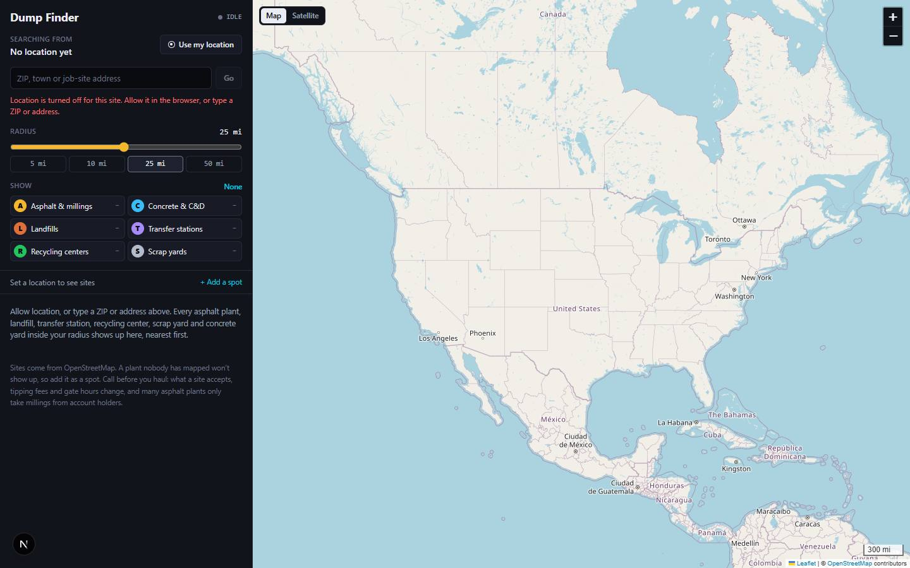

# Dump Finder

`/apps/dump-finder` · Utilities · live · shows as: App plugins card

> Where this load can go, and how far it is

A map for whoever is standing next to a loaded truck. It finds the phone, draws a ring of the chosen
radius (1–50 miles) and pins every asphalt plant / paving yard, concrete and rubble yard, landfill,
transfer station, recycling center and scrap yard inside it, nearest first — with the driver's own
notes (price a ton, gate hours, "taking millings this week?") kept on each site.

## Features — every one of these must still exist after your change

The owner asked for each of these. Removing, hiding or "simplifying away" one is a regression,
even if the code looked unused. If a change needs one gone, ask first.

**Where you are searching from**
- **Finds the phone on open** — asks for location once; a saved last place shows straight away and a GPS fix replaces it. `src/components/dump-finder/DumpFinder.tsx`
- **Use my location** button with plain-English errors when the browser can't share location. `DumpFinder.tsx`
- **Type a ZIP, town or job-site address instead** — up to 5 matches (US and Canada) to pick from; "Nothing matched. Try a ZIP." `DumpFinder.tsx`, `src/app/api/dump-finder/geocode/route.ts` (OpenStreetMap Nominatim, no key)
- **Search this area** — drag the map away and a button appears to search around the map's centre. `DumpFinder.tsx` (`searchHere`), `src/components/dump-finder/MapView.tsx`
- **"Searching from" readout** with the place name and a status light (Locating / Searching / ready / error). `DumpFinder.tsx`
- **Remembers where you left it** — last place, radius, filters and map style reopen as they were. `src/lib/dump-finder/store.ts`

**Radius and filters**
- **Radius slider 1–50 mi** with a mono readout, plus quick buttons **5 / 10 / 25 / 50 mi** (default 25). `DumpFinder.tsx`, `store.ts` (`RADIUS_STOPS`)
- **Six kind filter chips** — Asphalt & millings (A), Concrete & C&D (C), Landfills (L), Transfer stations (T), Recycling centers (R), Scrap yards (S); each with its colour, letter, live count, and a tooltip of what it takes. `src/lib/dump-finder/kinds.ts`, `DumpFinder.tsx`
- **Double-click a chip to show only that kind**; an **All / None** switch toggles every kind. `DumpFinder.tsx` (`onlyKind`)

**The map**
- **Leaflet map with the radius drawn as a dashed survey ring**, auto-fitted to the ring; zoom control and an imperial-only scale bar. `MapView.tsx`
- **Map / Satellite switch** — OpenStreetMap streets or Esri World Imagery (to see whether a plant has a pile and a way in for a tri-axle). `MapView.tsx`, `DumpFinder.tsx`
- **Lettered, coloured pins** so they read in sunlight and for colour-blind eyes; a "+N" badge when a site is more than one kind; your own spots have a dashed white border; the selected pin grows. `MapView.tsx` (`pinHtml`), `src/components/dump-finder/dump-finder.css`
- **"You are here" dot** — solid pulsing blue for GPS, hollow for a typed place. `MapView.tsx`, `dump-finder.css`
- **Tap a pin → its row opens and scrolls into view**; picking a row pans the map to it when it is off-screen. `MapView.tsx`, `DumpFinder.tsx`

**The site list**
- **Every site inside the radius, nearest first**, with name, kinds and distance in miles; closed / disused / capped sites are left out; a plant mapped twice shows once. `src/lib/dump-finder/sites.ts` (`classify`, `toSites`)
- **Site detail** — address, operator, hours, phone (with Copy), fee ("Charges a fee" / "Free" / price), what it says it takes, and the exact point (with Copy). `DumpFinder.tsx`, `sites.ts` (`acceptedMaterials`)
- **Directions** button (opens Google Maps directions to the site), **Website** button, and **Fix on OpenStreetMap** link. `DumpFinder.tsx` (`directionsUrl`)
- **Notes box on every site** — "Takes millings? Price a ton, gate hours, who to ask for…"; saved per site and synced. `DumpFinder.tsx`, `store.ts` (`notes`)
- **Empty and error states in plain English** — no location yet, nothing within N mi ("Widen the radius, or add a spot you know"), nothing matching your filters, and an error with **Try again**. `DumpFinder.tsx`
- **Footer honesty note** — sites come from OpenStreetMap, call before you haul, many plants only take millings from account holders; plus "Updated <time>". `DumpFinder.tsx`

**Your own spots**
- **+ Add a spot** — "Tap the map where the spot is" banner (Cancel), then name it and pick its kinds (defaults to millings), Save spot / Discard. `DumpFinder.tsx`, `MapView.tsx`
- **Your spots appear with a "Your spot" tag**, mixed into the list by distance, and follow you to every device. `DumpFinder.tsx`, `store.ts` (`spots`)
- **Delete spot** with a "Delete this spot?" confirm. `DumpFinder.tsx`

**Behind the scenes**
- **Live sites from OpenStreetMap, no key** — Overpass query tried against three public mirrors in turn, with a 15-minute in-memory cache per ~1 km cell. `src/app/api/dump-finder/sites/route.ts`, `sites.ts` (`buildQuery`)

## How it looks

- **Look:** "the hub's instrument panel, bolted to a map" — follows DESIGN.md (near-black panels, colour only for state, mono for every number a driver reads). No `.impeccable/surfaces/` record; design skill not recorded.
- **Colours / type:** DESIGN.md tokens via CSS variables (`--color-canvas`, `--color-panel`, `--color-line`, `--color-ink*`, `--color-core` for ready, `#f59e0b` loading, `#ef4444` error, `--color-brand` focus ring). The only extra colour is the six kinds: millings `#f5b72b`, concrete `#38bdf8`, landfill `#e0703a`, transfer `#a78bfa`, recycling `#22c55e`, scrap `#b4bccb` (each with a dark ink colour for the letter). Search ring: dashed `#0a0b0f` stroke with a 6 % gold fill. Map tiles are left light on purpose (a dark-filtered map is hard to read in a cab at noon); map background `#d9d6cf`. Fonts: `--font-sans` body 13 px, title 18 px/650; `--font-mono` with tabular numbers for miles, coordinates, counts.
- **Layout:** full-screen fixed grid. Phone — map on top (min 260 px, 46 dvh), list as a sheet below, safe-area gutters. Laptop (≥ 900 px) — 400 px list rail on the left, map fills the right.
- **Signature pieces:** lettered colour pins, the dashed survey-line ring, the kind chips with live counts, the Map / Satellite segmented switch, the pulsing blue GPS dot.
- **Motion:** GPS dot ping, blinking status light while locating/loading, pin scale on hover/select, animated fit-to-ring. Reduced motion stops the ping and blink and the pin transition.

## Where the code is

| Part | Path |
|---|---|
| Page | `src/app/apps/dump-finder/page.tsx` |
| UI | `src/components/dump-finder/` (`DumpFinder.tsx`, `MapView.tsx`, `dump-finder.css`) |
| Logic + tests | `src/lib/dump-finder/` (`sites.ts` + `sites.test.ts`, `kinds.ts`, `store.ts`) |
| API | `src/app/api/dump-finder/sites/route.ts` (Overpass), `src/app/api/dump-finder/geocode/route.ts` (Nominatim) |
| Saved data | synced key `dump-finder:v1` (localStorage, synced through Supabase `app_state`; works local-only) — notes per site id (`osm:…` / `mine:…`), your spots, radius, kinds, map layer, last place |

## Owner's rules for this app

- **No API key needed** — sites and address search come from free OpenStreetMap services; keep it working with nothing set up.
- Every pin carries a **letter as well as a colour** (sunlight, colour-blind readers).
- **Map tiles stay light** — do not dark-filter the street map.
- Be honest that OSM does not know prices, acceptance or gate hours — that is what the notes box is for.
- Listed with `noPreview: true` in `src/lib/catalog.ts` — the hub carousel must never frame it (it asks a stranger for their location).
- Shows as an App plugins card (`PLUGIN_SLUGS` in `src/lib/studio/plugins.ts`), so it is off the hub grid.

## Described but not found in code

- None found.
