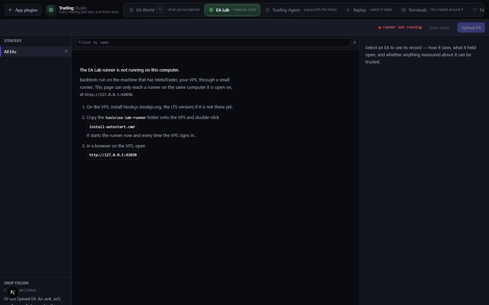

# EA Lab

`/apps/ea-lab` · Utilities · live · shows as: section of trading-studio (Trading Studio › EA Lab; `MERGED_INTO["ea-lab"] = "trading-studio"` in `src/lib/studio/plugins.ts`, so it is not a hub tile or an App plugins card)

> Test your trading bots

A bench where a MetaTrader Expert Advisor (a trading bot) stops being a claim and becomes a measurement. Drop a
bot in and a small runner on the PC/VPS installs it into a spare MetaTrader, backtests it with nobody touching the
terminal, files it by how it fails, and rates it on results it has not seen before. It reads like a database:
strategy list on the left, a sortable table in the middle, the full record on the right.

## Features — every one of these must still exist after your change

The owner asked for each of these. Removing, hiding or "simplifying away" one is a regression,
even if the code looked unused. If a change needs one gone, ask first.

**Getting bots in**

- **Upload EA** — button that takes `.ex4`, `.ex5`, `.mq4`, `.mq5`; shows "Working…" while busy. `src/components/ea-lab/EaLab.tsx`, `src/lib/ea-lab/client.ts` (`upload`)
- **Drag and drop anywhere** — dropping files on the page shows a "Drop to upload and test" overlay. `EaLab.tsx` (`dropProps`, `dragging`)
- **Drop folder (watched inbox)** — the left column shows the folder path (default `C:\EA-Lab\inbox`) and how many files are waiting; anything put there is taken in like an upload. `EaLab.tsx`, `tools/ea-lab-runner/server.mjs` (`INBOX`)
- **Scan inbox** — button to take the inbox in right now. `EaLab.tsx`, `client.ts` (`scan`)
- **Source is compiled first** — `.mq4`/`.mq5` are compiled with the chosen terminal's MetaEditor before each test; a compile error is shown in red on the record. `tools/ea-lab-runner/server.mjs`, `src/components/ea-lab/DetailPanel.tsx`

**The runner and test terminals**

- **Runner status light** — green "idle", amber "testing · N queued", "no test terminal", or red "runner not running", plus the machine name. `EaLab.tsx` (header)
- **Test terminals picker** — "Test terminals on <machine>": choose which spare MT4 and MT5 installs are used ("Test with this" / "testing with this"); opens by itself when none is chosen; MT4/MT5 badges in the header reopen it. `EaLab.tsx` (`RigPicker`), `client.ts` (`rigs`, `chooseRig`)
- **Runner-down help** — when the runner can't be reached, a plain panel explains it and lists the setup steps (copy `tools\ea-lab-runner`, run `install-autostart.cmd`, open `http://127.0.0.1:42030`). `EaLab.tsx` (`BridgeDown`)
- **Refreshes itself** — re-reads the runner every 15 seconds so tests finishing in the background show up. `EaLab.tsx`
- **Notices** — green/red one-line messages after an upload, scan or test request. `EaLab.tsx` (`notice`)

**The table**

- **Strategy tree** — All EAs, Trend, Mean reversion, Grid, Martingale, Hedge recovery, Scalper, News, Arbitrage, Panel / tool, Unfiled — each with a count; click to filter. `EaLab.tsx` (`STRATEGY_LABEL`)
- **Filter by name** — search box with a live row count. `EaLab.tsx`
- **Sortable columns** — Expert Advisor, Strategy, Rating, Max DD, **Naked**, Risk, Trades, Quality; default sort by rating, unrated last. `EaLab.tsx` (`COLS`, `rows`)
- **NAKED column** — peak *unhedged* exposure rebuilt from the open book, not from closed trades — the figure that actually ends accounts and no MetaTrader report prints. `src/lib/ea-lab/exposure.ts` (`analyzeExposure`)
- **Quality badge** — modelling quality rides with every number: untrusted / indicative / good / high fidelity. `src/lib/ea-lab/rating.ts` (`qualityTier`, `TIER_LABEL`)

**The record (right panel)**

- **Verdict first** — score coloured green ≥60, amber ≥35, red below, with the reasons; or "Not rated" with why. `DetailPanel.tsx`
- **Filed as** — the failure-mode family and how confident the filing is. `DetailPanel.tsx`, `src/lib/ea-lab/classify.ts` (`classify`)
- **Exposure** — base lot, largest multiple, gross peak, naked peak. `DetailPanel.tsx`
- **Runs** — every test with net profit, PF, drawdown and quality; profit factor deliberately last. `DetailPanel.tsx`
- **Test buttons** — Out-of-sample (the one the rating uses) and In-sample. `DetailPanel.tsx`, `client.ts` (`queueTest`)

**The rules that make the rating honest**

- **Out-of-sample only** — an EA with no out-of-sample run is not rated ("An in-sample backtest measures memory, not skill"); needs at least 30 closed trades; only the best quality tier available is used and "untrusted" (too-coarse) runs never count; an exposure penalty stops a martingale topping the table. `src/lib/ea-lab/rating.ts` (`rate`, `MIN_TRADES`)
- **Filed by how it fails** — martingale, hedge-recovery, grid, scalper, trend, mean-reversion…, read from the trades and exposure, not from which indicator it uses. `src/lib/ea-lab/classify.ts`
- **MT4 and MT5 report parsing** — Strategy Tester `.htm` reports from both platforms (encoding detected), with fixtures and tests. `src/lib/ea-lab/report.ts` (`parseReport`, `parseMt4Report`, `parseMt5Report`), `src/lib/ea-lab/__fixtures__/`

**Where it runs**

- **Inside Trading Studio, embedded** — drops its own "EA Lab · Expert Advisor testing bench" wordmark but keeps the runner readout and buttons. `EaLab.tsx` (`embedded`), `src/components/trading-studio/TradingStudio.tsx`
- **Standalone on the VPS** — the runner serves the same page itself at `http://127.0.0.1:42030`, so a VPS needs only Node.js and the folder; autostart at sign-in. `tools/ea-lab-runner/ui-src/main.tsx`, `tools/ea-lab-runner/build-ui.mjs`, `tools/ea-lab-runner/{install-autostart.cmd,uninstall-autostart.cmd,start.cmd,start-hidden.vbs}`
- **Old link** — `/apps/ea-lab` lands on `/apps/trading-studio?section=lab`. `src/app/apps/ea-lab/page.tsx`, `next.config.mjs`

## How it looks

- **Look:** a dense database / instrument-panel screen on the hub's own DESIGN.md tokens, unchanged; no `.impeccable` record.
- **Colours / type:** Tailwind hub tokens — `bg-canvas`, `bg-panel`, `bg-panel-2`, `border-line`, `text-ink`/`ink-muted`/`ink-faint`, buttons `bg-brand-2`; state colours green-400/500, amber-400/500, red-400/500 only for status and verdicts. System sans at 12–14px; numbers, paths and counts in JetBrains Mono 11.5px with tabular figures. Section accent in Trading Studio: hue 150.
- **Layout:** laptop (≥1024px) — three columns: 210px strategy tree, table, 380px record. Tablet (≥768px) — tree + table, record hidden. Phone — table only (tree and record hidden); low-value columns (Strategy, Max DD, Risk, Trades, Quality) drop out by width.
- **Signature pieces:** the NAKED column, the quality badge on every run, the runner status dot, the sticky table header.
- **Motion:** almost none — the drag overlay and hover colour changes; no animation to reduce.

## Where the code is

| Part | Path |
|---|---|
| Page | `src/app/apps/ea-lab/page.tsx` (a redirect to `/apps/trading-studio?section=lab`) |
| UI | `src/components/ea-lab/` (`EaLab.tsx`, `DetailPanel.tsx`) |
| Logic + tests | `src/lib/ea-lab/` (`classify`, `exposure`, `rating`, `report`, `client`, `types` + tests and `__fixtures__/`) |
| API | none in the hub — the page talks to the runner at `http://127.0.0.1:42030` (`src/lib/ea-lab/client.ts` `BRIDGE`) |
| PC helper | `tools/ea-lab-runner/` (`server.mjs`, `ui/`, `ui-src/`, autostart scripts, `README.md`) |
| Saved data | on the runner machine only: `C:\EA-Lab\{inbox,installed,reports,build}` and `C:\EA-Lab\config.json` (which MT4/MT5 are test terminals). Env overrides `EA_LAB_ROOT`, `EA_LAB_PORT`, `EA_LAB_RIG_EXE`, `EA_LAB_RIG_DATA`, `EA_LAB_MT5_EXE`, `EA_LAB_MT5_DATA`, `EA_LAB_TIMEOUT_MS` |

## Owner's rules for this app

- **Never create anything under `src/app/apps/ea-lab/` from a cloud session** (owner's rule, the old CLAUDE.md). The existing `page.tsx` there is the committed redirect from commit 30052bb; leave it as a redirect and add nothing beside it. `/apps/ea-lab` also redirects from `next.config.mjs`.
- EA Lab is a section of Trading Studio, not its own app: keep it in `MERGED_INTO`, keep the catalog entry, mount it with `embedded`.
- Rank on out-of-sample results only; never rank runs of different modelling quality together.
- File EAs by how they fail, never by indicator.
- Test terminals must be spare MT4/MT5 installs on a demo account — the runner closes and restarts them for every test (`tools/ea-lab-runner/README.md`).
- Keep `C:\EA-Lab` a short path with no OneDrive sync — MetaEditor fails silently on long paths.
- After changing `src/components/ea-lab` or `src/lib/ea-lab`, rebuild the runner page with `node tools/ea-lab-runner/build-ui.mjs` and copy `ui\` to the VPS.
- The MT5 parser was written against a hand-made sample; replace `src/lib/ea-lab/__fixtures__/mt5-report.htm` with a real one when the VPS produces it and re-run `npx vitest run src/lib/ea-lab`.

## Described but not found in code

- "With it off the app opens, says so plainly, and shows everything it already knows" (catalog overview, `src/lib/catalog.ts`) — when the runner is down the page shows the runner-down panel and an empty list; nothing already known is kept or shown (`EaLab.tsx` `refresh` sets `views` to `[]`).
