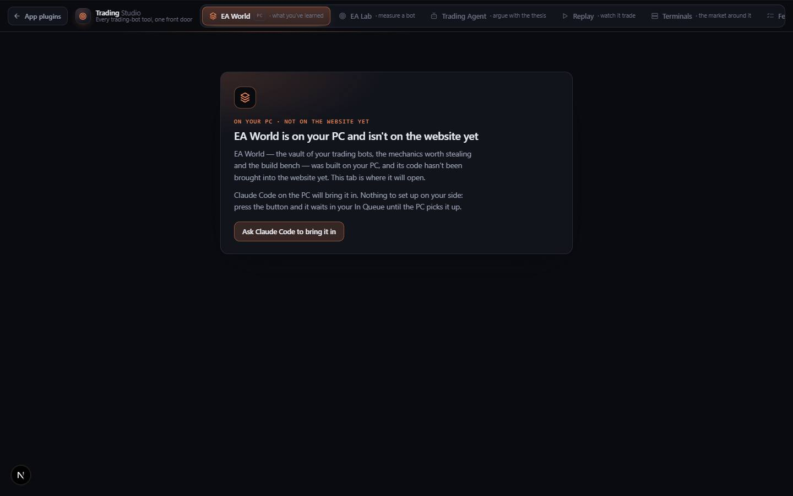

# Expert Advisor World

`/apps/ea-world` · Utilities · live · shows as: section of trading-studio (Trading Studio › EA World, a **pending** section; `MERGED_INTO["ea-world"] = "trading-studio"` in `src/lib/studio/plugins.ts`, so it is not a hub tile or an App plugins card)

> The trading-bot vault

The vault of what the owner has *learned* about trading bots (MetaTrader Expert Advisors): the bots themselves with
readable source, the mechanics worth copying, strategy families filed by how they die, ideas not built yet, and a
build bench that turns any of it into one build prompt. **Its code lives only on the owner's PC and is not in this
repository.** On the website it is a "PC" tab in Trading Studio that explains this and offers one button to ask
Claude Code on the PC to bring it in. Its old Replay and Terminals studios already moved into Trading Studio.

## Features — every one of these must still exist after your change

The owner asked for each of these. Removing, hiding or "simplifying away" one is a regression,
even if the code looked unused. If a change needs one gone, ask first.

**What exists in this repo**

- **EA World tab in Trading Studio** — first tab, label "EA World", hint "what you've learned", icon Layers, accent hue 45, with a small "PC" badge meaning "On your PC — not on the website yet". `src/lib/studio-home/trading.ts` (`world`), `src/components/studio-home/StudioHome.tsx`
- **"On your PC" panel** — title "EA World is on your PC and isn't on the website yet" and two plain paragraphs saying the tab is where it will open and nothing needs setting up. `trading.ts` (`pending.title`, `pending.body`), `StudioHome.tsx` (`PendingSection`)
- **"Ask Claude Code to bring it in" button** — files one In Queue request in folder `app:trading-studio` with the exact wiring instructions; shows Filing… → "In your queue ✓", or says it was already waiting. `trading.ts` (`pending.request`), `StudioHome.tsx`, `src/lib/studio-home/fileRequest.ts`
- **Ready-made wiring line** — the commented-out `world: dynamic(() => import("../ea-world/EaWorld")…)` entry waiting in the section map. `src/components/trading-studio/TradingStudio.tsx`
- **Old address keeps working** — `/apps/ea-world` redirects to `/apps/trading-studio?section=world` from `next.config.mjs` (deliberately not from a page file). `next.config.mjs` (`redirects()`)
- **Former EA World › Replay and › Terminals** — now Trading Studio sections; `/apps/ea-world/replay` and `/apps/ea-world/terminals` redirect there. Full feature list in [trading-studio.md](trading-studio.md). `src/app/apps/ea-world/replay/page.tsx`, `src/app/apps/ea-world/terminals/page.tsx`, `src/components/ea-replay/`
- **HFT Secret EA sources** — `HFT_Secret_Rebuild.mq4` (v1, clean build-600+ rewrite of the pending-stop HFT style; the original `.ex4` is encrypted) and `HFT_Secret_v2.mq4` (v2, 34-SMA high/low wave + HFT, distances in price), served from EA World's public folder; their replay twins are `src/lib/ea-replay/strategies/hftSecret.ts` / `hftSecretV2.ts`. `public/ea-world/experts/`
- **Shared report parser** — the Strategy Tester `.htm` parser EA World is meant to reuse so the two apps never disagree about a report. `src/lib/ea-lab/report.ts`
- **Catalog entry and plugin blurb kept** — the catalog entry stays (merged apps keep theirs) and is kept out of the hub carousel. `src/lib/catalog.ts` (`ea-world`, `UNPREVIEWABLE`), `src/lib/studio/plugins.ts` (description for `ea-world`)

## How it looks

- **Look:** on the website, the Studio home "pending" panel — EA World's own look is on the PC and not recorded here (no `.impeccable` record).
- **Colours / type:** section hue 45 (gold/amber) through `--sh-accent: oklch(0.74 0.15 45)`; catalog hues `[45, 150]`. Replay's playhead colour `#e3bb4f` is labelled "EA World's own hue" in `src/components/ea-replay/replay.css`. Everything else is DESIGN.md (near-black `#0a0b0f` canvas, `#e9ecf3` ink, system sans).
- **Layout:** the pending panel is a single centred card (glyph, small "On your PC · not on the website yet" kicker, title, two paragraphs, button + status line) on laptop and phone alike (`.sh-pending` in `src/components/studio-home/studio-home.css`).
- **Signature pieces (per the catalog, on the PC):** several studios behind one front door — Analyze, Vault, Bench — each with its own accent hue, sharing a palette and a store.
- **Motion:** the shell's hue glide when the tab opens; off under `prefers-reduced-motion`.

## Where the code is

| Part | Path |
|---|---|
| Page | **none on purpose** — `/apps/ea-world` redirects via `next.config.mjs`; `src/app/apps/ea-world/{replay,terminals}/page.tsx` are redirects |
| UI | not in repo (on the PC: `src/components/ea-world/`, mounted as `EaWorld`) · pending panel `src/components/studio-home/StudioHome.tsx` |
| Logic + tests | not in repo (on the PC: `src/lib/ea-world/`, incl. `studios.ts` referenced from `src/lib/bible/rooms.ts`) · section def `src/lib/studio-home/trading.ts` |
| API | none |
| Static files | `public/ea-world/experts/*.mq4` |
| Saved data | none in this repo (catalog says the Vault is "synced to every device"; its key is in the PC code) |

## Owner's rules for this app

- **Never create `src/app/apps/ea-world/page.tsx` from a cloud session.** EA World's code is only on the owner's PC and uncommitted; a file there would collide with it. The redirect lives in `next.config.mjs` for exactly this reason. (Same rule for anything under `src/app/apps/ea-lab/`.)
- Do not try to rebuild EA World from the catalog description. Bringing it in is Claude Code's job **on the PC**: commit `src/components/ea-world`, `src/lib/ea-world`, `src/app/apps/ea-world/page.tsx`, then add the `world:` line in `TradingStudio.tsx` with `embedded` and delete the `pending` field on `world` in `trading.ts`. Remove the `next.config.mjs` redirect only if the page itself becomes a redirect.
- A section is pending or mounted, never both.
- Keep the catalog entry and the `MERGED_INTO` line — deleting the entry is what silently kills a card.
- EA World is where a bot is *understood*; EA Lab is where it is *measured*. Pair them, don't merge them.
- In Queue folder: `app:trading-studio`.

## Described but not found in code

Everything below is described in `src/lib/catalog.ts` (EA World overview) and `src/lib/studio/plugins.ts` (its blurb); the code is only on the owner's PC:

- **Analyze** — drop or paste an EA (straight out of MetaEditor), read in the browser with nothing uploaded: strategy family, a risk score with every tell quoted at its line number, and the mechanics worth copying with code pulled out; `.htm` tester reports parsed by EA Lab's parser; an `.ex4` told plainly nothing can read machine code.
- **Vault — four ledgers** — EAs with source kept as readable text and synced to every device; mechanics worth stealing (overview + smallest working MQL4 incl. stop levels and error codes); strategy families filed by how they die; ideas not built yet with their stage. Every record has "where it came from" and "how it fails", blank failure mode shown in amber.
- **Bench** — draft features, bots and ideas onto it and it compiles one build prompt (governing rules first, risk floor second) and names contradictions (e.g. loss-doubling sizer vs drawdown ceiling) with the reconciling move.
- **Twelve dictated feature specs read live from the EA Feature List** — the Feature List in this repo holds one spec (`src/lib/ea-features/features.ts`).
- **Per-studio accent hues** for Analyze / Vault / Bench.
