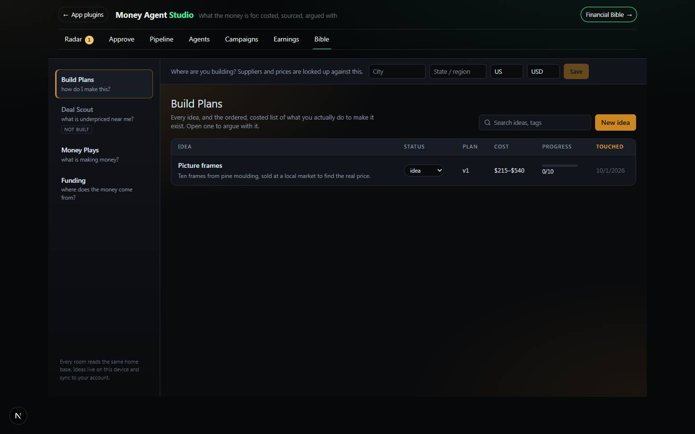

# Financial Bible

`/apps/financial-bible` · Utilities · live · shows as: section of Money Agent Studio (its **Bible** tab — `/apps/financial-bible` redirects to `/apps/money-agent-studio?tab=bible`)

> The book of money plays

Several "rooms" behind one front door for turning money ideas into action. Build Plans turns every
idea into an ordered, costed, sourced build plan you can argue with; Funding is a loan broker's desk
reference built from the owner's 6 Figure Funder course; Money Plays shows what Money Agent Studio's
agents are earning. It is the owner's private tool (kept out of the hub carousel via `UNPREVIEWABLE`
in `src/lib/catalog.ts`).

## Features — every one of these must still exist after your change

The owner asked for each of these. Removing, hiding or "simplifying away" one is a regression,
even if the code looked unused. If a change needs one gone, ask first.

**Shell and rooms**
- **Four rooms on a left rail** — Build Plans, Deal Scout, Money Plays, Funding, each with a one-line hint and its own accent hue. `src/lib/bible/rooms.ts`, `src/components/bible/Bible.tsx`
- **Remembers the last room; `?studio=<room>` opens a named room** — switching rewrites the URL without reloading so unsaved work survives; the old route carries `?studio=` across. `src/components/bible/Bible.tsx`, `src/app/apps/financial-bible/page.tsx`
- **Home base strip** — asked once (city, state/region, country, currency), then a quiet "Home base … · prices in USD" line with Change; never a blocking modal. `src/components/bible/Bible.tsx`
- **Unbuilt rooms say what they will hold** — Deal Scout renders a "Not built yet" panel with its spec blurb. `src/components/bible/rooms/EmptyRoom.tsx`
- **Embedded mode inside Money Agent Studio** — wordmark hidden, room rail kept, loaded on demand behind a skeleton. `src/components/money-agents/MoneyAgentStudio.tsx`, `src/components/bible/Bible.tsx`

**Build Plans — the ideas ledger**
- **Ideas table** — columns Idea, Status, Plan, Cost, Progress, Touched; click a header to sort; pinned ideas (★) always first. `src/components/bible/plans/IdeaTable.tsx`
- **Search ideas and tags.** `src/components/bible/plans/IdeaTable.tsx`
- **Status dropdown on each row** — idea · planning · building · built · parked. `src/components/bible/plans/IdeaTable.tsx`, `src/lib/bible/types.ts`
- **New idea brief** — name, one line, what you are building, how far you are taking it (scale), how much you have done before (skill), tools/space already owned, budget ceiling, where; then "Create and write the plan". `src/components/bible/plans/IdeaTable.tsx`
- **Seeded example idea (picture frames)** — seeds and your own ideas merge by id; edit a seed and your copy wins; delete one and it stays deleted. `src/lib/bible/seed.ts`, `src/lib/bible/store.ts`
- **Pin, Delete (with confirm), Back** on an open idea. `src/components/bible/plans/PlanSheet.tsx`, `src/components/bible/plans/IdeaTable.tsx`

**Build Plans — the plan sheet**
- **AI-written plan** — phases, numbered steps, cost range per step, materials with quantities, who sells them near you, time, and "how you know it is right"; progress line while writing; "Write the plan" if none yet. `src/components/bible/plans/PlanSheet.tsx`, `src/app/api/bible/plan/route.ts`, `src/lib/bible/prompts.ts`
- **Pinned totals header** — Total to build (a range that gently "breathes"), Done, Time, Checked (share of prices verified). `src/components/bible/plans/PlanSheet.tsx`, `src/lib/bible/totals.ts`
- **Tick a step done** — an ink line draws across the row and the total re-counts. `src/components/bible/plans/StepRow.tsx`
- **Edit any price yourself** — low/high inputs; the tag flips to YOURS and nothing will overwrite it. `src/components/bible/plans/StepRow.tsx`, `src/lib/bible/ops.ts`, `src/lib/bible/verify.ts`
- **Your note per step** — "what you actually did, what it really cost, who you spoke to". `src/components/bible/plans/StepRow.tsx`
- **Legal flags as a question + who to ask** — a red thread in the margin that cannot be collapsed; never a legal answer. `src/components/bible/plans/StepRow.tsx`, `src/lib/bible/prompts.ts`
- **Assumed / It needs to know** — the plan's assumptions, and open questions you can click to send to the agent. `src/components/bible/plans/PlanSheet.tsx`
- **First one costs / Sells for** — unit economics block. `src/components/bible/plans/PlanSheet.tsx`
- **Two-currency honesty** — a plan mixing currencies shows "two currencies" instead of a fake total. `src/components/bible/plans/IdeaTable.tsx`, `src/components/bible/plans/PlanSheet.tsx`
- **Versions** — v1, v2… picker; older versions are read-only with "Back to current"; Regenerate keeps the old version. `src/components/bible/plans/PlanSheet.tsx`
- **Price this for real** — a web-reading model (`perplexity/sonar` by default) finds real shops, addresses and prices; checked lines say VERIFIED with the page they came from, the rest stay ESTIMATE. `src/app/api/bible/verify/route.ts`, `src/lib/bible/verify.ts`, `src/components/bible/plans/StepRow.tsx`

**Build Plans — the agent and the gate**
- **Plan agent chat** — "Make it cheaper. Use oak instead. Do I need a permit to sell these?" Answers in words plus an edit. `src/components/bible/plans/Agent.tsx`, `src/app/api/bible/chat/route.ts`
- **Accept / Discard gate** — the edit is previewed; Accept makes a new version (v1 stays readable); Discard throws it away; an edit naming a missing step is shown as dropped, never hidden. `src/components/bible/plans/Agent.tsx`, `src/lib/bible/ops.ts`
- **Beyond the build — nine buttons** — Legal structure, Insurance, Banking, Taxes, Branding, Marketing, Selling online, Hiring, Scaling; each generates nothing until pressed. `src/components/bible/plans/Beyond.tsx`, `src/app/api/bible/extra/route.ts`

**Funding room (6 Figure Funder desk reference)**
- **Seven tabs** — Qualify a client, Lenders (count), Cheat sheets, Plays & sequences, Mistakes, Scripts & docs, Lessons (count). `src/components/bible/funding/FundingRoom.tsx`
- **Search everything** — one box across lenders, cheat sheets, plays, mistakes, sequences, scripts, lessons, "left out"; a hit jumps to and scrolls to the item. `src/components/bible/funding/FundingRoom.tsx`, `src/lib/bible/funding/search.ts`
- **Qualify a client** — type report/bank numbers; one sheet gives a Verdict, Likely business funding (2–3x personal available credit), a Checks list and matching lenders, soft pulls first; saved on this device until cleared. `src/components/bible/funding/QualifyTab.tsx`, `src/lib/bible/funding/qualify.ts`
- **Lenders table (93 lenders)** — filter by lender type, personal/business products, bureau pulled (EX/TU/EQ) and client state; expand a row for products, rules, tips, how to join, pays brokers. `src/components/bible/funding/LendersTab.tsx`, `src/lib/seed-content/financial-bible/lenders.ts`
- **Cheat sheets, Plays & Sequences, Mistakes (mistake / what it costs / do this instead), Left out on purpose, Scripts & Course documents.** `src/components/bible/funding/ReferenceTabs.tsx`, `src/lib/seed-content/financial-bible/playbook.ts`
- **Lesson index (226 lessons)** — filter by course; each marked Captured or Watch. `src/components/bible/funding/ReferenceTabs.tsx`, `src/lib/seed-content/financial-bible/lessons.ts`
- **"Read on" date + bank-rules warning** in the header ("confirm a figure with the bank before you promise it"). `src/components/bible/funding/FundingRoom.tsx`
- **File into Projects Timeline** — adds the knowledge-base entries to the Financial Bible project (additive only, works on local or Supabase backend). `src/lib/bible/funding/fileToTimeline.ts`, `src/lib/seed-content/financial-bible/timeline.ts`

**Money Plays room**
- **Every money agent as a play** — reads Money Agent Studio's board and Personas Studio's views (no copy): totals tiles, then a table Play, Kind, Status, Made, Live, Views, Estimated, Paid; "No plays running yet" when empty; "Open Money Agent Studio ↗" link when not embedded. `src/components/bible/rooms/PlaysRoom.tsx`

**Works with no keys**
- **No AI key = plain sentence, never a 500** — every route says to set `OPENROUTER_API_KEY`; you can still write steps by hand. `src/app/api/bible/plan/route.ts`, `src/app/api/bible/chat/route.ts`, `src/app/api/bible/extra/route.ts`, `src/app/api/bible/verify/route.ts`

## How it looks

- **Look:** "a workshop job sheet on an instrument chassis" — warm paper raised on graphite. Made with `interactive-web-studio` (change log b6ce72f). No WebGL on purpose. Does **not** follow DESIGN.md; all tokens are local to `.bible` in `src/components/bible/bible.css`.
- **Colours / type:** chassis `#0a0b0d` / `#11141a` / `#181c24`, hairline `#262c37`, chrome text `#8b95a5` / `#dfe5ee`; paper `#f6f2ea` / `#efe9dd`, ink `#16150f` / `#4a4639` / `#7d7866`, rule `#ddd5c4`; states ok `#3f7d4e`, warn `#9a6a1c`, thread (red, **reserved for legal and removal only**) `#a8352c`. Accent is a hue per room via `--bible-accent` (Plans 36 amber, Scout 168, Plays 268, Funding 320) → `hsl(hue 85% 58%)`. Font: system sans (`ui-sans-serif, system-ui, -apple-system, "Segoe UI"`) with tabular numerals (`tnum`) everywhere. Funding has extra styles in `src/components/bible/funding/funding.css`.
- **Layout:** laptop — 232px room rail on the left, home-base strip on top, room on the right; an open idea shows the sheet and the agent side by side (stacks under 1180px). Phone (≤860px) — rail becomes a sideways-scrolling row of room buttons, wordmark and hints hidden, step rows reflow. Embedded in Money Agent Studio it runs full-width (`.mas-bible` in `src/components/money-agents/money-agents.css`) and stops claiming the whole viewport.
- **Signature pieces:** the ruled paper sheet with a hole-punch margin line; the sticky pinned totals header; provenance tags (estimate / verified / yours) with a source host as receipt; the red legal thread in the margin; ambient radial glow in the room's hue.
- **Motion:** ink strike across a ticked step (260ms), the cost range "breathing" letter-spacing (6s), ambient glow fades 700ms between rooms, skeleton sweep, working pulse. `prefers-reduced-motion` switches all animation off but keeps the strike line drawn.

## Where the code is

| Part | Path |
|---|---|
| Page | `src/app/apps/financial-bible/page.tsx` (redirect) → `src/app/apps/money-agent-studio/page.tsx` (`?tab=bible&studio=<room>`) |
| UI | `src/components/bible/` (`Bible.tsx` shell, `plans/`, `funding/`, `rooms/`); mounted by `src/components/money-agents/MoneyAgentStudio.tsx` |
| Logic + tests | `src/lib/bible/` (+ `funding/`); knowledge base `src/lib/seed-content/financial-bible/` (lenders, playbook, lessons, timeline; course notes in `notes/`) |
| API | `src/app/api/bible/` — `plan`, `chat`, `extra`, `verify` (OpenRouter; `AI_MODEL`, `BIBLE_VERIFY_MODEL` optional) |
| Saved data | synced key `bible:v1` (ideas, home base, hidden seeds, last room) via `src/lib/sync/appState.ts`; Qualify form in localStorage `financial-bible:funding:client` (device only); Money Plays reads `money-agents:v1` and the Personas board |

## Owner's rules for this app

- It is the **Bible tab of Money Agent Studio** (`MERGED_INTO` `financial-bible → money-agent-studio` in `src/lib/studio/plugins.ts`). Keep its catalog entry and keep `/apps/financial-bible` as a redirect.
- The plan **never** mentions an LLC, insurance, branding or marketing unless one of the nine "Beyond the build" buttons is pressed.
- Anything legal (permits, resale certificates, selling food, electrical/gas, venue rules) is a **question with somebody to ask**, never an answer.
- Nothing the agent proposes touches the plan until **Accept**; Accept makes a new version and old versions stay readable.
- A price you typed (YOURS) is never overwritten by the agent or by Price this for real. Unchecked prices must keep saying ESTIMATE.
- Money Plays keeps no copy of earnings — it reads Money Agent Studio's board; the two apps' data flows in, never duplicated.
- Banks change rules: Funding figures carry the "read on" date and the warning to confirm with the bank.

## Described but not found in code

- **Deal Scout** (Marketplace/OfferUp/Craigslist resale finder) — described in `src/lib/bible/rooms.ts` and the catalog overview; declared `built: false`, only the "Not built yet" panel exists.
- **Money Plays "not built yet"** — the catalog overview says Deal Scout and Money Plays both admit they are not built; Money Plays is in fact built (`src/components/bible/rooms/PlaysRoom.tsx`), so that part of the catalog text is stale.
