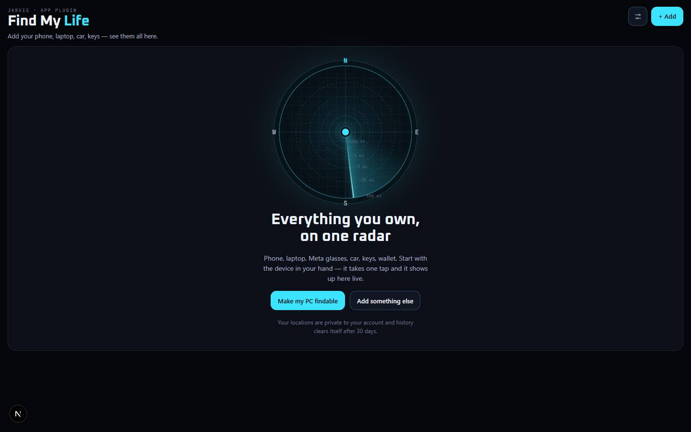

# Find My Life

`/apps/find-my-life` · AI · live · shows as: Dashboard widget (Jarvis › Dashboard, widget id `findmy`) + the "Find" step in Jarvis onboarding; also opens on its own page

> Every device and thing you own, on one radar

Your phone, laptop, Meta glasses, car, keys and wallet in one place, on a live radar with you in the middle (or on a
dark street map), with a dense list of how fresh each location is, battery and distance. Apple Find My and Google
Find Hub have no API, so each thing gets the best way of being found that really works, picked automatically.

## Features — every one of these must still exist after your change

The owner asked for each of these. Removing, hiding or "simplifying away" one is a regression,
even if the code looked unused. If a change needs one gone, ask first.

**Seeing everything**
- **Life Radar** — you in the middle, each thing as a blip at its true bearing and log-scaled distance (rings 100 ft · ¼ mi · 2 mi · 25 mi · 500 mi); the sweep lights each blip via a bearing-derived delay; tap the dish to refresh; tap a blip to pick it. `src/components/find-my-life/Radar.tsx`
- **Compass mode** — the dish turns with the phone so blips point at the real things (shortest-way unwrap). `src/components/find-my-life/FindMyLifeApp.tsx`, `Radar.tsx`
- **Radar / Map switch** — dark Leaflet map (CARTO dark tiles over OpenStreetMap), pins in freshness colours, you as a cyan dot. `src/components/find-my-life/FmlMap.tsx`
- **Center on me** — asks for location only when tapped; the radar centres on you, else your phone, else anything located. `src/components/find-my-life/FindMyLifeApp.tsx`, `src/lib/find-my-life/useFindMyLife.ts`
- **Freshness legend** — Live · Last hour · Today · Older · Lost. `src/components/find-my-life/FindMyLifeApp.tsx`, `src/lib/find-my-life/engine.ts` (`freshness`)
- **At-a-glance stats** — tracked, located, live now, low battery, lost. `src/components/find-my-life/FindMyLifeApp.tsx`
- **Dense list** with search ("Search N things"), "This" and "Lost" chips, where/ago/battery/distance per row; lost things sort first. `src/components/find-my-life/FindMyLifeApp.tsx`, `src/lib/find-my-life/engine.ts` (`sortDevices`)
- **Places** — name the spots you go most (save where you are), so it says "At Home" instead of an address; remove them. `src/components/find-my-life/FindMyLifeApp.tsx`, `src/lib/find-my-life/engine.ts` (`placeFor`)
- **Street addresses** from Nominatim, best effort (3 s, cached). `src/lib/find-my-life/server/geocode.ts`
- **Updates by itself** — polls every 15 s; "x min ago" stays true without a refresh. `src/lib/find-my-life/useFindMyLife.ts`

**One thing up close (detail panel)**
- **Where in words, how fresh, how far and which way, battery** (`From you`, `Seen`, `Battery`). `src/components/find-my-life/DeviceDetail.tsx`
- **Directions** (Apple Maps on iPhone, Google Maps elsewhere), **Ring it**, **Open Find My / its tag app**, **It's here with me** (pin where you are), **Mark lost / Found it** (lost shows first everywhere, with a Lost Mode tip), **Rename**, **Remove**. `src/components/find-my-life/DeviceDetail.tsx`
- **Recent sightings, newest first** — history kept 30 days. `src/components/find-my-life/DeviceDetail.tsx`, `src/lib/find-my-life/engine.ts` (`KEEP_DAYS`)
- **The ladder of ways we find it**, each rung set up in place with its status — no instructions elsewhere. `src/components/find-my-life/DeviceDetail.tsx`, `src/lib/find-my-life/kinds.ts`

**Ways a thing gets found (`SourceKind` ladder per kind)**
- **`self`** — "Make this device findable": a browser with Jarvis open reports itself (at most once a minute, sooner if it moved) and answers **Ring** with a full-screen alarm ("Someone pressed Ring on…", **Found it — stop**). `src/lib/find-my-life/useFindMyLife.ts`, `src/components/find-my-life/FindMyLifeApp.tsx` (`Ringing`)
- **`shortcut`** — iPhone Shortcut automation (Charger disconnected, Leave/Arrive, Time of Day) GETs `/api/find-my-life/ping?k=&d=&lat=&lng=&b=`; step-by-step with the private link. `src/app/api/find-my-life/ping/route.ts`, `DeviceDetail.tsx`
- **`car`** — Smartcar API v3: sign in with your car-maker login on Smartcar's screen; live location, fuel/charge, locks, refresh, disconnect. `src/lib/find-my-life/server/smartcar.ts`, `src/app/api/find-my-life/car/connect/route.ts` → `car/callback/route.ts`
- **`disconnect`** — Shortcut on Bluetooth / CarPlay disconnect drops a last-seen pin (`&e=disconnect|parked`); you enter the Bluetooth name. `src/app/api/find-my-life/ping/route.ts`, `DeviceDetail.tsx` (`device.bt`)
- **`tag-link`** — pick the tag brand (AirTag, Tile, SmartTag, Google Find Hub tag, Chipolo, none); open its app; paste an AirTag **Share Item Location** link (Apple keeps it 7 days). `src/lib/find-my-life/kinds.ts` (`TAGS`), `DeviceDetail.tsx`
- **`manual`** — pin anything by hand. `DeviceDetail.tsx`, `src/app/api/find-my-life/route.ts` (`fix.manual`)

**Adding things**
- **Add sheet** — "This device" in one tap, or pick a kind (Phone, Laptop, Tablet, Watch, Earbuds, Smart glasses, Car, Keys, Wallet, Bag, Bike, Pet, Something else), name it, pick a tag. `src/components/find-my-life/FindMyLifeApp.tsx`, `src/lib/find-my-life/kinds.ts`
- **Empty state** — "Everything you own, on one radar", start with the device in your hand. `src/components/find-my-life/FindMyLifeApp.tsx`

**Setup sheet** (gear button: places, car, privacy)
- This device · Places · Cars (connect / refresh / disconnect; car messages in plain English) · **New key** (old Shortcut links stop working) · Privacy: **delete every device and all history**. `src/components/find-my-life/FindMyLifeApp.tsx`

**Other homes**
- **Dashboard widget** — mini radar + the five things that matter most (lost first, then freshest); tap for the full app in the widget sheet (`embedded`); keeps this browser reporting and answering Ring while the Dashboard is open. `src/components/find-my-life/FindMyLifeWidget.tsx`, mounted in `src/components/new-jarvis/Deck.tsx`
- **Onboarding "Find" step** — make this device findable in one tap, then add other things one tap each. `src/components/find-my-life/FindMyLifeOnboard.tsx`, mounted in `src/components/new-jarvis/Onboarding.tsx`

## How it looks

- **Look:** interactive-web-studio "Life Radar" in Jarvis's HUD language. Does **not** use DESIGN.md's tokens; own `--fml-*` set.
- **Colours / type:** canvas `#05060a`, panels `#0c0f17` / `#121623` / `#181d2c`, lines `rgb(120 220 255 / .12–.24)`, ink `#eef3fb` / `#a3adc2` / `#6c7790`, HUD cyan `#3be3ff`. Freshness: live `#5be38f`, recent `#3be3ff`, today `#ffb547`, old `#7d879c`, lost `#ff4b3e`. Sweep period `--fml-sweep: 4.2s`. Fonts: Oxanium + JetBrains Mono (`--font-nj-display` / `--font-nj-mono`, loaded in `page.tsx`).
- **Layout:** phone — one column (radar/map, then list, detail opens up close). ≥960px — two columns (stage | sticky side with list + detail). ≥1280px — three columns: radar | list | the picked thing, and the detail is never empty (first thing auto-picked). Sheets are bottom sheets on phone.
- **Signature pieces:** the radar dish with sweep and blips, the dark map, kind glyphs (`KindIcon.tsx`), the source ladder.
- **Motion:** sweep spin, blip flare/ping, breathe, ring alarm, sheet rise/fade; transform/opacity only; stops under `prefers-reduced-motion`.

## Where the code is

| Part | Path |
|---|---|
| Page | `src/app/apps/find-my-life/page.tsx` |
| UI | `src/components/find-my-life/` (`FindMyLifeApp.tsx`, `DeviceDetail.tsx`, `Radar.tsx`, `FmlMap.tsx`, `KindIcon.tsx`, `FindMyLifeWidget.tsx`, `FindMyLifeOnboard.tsx`, `find-my-life.css`) |
| Logic + tests | `src/lib/find-my-life/` (`engine.ts` + `engine.test.ts`, `kinds.ts`, `useFindMyLife.ts`, `server/store.ts`, `server/smartcar.ts`, `server/geocode.ts`, `server/run.ts`) |
| API | `src/app/api/find-my-life/route.ts` (device.*, fix.*, place.*, car.*, key.rotate, all.delete) · `ping/route.ts` · `car/connect/route.ts` · `car/callback/route.ts` |
| Saved data | server_docs `.find-my-life.<uid>.json` (devices, history, places) · `.find-my-life-keys.json` (ping key → account) · `.find-my-life-car.<uid>.json` (Smartcar tokens, server only, never sent to the browser); no migration |

## Owner's rules for this app

- Widget only (owner's call, Nov 2026): **no App plugins card and no hub tile.** The slug stays in `WIDGET_SLUGS` in `src/lib/studio/plugins.ts` (dropping it would bring the hub tile back). Route, APIs and onboarding sheet stay.
- Apple Find My / Google Find Hub have **no API** — never pretend to read them; use the source ladder.
- `/api/find-my-life/ping` is session-exempt in `src/middleware.ts` with a per-account key. Car keys: `SMARTCAR_CLIENT_ID`, `SMARTCAR_CLIENT_SECRET`, `SMARTCAR_APPLICATION_ID` (optional `SMARTCAR_MODE=simulated`), set up in Jarvis › Profile › Connections › Cars.
- Locations are private: the browser never reads the table; it never asks for location on its own; history clears after 30 days; works with no keys. In `UNPREVIEWABLE` in `src/lib/catalog.ts`.

## Described but not found in code

- "App plugins card `/apps/find-my-life`" (the old CLAUDE.md "Where things live" row) — removed on purpose 2026-11-02 (commit f0f7bcb); now widget-only.
