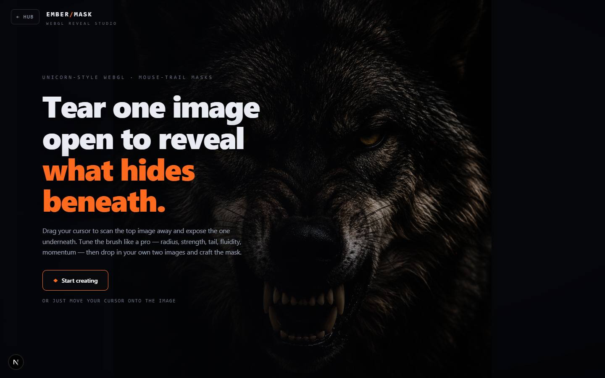

# EMBER Reveal

`/apps/fire-reveal` · Image · live · shows as: section of App Builder › Website Redesigner › Showcase (`MERGED_INTO` → `website-redesigner` → `app-builder`; played there in a frame)

> WebGL image reveal

A WebGL mouse-trail image-reveal studio with a custom GLSL shader, in the style of Unicorn Studio's
scanning effect. Two pixel-aligned images are stacked in one shader; moving the cursor paints a
trail that scans the top image away to reveal the hidden one underneath, with a thin chromatic-split
band at the edge. The trail holds for a beat after you stop, then eases closed. You can upload your
own two images, pick a reveal type and tune the brush live. It is now a reference piece in
Website Redesigner's Showcase.

## Features — every one of these must still exist after your change

The owner asked for each of these. Removing, hiding or "simplifying away" one is a regression,
even if the code looked unused. If a change needs one gone, ask first.

- **Mouse-trail reveal** — moving the pointer over the stage paints a persistent trail that reveals the hidden image, with chromatic split at the boundary; the trail fades after you stop. `src/components/reveal/RevealPlane.tsx`, `src/shaders/trailReveal.ts`, `src/components/reveal/FireRevealStudio.tsx`
- **Click to flash** — a click (or the panel's "⚡ Flash reveal" button) fires a burst reveal. `FireRevealStudio.tsx` (`flash`, `burstRequest`)
- **Intro screen** — "Tear one image open to reveal what hides beneath.", a lede, a **Start creating** button; it also dismisses the moment you move onto the image. `FireRevealStudio.tsx`
- **Six reveal types, each with its own accent** — Trail `#ff6a1f`, Liquid `#5fe6ff`, Ripple `#4a90ff`, Glitch `#ff36c8`, Pixel `#7dff45`, Bulge `#a56bff`; the accent recolours the headline, buttons, sliders and brand slash. `src/shaders/trailReveal.ts` (`MODES`), `FireRevealStudio.tsx` (`ControlPanel`)
- **Nine brush sliders (0–100%)** — Radius, Strength, Hardness, Tail, Fluidity, Dissipation, Chromatic ab., Momentum, Scale, each with a hover hint. `trailReveal.ts` (`PARAM_META`), `FireRevealStudio.tsx` (`ParamSlider`)
- **Reset** — puts every slider back to its default. `FireRevealStudio.tsx`
- **Layers toolbar: upload your own images** — "↑ Base" and "↑ Hidden" file pickers (any image), plus **Demo wolf** to restore the bundled pair. `FireRevealStudio.tsx` (`UploadButton`), `public/reveal/demo-base.png`, `public/reveal/demo-reveal.png`
- **Safe placeholders** — if an image fails to load, a generated "BASE" / "HIDDEN" gradient stands in. `FireRevealStudio.tsx` (`makePlaceholder`)
- **On-stage hint** — "move to reveal · click to flash · drag to carve". `FireRevealStudio.tsx`
- **Reduced motion / no WebGL fallback** — a flat drag-to-reveal crossfade with a slider, and a note saying which case applies; reacts live if the reduced-motion setting changes. `FireRevealStudio.tsx` (`FlatFallback`)
- **Back link "← Hub"** and the **EMBER/MASK · WebGL Reveal Studio** wordmark. `FireRevealStudio.tsx`
- **Listed in Website Redesigner › Showcase** (view `?v=showcase`) — plays in place on the PlayShelf (poster note "WebGL — move the pointer over it once it loads"), "Open full screen", and **Use this idea** opens App Builder › Build with the idea box prefilled ("Build an app like EMBER Reveal: WebGL image reveal"). `src/lib/studio-home/builder.ts` (`SHOWCASE`, hue 22), `src/components/redesigner/Showcase.tsx`

## How it looks

- **Look:** a dark full-bleed "reveal studio" with film vignette and grain; styles are inline objects in `FireRevealStudio.tsx`. No design-skill record found.
- **Colours / type:** stage `#05060a`; panels `rgba(12,14,20,0.86)` with `var(--color-line)` borders; text from hub tokens (`--color-ink`, `--color-ink-muted`, `--color-ink-faint`); the one accent comes from the selected reveal type (Trail orange `#ff6a1f` by default; the fallback slider is always `#ff6a1f`). Headline 800 weight, `clamp(34px, 5.4vw, 72px)`, system sans; labels, hints and the wordmark in `ui-monospace`, uppercase, wide letter-spacing.
- **Layout:** full screen. Wordmark top-left, control panel a fixed 280 px column on the right (from 88 px down to 18 px from the bottom), Layers toolbar bottom-left, hint bottom-centre. There is no separate phone layout — the same panel overlays the image on a narrow screen.
- **Signature pieces:** the trail mask with chromatic rim, the "Reveal" control panel with 2-column type chips and accent-coloured sliders, the intro hero that blurs away.
- **Motion:** shader trail with persistence and eased close; intro fades up and blurs out on first move. Reduced motion swaps the live shader for the static crossfade.

## Where the code is

| Part | Path |
|---|---|
| Page | `src/app/apps/fire-reveal/page.tsx` + `FireRevealClient.tsx` (client-only) |
| UI | `src/components/reveal/` (`FireRevealStudio.tsx`, `RevealPlane.tsx`) |
| Logic + tests | `src/shaders/trailReveal.ts` (shader, `MODES`, `PARAM_META`, `DEFAULT_PARAMS`) — there is no `src/lib/reveal/`; no tests |
| API | none |
| Saved data | none — uploaded images stay in the browser tab (object URLs), settings reset on reload |

## Owner's rules for this app

- It is a **Showcase piece** in App Builder › Website Redesigner, not a tile of its own; the route is kept only so it can be played in place there and opened full screen.
- Keep the reduced-motion and no-WebGL fallback (drag-to-reveal crossfade).

## Described but not found in code

- **Rim tints "Ember, Inferno, Frost, Toxic"** — named in the catalog overview (`src/lib/catalog.ts`, `fire-reveal`); the code has six reveal types instead (Trail, Liquid, Ripple, Glitch, Pixel, Bulge) in `src/shaders/trailReveal.ts`.
