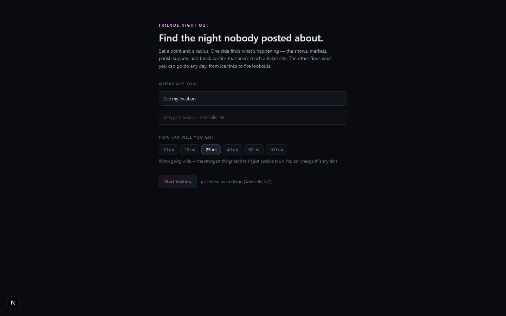

# Friends Night Out

`/apps/friends-night-out` · Apps · live · shows as: hub tile

> Find the night nobody posted about

An event finder built around the events nobody hears about. You set a point on the map and a radius, and it shows two things at once. One is what's happening (concerts, festivals, church gatherings, markets, block parties). The other is what you can go do any day (ice rinks, climbing walls, stables, kayak launches, drive-ins). Its "obscurity score" puts the single-source local find above the stadium tour everyone already posted about. It works with no API keys and saves on your device, synced to your account.

## Features — every one of these must still exist after your change

The owner asked for each of these. Removing, hiding or "simplifying away" one is a regression,
even if the code looked unused. If a change needs one gone, ask first.

**Setup and header**

- **First-run setup** — "Use my location" (browser) or "type a town" (OpenStreetMap Nominatim, debounced to 1 request/s), radius 10/15/25/40/60/100 mi (default 25), or try a demo. `src/components/friends-night-out/Onboarding.tsx`, `src/lib/friends-night-out/geo.ts`, `src/app/api/fno/geocode/route.ts`
- **Demo mode** — invented listings with an amber "Demo data — these listings are invented. Set your real location" bar. `src/lib/friends-night-out/seed.ts`, `src/components/friends-night-out/FriendsNightOut.tsx`
- **Location + radius control in the header** — tap the place name to set it again; radius dropdown re-runs both searches. `RadiusControl` in `src/components/friends-night-out/FriendsNightOut.tsx`
- **Four tabs** — Upcoming, Always On, Date Night, Inbox. `TABS` in `src/components/friends-night-out/FriendsNightOut.tsx`
- **Instant board from cache, refreshed behind it** — last results show at once, then both searches re-run. `src/components/friends-night-out/FriendsNightOut.tsx`, `cacheEvents`/`cachePlaces` in `src/lib/friends-night-out/store.ts`

**Upcoming (dated events)**

- **Merged multi-source search** — Ticketmaster, community RSS / iCal / JSON-LD calendars, followed organizers, your watchlist and a verified AI web sweep run in parallel. One source failing never fails the search. `src/app/api/fno/search/route.ts`, `src/lib/friends-night-out/sources/ticketmaster.ts`, `src/lib/friends-night-out/sources/feeds.ts`, `src/lib/friends-night-out/sources/organizers.ts`, `src/lib/friends-night-out/sources/aiSweep.ts`
- **Obscurity score and confidence** — results from every source are merged, de-duplicated and scored. A recurring series discounts obscurity, and confidence is a gate, not a multiplier. `src/lib/friends-night-out/normalize.ts`
- **Sort "For you" (default) or "Hidden gems"** — For you filters on confidence first, then ranks by obscurity. `src/components/friends-night-out/UpcomingView.tsx`, `sortEvents` in `src/lib/friends-night-out/normalize.ts`
- **Filters** — price (Any / Free / Paid / Donation / Unlisted), room size (Under 100, 100–500, 500–2,000, 2,000+), kind of event, hidden gems only, and one venue. `src/components/friends-night-out/UpcomingView.tsx`, `VENUE_SIZE_LABELS` in `src/lib/friends-night-out/types.ts`
- **Grouped by time** — This weekend, Next 7 days, This month. Times are read in the viewer's time zone. `src/components/friends-night-out/UpcomingView.tsx`, `src/lib/friends-night-out/time.ts`
- **Event card** — "◈ Hidden gem" badge with its obscurity score, ★ watchlist match, series chip ("N dates found"), colour-coded price chip, link to the source, "See everything else at this venue", "I'm in" / "Going", and Save. `src/components/friends-night-out/EventCard.tsx`, `src/components/friends-night-out/chips.tsx`
- **Honest price colours** — Free (green), Paid (amber), Donation (violet), "Price not listed" (grey). An unknown price is never guessed. `TIER_STYLE` in `src/components/friends-night-out/chips.tsx`

**Always On (standing and seasonal places)**

- **Keyless places board** — OpenStreetMap places through Overpass (requests spread across mirrors, retried), plus a Wikipedia "hook line" per place. Works with no setup. `src/app/api/fno/places/route.ts`, `src/lib/friends-night-out/sources/overpass.ts`, `src/lib/friends-night-out/sources/wikipedia.ts`, `src/lib/friends-night-out/categories.ts`
- **Sorted by obscurity, not distance** — distance is a filter here, not the sort order. `src/components/friends-night-out/AlwaysOnView.tsx`
- **"✦ Surprise me"** — hands you one place in a "Go here" panel. `src/components/friends-night-out/AlwaysOnView.tsx`
- **Filters** — category (Everything / …), vibe (Free & Weird, Big View, Only One Near You, Locally Owned, …), "Open this season", "No chains". `src/components/friends-night-out/AlwaysOnView.tsx`, `src/components/friends-night-out/chips.tsx`
- **Place card** — hook line, chain chip, "nearby" (other finds within a mile), dismiss ("Stop showing me this", remembered), Save, link out. `src/components/friends-night-out/PlaceCard.tsx`, `dismissPlace` in `src/lib/friends-night-out/store.ts`

**Date Night**

- **Whole evenings, composed** — each plan pairs an activity, an event and a food stop, with a cost range ("treat this as a floor" when a price isn't published; food estimated at $20–45 a head). If nothing clears the bar, it says so instead of padding the list. `src/components/friends-night-out/DateNightView.tsx`, `src/lib/friends-night-out/dateNight.ts`
- **"↻ Another three" / "start over" / "Save this evening"**. `src/components/friends-night-out/DateNightView.tsx`, `savePlan` in `src/lib/friends-night-out/store.ts`

**Inbox (things you found yourself)**

- **Paste a link → event** — Instagram, Facebook or any page is read into a form you check before adding. A date is required, and nothing is added automatically. `src/components/friends-night-out/InboxView.tsx`, `src/app/api/fno/extract/route.ts`, `src/lib/friends-night-out/sources/social.ts`
- **Photograph a flyer → event** — an image is read by a vision model into the same form. `src/components/friends-night-out/InboxView.tsx`, `extractFromImage` in `src/lib/friends-night-out/sources/social.ts`
- **Follow the organizer behind a link** — "That link belongs to X. Follow them" prompt, plus a "Following" list with unfollow. `src/components/friends-night-out/InboxView.tsx`, `src/lib/friends-night-out/sources/organizers.ts`
- **Inbox events show in Upcoming straight away**. `allEvents` in `src/components/friends-night-out/FriendsNightOut.tsx`

**Sources panel**

- **Source status** — a "Sources n/m" button opens a side panel with each source's ok/error state and reason. `src/components/friends-night-out/SourcesPanel.tsx`
- **Community calendars** — "Find calendars near me" (discovery, accept each one), "Or paste an RSS / iCal URL", plus turn on/off and remove. `src/components/friends-night-out/SourcesPanel.tsx`, `src/app/api/fno/discover/route.ts`, `src/lib/friends-night-out/sources/discover.ts`
- **Watchlist** — artists, venues and promoters you follow get flagged on matching events. `src/components/friends-night-out/SourcesPanel.tsx`, `addWatch` in `src/lib/friends-night-out/store.ts`
- **AI sweep on/off**. `src/components/friends-night-out/SourcesPanel.tsx`

**Accounts and AI spend**

- **AI only for signed-in visitors** — the AI sweep, the link/flyer reader and place rating need a hub sign-in when Supabase is configured. Local mode keeps AI. `src/lib/friends-night-out/aiAccess.ts`
- **Follows you across devices** — saved events, places, plans, feeds and preferences sync to your account. The cached results are left out of the sync. `src/lib/friends-night-out/store.ts` (`KEY = "friends-night-out:v1"`, `pushRemote`), `useRemotePull` in `src/components/friends-night-out/FriendsNightOut.tsx`

**Server-only: any-city places catalog (no screen uses it yet)**

- **Any-city builder** — streams progress, reuses a city area that already covers the point, uses perplexity/sonar web discovery (`FNO_DISCOVERY_MODEL`) for food, gems, parks, kids and fun, and checks every find against a named OSM element in the radius. `src/app/api/fno/areas/build/route.ts`, `src/lib/friends-night-out/catalog/build.ts`, `src/lib/friends-night-out/catalog/verify.ts`, `src/lib/friends-night-out/areas.ts`
- **Sections + blended AI/community stars** — sections Parks and outside / Fun / Unique gems / Kids / Food. AI stars are rated in rounds, and out-of-credit (402) is detected. `src/lib/friends-night-out/sections.ts`, `src/lib/friends-night-out/stars.ts`, `src/lib/friends-night-out/catalog/rubric.ts`, `src/lib/friends-night-out/catalog/ai.ts`, `src/app/api/fno/areas/[id]/rate/route.ts`, `src/app/api/fno/areas/[id]/places/route.ts`

## How it looks

- **Look:** dark DESIGN.md canvas, but written as hard-coded hex values in inline styles and Tailwind arbitrary classes rather than tokens. No design skill is recorded for it.
- **Colours / type:** background `#0a0b0f`, text `#e9ecf3`, muted `#6b7385` / `#7c839a` / `#5b6478`, panels `#101219` with borders `#20242f` / `#1a1e26`, active tab `#1a1e28`. Its own accent is a pink→sky gradient (`rgba(236,72,153)` → `rgba(56,189,248)`, text `#f0abfc` / `#f9a8d4`) for Hidden gem, Surprise me and Another three. Price chips: free `#6ee7b7`, paid `#fcd34d`, donation `#c4b5fd`, unknown `#94a3b8`. The demo bar is amber `#d4a15e` on `#161208`. It uses the system sans font (no mono or serif).
- **Layout:** sticky blurred header (← OS · title · location|radius · Sources n/m) with a scrolling tab row. Main area is max-w-6xl. On a laptop: content plus a 320px Sources panel when it is open (`lg:grid-cols-[1fr_320px]`). On a phone: one column, with the tabs scrolling sideways.
- **Signature pieces:** the glowing "◈ Hidden gem" badge (`GemBadge` in `chips.tsx`), colour-edged price chips, the Surprise-me "Go here" panel, Date Night evening cards.
- **Motion:** minimal. Colour transitions and `animate-pulse` loading skeletons. There is no custom reduced-motion handling (nothing large moves).

## Where the code is

| Part | Path |
|---|---|
| Page | `src/app/apps/friends-night-out/page.tsx` |
| UI | `src/components/friends-night-out/` |
| Logic + tests | `src/lib/friends-night-out/` (`sources/`, `catalog/`) |
| API | `src/app/api/fno/` (`search`, `places`, `discover`, `extract`, `geocode`, `areas/build`, `areas/[id]/places`, `areas/[id]/rate`) |
| Saved data | synced key `friends-night-out:v1` (localStorage + app_state, via `src/lib/friends-night-out/store.ts`); Supabase tables `fno_areas`, `fno_places` for the any-city catalog (`supabase/migrations/20260919000000_fno_social.sql`). Optional env: `TICKETMASTER_API_KEY`, `EVENTBRITE_TOKEN`, `AI_MODEL`, `FNO_DISCOVERY_MODEL` |

## Owner's rules for this app

- Hidden gems come first. Obscurity outranks popularity, but "For you" first filters on confidence so the top of the list is both obscure and believable.
- An unknown price stays an honest grey "Price not listed". Never guess it.
- It must be usable with **no API keys at all**: location, places and the demo are all keyless.
- Never scrape Instagram, TikTok or Facebook. The app accepts what the user pastes or photographs instead.
- Nothing from a link or flyer is added without the user confirming the form.
- Anonymous visitors must not spend the owner's AI credit (`aiAccess.ts`).
- Map checks that fail are retried and reported as failures, never as "couldn't be confirmed".
- When adding or renaming a places section, change `sections.ts` AND the `fno_places` check constraint. A test keeps them in step.

## Described but not found in code

- A screen for the any-city builder, the Explore places sections and the blended AI + community stars (change log 2026-09-19: "Any-city builder…", "Sections, blended AI + community stars, shared city area reuse"). The API routes and logic exist, but no component calls `/api/fno/areas/*`, and there is no "Explore" tab or star rating anywhere in `src/components/friends-night-out/`.
