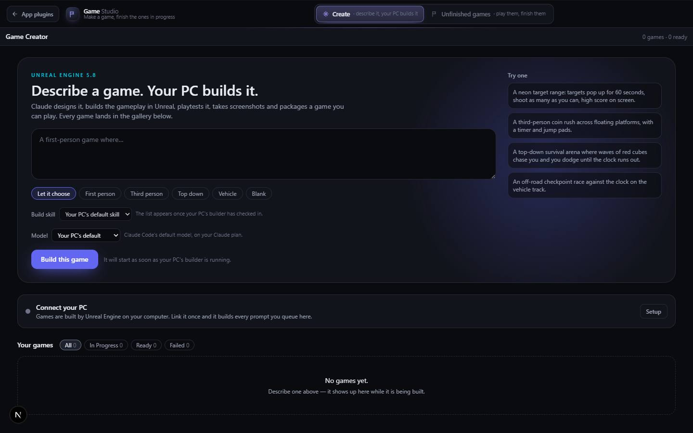

# Game Creator

`/apps/game-creator` · Apps · live · shows as: section of Game Studio (Create) — `/apps/game-creator` redirects to `/apps/game-studio?section=create`; game pages stay at `/apps/game-creator/<id>`

> Describe a game → Unreal Engine builds it

Type an idea for a video game and Unreal Engine 5.8 on the owner's own PC builds it. A builder
program on the PC picks up each prompt and runs Claude Code with the `unreal-game-builder` skill:
it writes a one-page design, creates a Blueprint project from the right engine template, builds the
gameplay through Epic's in-editor MCP tools, playtests it, takes screenshots from the player's eye
and packages a Windows game. Every game lands in a gallery that updates live while it is built;
a finished game opens in Unreal or launches to play on the PC that built it.

## Features — every one of these must still exist after your change

The owner asked for each of these. Removing, hiding or "simplifying away" one is a regression,
even if the code looked unused. If a change needs one gone, ask first.

**Make a game** (`src/components/game-creator/GameCreator.tsx`)

- **Prompt box** — "Describe a game. Your PC builds it."; Ctrl/⌘+Enter submits; 8–4,000 characters. `GameCreator.tsx`, `src/app/api/game-creator/games/route.ts`
- **Template chips** — Let it choose · First person · Third person · Top down · Vehicle · Blank, each with a hover blurb (visible label is the accessible name). `src/lib/game-creator/types.ts` (`TEMPLATES`)
- **"Try one" example prompts** — four ideas that fill the box. `GameCreator.tsx` (`EXAMPLES`)
- **Build skill drop-down** — lists every skill on the PC tagged `game-creator: true` (one marked default); exactly one skill builds each game. `GameCreator.tsx`, `tools/unreal-builder/lib/skills.mjs`
- **Model drop-down, per game** — "Your PC's default", Claude on the owner's plan (Opus 5, Fable 5.1, Sonnet 5, Haiku 4.5) or OpenRouter LLMs (GPT-5.6 Sol, Gemini 3.1 Pro, Grok 4.6, Kimi K2.7 Code, GLM 5.3, DeepSeek V4 Pro). OpenRouter ones are disabled until the PC reports a key; the server also refuses them. Choice remembered in localStorage `gc-model`. `types.ts` (`BUILD_MODELS`), `GameCreator.tsx`, `games/route.ts`
- **Queue line** — "Your PC is ready to build" / "N in the queue — your PC builds one at a time" / "It will start as soon as your PC's builder is running". `GameCreator.tsx`
- **AI problem strip** — shows the hub AI switchboard's errors that concern the game builder. `src/components/hub/AiPanel.tsx` (`AiProblemStrip only="builder"`)

**Connect your PC** (`src/components/game-creator/BuilderSetup.tsx`)

- **Builder status** — green dot "Your PC is connected" + last check-in, amber "builder is offline", grey "Connect your PC". `BuilderSetup.tsx`
- **3-step setup** — (1) Create / Replace token (shown once; a new one disconnects the old builder), (2) `.env` lines `HUB_URL` + `BUILDER_TOKEN` for `tools\unreal-builder\.env`, (3) start command — each with Copy. `BuilderSetup.tsx`, `src/app/api/game-creator/builder-token/route.ts`

**Gallery**

- **Live gallery, newest first** — polls every 5 s while anything builds, every 20 s otherwise. `GameCreator.tsx`
- **Filters** — All · In progress · Ready · Failed, with counts; header shows "N games · N ready". `GameCreator.tsx`
- **Game card** — first screenshot (zooms on hover) or an animated "forge" placeholder; status pill; 5-segment stage bar (designing → packaging); "N shots"; current note or genre; time ago. `GameCard.tsx`, `StatusPill.tsx`
- **Status names** — Waiting for your PC · Designing · Building in Unreal · Playtesting · Packaging · Ready to play · Build failed. `types.ts` (`STATUS_LABEL`)

**One game's page** (`/apps/game-creator/<id>`, `src/components/game-creator/GamePage.tsx`)

- **Screenshots** — big hero shot, thumbnail strip, full-screen viewer with captions, n/N, ←/→ and Esc. `GamePage.tsx`
- **Tabs** — Chat with the agent (default) · About · Design · Build log (N). `GamePage.tsx`
- **Chat with the build agent** — your messages interleaved with the agent's narration; each shows "the agent has it" / "waiting for your PC". During a build they join the running Claude session; on a finished game "Send and rebuild" starts a follow-up that resumes the same session on the same project. Enter sends, Shift+Enter new line, 2,000 chars max. `GamePage.tsx`, `src/app/api/game-creator/games/[id]/route.ts`, `tools/unreal-builder/builder.mjs`
- **About** — the prompt, summary, "Built" list, "Left out" list with reasons, and "Why the build stopped" for failures. `GamePage.tsx`
- **Design** — the skill's Design.md rendered as markdown. `GamePage.tsx`
- **Build log** — timestamped monospace log, auto-scrolls, last 500 lines kept. `GamePage.tsx`, `types.ts` (`MAX_LOG_LINES`)
- **Side card** — title, genre · template, queued time, Model, Skill with "loaded" (green) / "not confirmed" (amber). `GamePage.tsx`
- **Play on my PC / Open in Unreal Engine** — posts a request the builder picks up on its next check-in (~4 s) and opens itself; status line shows sent/picked up; "Try the direct link" (`ueos://play|open?id=`) stays as a fallback. `GamePage.tsx`, `tools/unreal-builder/open.mjs`, `install.mjs`
- **Try building again** on a failed game. `GamePage.tsx`
- **Controls** list and **On your PC** paths (Game .exe, Project .uproject) with Copy. `GamePage.tsx`
- **Remove from gallery** — confirms; the Unreal project on the PC is never deleted; returns to Game Studio › Create. `GamePage.tsx`
- **Live refresh** — every 4 s while building, every 3 s while a Play/Open is pending. `GamePage.tsx`

**On the PC** (`tools/`, not deployed)

- **Builder daemon** — claims queued games (checks in every 4 s), runs `claude -p` with the chosen skill and model, streams narration, design, screenshots and the `game.json` manifest back, one game at a time, 240-minute limit; warns in the log if the skill was not loaded. `tools/unreal-builder/builder.mjs`, `lib/env.mjs`, `lib/watch.mjs`
- **OpenRouter routing + fallback** — the hub AI panel can send every build through OpenRouter, and when the Claude plan hits a limit the builder retries the same session through OpenRouter (if `builderFallback` is on and a key exists). `builder.mjs`, `src/lib/ai/settings.ts`
- **Unreal bridge MCP** — creates UE 5.8 Blueprint projects from engine templates (incl. ArenaShooter and SurvivalHorror variants, shooter AI left out so packaging works), launches the editor with Epic's MCP server and proxies its tools, real in-game screenshots, Poly Haven model/surface import, content-only Windows packaging, watchdog for the engine's hanging SDK check. `tools/unreal-bridge/server.mjs`, `lib/templates.mjs`, `lib/assets.mjs`, `lib/gameshot.mjs`, `lib/sdkcheck.mjs`
- **The skill** — design → project → Blueprint build → playtest → package → report, with a realism guide for gritty/AAA games. Backup copy in `skills/unreal-game-builder/` (`SKILL.md`, `references/realism.md`)

## How it looks

- **Look:** DESIGN.md "instrument panel" unchanged, plus a glowing hero card; no design-skill record found.
- **Colours / type:** hub tokens via Tailwind (`bg-panel`, `border-line`, `text-ink*`, `bg-brand` indigo buttons, `text-accent` cyan eyebrow "UNREAL ENGINE 5.8", `bg-core` green Play button). Status pills: brand for designing/building, accent for testing/packaging, core for ready, red for failed. System sans; mono for log and paths.
- **Layout:** laptop — hero splits prompt (left) and "Try one" column (320 px right); gallery 4 columns at xl, 3 lg, 2 sm, 1 phone. Game page: main column + 380 px sticky side card (`lg`); on a phone the side card drops below.
- **Signature pieces:** `.gc-hero__glow` radial brand glow; the **forge** placeholder — perspective grid floor scrolling toward you with a cyan scan line (red tint when failed, grey and still when queued) in `game-creator.css`.
- **Motion:** forge grid 3.2 s loop, scan 2.6 s; cards lift on hover; active status dots pulse. Reduced motion stops the forge animations.

## Where the code is

| Part | Path |
|---|---|
| Page | `src/app/apps/game-creator/page.tsx` (redirect) · `src/app/apps/game-creator/[id]/page.tsx` |
| UI | `src/components/game-creator/` |
| Logic + tests | `src/lib/game-creator/` (`types.ts`, `reducer.ts` + `reducer.test.ts`, `store.ts`, `http.ts`) |
| API | `src/app/api/game-creator/` — `games`, `games/[id]`, `shots/[id]/[n]`, `builder-token`, `builder/{claim,progress,screenshot,messages,fail}` (token-auth, session-exempt in `src/middleware.ts`) |
| Saved data | one `server_docs` row `game-creator` (all owners' games, hashed builder tokens, last-seen, PC skill lists; local `.data` / `GAME_CREATOR_DATA_DIR` fallback) · Storage bucket `game-shots` |
| PC helpers | `tools/unreal-builder/`, `tools/unreal-bridge/`, skill backup `skills/unreal-game-builder/` |

## Owner's rules for this app

- The website never touches Unreal — it only keeps the record; the PC does the work.
- Exactly **one** game-building skill per game (the owner's pick if the PC has it, else the PC's default).
- Deleting a game on the site never deletes the Unreal project on the PC.
- PC builder `.env` keys: `HUB_URL`, `BUILDER_TOKEN`, optional `BUILDER_MODEL`, `OPENROUTER_API_KEY`, `BUILDER_SKILL_DIRS`, `BUILDER_DEFAULT_SKILL`, `BUILDER_POLL_MS`, `BUILDER_MAX_MINUTES`, `GC_PROJECTS_ROOT`.
- The setup panel's start command still names the old folder `C:\Users\honey\OneDrive\Desktop\claude code files` (`BuilderSetup.tsx` `REPO`); the repo moved to `C:\Users\honey\Projects\ultimate-assistant-os` on 2026-10-13.

## Described but not found in code

- None found.
