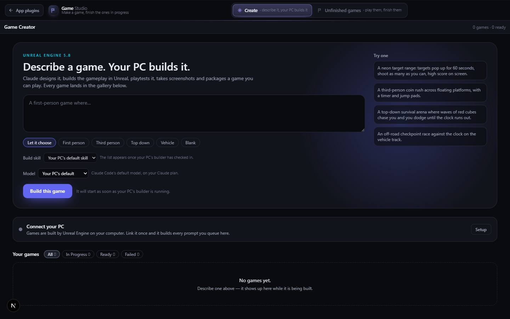

# Game Studio

`/apps/game-studio` · Apps · live · shows as: a panel on Jarvis › Studio tab (the slug is in `PLUGIN_SLUGS`, but the Studio wall in `src/lib/studio-home/panels.ts` is its door, so it gets no App plugins card and no hub tile)

> Make a game, finish the ones in progress

Every game in one place, behind one front door. **Create** is Game Creator: describe a game and
Unreal Engine on the owner's PC designs, builds, playtests, screenshots and packages it. **Unfinished
games** is a shelf of games that already play but are not done (Slippery Escape and Item Storm
Arena today) — each playable right in the list, with a **Finish it** button that hands the rest of
the work to Claude Code through the owner's In Queue.

## Features — every one of these must still exist after your change

The owner asked for each of these. Removing, hiding or "simplifying away" one is a regression,
even if the code looked unused. If a change needs one gone, ask first.

**The shell**

- **Two sections: Create · Unfinished games** — a switcher bar with the brand "Game *Studio*", tagline and a Flag icon; Create hint "describe it, your PC builds it", Unfinished hint "play them, finish them". `src/components/game-studio/GameStudio.tsx`, `src/lib/studio-home/games.ts` (`GAME_SECTIONS`)
- **Lit sliding pane + colour glide** — the selected section's pane slides between buttons and the whole home's accent hue glides to that section's own (Create 285 violet, Unfinished 32 amber). `src/components/studio-home/StudioHome.tsx`, `src/components/studio-home/studio-home.css`
- **Opens where you left off** — the last section is remembered on this device (localStorage `game-studio:section`); `?section=create` / `?section=unfinished` opens one directly and the address updates without a reload when you switch. `StudioHome.tsx`, `src/app/apps/game-studio/page.tsx`
- **Keyboard switching** — ←/→ cycle sections, Home/End jump to first/last. `StudioHome.tsx` + `stepSection` in `src/lib/studio-home/sections.ts`
- **Back link "App plugins"** to `/apps/jarvis#plugins`. `StudioHome.tsx` (default `back`)
- **Loading skeletons** while a section's code loads (grid shape for Create). `GameStudio.tsx` (`HomeSkeleton`)
- **Studio wall panel** — Game Studio is drawn on Jarvis › Studio with its two sections as spines. `src/lib/studio-home/panels.ts` (`PANELS`)

**Create**

- **Game Creator mounted `embedded`** — the full app (prompt, templates, skill + model pickers, PC setup, live gallery); embedded drops its own Hub link and stops its count row sticking under the studio bar. Full feature list: [game-creator.md](game-creator.md). `src/components/game-creator/GameCreator.tsx`
- **Old route redirects in** — `/apps/game-creator` → `/apps/game-studio?section=create`; each game's page stays at `/apps/game-creator/<id>` and its back link "Games" returns to Create. `src/app/apps/game-creator/page.tsx`, `src/components/game-creator/GamePage.tsx`

**Unfinished games**

- **Dense database-style table** — columns Game · Still missing · Plays with, a coloured dot per row, header "Unfinished games", lede, and a "2 in progress" count. `src/components/game-studio/UnfinishedGames.tsx`, `src/components/studio-home/PlayShelf.tsx`
- **Play it here** — the selected game plays inside a frame beside the table. Only one runs at a time and nothing loads until you press Play (row button or the big poster); 3D games show "3D — runs best on a computer with a real graphics card". `PlayShelf.tsx`, `UnfinishedGames.tsx` (`posterNote`)
- **Stop** — unloads the running game. `PlayShelf.tsx`
- **Open full screen** — opens the game's own route in a new tab. `PlayShelf.tsx`
- **"Still missing" chips** under the frame, one per missing piece. `PlayShelf.tsx`, `games.ts` (`missing`)
- **Finish it** — files one request in In Queue folder `app:game-studio` (same API App Builder's Build it and Jarvis's queue_build use); the text names the route, lists what is missing, asks for phone + reduced-motion support and for the game to be removed from the list when done (capped at 3,900 chars). Button shows "Working…", then "Queued ✓"; a duplicate shows "already waiting"; a failure shows a plain-English error. `games.ts` (`finishRequest`), `src/lib/studio-home/fileRequest.ts`, `UnfinishedGames.tsx`
- **Slippery Escape** — first-person physics escape; missing: touch controls, more than one room, sound, win screen + best-time board; plays with WASD + mouse. Route `/apps/slippery-escape` (frame-only), code `src/components/slippery/`, `src/lib/slippery/`. `games.ts` (`UNFINISHED_GAMES`)
- **Item Storm Arena** — gravity playground; missing: a goal and an end, touch play, sound, saved best score. See [item-storm-arena.md](item-storm-arena.md). `games.ts`
- **Titles/tags/overviews come from the catalog** so the shelf never drifts from `catalog.ts`. `games.ts` (`fromCatalog`)

## How it looks

- **Look:** the shared "studio home" chrome (generalised from Jarvis Audio Studio), driven by `interactive-web-studio` — dark, dense, restrained; the switcher is the one signature moment.
- **Colours / type:** DESIGN.md tokens re-scoped as `--sh-*` (canvas `#0a0b0f`, panel `#12141c`, panel-2 `#181b25`, line `#262a38`, ink `#e9ecf3` / `#9aa3b5` / `#6b7385`). The only accent is a **hue**, `oklch(0.74 0.15 var(--sh-hue))`, set per section; shelf rows use their own `--ps-hue` (Slippery 196, Item Storm 168). Mono (`--font-mono`) for counts and column heads. System sans otherwise.
- **Layout:** laptop ≥1100 px — table left, play stage right (1 : 1.25 columns). Phone ≤760 px — table header hidden, each row stacks name / missing / controls / buttons; stage drops below. Switcher wraps under the brand below 900 px; tagline hidden below 560 px.
- **Signature pieces:** sliding lit switcher pane with a hairline glow under it; the PlayShelf (table + framed stage + poster "Play … here" button + chips).
- **Motion:** `--sh-hue` glides 520 ms; pane slides; row hover tints. `prefers-reduced-motion` removes the transitions (`studio-home.css`, `play-shelf.css`).

## Where the code is

| Part | Path |
|---|---|
| Page | `src/app/apps/game-studio/page.tsx` |
| UI | `src/components/game-studio/` (shell + Unfinished) · shared chrome `src/components/studio-home/` (`StudioHome.tsx`, `PlayShelf.tsx`) · Create = `src/components/game-creator/` |
| Logic + tests | `src/lib/studio-home/games.ts`, `sections.ts` (+ `sections.test.ts`), `fileRequest.ts`, `panels.ts` · `src/lib/game-creator/` |
| API | none of its own — Finish it posts to `/api/new-jarvis/requests`; Create uses `src/app/api/game-creator/` |
| Saved data | localStorage `game-studio:section`; In Queue rows in folder `app:game-studio`; Create's data is in [game-creator.md](game-creator.md) |

## Owner's rules for this app

- One home per kind of thing: Game Creator, Slippery Escape and Item Storm Arena are merged here (`MERGED_INTO` in `src/lib/studio/plugins.ts`) — they keep catalog entries and routes but get no tile of their own.
- **Finishing a game = removing it from `UNFINISHED_GAMES`** in `src/lib/studio-home/games.ts`.
- Unfinished games play in place, **one at a time, nothing runs until asked** — two WebGL scenes must never fight for the GPU, and opening the list must never spin one up.
- Old routes stay alive: `/apps/slippery-escape` and `/apps/item-storm-arena` exist so the shelf can frame them.

## Described but not found in code

- None found.
