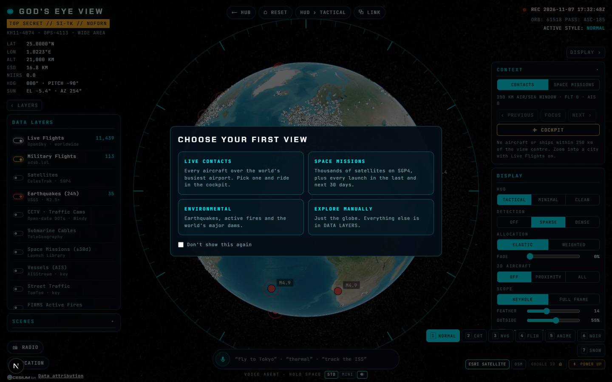

# God's Eye View

`/apps/gods-eye-view` · Apps · live · shows as: App plugins card (Jarvis › App plugins; it is in `PLUGIN_SLUGS` in `src/lib/studio/plugins.ts`, so it is **not** a hub tile)

> A spy-satellite view of the real, live planet

A 3D globe in the browser dressed up as a spy-satellite console, showing real live data: planes, military
flights, satellites, earthquakes, ships, fires and about 24,000 public traffic cameras. The owner uses it
to look at anywhere on Earth and to grab a real location shot (a camera feed or a satellite view) for
video work. It is a port of the open-source project bilawalsidhu/gods-eye-view (MIT licence).

## Features — every one of these must still exist after your change

The owner asked for each of these. Removing, hiding or "simplifying away" one is a regression,
even if the code looked unused. If a change needs one gone, ask first.

**The globe and the console**

- **Boot screen** — "ESTABLISHING UPLINK" while the globe loads; "UPLINK FAILED" with a Back to hub button if it can't. `src/app/apps/gods-eye-view/GodsEyeClient.tsx`, `src/components/gods-eye/GodsEyeView.tsx`
- **3D globe (CesiumJS)** — Cesium is loaded from the jsDelivr CDN, never bundled. `src/lib/gods-eye/cesium.ts`, `src/lib/gods-eye/globe.ts`
- **Three map sources** — ESRI SATELLITE (works with no key), OSM, and GOOGLE 3D photorealistic cities. `src/components/gods-eye/GodsEyeView.tsx` (`MAP_SOURCES`), `src/lib/gods-eye/globe.ts`
- **POWER UP key box** — paste a Cesium ion token or Google Maps key (saved in this browser) to unlock 3D cities; shows "CONFIGURED EXTERNALLY" when the env var is set. `src/components/gods-eye/GodsEyeView.tsx`
- **Keyhole scope** — round scope mask with tick ring; switch KEYHOLE / FULL FRAME, sliders for FEATHER and OUTSIDE darkness. `GodsEyeView.tsx`, `gods-eye.module.css` (`.scope`, `.scopeRing`)
- **Tactical HUD** — classification banner, LAT / LON / ALT, estimated GSD and NIIRS, heading and pitch, sun elevation, ORB/PASS stamp and a red REC UTC clock. `GodsEyeView.tsx`, `src/lib/gods-eye/geo.ts`
- **HUD modes** — tactical → minimal → clean (hidden, for clean recordings), cycled with the HUD button or the H key. `GodsEyeView.tsx`, `src/lib/gods-eye/commands.ts` (`HudMode`)
- **Detection boxes** — box labels drawn on contacts, off / sparse / dense, with a DENSITY slider, ELASTIC vs WEIGHTED label sharing, and a FADE slider. `GodsEyeView.tsx`, `src/lib/gods-eye/globe.ts` (`setDetection`)
- **Seven sensor looks** — NORMAL, CRT, NVG (night vision), FLIR thermal (IRONBOW or WHITE-HOT), ANIME, NOIR, SNOW, on keys 1–7; GLSL shaders from the original. `src/lib/gods-eye/shaders.ts` (`STYLES`)
- **Display switches** — DAY / NIGHT lighting, ORBIT DRIFT (auto-rotate), CELESTIAL (real sun, moon, stars). `GodsEyeView.tsx`, `globe.ts` (`setCelestial`)
- **3D aircraft models** — swap aircraft icons for a 3D plane model: off / proximity / all (capped). `globe.ts` (`setModelMode`, `AIRCRAFT_MODEL_URL`)
- **Location presets + place search** — LOCATION tray with Austin, San Francisco, New York, London, Tokyo, Dubai, Paris, Sydney… plus a search box (Photon / OpenStreetMap). `src/lib/gods-eye/commands.ts` (`LOCATIONS`), `src/lib/gods-eye/feeds.ts` (`search`)
- **First-view picker** — on first visit choose LIVE CONTACTS, SPACE MISSIONS, ENVIRONMENTAL or EXPLORE MANUALLY, with "don't show again". `GodsEyeView.tsx` (`chooseFirstView`)
- **Share a view as a link** — ⧉ LINK copies a URL whose hash holds the camera, sensor look, layers and map source; opening it restores the view. `GodsEyeView.tsx` (`readHash`)
- **RESET and ⟵ HUB buttons** — reset flies back to the whole Earth (also the R key). `GodsEyeView.tsx`
- **Collapsible side panels** — LAYERS panel on the left, DISPLAY panel on the right. `GodsEyeView.tsx`

**Live data layers** (left panel, each with its source, colour dot and live / stale / error status)

- **Live Flights** — OpenSky, with adsb.lol near you when OpenSky is throttled; planes glide between updates by dead reckoning. `src/lib/gods-eye/feeds.ts`, `globe.ts`
- **Military Flights** — from adsb.lol. `feeds.ts`
- **Satellites** — thousands of CelesTrak orbits, moved in the browser with SGP4 (satellite.js pinned to v6). `feeds.ts`, `globe.ts`
- **Earthquakes (24 h)** — USGS. `feeds.ts`
- **CCTV · Traffic Cams** — ~24,000 official keyless cameras from 23 open-data networks (TfL, fifteen 511 DOT sites, NYC DOT, Caltrans, DriveBC, Digitraffic, NZTA, Hong Kong, Singapore), loaded one network per request to fit Vercel's size limit; plus up to 200 Windy webcams when `WINDY_WEBCAMS_API_KEY` is set. Streaming cameras are drawn cyan, stills green. `src/lib/gods-eye/cameras.ts`
- **Submarine Cables** — TeleGeography map. `feeds.ts`
- **Space Missions (±30 days)** — Launch Library. `src/lib/gods-eye/extra-feeds.ts`
- **Vessels (AIS)** — needs `AISSTREAM_API_KEY`. `extra-feeds.ts`
- **Street Traffic** — TomTom flow tiles, needs `TOMTOM_API_KEY` (kept server-side by a tile proxy). `src/app/api/gods-eye/traffic/[z]/[x]/[y]/route.ts`
- **FIRMS Active Fires** — NASA, needs `NASA_FIRMS_MAP_KEY`. `extra-feeds.ts`
- **Datacenters and Dams** — static snapshots in `public/gods-eye/datacenters.json` and `dams.json`, rebuilt by `scripts/gods-eye-snapshot.mjs`. `globe.ts`
- **Caching feed proxy** — every feed goes through one server route with its own TTL and serves its last good copy when the source fails. `src/app/api/gods-eye/[feed]/route.ts`, `src/lib/gods-eye/cache.ts`

**Lock on, track and fly**

- **Click anything to lock on** — selection card with telemetry fields, a fading trail for moving targets, and orbit lines for satellites; TRACK / RELEASE / FOCUS. `GodsEyeView.tsx`, `globe.ts`
- **Hover preview** — hovering a contact shows a small card (with a camera's picture). `GodsEyeView.tsx` (`hoverCard`)
- **Cockpit (first person)** — ride any live aircraft: compass tape, horizon, ground speed, heading, altitude, vertical speed, nearby traffic, PREV / NEXT / EXIT COCKPIT. `GodsEyeView.tsx` (cockpit block), `globe.ts` (`CockpitInfo`)
- **CONTEXT card** — CONTACTS tab (aircraft and ships within 250 km, previous / focus / next / cockpit) and SPACE MISSIONS tab (upcoming soonest first). `GodsEyeView.tsx`
- **SCENES** — capture shots (view + look + layers), load, delete, START plays them in order, EXPORT / IMPORT as a file. `GodsEyeView.tsx` (`readShots`, `exportShots`, `importShots`)

**Traffic cameras**

- **Live camera card** — tag reads LIVE VIDEO, LIVE CLIP or STILL (amber dot); HLS streams play with hls.js; stills poll every second and only swap when a genuinely new frame arrives, reporting the agency's real publish gap. `src/components/gods-eye/LiveCam.tsx`
- **Enlarge** — click a still to open a big centred viewer with a red close X (Esc closes); the small card pauses so a camera streams once. `GodsEyeView.tsx`, `LiveCam.tsx`
- **PREV / NEXT / AUTO HOP** — move between nearby cameras, or hop automatically. `GodsEyeView.tsx`, `globe.ts` (`cycleCamera`)
- **VIDEO ONLY + NEAREST LIVE VIDEO** — only visit streaming cameras (search out to 400 km); the button probes the closest streams and flies to the first that answers. `GodsEyeView.tsx`, `globe.ts` (`cycleCamera`, nearest-stream probe)

**Talk to it**

- **Typed commands** — "fly to Tokyo", "thermal", "turn on satellites", "track the ISS", "reset globe" work offline through a local parser. `src/lib/gods-eye/commands.ts` (`parseCommand`, tested in `commands.test.ts`)
- **Voice agent (hold Space)** — browser speech-to-text, then a tool-calling Claude turn on the server (STD = Claude Sonnet 5, MINI = Claude Haiku 4.5) that can fly, switch layers / looks / HUD / detection, track, cockpit, mark a place, orbit, draw a real road / foot / bike route and fly it, and drive the radio; replies are spoken aloud (toggle) and shown in a transcript with NEW. Falls back to local commands when there is no AI key. `src/lib/gods-eye/agent.ts`, `src/app/api/gods-eye/agent/route.ts`, `GodsEyeView.tsx` (`askAgent`, `speak`)
- **Radio scanner** — NOAA Weather Radio, police / fire / EMS / ATC scanner feeds and local stations near the view, with volume, prev / pause / next / stop and a live level meter. `src/components/gods-eye/RadioDeck.tsx`, `src/lib/gods-eye/radio.ts`
- **Keyboard** — 1–7 sensor looks, H HUD, R reset, hold Space to talk, Esc closes the enlarged camera. `GodsEyeView.tsx`

## How it looks

- **Look:** "spy-satellite console" — a full-screen globe behind a keyhole scope with a tactical HUD, taken from the original project's design. No hub design skill is recorded for it; there is no `.impeccable/surfaces` file for it.
- **Colours / type:** own palette on `.root` in `src/components/gods-eye/gods-eye.module.css`, ignoring DESIGN.md's tokens: background `#050811`, ink `#d8f6ff`, dim `#7aa3b3`, cyan `#00f0ff` (lines and accents), amber `#ffb020`, red `#ff3b3b`, green `#39ff88`, glass panels `rgba(4,12,22,0.72)`, cyan hairlines `rgba(0,240,255,0.28)`. Each data layer has its own colour (`LAYERS` in `globe.ts`). Fonts: **Chakra Petch** (titles) and **JetBrains Mono** (everything else) via `next/font`, 11px uppercase text with wide letter-spacing.
- **Layout:** laptop — globe fills the screen; brand + HUD readout top-left, controls top-centre, LAYERS panel left, DISPLAY / CONTEXT panel right, a dock along the bottom with location presets, the command / voice bar, sensor looks and map sources. Phone (≤860px) — top-right block hidden, side panels narrower and pushed down, dock stacks to one column, voice label hidden, street-traffic readout hidden, scope slightly smaller.
- **Signature pieces:** the keyhole scope ring, scan-line overlay, "TOP SECRET // SI-TK // NOFORN" banner, blinking red REC dot, detection boxes on a canvas over the globe, the cockpit instrument row, the enlarged camera viewer with a red X.
- **Motion:** boot bar sweep, REC blink, pulse and toast-in animations, camera viewer pop-in, ORBIT DRIFT auto-rotation, aircraft dead-reckoning glide. There is **no reduced-motion fallback** in this app's CSS or code.

## Where the code is

| Part | Path |
|---|---|
| Page | `src/app/apps/gods-eye-view/page.tsx` + `GodsEyeClient.tsx` (client-only dynamic import, no SSR) |
| UI | `src/components/gods-eye/` (`GodsEyeView.tsx`, `LiveCam.tsx`, `RadioDeck.tsx`, `gods-eye.module.css`) |
| Logic + tests | `src/lib/gods-eye/` (`globe.ts` engine, `shaders.ts`, `feeds.ts`, `extra-feeds.ts`, `cameras.ts`, `radio.ts`, `agent.ts`, `commands.ts` + test, `geo.ts` + test, `cache.ts`, `cesium.ts`, `types.ts`) |
| API | `src/app/api/gods-eye/[feed]/route.ts` (flights, military, satellites, quakes, cameras, webcams, launches, fires, vessels, radio, cables, search), `agent/route.ts`, `traffic/[z]/[x]/[y]/route.ts` |
| Saved data | This browser only (localStorage): `gods-eye-view.keys`, `gods-eye-view.scenes`, `gods-eye-view.first-view-dismissed`, `gods-eye-view.agent`. Views live in the URL hash. Server keeps feed caches in memory and camera lists in `tmpdir/gods-eye-view/cameras-v3`. No Supabase. |

## Owner's rules for this app

- Must work with no keys: Esri imagery and the keyless layers are the default; key-gated layers say which env var they need (`NASA_FIRMS_MAP_KEY`, `AISSTREAM_API_KEY`, `TOMTOM_API_KEY`, `WINDY_WEBCAMS_API_KEY`, `NEXT_PUBLIC_CESIUM_ION_TOKEN`, `NEXT_PUBLIC_GOOGLE_MAPS_KEY`).
- Cameras: never label a still as LIVE — say LIVE VIDEO, LIVE CLIP or STILL. Stream URLs are limited to hosts verified to serve a public, CORS-enabled playlist.
- Load camera networks one per request — one combined response broke Vercel's 4.5 MB limit and left the layer empty in production.
- Keep satellite.js pinned to v6 (v7's WASM will not bundle) and keep Cesium and hls.js on the CDN.
- Only https radio streams (browsers block http audio on the https hub).
- Datacenters and dams are snapshots; regenerate with `node scripts/gods-eye-snapshot.mjs`, never query them live.
- AI calls go through the hub provider (`src/lib/ai/provider.ts`), never a hard-coded gateway.

## Described but not found in code

- None found. (The catalog says "~25,000" cameras; the code and change log say about 24,000 from 23 networks plus optional Windy webcams.)
