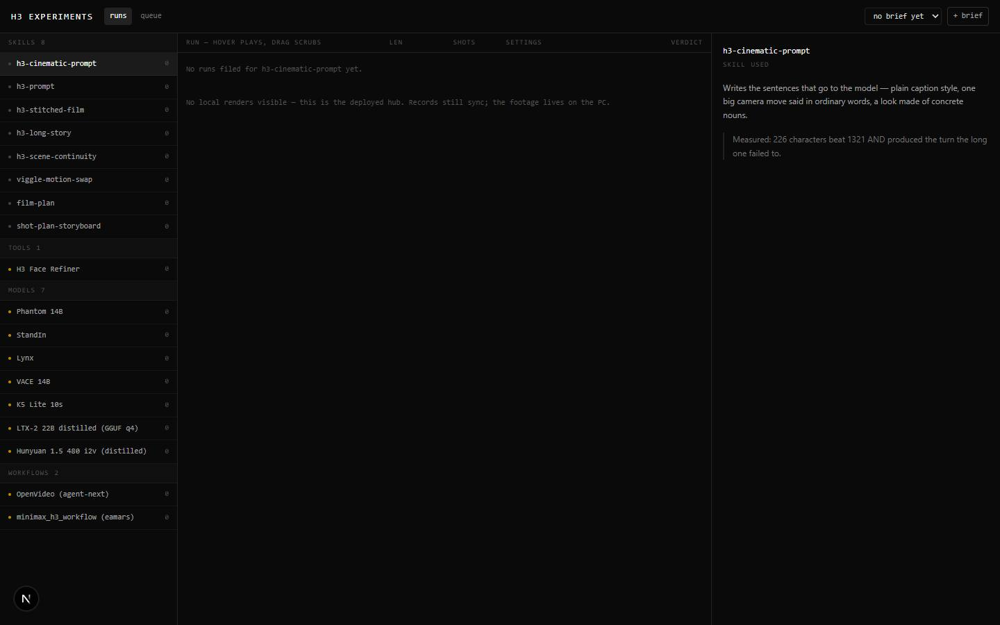

# H3 Experiments

`/apps/h3-experiments` · Video · live · shows as: hub tile (it is in none of `PLUGIN_SLUGS`, `TOOLBOX_SLUGS`, `WIDGET_SLUGS` or `MERGED_INTO` in `src/lib/studio/plugins.ts`; not in `UNPREVIEWABLE`, so the hub carousel runs it live on its panel)

> Which skill actually makes a good film

A lab notebook for AI video. Every way the owner has of making or fixing a film (a prompting skill, a
model, a post-process tool, an outside workflow) is a folder; the same short story ("brief") is given
to each, and every film that comes back is filed, watched, rated and tagged with what went wrong. It
exists because films were being made with different methods and nobody recorded which method made
which, so the same lessons kept being re-learned.

## Features — every one of these must still exist after your change

The owner asked for each of these. Removing, hiding or "simplifying away" one is a regression,
even if the code looked unused. If a change needs one gone, ask first.

- **A folder per method, grouped by kind** — left list grouped Skills · Tools · Models · Workflows with a count per group; 18 seeded methods (the five h3-* prompting skills, viggle-motion-swap, film-plan, shot-plan-storyboard, H3 Face Refiner, Phantom 14B, StandIn, Lynx, VACE 14B, K5 Lite, LTX-2, Hunyuan 1.5, OpenVideo, minimax_h3_workflow). `src/lib/h3-lab/methods.ts` (`SEED_METHODS`, `KIND_ORDER`), `src/components/h3-lab/H3Lab.tsx`
- **"Untried" mark** — an amber dot on any method that has never produced footage, so unused tools stand out. `src/lib/h3-lab/methods.ts` (`status`), `H3Lab.tsx`
- **Score per method** — each row shows good count (green), bad count (red) and total runs. `src/lib/h3-lab/types.ts` (`skillScore`), `H3Lab.tsx`
- **Live skill descriptions** — for the skill-type methods, the description is read from that skill's `SKILL.md` on disk (`~/.claude/skills` or repo `skills/`), so editing a skill updates it here. `src/app/api/h3-lab/skills/route.ts`
- **Method dossier** — right pane shows the method's name, kind, used / untried status, description, the owner's note, its source link (repo URL or WanGP model id) and the current brief's story. `H3Lab.tsx`
- **Briefs (the controlled variable)** — "+ brief" asks for a title and the story in plain words; a dropdown in the header switches the current brief. `H3Lab.tsx` (`addBrief`), `src/lib/h3-lab/types.ts` (`Brief`)
- **Runs list, one dense row per film** — skill, length, shot count, settings and a verdict dot; newest first. `src/components/h3-lab/ScrubRow.tsx`, `types.ts` (`runsForSkill`)
- **Hover plays, drag scrubs** — hovering a row plays the film faintly behind the text; the row's width is the timeline, so moving or dragging across it scrubs; a white scrub line follows the pointer. The video only loads on first hover. `ScrubRow.tsx`
- **File a film from disk** — "on disk, unfiled" lists finished renders no run has claimed yet; one click files it under the selected method and brief. `H3Lab.tsx` (`claim`), `src/app/api/h3-lab/films/route.ts`
- **Run record** — full video player with controls, editable length and shots, "settings that actually applied", notes ("what was actually wrong or right"), and "remove this record". `H3Lab.tsx` (dossier, `patch`)
- **Verdict** — good / mixed / bad (green / amber / red), tap again to clear. `H3Lab.tsx` (`VERDICTS`)
- **Defect tags from a fixed list** — identity drift, style break, dead shot, locked landing, wrong direction, prop never acted, creature off-model, no threat, bad join, flat pacing. `H3Lab.tsx` (`DEFECTS`)
- **Defects counted per method** — "its defects, counted" tally in the dossier, so one bad film becomes a pattern. `types.ts` (`defectTally`), `H3Lab.tsx`
- **Queue view** — lists every method × brief pair that has never been rendered, with a count badge on the tab; "skip" waves one off; clicking a method jumps to its runs. `types.ts` (`openGaps`, `gapId`), `H3Lab.tsx`
- **Works on the deployed site as a ledger** — when the render folder isn't there (Vercel), it says "No local renders visible — this is the deployed hub" and records still sync. `films/route.ts`, `H3Lab.tsx`
- **Streams films with seeking** — the films route serves byte ranges (206) so scrubbing works, and only reads `.mp4/.webm/.mov` files inside the render folder (blocks `..` paths). `src/app/api/h3-lab/films/route.ts` (`resolveInside`)
- **Syncs between devices** — briefs, runs and skipped gaps save under one synced key. `H3Lab.tsx` (`saveSynced`, `useRemotePull`), `src/lib/sync/appState.ts`

## How it looks

- **Look:** dense "lab ledger" — three panes of monospace rows, no cards. No design skill or `.impeccable/surfaces` record is stored for it; it does not use the DESIGN.md tokens.
- **Colours / type:** plain Tailwind classes in `H3Lab.tsx` / `ScrubRow.tsx`: page `#0a0a0b`, text `neutral-300` (headings `neutral-100`, labels `neutral-600`), hairlines `white/10` and `white/5`, selected row `white/[0.07]`. Status colours: emerald-400 good, amber-400 mixed / untried / queue badge, rose-500 bad and defect tags. Type is the system monospace (`font-mono`) at 10–13px; small uppercase wide-tracked section labels.
- **Layout:** laptop — header (title, runs / queue tabs, brief picker, + brief), then skills list on the left (w-48 → w-64 on wide screens), runs or queue in the middle, dossier on the right (20rem → 26rem). Phone — the dossier pane is hidden below the `md` breakpoint (`hidden md:block`), so only the skills list and runs show; there is no phone-specific layout.
- **Signature pieces:** `ScrubRow` — the row that is also the film, with the faded video behind the text and the scrub line; the amber "untried" dots; the queue count badge.
- **Motion:** only colour / opacity transitions and the hover video. Reduced motion: rows never autoplay — you get a still frame you can still scrub (`ScrubRow.tsx`).

## Where the code is

| Part | Path |
|---|---|
| Page | `src/app/apps/h3-experiments/page.tsx` (renders `H3Lab`) |
| UI | `src/components/h3-lab/` (`H3Lab.tsx`, `ScrubRow.tsx`) — the folder is named `h3-lab`, not the slug |
| Logic + tests | `src/lib/h3-lab/` (`methods.ts` seed registry, `types.ts` state + pure helpers). No tests. |
| API | `src/app/api/h3-lab/skills/route.ts` (methods + live descriptions), `src/app/api/h3-lab/films/route.ts` (list renders / stream one) |
| Saved data | Synced key `h3lab:v1` (Supabase `app_state` via `src/lib/sync/appState.ts`). Footage is NOT saved — it is read from `tools/studio-bridge/out/films` on the PC. |

## Owner's rules for this app

- A method is something that can actually make or repair footage. Do **not** list every skill whose text mentions "video" — an earlier version did and swept in website builders and design skills, which made the list useless. Add a method by adding it to `SEED_METHODS` in `src/lib/h3-lab/methods.ts`.
- "untried" is the honest flag: it means installed or available but never run. Those rows are meant to bother the owner — don't hide them.
- Every method must render the same brief for the comparison to mean anything; runs are always filed under a brief.
- The Queue exists because undone work should be visible rather than remembered — keep it.
- Defects come from the fixed list so they tally; don't make them free text.

## Described but not found in code

- "Skills are read off disk, so adding one to the library adds it here" (catalog overview, `src/lib/catalog.ts`) — not true in code: the list is the hard-coded `SEED_METHODS` in `src/lib/h3-lab/methods.ts`; disk is only read to refresh the description of skills already in that list (`src/app/api/h3-lab/skills/route.ts`).
- "The tags are counted per skill" (catalog overview) — works for skills, but the dossier calls `defectTally(state, activeSkill.name)` while runs store the method **id**, so for tools / models / workflows whose name differs from their id (e.g. "H3 Face Refiner" vs `h3_face_refiner`) the tally never shows (`src/components/h3-lab/H3Lab.tsx`).
