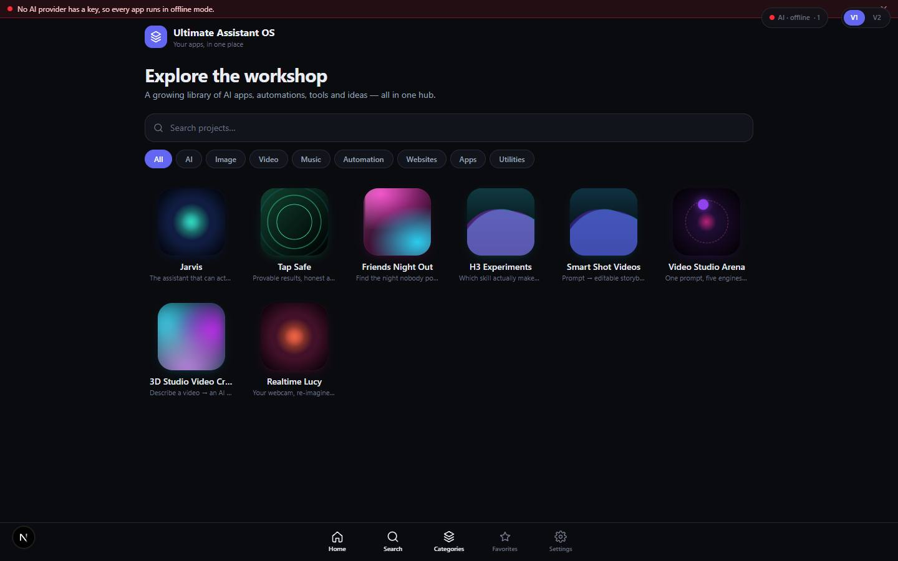

# Hub

`/` · the site shell (not a catalog entry) · live · shows as: the website itself — the front page, app detail pages, login, legal pages, gates and crash screens around every app

> Your apps, in one place

The hub is the whole Next.js site that holds every app the owner builds: the front page that lists
what has not moved into Jarvis yet, a detail page for every app in the catalog, Google sign-in, the
owner-only gate, the password gates, the public legal pages, and the crash screens. Only the owner
gets past `/` when accounts are switched on; everyone else is sent to Friends Night Out. Every other
doc in `docs/apps/` describes one app *inside* this shell.

## Features — every one of these must still exist after your change

The owner asked for each of these. Removing, hiding or "simplifying away" one is a regression,
even if the code looked unused. If a change needs one gone, ask first.

**Which apps the hub shows**
- **One catalog, one source of truth** — every app is one object in `PROJECTS`; adding an app = adding one object. `src/lib/catalog.ts`
- **The hub shows only what has not moved** — `hubProjects()` = catalog minus App plugins (`PLUGIN_SLUGS`), Toolbox tabs (`TOOLBOX_SLUGS`), Dashboard widgets (`WIDGET_SLUGS`) and apps merged into a studio home (`MERGED_INTO`), so no app has two front doors. Today that leaves 8 tiles: Jarvis, Tap Safe (`std-safe`), Friends Night Out, H3 Experiments, Smart Shot Videos, Video Studio Arena, 3D Studio, Realtime Lucy. `src/lib/studio/plugins.ts`
- **Live previews picked automatically** — `previewFor()` gives every live app with a route a running preview of itself; `noPreview` (Realtime Lucy, Baby No Scroll, Dump Finder) and the private `UNPREVIEWABLE` list (Dashboard, Jarvis, Projects Timeline, Trading Studio, Personas Studio, Client Review, App Builder, etc.) keep the animated icon instead. A project may also set `preview: {kind:"video"|"site"}`. `src/lib/catalog.ts` (`previewFor`, `previewUrl`, `UNPREVIEWABLE`)

**Front page `/` — layout switch**
- **V1 / V2 toggle** — small pill, fixed top-right, switching between the gallery (V1) and the rotating stand (V2). `src/components/hub/HubShell.tsx` (`VersionToggle`)
- **Choice remembered per browser** — saved in localStorage `hub:version`; `?v=1` / `?v=2` in the link wins over it, and the URL is kept in step without a page reload. `src/components/hub/HubShell.tsx`
- **No flash of the wrong layout** — renders nothing until the saved choice is read. `src/components/hub/HubShell.tsx`

**Front page — V1 gallery (the default)**
- **Header + hero** — "Ultimate Assistant OS · Your apps, in one place" and "Explore the workshop". `src/components/hub/HubHome.tsx`
- **Search box** — filters by title, tag line or category as you type. `src/components/hub/HubHome.tsx`
- **Category chips** — All, AI, Image, Video, Music, Automation, Websites, Apps, Utilities (sideways-scrolling row). `src/components/hub/HubHome.tsx`, `src/lib/catalog.ts` (`CATEGORIES`)
- **"No projects match."** empty state. `src/components/hub/HubHome.tsx`
- **Icon grid** — 3 columns on a phone, 4 / 5 / 6 as the screen widens; each tile is an animated icon, title and tag line. `src/components/hub/HubHome.tsx`, `src/components/hub/ProjectCard.tsx`
- **Animated icons** — six CSS-only styles (aurora, orbit, rings, mesh, pulse, waves) coloured from each app's two `hue` values; lift on hover. `src/components/hub/AnimatedIcon.tsx`, `src/app/globals.css` (`.hub-icon*`)
- **Hover popover (laptop only)** — category, Live/Soon badge, title, tag line and the full overview, without leaving the grid. `src/components/hub/ProjectCard.tsx`
- **Tap goes straight to the app** — a live app opens its route (or external site in a new tab); a coming-soon app opens its detail page and shows a "Soon" badge. `src/components/hub/ProjectCard.tsx`
- **Bottom-nav deep links** — `/?focus=search` focuses the search box, `/?focus=cats` scrolls to the chips. `src/components/hub/HubHome.tsx`

**Front page — V2 rotating stand (carousel)**
- **3D ring of panels** — every hub app on a ring around a spindle (hub, post, base), packed like the pages of an open book with a wedge opened around the front panel. `src/components/hub/v2/CarouselHub.tsx`, `src/components/hub/v2/useCarousel.ts`
- **Ways to spin** — drag/flick (with coasting and snap to a slot), mouse wheel, moving the cursor towards the left/right edge (not on touch), ← → keys, Home key, the arrow buttons, or clicking a side panel to bring it to the front. `src/components/hub/v2/useCarousel.ts`, `src/components/hub/v2/CarouselHub.tsx`
- **Depth look** — off-centre panels sit back, dim and blur (more while spinning); panels past 120° are hidden. `src/components/hub/v2/CarouselHub.tsx`
- **Live face on the front panel only, once it stops** — the real app running in a desktop-width iframe scaled down (or a looping muted clip for `video` previews); every other panel shows its animated icon. Only one preview is ever mounted. `src/components/hub/v2/PanelFace.tsx`
- **Panel plate** — category, Soon badge, title, tag line; the full overview only on the settled front panel. `src/components/hub/v2/PanelFace.tsx`
- **Open / Details button** — only on the front, settled panel, so a stray Tab can't open an app you can't see. `src/components/hub/v2/CarouselHub.tsx`
- **Read-out under the stand** — current app name (fades while spinning), "N / total", and a hint "move left or right to spin · drag · ← →" that disappears once you touch it. `src/components/hub/v2/CarouselHub.tsx` (`Controls`)
- **Sized to the screen** — panel width and ring radius are recalculated on resize so the stand fits a phone and a 27" monitor. `src/components/hub/v2/CarouselHub.tsx`

**AI switchboard (top-right on `/`)**
- **"AI · <provider>" status pill** — coloured dot (green / amber / red) and a count of problems, polled every 60 s from `/api/ai/status`. `src/components/hub/AiPanel.tsx`
- **Red problem strip** — anything actually broken shows across the top in plain words; dismissible for the tab session. `src/components/hub/AiPanel.tsx` (`AiProblemStrip`)
- **Provider choice** — Auto / OpenRouter / Vercel, "retry on the other provider" toggle, saved on the server so it holds on every device (`/api/ai/settings`). `src/components/hub/AiPanel.tsx`, `src/lib/ai/settings.ts`
- **Model picker + two fall-back models** — searchable list of OpenRouter's catalogue with price and whether it can see images (`/api/ai/models`). `src/components/hub/ModelPicker.tsx`
- **Provider table** — each provider's state and "in use" marker. `src/components/hub/AiPanel.tsx`
- **Game Creator builder setting** — runs on Claude plan or OpenRouter, with "retry through OpenRouter" toggle and its status line. `src/components/hub/AiPanel.tsx`
- **API keys list** — "API keys (N/M set)" with what each key is used by. `src/components/hub/AiPanel.tsx`
- **Also mounted inside Jarvis › Settings** — `<AiPanel inline />`. `src/components/hub/AiPanel.tsx`

**Bottom navigation (front page, detail pages, Favorites, Settings)**
- **Home · Search · Categories · Favorites · Settings** — fixed bar with blur, safe-area padding for iPhones, current page lit. `src/components/hub/BottomNav.tsx`

**App detail page `/p/<slug>`**
- **A page for every catalog app** — including ones that have moved into Jarvis (pre-rendered for all of `PROJECTS`); unknown slug → 404. `src/app/p/[slug]/page.tsx`
- **Hero** — big animated icon, category · tag line, title, full overview, "Back to hub". `src/app/p/[slug]/page.tsx`
- **Launch app / Open / Coming soon** — Launch for an internal route, Open for an external URL, a "Coming soon" chip otherwise. `src/app/p/[slug]/page.tsx`
- **Preview block** — an external site is framed in place (70% of the screen high); an internal app gets a "Ready to use — Open <title>" card with a blurred icon behind it; a coming-soon app gets "In the workshop · Not built yet". `src/app/p/[slug]/page.tsx`

**Other hub pages**
- **Favorites `/favorites`** — "No favorites yet" screen with a Browse projects button (placeholder: nothing can be starred yet). `src/app/favorites/page.tsx`
- **Settings `/settings`** — three fixed rows (Storage, AI engine, Modules); the values are hard-coded text, not live state. `src/app/settings/page.tsx`
- **Old review links** — `/review` → `/apps/client-review`; `/review/<code>` → `/apps/client-review?site=<code>`. `src/app/review/page.tsx`, `src/app/review/[token]/page.tsx`
- **Favicon** — `src/app/icon.svg`

**Sign-in and who can see what**
- **Login `/login` — one "Continue with Google" button** — the same button creates an account; Google One Tap also offers itself automatically when `NEXT_PUBLIC_GOOGLE_CLIENT_ID` is set. `src/app/login/page.tsx`, `src/lib/auth/google.ts`
- **Plain-English Google error** — "provider is not enabled" is explained with where to switch it on in Supabase. `src/app/login/page.tsx`
- **"Trouble with Google?" fallback** — hidden email + password sign-in for existing accounts only (no sign-up). `src/app/login/page.tsx` (`EmergencyEmailForm`)
- **No accounts mode** — without Supabase keys the login page says so and offers "Continue to app" (local demo mode). `src/app/login/page.tsx`
- **OAuth callback** — `/auth/callback` swaps the code for a session and returns to `next` (or `/login` on failure). `src/app/auth/callback/route.ts`
- **Owner-only hub** — every page and API is owner-only unless listed otherwise; owners are the emails in `HUB_OWNER_EMAILS` (unset = nobody, fail-closed). Signed-out → `/login` (APIs get a 401 JSON); signed-in non-owner → `/apps/friends-night-out` (APIs get 403). A signed-in visitor on `/login` is sent home. `src/middleware.ts`, `src/lib/hubAccess.ts` (+ `hubAccess.test.ts`)
- **Public paths** — Friends Night Out and `/api/fno`, Client Review (`/apps/client-review`, `/review`, `/api/client-review/portal`, `/client-review-sw.js`), `/legal/*`, and the exact file `/jarvis-errors.js`. `src/lib/hubAccess.ts`
- **Token-only API paths** — an exact-match list (iPhone Shortcuts, PC builders/runners, the Record extension, memory MCP, skill sync, site-error report/feed, …) that skip the session check and verify their own token in the route. `src/middleware.ts` (`TOKEN_AUTH_PATHS`)
- **Per-account browser data** — middleware hands the signed-in account id to the browser in the `hub_uid` cookie; every app blob is stored under `u:<uid>:<key>` and `IdentityBoundary` clears other accounts' leftovers on a shared machine. `src/middleware.ts`, `src/lib/sync/identity.ts`, `src/components/IdentityBoundary.tsx`
- **Password gate: Projects Timeline** — with `TIMELINE_PASSWORD` set, `/apps/projects-timeline` redirects to `/timeline-unlock`; a correct password sets a 30-day `timeline_auth` cookie (SHA-256 hash, constant-time check). No password = open. `src/lib/appGate.ts`, `src/middleware.ts`, `src/app/timeline-unlock/page.tsx`, `src/app/api/timeline-unlock/route.ts`
- **Password gate: Jarvis** — `/recall-unlock` ("One password for everything Jarvis keeps"), sent there by `src/app/apps/jarvis/page.tsx` when its in-app password is set. `src/app/recall-unlock/page.tsx`, `src/app/api/recall-unlock/route.ts`, `src/lib/recall/gateStore.ts`
- **Shared unlock screen** — password field, "Wrong password." message, return to `?next=`. `src/components/UnlockForm.tsx`
- **Family door `/recall-join`** — sign-up with `?t=<invite>` or sign-in for the shared Lists board. `src/app/recall-join/page.tsx`, `src/components/recall/lists/JoinForm.tsx`

**Legal pages (public — TikTok and Meta require them)**
- **Privacy Policy, Terms of Service, Delete your data** — plain-language pages about Personas Studio, linked to each other, with a contact line from `LEGAL_CONTACT_EMAIL`. `src/app/legal/LegalPage.tsx`, `src/app/legal/privacy/page.tsx`, `src/app/legal/terms/page.tsx`, `src/app/legal/data-deletion/page.tsx`

**Never a white page — crashes**
- **Crash screen** — "Something broke · This page hit a problem." with "Try again" and "Go to the start"; used for a crash in any page and for a crash in the root layout itself. `src/components/CrashScreen.tsx`, `src/app/error.tsx`, `src/app/global-error.tsx`
- **Every crash logged** — the crash screen and `ErrorReporter` (uncaught errors + unhandled promise rejections, mounted in the root layout) post to `/api/site-errors/report`; one entry per fingerprint with a count. The owner reads them in Jarvis › More › Work › Site errors (`/apps/jarvis#site-errors`); client sites load `public/jarvis-errors.js`. `src/components/ErrorReporter.tsx`, `src/lib/site-errors/`, `src/app/api/site-errors/`

**Site-wide plumbing**
- **Root layout** — dark theme colour `#0a0b0f`, phone viewport with zoom locked (`maximumScale: 1`), mounts `IdentityBoundary` and `ErrorReporter` on every page. `src/app/layout.tsx`
- **Redirects / rewrites** — `/apps/ea-world` and `/apps/ea-lab` → Trading Studio sections; `/pod-play-connect/*` serves its prebuilt bundle. `next.config.mjs`

## How it looks

- **Look:** "The Night Console" (`DESIGN.md`): a near-black instrument panel where colour only reports state, monospace is reserved for machine facts, surfaces are separated by tone and 1px hairlines rather than shadows, and dense tables beat card grids. The V2 stand is modelled on a desk rotary reference stand (black hinged holders on a hub and weighted base). No design-skill record for the hub page itself was found in `.impeccable/`.
- **Colours / type:** tokens in `src/app/globals.css` `@theme` — canvas `#0a0b0f`, panel `#12141c`, panel-2 `#181b25`, elevated `#1d212d`, line `#262a38`, ink `#e9ecf3` / muted `#9aa3b5` / faint `#6b7385`, brand indigo `#6366f1` / `#4f46e5`, core green `#22c55e`, support blue `#3b82f6`, cyan accent `#00cae0`. Fonts: system sans (`--font-sans`) and JetBrains Mono (`--font-mono`). Each app tile's colours come from its own two catalog `hue` values. **What the hub does differently from DESIGN.md:** the front page breaks the 14px ceiling on purpose (24–30px hero, 36px detail title), uses a card-style icon grid with soft coloured icon shadows and a shadowed popover, and `hub-v2.css` adds its own hard-coded darks (`#14161e`→`#0e1016` holder gradient, `#2a2f3d` border, `#0b0d13` page art, silver tab `#e8ecf5`→`#aeb6c8`), an indigo floor glow `hsl(243 70% 60%)` and an indigo glow on the focused panel. The crash screen uses inline colours (`#0a0b0f` background, `#3b82f6` button) so it works even when the stylesheet failed. Login's Google button is white with Google's four-colour mark (their brand rule).
- **Layout:** V1 laptop — one centred column (`max-w-5xl`), header, hero, full-width search, chip row, 5–6-column icon grid, bottom nav. V1 phone — same column, 3-column grid, chips scroll sideways, no popovers. V2 — full-height stage (`100dvh`, no page scroll), ring centred at 46% height, read-out and arrows under it, bottom nav on top; panel size scales with the window (170–250px wide). The V1/V2 pill sits fixed top-right with the AI pill to its left; the AI panel opens as a 400px dropdown on a laptop and a near-full-width sheet on a phone. Detail page: one column `max-w-3xl`, hero stacks centred on a phone and sits icon-left on a laptop.
- **Signature pieces:** the animated catalog icons, the V1/V2 pill, the rotating stand with its spine tab on each panel and the one live iframe on the front panel, the AI status pill, the floating bottom nav.
- **Motion:** icons animate continuously in CSS (aurora drift, orbit spin, ring pulse, mesh, wave) and lift on hover; panels fade in with `animate-fade-in` (180 ms). The carousel is physics, not CSS transitions — velocity, friction, snap spring, squeeze while spinning — written to the DOM every frame. Reduced motion: icon animations stop (`.hub-icon * { animation: none }`), the carousel drops its blur and hides preview video (`.hubv2-media`), but the ring still turns when you drive it.

## Where the code is

| Part | Path |
|---|---|
| Page | `src/app/page.tsx` (front page), `src/app/layout.tsx`, `src/app/p/[slug]/page.tsx`, `src/app/login/page.tsx`, `src/app/auth/callback/route.ts`, `src/app/favorites/page.tsx`, `src/app/settings/page.tsx`, `src/app/legal/`, `src/app/timeline-unlock/`, `src/app/recall-unlock/`, `src/app/recall-join/`, `src/app/review/`, `src/app/error.tsx`, `src/app/global-error.tsx` |
| UI | `src/components/hub/` (`HubShell`, `HubHome`, `ProjectCard`, `AnimatedIcon`, `BottomNav`, `AiPanel`, `ModelPicker`, `v2/CarouselHub`, `v2/PanelFace`, `v2/useCarousel`), `src/components/CrashScreen.tsx`, `ErrorReporter.tsx`, `IdentityBoundary.tsx`, `UnlockForm.tsx`, `icons.tsx` |
| Styles | `src/app/globals.css` (tokens, `.hub-icon`, `.hub-card`), `src/app/hub-v2.css` (V2 only, imported by globals.css) |
| Logic + tests | `src/lib/catalog.ts`, `src/lib/studio/plugins.ts`, `src/lib/hubAccess.ts` (+ `hubAccess.test.ts`), `src/lib/appGate.ts`, `src/middleware.ts`, `src/lib/auth/google.ts`, `src/lib/sync/identity.ts`, `src/lib/site-errors/`, `src/lib/ai/` (status, settings, models) |
| API | `src/app/api/ai/{status,settings,models}`, `src/app/api/timeline-unlock`, `src/app/api/recall-unlock`, `src/app/api/site-errors/{report,feed}` |
| Saved data | localStorage `hub:version` (V1/V2); sessionStorage `ai-strip-hidden`; cookies `hub_uid`, `timeline_auth`, Supabase session; AI settings in one server document (`src/lib/ai/settings.ts`); crash log in `server_docs` |

## Owner's rules for this app

- **The catalog is the single source of truth.** An app not in `PROJECTS` does not exist. Never delete a catalog entry to hide an app — that is what silently killed the old Cookbook Genie card; move it instead.
- **Moving an app off the hub is one edit in `src/lib/studio/plugins.ts`:** `PLUGIN_SLUGS` (a card on Jarvis › App plugins that opens the app in its own tab), `TOOLBOX_SLUGS` (a tab inside Jarvis › Toolbox, wired in `NewJarvis.tsx`), `WIDGET_SLUGS` (Dashboard widget only). A slug dropped from every list gets its hub tile back — so the two places can never show the same app twice.
- **Merging an app into a studio home:** add `slug → home` to `MERGED_INTO`, add a section in `src/lib/studio-home/<home>.ts`, mount its component `embedded`, and turn its old page into a `redirect()` to `?section=`. If the old path holds the owner's uncommitted PC work (EA World, EA Lab), redirect from `next.config.mjs` instead — never create `src/app/apps/ea-world/page.tsx` or anything under `src/app/apps/ea-lab/`.
- **Private apps holding the owner's data go in `UNPREVIEWABLE`** so the carousel never frames them.
- **V1 must stay untouched.** V2 is a second view of the same catalog with its own stylesheet; nothing in V2 may reach into V1's markup or `globals.css` classes (`HubShell.tsx`, `hub-v2.css` headers).
- **Only one heavy preview at a time** — the front panel, after it settles. Do not mount iframes on other panels.
- **Fail closed:** with `HUB_OWNER_EMAILS` unset nobody is the owner. Token-exempt API paths are exact matches, never prefixes; APIs get JSON 401/403, never a redirect to HTML.
- **Apps must work with no keys set** — a missing key degrades visibly, never 500s (login's "no accounts" mode, AI panel's offline state).
- **Never a white page:** every crash shows the plain-English crash screen and is logged (build checklist R1–R3).
- The legal pages must stay publicly reachable — TikTok and Meta check them before approving a developer app.
- Every app edit lands in Projects Timeline: after committing, run `npm run timeline:log` and commit `src/lib/timeline/feature-log.json`; commit subjects read "<App>: <what changed>".
- Dense, database-style UIs over card grids; every new UI gets a design skill first (`interactive-web-studio` by default).

## Described but not found in code

- **Starring apps** — the Favorites page says "Star projects from their detail page to pin them here", but `/p/<slug>` has no star button and nothing stores favorites (`src/app/favorites/page.tsx`).
- **The hub as a public portfolio** — `PRODUCT.md` says visitors "see the front page and the public apps", but `src/middleware.ts` makes `/` owner-only whenever Supabase is configured; a non-owner is sent to Friends Night Out.
- **A site-wide password gate** — `PRODUCT.md` describes the deployment as "behind an app-level password gate (`appGate.ts` + middleware)"; `APP_GATES` holds only Projects Timeline. The site-wide gate is the Google sign-in + owner-email check.
- **Dashboard gating itself in `src/app/apps/dashboard/page.tsx`** — stated in `src/lib/appGate.ts`'s header; that page is now a redirect, and the password check lives in `src/app/apps/jarvis/page.tsx` (→ `/recall-unlock`).
- **Live settings page** — `/settings` says "Local demo mode" and "Heuristic (no key set)" for everyone; these are fixed strings, not the real storage/AI state (the real AI settings are in the AI pill).
- Code comments in `CarouselHub.tsx` / `PanelFace.tsx` speak of "twenty-seven panels"; the hub currently has 8. The root layout's page title is still "Projects Timeline · Ultimate Assistant OS", so `/` shows that title in the browser tab.
