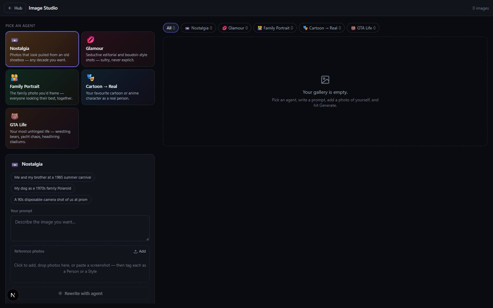

# Image Studio

`/apps/image-studio` · Image · live · shows as: Studio wall panel in Jarvis › Studio (spines "Agents" and "Gallery"; in `PLUGIN_SLUGS` but kept off the App plugins page because it is on the wall — `PANELS` in `src/lib/studio-home/panels.ts`)

> Specialist image agents

A studio of image "agents", each an expert in one look: Nostalgia (old-decade photos), Glamour
(sultry magazine portraits), Family Portrait, Cartoon → Real and GTA Life (outrageous action
stills). You pick an agent, write an idea, add reference photos tagged Person (keep this face) or
Style (borrow this look); the agent rewrites the idea into a detailed prompt you can edit, then
makes up to four pictures. Everything lands in a gallery in this browser. In Jarvis it is "where a
frame gets made before it moves" — the first still a video workflow is handed.

## Features — every one of these must still exist after your change

The owner asked for each of these. Removing, hiding or "simplifying away" one is a regression,
even if the code looked unused. If a change needs one gone, ask first.

**Agents**
- **Five specialist agents** — Nostalgia 📼, Glamour 💋, Family Portrait 👨‍👩‍👧, Cartoon → Real 🎭, GTA Life 🐻, each with its own brief, house style, picture shape and colours. Adding an agent = one object in `AGENTS`. `src/lib/image-studio/agents.ts`
- **Agent picker** — two-column grid of agent cards (icon, name, one-line pitch) tinted with the agent's own gradient; picking one clears the rewritten prompt. `src/components/image-studio/AgentPicker.tsx`
- **Agent safety rules baked into the briefs** — Glamour: adults only, no nudity or sex acts, "tasteful and suggestive"; GTA Life: never a named real celebrity (turned into an unnamed lookalike); Nostalgia: nothing modern in frame. `src/lib/image-studio/agents.ts`
- **Picture shape per agent** — portrait 3:4 (Nostalgia, Glamour, Cartoon → Real), landscape 16:9 (Family Portrait, GTA Life); gallery tiles use the same shape. `src/lib/image-studio/prompt.ts` (`aspectRatio`), `src/components/image-studio/Gallery.tsx`

**Composer**
- **Example prompt chips** — three examples per agent; tapping one fills the prompt box. `src/components/image-studio/Composer.tsx`
- **Reference photos, up to 6, each tagged Person or Style** — Person = keep this face/age/skin/hair; Style = borrow colours, light, mood only. The model is told which numbered image is which. `src/components/image-studio/Composer.tsx` (`RefTray`), `src/lib/image-studio/prompt.ts` (`refGuide`, `MAX_REFS`)
- **Add photos every way** — Add button, drag-and-drop files, drag an image straight from another web page (its URL is fetched), and Ctrl/Cmd+V paste a screenshot anywhere on the page. `src/components/image-studio/Composer.tsx`, `src/lib/image-studio/files.ts` (`imageUrlFromDrop`), `src/components/image-studio/ImageStudio.tsx` (`addFromUrl`)
- **Uploads never fail silently** — files with a blank type are still tried; anything skipped gets a plain-English reason; iPhone HEIC gets a "share it as JPEG" hint; a site that blocks copying gets "save it to your device first". `src/lib/image-studio/files.ts` (`pickImageFiles`, `isHeic`), `src/components/image-studio/ImageStudio.tsx` (`addFiles`)
- **Photos shrunk before sending** — every reference becomes a JPEG ≤ 1024 px, painted on white so transparent PNGs don't turn black; `` decode fallback for Safari/HEIC. `src/lib/image-studio/media.ts` (`downscaleToDataUrl`, `decode`)
- **Rewrite with agent** — the agent's brief turns a short idea into one 80–180-word detailed prompt shown in an editable box ("Agent's prompt — edit freely", "Rewrite again", "Use my prompt instead"). Model: Claude Sonnet 5 (`REWRITE_MODEL`, override env `IMAGE_STUDIO_REWRITE_MODEL`). `src/app/api/image-studio/rewrite/route.ts`, `src/lib/image-studio/prompt.ts` (`rewriteSystem`)
- **Skip the rewrite** — generating straight from your words adds the agent's house style block (a hint under the button says so). `src/lib/image-studio/prompt.ts` (`fallbackPrompt`), `src/components/image-studio/Composer.tsx`
- **1–4 images per run** — segmented 1/2/3/4 picker; each image is its own request run in parallel (one image per response keeps under Vercel's 4.5 MB limit). `src/components/image-studio/Composer.tsx`, `src/components/image-studio/ImageStudio.tsx` (`generate`), `src/app/api/image-studio/generate/route.ts`
- **Consent line** — "Only upload photos of yourself or people who agreed to this." under the composer. `src/components/image-studio/Composer.tsx`

**Results and gallery**
- **Live job cards** — a pulsing placeholder per image while it generates; header shows "Generating N…" or the image count. `src/components/image-studio/Gallery.tsx` (`JobCard`), `src/components/image-studio/ImageStudio.tsx`
- **Refused / failed jobs** — "The model declined" offers **Soften prompt** (re-rewrites the idea as clearly tasteful: clothed adults, no violence, no real named people, then scrolls back to the composer); "Generation failed" offers **Retry**; both have Dismiss. `src/components/image-studio/Gallery.tsx`, `src/components/image-studio/ImageStudio.tsx` (`soften`), `src/lib/image-studio/prompt.ts`
- **Gallery filter by agent** — All + one chip per agent with counts. `src/components/image-studio/Gallery.tsx`
- **Lightbox** — full-size view with ← / → and Esc keys, date, number of references, model used; collapsible "Prompt the model received" with copy button. `src/components/image-studio/Gallery.tsx` (`Lightbox`)
- **Download, Refine, Delete** — Download saves `image-studio-<agent>-<date>-<id>`; Refine puts the result back in as a Person reference with the same agent and prompt for the next round; Delete removes it and its stored bytes. `src/components/image-studio/Gallery.tsx`, `src/components/image-studio/ImageStudio.tsx` (`refine`, `remove`)
- **Gallery kept in this browser, newest first** — list in localStorage, image bytes in IndexedDB; if storage is blocked it still works for the session. `src/lib/image-studio/gallery.ts`, `src/lib/image-studio/media.ts`

**No-key mode**
- **Offline preview** — with no AI key the rewrite returns your words + style block and Generate returns a gradient placeholder card (agent icon, your words, "offline preview"); a banner says to add `OPENROUTER_API_KEY`. If the rewrite model fails, the style block is used with a warning. `src/lib/image-studio/prompt.ts` (`placeholderImage`), `src/components/image-studio/ImageStudio.tsx`, `src/app/api/image-studio/rewrite/route.ts`

## How it looks

- **Look:** the hub's default instrument-panel look — DESIGN.md unchanged; no `.impeccable` surface record and no design skill named in its history. Colour comes only from the agents' own gradients.
- **Colours / type:** Tailwind tokens from DESIGN.md — `bg-panel` `#12141c`, `bg-panel-2` `#181b25`, `border-line` `#262a38`, `text-ink` / `ink-muted` / `ink-faint`, brand `var(--color-brand)` `#6366f1` for selected agent ring, active Person/Style tag and the Generate button. Agent cards use `linear-gradient(135deg, hsl(hue0 70% 50% / .14–.28), hsl(hue1 60% 40% / .06–.16))` from each agent's `hue`. Errors `red-300` on `red-500/10`; refusals `amber-300`. System sans, 11–13 px dense text, uppercase tracked 11 px section labels.
- **Layout:** laptop (`lg`) — two columns: a 440 px sticky left rail (agent picker + composer, scrolls on its own) and the gallery on the right, max width 1500 px. Phone — one column: picker, composer, then gallery. Gallery grid 2 columns on phone, 3 from `sm`, 4 from `xl`. Lightbox: image + 340 px side panel on laptop; image over a bottom panel (max 45% of screen) on phone. Sticky top bar with "← Hub", title and count.
- **Signature pieces:** gradient agent cards with emoji icons; reference tray of square thumbnails with a Person | Style toggle under each; editable "Agent's prompt" box; 1-2-3-4 segmented count; aspect-correct gallery tiles with prompt caption on hover; dark blurred lightbox.
- **Motion:** pulsing job cards (`animate-pulse`), 1.03× zoom and caption fade on tile hover, smooth scroll back to the composer on Refine/Soften. No app-specific reduced-motion fallback.

## Where the code is

| Part | Path |
|---|---|
| Page | `src/app/apps/image-studio/page.tsx` |
| UI | `src/components/image-studio/` (`ImageStudio.tsx` shell, `AgentPicker.tsx`, `Composer.tsx`, `Gallery.tsx`, `api.ts`) |
| Logic + tests | `src/lib/image-studio/` (`agents.ts`, `prompt.ts`, `files.ts`, `gallery.ts`, `media.ts`, `server.ts`; tests `image-studio.test.ts`, `files.test.ts`) |
| API | `src/app/api/image-studio/rewrite/route.ts`, `src/app/api/image-studio/generate/route.ts` |
| Saved data | This browser only: localStorage `image-studio:gallery` (metadata) + IndexedDB `image-studio-media` / store `blobs` (images). No synced key, no Supabase table. |

Shared with other apps: Jarvis Studio's `/api/studio/image` reuses `DEFAULT_IMAGE_MODEL`, `chat`, `extractResult`, `userContent`; Smart Shot's `Brief.tsx` reuses `files.ts`. Change those exports carefully.

## Owner's rules for this app

- One agent = one object in `AGENTS` (`agents.ts`); the picker, gallery filter, both routes and the placeholder read from it — nothing else should need to change.
- Every agent starts on the same image model, `google/gemini-3.1-flash-image` via OpenRouter (`DEFAULT_IMAGE_MODEL`); swap one agent by changing its `model` string. Rewrites use Claude Sonnet 5.
- One image per request, always — never batch several images into one response (Vercel 4.5 MB limit).
- Must work with no key set (offline placeholders), and a dropped or unreadable photo must always show a reason, never do nothing.
- The Glamour and GTA Life hard rules (adults only, no nudity, no real named celebrities) override whatever the user types.

## Described but not found in code

- None found.
