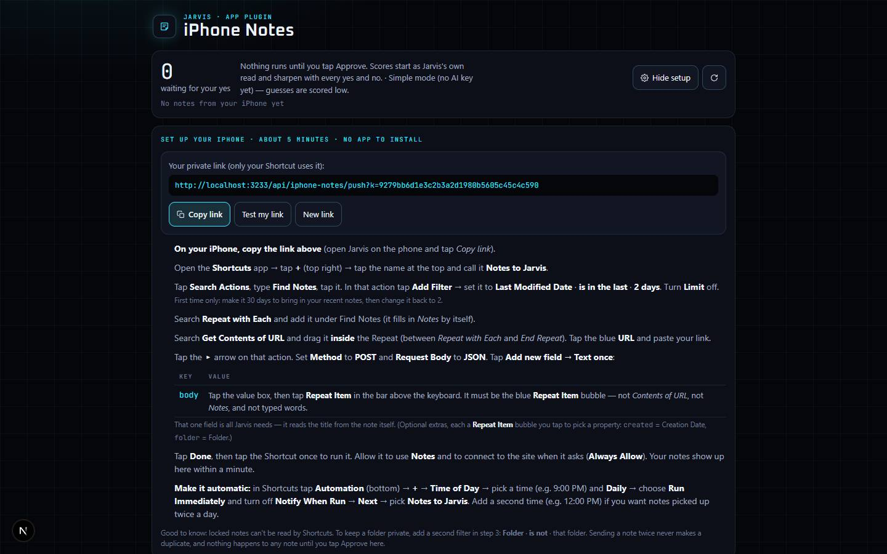

# iPhone Notes

`/apps/iphone-notes` · AI · live · shows as: Dashboard widget — the **Notes half of the one "iPhone" widget** (`src/components/iphone-hub/IphoneWidget.tsx`, widget id `iphone`), shared with Text Inbox

> Your notes, read by Jarvis — you approve every one

An iPhone Shortcut ("Notes to Jarvis") sends the notes you wrote or changed lately, and Jarvis reads each one into
proposals: a to-do, a calendar event, a birthday, something to remember, an app idea for In Queue, a job for the chat
agent, or just keep it in Folders. Every proposal has a confidence score that learns from what you approve — and
nothing runs until you tap Approve.

## Features — every one of these must still exist after your change

The owner asked for each of these. Removing, hiding or "simplifying away" one is a regression,
even if the code looked unused. If a change needs one gone, ask first.

**The iPhone widget (shared with Text Inbox)**
- **One widget, two halves** — compact card with a Notes half (waiting count + the two most-sure proposals with score, action and note title) and a Texts half; tapping a half opens the sheet on that side. `src/components/iphone-hub/IphoneWidget.tsx`
- **Status line** — "Notes · N waiting / not linked · Texts … · nothing runs until you approve". `src/components/iphone-hub/IphoneWidget.tsx`
- **Sheet with a Notes / Texts switch** that remembers the last side (`localStorage` `jarvis-iphone:tab`) and mounts `IphoneNotesApp embedded inJarvis`. `src/components/iphone-hub/IphoneWidget.tsx` (`IphoneExpanded`)

**Reading notes**
- **Up to 6 proposals per note**, each one of: To-do, Calendar, Birthday, Remember, In Queue, Do it (chat), Save to Folders, Nothing to do. `src/lib/iphone-notes/engine.ts` (`ACTIONS`, `ACTION_LABEL`, `MAX_ITEMS`)
- **Self-improving confidence score** — the model's own score, calibrated against your past approvals/declines (a kind of guess you keep declining drops); your last decisions also ride along as examples in the next read. `src/lib/iphone-notes/engine.ts`, `src/lib/confidence/calibrate.ts`
- **Why line** — each proposal shows why Jarvis guessed it and how the calibration moved the score. `src/components/iphone-notes/IphoneNotesApp.tsx`
- **Simple mode with no AI key** (or when the call fails / daily cap is spent) — keyword reading, scores kept low, and the page says so. `src/lib/iphone-notes/server/brain.ts`, `src/lib/iphone-notes/engine.ts`
- **No duplicates on re-send** — the same text is a no-op; a re-send with a real title/date/folder fixes those in place without a re-read; an edited note is read again and earlier decisions stay. `src/lib/iphone-notes/engine.ts` (`ingest`)
- **Paste or type a note to try it** — "Read it" runs the same reading without the iPhone. `src/components/iphone-notes/IphoneNotesApp.tsx` (`PasteNote`)
- **"Not right? Tell Jarvis what this note is"** — re-read a note with your own words. `src/components/iphone-notes/IphoneNotesApp.tsx`, `src/app/api/iphone-notes/route.ts` (`change`)
- **Try again** on a note whose read failed; **Remove** a note from Jarvis. `src/components/iphone-notes/IphoneNotesApp.tsx`, `src/app/api/iphone-notes/route.ts` (`retry`, `remove`)

**Deciding**
- **Approve · <what it will do>** — the button names the action ("Add to your calendar on …", "Save to Folders › iPhone Notes › …"). `src/lib/iphone-notes/client.ts` (`actionLine`)
- **Approve runs first, then records the yes** — a failed save never shows as done or teaches Jarvis. `src/lib/iphone-notes/client.ts` (`runItem`), `IphoneNotesApp.tsx`
- **What each action does** — To-do → Lists "todo" with due date; Calendar → calendar event; Birthday → birthdays store; Remember → `/api/jarvis/memory/save`; In Queue → `/api/new-jarvis/requests`; Do it (chat) → inside Jarvis hands the job to the chat in Do mode (`askJarvis`), outside Jarvis goes to In Queue; Save → Folders › iPhone Notes › <folder>. `src/lib/iphone-notes/client.ts`
- **Edit before approving** — per-action fields (label, text, date, time, location, name, relation, when, folder); approved-after-edit shows "(edited)". `src/components/iphone-notes/IphoneNotesApp.tsx` (`EditFields`)
- **Decline** any proposal. `src/components/iphone-notes/IphoneNotesApp.tsx`

**Finding things**
- **Summary panel** — big "N waiting for your yes", what Jarvis has learned ("Learned from N of your decisions…"), last note from your iPhone time, refresh button. `src/components/iphone-notes/IphoneNotesApp.tsx`
- **Confidence Rail** — every waiting proposal is a tick at its score (coloured by band); drag the handle to show only what's at least that sure; tap a tick to jump to its card. `src/components/iphone-notes/IphoneNotesApp.tsx` (`ConfidenceRail`)
- **Tabs Waiting · Decided · All**, **sort Most sure / Least sure / Newest first**, **search notes**; sort and rail position are remembered (`localStorage` `iphone-notes:view`). `src/components/iphone-notes/IphoneNotesApp.tsx`, `src/lib/confidence/calibrate.ts` (`sortByConfidence`)

**iPhone setup**
- **Setup panel** ("iPhone setup" button) — your private push link with **Copy link**, **Test my link**, **New link** (old one stops working), and numbered Shortcut steps (about 5 minutes, no app). `src/components/iphone-notes/IphoneNotesSetup.tsx`
- **Last failed run shown with the fix** — what arrived (shape only, `lastFail`) and exactly what to change. `src/components/iphone-notes/IphoneNotesSetup.tsx`, `src/lib/iphone-notes/engine.ts`
- **Push door** `POST/GET /api/iphone-notes/push?k=` — one field `body` = Repeat Item is enough; any field name holding the note is accepted; answers fast and reads after the reply; GET checks the link. `src/app/api/iphone-notes/push/route.ts`
- **Refuses bad pushes with the exact fix** — Shortcut step words typed instead of a variable ("Repeat Item > tap it > Name"), Jarvis's own reply echoed back ("Contents of URL"), many notes glued into one, empty body. `src/lib/iphone-notes/engine.ts`

## How it looks

- **Look:** Jarvis HUD via interactive-web-studio. Does **not** use DESIGN.md's tokens; own `--ipn-*` set.
- **Colours / type:** canvas `#05060a`, panels `#0c0f17` / `#121623` / `#181d2c`, lines `rgb(120 220 255 / .12–.26)`, ink `#eef3fb` / `#a3adc2` / `#6f7a93`, HUD cyan `#3be3ff`. Confidence bands: high green `#5be38f`, medium cyan `#3be3ff`, low amber `#ffb547`; bad `#ff6b5e`. Own page adds a faint cyan 44px grid + radial glow. Fonts: Oxanium (display) + JetBrains Mono (every number), from `page.tsx` as `--font-nj-display` / `--font-nj-mono`.
- **Layout:** single column, max 980px, on laptop and phone; summary panel collapses to two columns under 640px. Phone first: 16px inputs (no zoom), 40px+ targets. Widget card styles (`.iph-*`) live in `src/components/new-jarvis/deck.css`.
- **Signature pieces:** the Confidence Rail, score rings per proposal (`.ipn-ring[data-band]`), "Approve · <action>" buttons.
- **Motion:** card entry, scan and breathe keyframes; transform/opacity only; all stop under `prefers-reduced-motion`.

## Where the code is

| Part | Path |
|---|---|
| Page | `src/app/apps/iphone-notes/page.tsx` |
| UI | `src/components/iphone-notes/` (`IphoneNotesApp.tsx`, `IphoneNotesSetup.tsx`, `iphone-notes.css`) + widget `src/components/iphone-hub/IphoneWidget.tsx` |
| Logic + tests | `src/lib/iphone-notes/` (`engine.ts` + `engine.test.ts`, `client.ts`, `server/brain.ts`, `server/store.ts`); shared calibration `src/lib/confidence/calibrate.ts` (also used by Camera Autopilot, `src/lib/recall/photos/confidence.ts`) |
| API | `src/app/api/iphone-notes/route.ts` (decide, change, retry, add, remove, key.rotate) · `src/app/api/iphone-notes/push/route.ts` (Shortcut door) |
| Saved data | server_docs `.iphone-notes.<uid>.json` (notes, decisions, habits) + `.iphone-notes-keys.json` (Shortcut key → account); no migration |

## Owner's rules for this app

- **Nothing runs without a yes** (Oct 2026): "everything has to be approved no matter the confidence score". The score only sorts and filters.
- Widget only (owner's call, Oct 28 2026): **one iPhone widget for Notes + Texts, no App plugins cards, no hub tiles.** Both slugs stay in `WIDGET_SLUGS` in `src/lib/studio/plugins.ts`; catalog entry and route stay.
- `/api/iphone-notes/push` is session-exempt in `src/middleware.ts` (exact path) and checked with the per-account key; keep `lastFail` shape-only (never store the failed text).
- Notes are personal: the browser never reads the table; in `UNPREVIEWABLE` in `src/lib/catalog.ts`; page is `noindex`.

## Described but not found in code

- None found.
