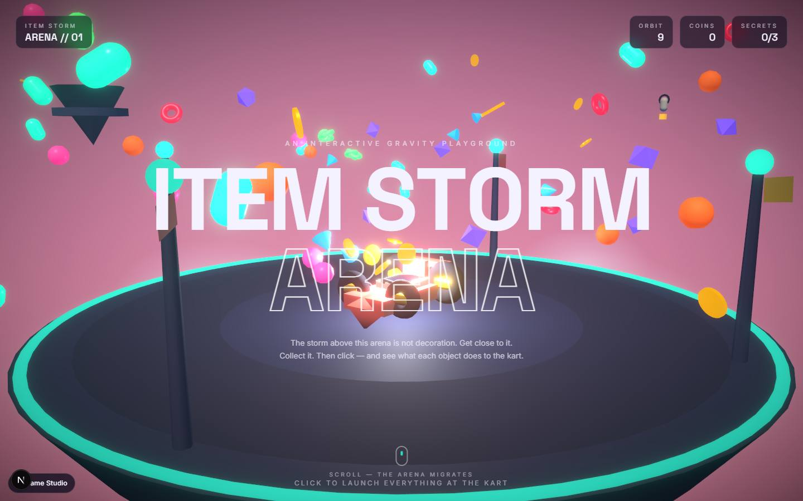

# Item Storm Arena

`/apps/item-storm-arena` · Apps · live · shows as: section of Game Studio (a row in Game Studio › Unfinished games, played there in a frame)

> An interactive gravity playground

A storm of living objects circles a floating arena, and your cursor is a gravity well. Drift near
the storm and it notices you; collect it, then click to launch everything at the kart — coins bank,
crystals shield, paint splashes the arena, an energy shell shatters the headline. Three secret
sequences set off arena-wide events the page never explains, and scrolling moves the world through
four biomes. It is a toy, not yet a game — it lives on the Unfinished games shelf.

## Features — every one of these must still exist after your change

The owner asked for each of these. Removing, hiding or "simplifying away" one is a regression,
even if the code looked unused. If a change needs one gone, ask first.

**The storm and the cursor**

- **Cursor is a gravity well** — inverse-square pull, scaled by each item's mass; captured items orbit the cursor on a springy lock. `src/components/item-storm-arena/three/ItemStorm.tsx`
- **Eight item kinds with personalities** — capsule (eager, darts in), coin (light, blown by fast-cursor "wind"), crystal (resists, then commits), orb (circles instead of coming straight in), paint bomb (wobbly), energy shell (lunges late), magnet core, gravity orb (heaviest); 60 items total, each its own colour and glow. `src/lib/item-storm-arena/items.ts`, `ItemStorm.tsx`
- **Click to launch the volley at the kart** — items land one by one in the order collected, with impact bursts (showier for coins and orbs). `three/Experience.tsx`, `ItemStorm.tsx`, `three/LaunchFX.tsx`
- **What each hit does** — coin +25 to the bank; crystal raises a shield bubble on the kart (4 s); paint repaints the arena platform (5 s); energy shell shatters the "ITEM STORM ARENA" headline, which springs back; magnet drags the storm (2.4 s); gravity orb flips gravity so the storm floats up (2.8 s). `ItemStorm.tsx`, `src/lib/item-storm-arena/store.ts`, `three/Kart.tsx`, `three/Arena.tsx`, `dom/Hero.tsx`
- **Big volley stunt** — 6+ items in one launch sends the kart into a jump-and-backflip with squash and stretch. `store.ts`, `three/Kart.tsx`
- **Three secret combos** (last three hits, in order, never explained in advance): PRISM BREAK (crystal → coin → orb, galaxy sky 10 s), PAINTED VOID (paint → magnet → gravity, low gravity 8 s), OVERDRIVE (shell → coin → crystal, neon arena 8 s). `src/lib/item-storm-arena/combos.ts`, `three/Sky.tsx` (galaxy), `three/Atmosphere.tsx` + `three/Experience.tsx` (neon + bloom swell), `three/ItemStorm.tsx` (low gravity)

**The world**

- **Four biomes by scroll** — SKY ARENA → CRYSTAL CAVERNS → NEON CITY → DEEP SPACE; sky, fog, lights, accent and star field lerp as you scroll, and scrolling back rewinds it. `src/lib/item-storm-arena/palette.ts`, `three/Sky.tsx`, `three/Atmosphere.tsx`, `three/CameraRig.tsx`
- **Living arena** — waving flags, patrolling cargo drones, a fidgeting kart with breathing glow and exhaust, satellite islands. `three/Arena.tsx`, `three/Kart.tsx`
- **Idle secret** — stay still for 12 s and birds fly past. `three/Arena.tsx`
- **Smooth scroll** — Lenis synced to GSAP ScrollTrigger; one progress number drives the world. `dom/SmoothScrollProvider.tsx`

**The page around it**

- **HUD** — "ITEM STORM / ARENA // 01" plate, ORBIT count, COINS, SECRETS n/3 (hidden on a phone); a toast names a discovered combo; a bottom hint ("drift near the storm — it notices you" → "click to launch everything at the kart") until the 4th hit. Never steals clicks. `dom/Hud.tsx`
- **Hero headline** — split into letters that rise in on load and physically shatter on a shell hit. `dom/Hero.tsx`
- **Four story chapters** — kicker + big headline per biome, revealed on scroll, hinting at mechanics without explaining combos. `dom/Sections.tsx`
- **Loading veil** — "entering arena" with a glowing orb until the first frame draws. `dom/Overlays.tsx`
- **Back link "Game Studio"** → `/apps/game-studio?section=unfinished`. `src/components/item-storm-arena/ItemStormArena.tsx`

**Works on any device**

- **GPU tiers** — bloom + vignette post-processing on a capable GPU; software renderers and weak touch devices get a lighter arena at lower resolution; an FPS watchdog demotes a device that runs slow. `src/lib/item-storm-arena/quality.ts`, `three/Experience.tsx`
- **Calm still version** — with reduced motion or no WebGL there is no canvas: a still gradient backdrop, the same words, and a corner note saying why. `ItemStormArena.tsx`, `dom/Overlays.tsx` (`StaticFallback`)
- **Crash-safe canvas** — if the 3D scene throws, the page stays a page and the veil lifts. `dom/Overlays.tsx` (`CanvasErrorBoundary`)

## How it looks

- **Look:** its own art direction (carried over from the original stand-alone app), not DESIGN.md; no design-skill record found.
- **Colours / type:** scoped under `.isa` — background `#0a0c1e`, ink `#f4f2ff`, accent teal `#22e6c8`; biome skies e.g. `#252a6e` → `#ff9bb8` (Sky Arena); item colours from `items.ts` (capsule `#3ef5c8`, coin `#ffd23e`, crystal `#9d7bff`, orb `#ff6fb1`, paint `#ff8a3d`, shell `#59d0ff`, magnet `#ff5470`, gravity `#8ef58a`). Fonts Space Grotesk (display, 500/700) and Inter (body), loaded only on this route (`src/app/apps/item-storm-arena/page.tsx`). Theme colour `#0a0c1e`.
- **Layout:** full-screen WebGL canvas behind a tall scrolling page; text ignores the pointer so clicks reach the arena. Laptop: HUD plates top-left and top-right, chapters alternate left/right/centre. Phone: same stack; the SECRETS plate hides.
- **Signature pieces:** outlined second headline line ("ARENA" in stroke only), HUD glass plates, combo toast pill, the kart in the middle of the storm.
- **Motion:** GSAP letter entrance and shatter/elastic reassembly, scroll-triggered chapter reveals, Lenis scroll; all gated by `gsap.matchMedia("(prefers-reduced-motion: no-preference)")`; reduced motion also removes the canvas entirely.

## Where the code is

| Part | Path |
|---|---|
| Page | `src/app/apps/item-storm-arena/page.tsx` |
| UI | `src/components/item-storm-arena/` (`ItemStormArena.tsx`, `dom/`, `three/`, `item-storm-arena.css`) |
| Logic + tests | `src/lib/item-storm-arena/` (`items.ts`, `combos.ts`, `palette.ts`, `quality.ts`, `store.ts`, `math.ts`, `useReducedMotion.ts`) — no tests |
| API | none |
| Saved data | none — score and discoveries live in memory (zustand `useArena`) and reset on reload |

## Owner's rules for this app

- It is **unfinished**: listed in `UNFINISHED_GAMES` (`src/lib/studio-home/games.ts`) with what is missing — a goal and an end, touch play on a phone, sound, a saved best score. When it is finished, remove it from that list.
- Ported from a stand-alone Next app at the repo root (root folder and its tsconfig exclude removed): uses the hub's three / react-three-fiber / drei versions, `gsap.context` / `gsap.matchMedia` in `useLayoutEffect` instead of `@gsap/react`, styles scoped under `.isa`.
- Keep the calm still version for reduced motion or no WebGL — "the experience degrades; the message doesn't".
- Merged into Game Studio (`MERGED_INTO` in `src/lib/studio/plugins.ts`); the route stays alive so the shelf can frame it.

## Described but not found in code

- None found.
