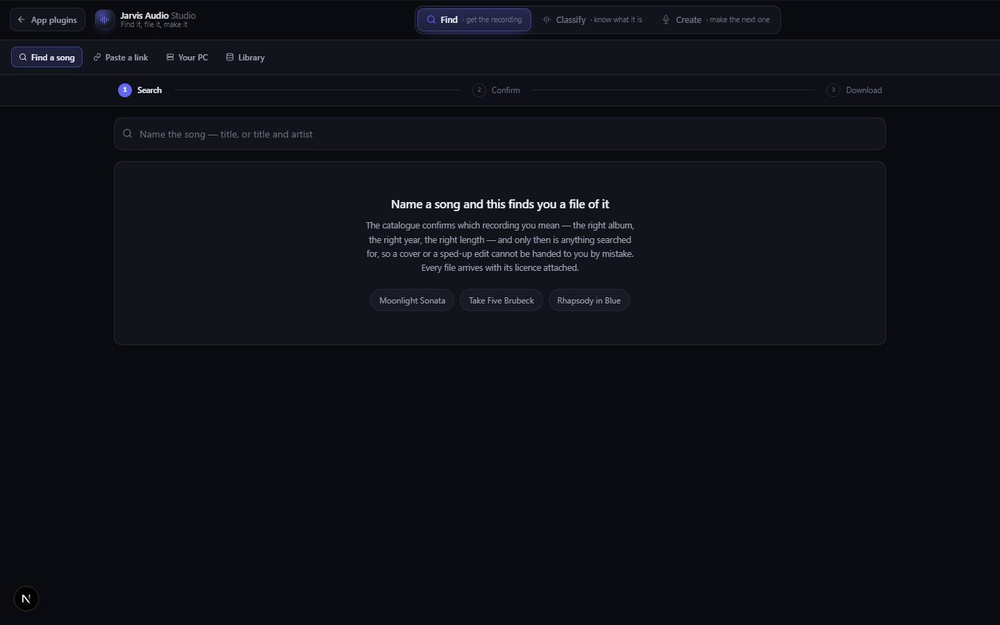

# Jarvis Audio Studio

`/apps/jarvis-audio-studio` · Music · live · shows as: a panel on the Jarvis Studio tab's wall (spines Find · Classify · Create, `src/lib/studio-home/panels.ts`) — it is in `PLUGIN_SLUGS` but gets no App plugins card because it is on the wall, and it is off the hub grid

> Find it, file it, make it

Three music studios behind one switcher: **Find** gets the exact recording you meant and a file of it with its licence written down, **Classify** is a private catalogue that measures and describes songs, and **Create** writes and renders new songs on a rented GPU. It is the soundtrack half of Jarvis's Studio — the owner uses it to pin down, understand or make the audio a video is cut to. Everything except GPU rendering works with no keys.

## Features — every one of these must still exist after your change

The owner asked for each of these. Removing, hiding or "simplifying away" one is a regression,
even if the code looked unused. If a change needs one gone, ask first.

**The shell**
- **Three-studio switcher** — Find / Classify / Create segmented tabs with a sliding lit thumb; hints ("get the recording"…) show on wide screens. `src/components/jarvis-audio-studio/JarvisAudioStudio.tsx`, list in `src/lib/jarvis-audio-studio/sections.ts`
- **`?section=` deep links + remembered studio** — a link naming a studio opens it; a bare visit resumes the last one (localStorage `jarvis-audio-studio:section`); switching rewrites the URL without reloading so unsaved work survives. `JarvisAudioStudio.tsx`, `src/app/apps/jarvis-audio-studio/page.tsx`
- **Old routes redirect in** — `/apps/mp3-download` → `?section=find`, `/apps/music-classified` → `classify`, `/apps/music-creator` → `create`. `src/app/apps/{mp3-download,music-classified,music-creator}/page.tsx`
- **One studio loaded at a time** with a studio-shaped skeleton while it arrives; skip-to-studio link for keyboard users. `JarvisAudioStudio.tsx`
- **Back link to Jarvis** (labelled "App plugins", goes to `/apps/jarvis#plugins` — note the app is actually reached from the Studio tab wall, not an App plugins card). `JarvisAudioStudio.tsx`

**Find (was MP3 Download)**
- **Search → Confirm → Download, three numbered stages** — search a song name, pick the exact recording, then hunt files for it. `src/components/mp3-download/Mp3Download.tsx`
- **Recordings table** — every catalogue match (Apple iTunes Search, keyless) with album, year and length, plus a 30-second preview. `src/components/mp3-download/ResultsTable.tsx`, `usePlayer.ts`, `src/lib/mp3-download/sources.ts`
- **Confirm dossier** — every catalogue field next to the real 30 s audio before anything is fetched. `src/components/mp3-download/Dossier.tsx`
- **Sources grouped by licence** — Public domain, Creative Commons, YouTube (rights not verified), … from Internet Archive, Openverse and YouTube, each scored against the confirmed recording with its reasons (match meter). `src/components/mp3-download/SourceTable.tsx`, `bits.tsx`, `src/lib/mp3-download/match.ts`, `types.ts` (`LICENCE_GROUP`)
- **YouTube rows with no yt-dlp and no key** — reads YouTube's results page directly on the live site. `src/lib/mp3-download/youtubeSearch.ts`
- **Paste a link** tab — a link from 20 allowed sites (YouTube, Vimeo, TikTok, Instagram, Facebook, X, Reddit, SoundCloud, Bandcamp, archive.org…) is read first (title, channel, length, stated licence; oEmbed when yt-dlp is absent), then grabbed as MP3 or MP4. `src/components/mp3-download/LinkGrab.tsx`, `src/lib/mp3-download/ytdlp.ts` (`SUPPORTED_HOSTS`), `oembed.ts`
- **A pasted URL in the search box hands over to the Paste tab.** `Mp3Download.tsx`
- **Big files download straight to disk** via one-shot tickets, not through tab memory. `src/lib/mp3-download/staging.ts`, `src/app/api/mp3-download/file/route.ts`
- **Your PC tab + PC bridge** — the live site queues a YouTube job, a runner on the owner's PC runs yt-dlp and returns the file through Storage; the tab makes the token and shows whether the runner is listening. `src/components/mp3-download/YourPc.tsx`, `src/lib/mp3-download/server/bridge.ts`, `src/app/api/mp3-download/{bridge,runner}/`, `tools/mp3-download-runner/`
- **Library tab** — every grab, newest first, no duplicates, with its licence kept forever; Copy credit lines, remove a row, Clear. `Mp3Download.tsx`, `src/lib/mp3-download/store.ts`

**Classify (was Music Classified)**
- **File a song from a name or a link** — identified against the iTunes catalogue ("Wrong song?" offers alternatives), tempo and key measured from the preview in the browser, then filed on the 1–10 energy ladder › genre › sub-genre. `src/components/music-classified/MusicClassified.tsx`, `src/lib/music-classified/identify.ts`, `measure.ts`, `classify.ts`, `levels.ts`
- **Energy ladder as a spectrum sidebar** (Still … Maximum, each with its hue) and a level › genre › sub-genre tree. `src/components/music-classified/LevelSidebar.tsx`
- **Describe-as lenses** — Plain English, Producer, Songwriter, Music theory, DJ, Vibe & moment, Dancer, Make one like it. `src/components/music-classified/LensPicker.tsx`, `levels.ts` (`LENSES`)
- **Style prompt on every song** — ≤1,000-character prompt of that exact recording for an AI song generator, with a quality-check count and copy button. `src/components/music-classified/StyleCard.tsx`, `src/lib/music-classified/style.ts`, `src/app/api/music-classified/style/route.ts`
- **Song panel** — filed-as (change the level/genre by hand), how it sounds (tempo, key, mood, instruments, vocals, era, sounds like), descriptions, your notes, links, Re-analyze, Delete (asks "Really delete?"). `src/components/music-classified/SongPanel.tsx`
- **My Music tab** — upload your own audio (type the artist first); a listening model hears a clip of it; browsed by artist; Listen again. Audio kept on the device in IndexedDB. `MusicClassified.tsx`, `ArtistSidebar.tsx`, `src/lib/music-classified/media.ts`, `wav.ts`, `src/app/api/music-classified/listen/route.ts`
- **Search, sort, favourites ★** across songs, sounds, moods and descriptions. `src/components/music-classified/SongTable.tsx`, `src/lib/music-classified/query.ts`
- **Blueprint** — what the songs in the current view share, written as a guide to making the next one. `src/components/music-classified/BlueprintBox.tsx`, `src/app/api/music-classified/blueprint/route.ts`
- **Export / Import library** (JSON; import replaces). `MusicClassified.tsx`, `src/lib/music-classified/store.ts`
- **Song screenshots from the photo inbox file into the Classifier.** `src/lib/dashboard/destinations/musicClassified.ts`

**Create (was Music Creator)**
- **Studio home** — tools grouped Create / Transform / Voice, each tile with its reason when the GPU lacks a model; Mashup and Remix tiles play preview loops on hover. `src/components/music-creator/MusicCreator.tsx`, `src/lib/music-creator/tools.ts`, `public/hub/icons/{mashup,remix}.{mp4,webp}`
- **GPU status pill** — GPU name / asleep · wakes on render / starting / no GPU server; render wakes the RunPod pod. `MusicCreator.tsx`, `src/components/music-creator/studio.tsx`, `src/lib/music-creator/pod.ts`
- **Song Creator** — type a style and (optional) lyrics; AI Producer on (producer → prompt engineer → code QC → one revision, original shown next to the optimised result, all editable) or off (sent exactly as typed); lyric modes; renders 48 kHz stereo on YuE2. `src/components/music-creator/tools/SongCreator.tsx`, `src/lib/music-creator/producer.ts`, `src/app/api/music-creator/produce/route.ts`
- **Hook Creator** — a wall of editable hook cards, each renderable across several seeds. `src/components/music-creator/tools/HookCreator.tsx`
- **Mashup** — name two records; hear each one's vocal / drums / bass / instruments on its own in a stem rack; pick what comes from which; Generated (SheetSage2 + YuE2) or Layered (real vocal over real backing); prompt for changes, every version kept. `src/components/music-creator/tools/Mashup.tsx`, `StemRack.tsx`, `SongPicker.tsx`, `src/lib/music-creator/mashup.ts`, `stems.ts`
- **Remix** — search a record, say what it should become ("NY drill remix"); melody transcribed and re-performed in that style's real tempo and kit; score (ABC) editor under Build; separated parts playable. `src/components/music-creator/tools/RemixStems.tsx`, `src/lib/music-creator/remix.ts`
- **One session, many versions** — Mashup/Remix revisions append to the same project, each re-renderable and downloadable. `src/lib/music-creator/versions.ts`
- **Tempo slider with style landmarks** (92 boom-bap, 124 house, 140 drill). `src/lib/music-creator/tempo.ts`
- **Scanner plates** — sweep a sealed plate to reveal the loaded clip's measured waveform (webgl-trail-reveal). `src/components/music-creator/Scanner.tsx`, `plates.ts`
- **Artist Voice Studio + Voice Library** — find a voice, cut the reference clip on a draggable waveform, isolate the vocal, clone with AuK (speech/rap, not singing), save once and reuse; Preview plays the clip. `src/components/music-creator/tools/ArtistVoice.tsx`, `ClipPicker.tsx`, `VoiceLibrary.tsx`, `src/lib/music-creator/audio.ts`
- **Projects** — every tool writes to one project list; a project reopens in its tool. `src/components/music-creator/Projects.tsx`
- **Finished songs** — every finished take, filterable per tool, saved as 256k MP3 to the account so it plays with the GPU asleep; Download on each take. `src/components/music-creator/Library.tsx`, `parts.tsx`, `src/lib/music-creator/library.ts`
- **Writing with no GPU** — style lines, lyric sheets, hooks and mashup plans work offline. `src/lib/music-creator/write.ts`, `src/app/api/music-creator/write/route.ts`
- **GPU server** — YuE2 + AuK + Demucs (+ SheetSage2) behind an allow-listed proxy; RunPod setup picks GPU and data centre from live stock; pod stops itself when idle. `tools/music-creator/`, `tools/music-creator/runpod/setup.mjs`, `src/app/api/music-creator/[...path]/route.ts`

## How it looks

- **Look:** "one chrome three studios share" — one grey family and one accent over the hub's own tokens; each studio keeps its own layout. Mashup/Remix plates were driven by interactive-web-studio + webgl-trail-reveal.
- **Colours / type:** DESIGN.md (Night Console) tokens, re-exported as `--jas-*`: canvas/panel from `--color-canvas`/`--color-panel`, extra line `#333849`, one accent `--color-brand` (indigo `#6366f1`). Create's own palette (`--mc-bg #08080b`, violet `--mc-go #7c5cff`) is overridden to the shared tokens inside the shell, and its rainbow hero line becomes a single-accent fade. Classify's level swatches take a per-level hue (`--h`, 230 → 55). Counts in `--font-mono`. Radii 14 / 10 / 7px.
- **Layout:** laptop — one 52px bar (back link, waveform mark + "Jarvis Audio *Studio*", switcher), the studio fills the rest. ≤900px the switcher drops to its own full-width row; ≤560px the tagline hides.
- **Signature pieces:** sliding-thumb switcher; Find's three-stage stepper and licence-grouped source table; Classify's energy spectrum sidebar; Create's tool tiles, GPU pill and scanner plates.
- **Motion:** studio fades/rises in (260ms); thumb slides. `prefers-reduced-motion` turns both off.

## Where the code is

| Part | Path |
|---|---|
| Page | `src/app/apps/jarvis-audio-studio/page.tsx` (+ redirect pages `src/app/apps/{mp3-download,music-classified,music-creator}/page.tsx`) |
| UI | `src/components/jarvis-audio-studio/` (shell) · `src/components/mp3-download/` · `src/components/music-classified/` (styles in `src/app/globals.css`) · `src/components/music-creator/` |
| Logic + tests | `src/lib/jarvis-audio-studio/sections.ts` · `src/lib/mp3-download/` · `src/lib/music-classified/` · `src/lib/music-creator/` |
| API | `src/app/api/mp3-download/` · `src/app/api/music-classified/` · `src/app/api/music-creator/` |
| Saved data | synced keys `mp3-download.library`, `music-classified:v1`, `music-creator.projects`, `music-creator.voices` (voice clips device-only `music-creator.voice-clips`); Storage buckets `mp3-download` (bridge files) and `music-creator` (finished songs, `<uid>/…`); server_docs doc `mp3-download-bridge`; own-music audio in IndexedDB |

## Owner's rules for this app

- Confirm the recording before fetching anything; score files against what was confirmed, never the typed words. Licence travels with every file and is shown, not hidden.
- Never fake a missing engine: yt-dlp absent, no GPU, no SheetSage2 — say so on screen and keep the rest working.
- Every song filed gets a style prompt (≤1,000 chars, no lyrics, no names); there is no separate Style Prompt tab.
- Song Creator takes only a style and lyrics. Producer priority: production > vibe > melody > vocals > lyrics.
- All edits that make a finished song stay in one project session (versions, never overwrite).
- Each stem plays on its own (A's vocal, B's vocal), and a click that would spend GPU time says so.
- Finished songs are copied to the account so they play with the GPU asleep.
- The shell never reimplements a studio; studios get `embedded` and keep every feature.
- Keys: `MUSIC_SERVER_URL`, `MUSIC_TOKEN`, `RUNPOD_API_KEY`, `MUSIC_POD_ID`/`MUSIC_POD_NAME`/`MUSIC_GPU`, `MUSIC_LISTEN_MODEL`, `MUSIC_MODEL`, `YTDLP_PATH`, `FFMPEG_PATH` — all optional.

## Described but not found in code

- "Style Prompt producer mode" (plain-words brief with genre/era/references/vocals/avoid and a 12-point gate as its own mode; feature log 2026-09-18) — superseded the same day by the per-song style prompt; `StyleStudio.tsx` no longer exists.
