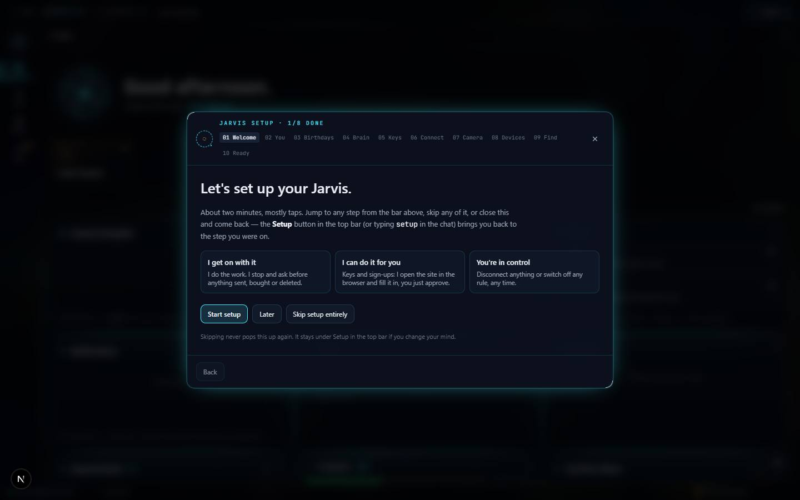

# Jarvis

`/apps/jarvis` · AI · live · shows as: hub tile (and the home every App plugin, Toolbox tab and Dashboard widget lives in)

> The assistant that can actually reach your computer

The owner's one assistant. A chat agent that can think, remember and act — including on the owner's
PC through a local helper (real browser with logins, shell, files, windows, screen) — plus the
owner's whole day: a Dashboard of widgets, memory, profile, folders, photos, lists, calendar,
inboxes, a Studio of video/image workflows, the work queue for Claude Code, and a Toolbox of tools.
`/apps/new-jarvis` redirects here. The old chat shell and Routines were removed 2026-10-17;
`src/components/jarvis/` now holds only panels Jarvis mounts.

## Features — every one of these must still exist after your change

The owner asked for each of these. Removing, hiding or "simplifying away" one is a regression,
even if the code looked unused. If a change needs one gone, ask first.

**Shell and access** — bare file names below are in `src/components/new-jarvis/`
- **Rail of three + More** — Dashboard, Chat, Studio; More is a searchable sheet (type, Enter opens the first match) with groups Work (Queue, Code, Site errors), Yours (Folders, Photos, Lists, Calendar, Inbox), Toolbox (Skills, Armory, Passwords, Calls, Router, Architect, Timeline, Apps, Settings). A More tab borrows a rail slot while open. `NewJarvis.tsx` (`TOP`, `GROUPS`, `MoreSheet`)
- **Hash deep links** — e.g. `/apps/jarvis#site-errors`, `#connections/<capability>`, `#setup`. `NewJarvis.tsx`
- **Password + family gate** — app password (`recall_auth`) and family members are sent to the Lists board only. `src/app/apps/jarvis/page.tsx`
- **Status dock + Voice orb** — one-line dock (voice, PC link, running jobs, queue count) and a floating orb that opens the voice chamber; Reactor faces ring / wave / core; speak replies on/off. `StatusDock.tsx`, `VoiceOrb.tsx`, `Reactor.tsx`, `src/lib/new-jarvis/reactor.ts`, `SidePanels.tsx`
- **Always-on voice** — wakes on "Jarvis" / "hey Jarvis"…, can be talked over, echo test so it never answers itself. `src/lib/new-jarvis/useWakeVoice.ts`, `src/lib/new-jarvis/wake.ts`
- **Onboarding** — opens on first run, every step skippable, reopens on the step it closed on; Setup button, typing "setup", `#setup`, "Finish setup" in Profile; includes the Keys step and birthdays. `Onboarding.tsx`, `src/lib/new-jarvis/onboarding.ts`

**Chat (the one Do agent)** — `ChatView.tsx`, `Blocks.tsx`, `src/lib/new-jarvis/runner.ts`
- **Conversations panel** — newest first under Today / Yesterday / Previous 7 days / Older; new, find, rename, delete. `ChatView.tsx`, `src/lib/new-jarvis/threads.ts`
- **Blocks** — each request keeps its steps and real results (tables, pages, screenshots, command output), re-run and stop. `Blocks.tsx`
- **Trust level** — Ask / Trusted (default) / Auto; "always allow" answers remembered; only money, sending and deleting always stop. `src/lib/new-jarvis/trust.ts`, `ChatView.tsx`
- **Model picker** — Claude cloud, Claude on my subscription (through the PC), presets (DeepSeek, MiMo, Gemini, GPT) and any OpenRouter model; synced. `ModelPicker.tsx`, `src/lib/new-jarvis/chatModels.ts`
- **Attachments** — up to 6 pictures/clips/audio, drop anywhere on the window. `src/lib/new-jarvis/chatMedia.ts`
- **Browser and Screen buttons** on the chat bar (Screen works without the PC). `ChatView.tsx`, `src/lib/new-jarvis/screenCapture.ts`
- **✦ Enhance / Goal check** — Felix end-goal pass + prompt enhancer above chat; "Send to board" files a super-board card (also on Improvements, Queue rows, Site errors). `GoalCheck.tsx`, `src/lib/new-jarvis/felix.ts`, `/api/new-jarvis/enhance`, `src/lib/new-jarvis/board.ts`, `/api/new-jarvis/board`
- **Reflex strip** — instant local answer while typing, never says "cannot"; "anyway" sends to the model. `ReflexStrip.tsx`, `src/lib/new-jarvis/reflex.ts`
- **PC off is never a dead end** — subscription brain falls back to cloud; cloud tools `web_search`/`web_read` (DuckDuckGo then OpenRouter web plugin, public addresses only), `app_builder`, `queue_build` (hands a change to In Queue `app:<slug>`). `src/lib/new-jarvis/web.ts`, `/api/new-jarvis/web`, `src/lib/new-jarvis/queueBuild.ts`, `src/lib/new-jarvis/agentTools.ts`
- **Errors that do the walking** — a plain-English error naming a chore offers the fix. `src/lib/new-jarvis/errorFix.ts`, `src/lib/new-jarvis/plainErrors.ts`
- **Decision models (Jev)** — triage trims tools on quick/remember turns; browser agent picks links/boxes and the words (saved Life Record detail via `hub/record_fill`, value never reaches a model; `JARVIS_TYPING_MODEL`); never submits. `src/lib/new-jarvis/triage.ts`, `browserFast.ts`, `fastTyping.ts`; catalogue `src/lib/ai/decisions.ts` + `decide.ts`; unwired points in `decisionPoints.ts`
- **Adult-content reroute** — Claude refusing explicit adult content → DeepSeek, then Grok (`JARVIS_UNCENSORED_MODELS`); never for blocked content or a hand-picked model. `src/lib/new-jarvis/reroute.ts`
- **App Builder over Jarvis** — `app_builder` opens `AppBuilderSheet.tsx` (full screen on phone, wide sheet on laptop, shrinks to a pill). See `docs/apps/app-builder.md`.
- **PC helper connects itself** — Connect button (`jarvis-agent://`), page pairs via `GET /pair` + `X-Jarvis-Pair`, re-pairs on a stale token; `selfheal.mjs` fixes the Startup shortcut and packages. `PcConnect.tsx`, `src/lib/new-jarvis/bridge.ts` (`autoPair`), `tools/jarvis-bridge/`

**Dashboard** — `DashboardPanel.tsx`
- **Deck** — live core, greeting, favourite + recent apps, widgets. `Deck.tsx`, `HudField.tsx`
- **Widgets** (owner picks which, synced; card → full sheet; phone Back closes the top sheet without reloading): Notifications (+ "Tell me when…" rules), To-do, Camera Autopilot, iPhone (Notes + Texts), Calendar, Improvements, In Queue, YouTube videos, Find My Life. `Widgets.tsx`, `WatchesEditor.tsx`, `QueueWidget.tsx`, `Improvements.tsx`
- **Camera Autopilot** — iPhone photos arrive via a Shortcut, get a self-improving confidence score (Sure 80+ / Maybe / Unsure filters, most/least sure sort), are filed or turned into jobs: a `task` Yes hands job + photo to chat (`jarvis:ask`) in Do mode; talk-to-type mic; same photos on every device (`inboxSync.ts`, `/api/dashboard/inbox/present`, `/api/dashboard/inbox/claim`). `Deck.tsx`, `src/lib/new-jarvis/autopilotChat.ts`, `/api/new-jarvis/autopilot`, `src/lib/new-jarvis/askEvent.ts`, `IphoneGuide.tsx`
- **Memory** — Map (layers 0 core…3 memories, zoom out to flat, Changed filter, timeline) and List (with "Same memory everywhere" card), vault status strip. `MemoryMap.tsx`, `src/lib/memory-map/build.ts` + `layers.ts`, `src/lib/jarvis/graph/force.ts`, `src/components/jarvis/MemoryTab.tsx`, `src/components/jarvis/MemorySyncCard.tsx`, `VaultStatus.tsx`
- **Profile** — Who you are (Life Record + Read my screen + documents + Finish setup), How you work (New Dashboard), Backend checklist, Connections. `src/components/jarvis/RecordTab.tsx`, `ScreenScan.tsx`, `RecordFiles.tsx`, `BackendChecklist.tsx`, `Connections.tsx`
- **Backend checklist** — THE build checklist (codes R S D P U L A O C); learns from chat (`/api/jarvis-profile/learn`), on-rules go into every chat build and publish as skill `website-build-checklist` (`/api/jarvis-profile/skill`). `BackendChecklist.tsx`, `src/lib/jarvis-profile/checklist.ts`
- **Connections / keys** — every key-switched capability with "Show me how" numbered steps, paste box and "Jarvis, do it". `Connections.tsx`, `src/lib/new-jarvis/keySetup.ts`, `src/lib/armory/catalog.ts`
- **Personas** pane (Personas Studio `embedded`), **Improve** (self-audit; approving writes a spec, never applies), **In Queue** board. `ImprovePanel.tsx`, `QueueBoard.tsx`
- **Birthdays** — family/friends in onboarding, calendar, notifications and chat. `src/components/birthdays/BirthdaysSheet.tsx`, `src/lib/birthdays/`

**Work** — **Queue**: ledger + a chat-style request folder per row and an Inbox, newest first, pictures, polls 15 s, completed requests vanish. `QueueBoard.tsx`, `QueueFolder.tsx`, `src/lib/new-jarvis/queue.ts`, `requests.ts`, `useRequests.ts` · **Code**: a coding agent (Claude Code or DeepSeek) in its own worktree; gates carry the patch to approve. `HarnessConsole.tsx` · **Site errors**: crash log of hub + client sites. `SiteErrors.tsx`, `src/lib/site-errors/`

**Yours** — Folders + Photos (`src/components/recall/Recall.tsx`), Lists (`src/components/recall/lists/ListsBoard.tsx`), Calendar (month grid, connected or typed events, changes go through a confirm card; `src/components/jarvis/CalendarTab.tsx`), Inbox (every connected mailbox/chat; sending always through the confirm card; `src/components/jarvis/InboxTab.tsx`).

**Studio** — `src/components/jarvis/StudioRoot.tsx`
- **Wall of studios** (only the panel nearest the pointer plays) and the **workflow wall**: cards mixed into a composer with variants, style keywords and the camera deck; Start runs as @-mentions in a Studio chat. `StudioWall.tsx`, `StudioTab.tsx`, `src/lib/studio/`
- **Kids Animation Flow** (card `animate-my-character`) — Character → Story → Board (draggable beat strip + animatic) → Render → Watch; planner `/api/studio/kids-flow/plan`; PC renders via `animate-character-story`. `src/components/jarvis/kids-flow/`, `src/lib/studio/kids-flow/`
- **3D Animation Flow** (card `film-3d`) — Three.js film engine; live 3D storyboard; "Make it here" (browser MP4 → `/api/studio/film3d/video`) or "Send to my PC" (`tools/film3d-render/render.mjs`). `src/components/jarvis/film3d/`, `src/lib/studio/film3d/`
- **PC-rendered workflows** end with `studio_queue` → that workflow's In Queue folder. `src/lib/studio/queueJob.ts`, `queueText.ts` (`PC_SKILLS`)
- Custom Video Swap and Workflow Maker cards open their own screens — see their docs.

**Toolbox** — Skills (Skills Library + "Skills on every device"), Armory (Capabilities: half-set-up first; Models), Passwords (encrypted vault, recovery key first), Calls (rules + log of calls it did NOT make; ships dormant), Router (read-only model routing + cost), Architect (`src/components/blueprint/Blueprint.tsx`), Timeline (`AppShell` chromeless), Apps (App plugins; `PluginsTab.tsx`), Settings (every switch). `ArmoryTab.tsx`, `PasswordVault.tsx`, `Telephony.tsx`, `src/components/jarvis/{RouterTab,PluginsTab,SettingsTab}.tsx`

## How it looks

- **Look:** "HUD skin" by interactive-web-studio over the hub dark set; Command Blocks direction (`.impeccable/surfaces/src-components-new-jarvis-newjarvis-tsx.md`).
- **Colours / type:** hub tokens re-declared translucent and cyan-edged (`new-jarvis-hud.css`): one cyan `--hud #47e8ff`, violet only in the field, brand indigo `#6366f1` on primary buttons; done `--color-core`, waiting `--nj-wip #e8a33d`. Oxanium for wordmark/headings (`--font-nj-display`), JetBrains Mono for anything Jarvis says about itself (`--font-nj-mono`).
- **Layout:** laptop — 56–68 px rail left with a cyan beam on the open section, centre content, dock across the bottom, floating orb. Phone — rail folds into a horizontal bar; sheets go full screen.
- **Signature pieces:** breathing galaxy ball (`WorldField.tsx`, Blender `tools/jarvis-world/build_world.py` → `public/jarvis/world.glb`), Reactor, blocks ledger, the Orb.
- **Motion:** field leans toward the pointer, radar sweep, sections resolve like a hologram; ease 160–220 ms. Every motion stops under reduced motion.

## Where the code is

| Part | Path |
|---|---|
| Page | `src/app/apps/jarvis/page.tsx` (`/apps/new-jarvis` redirects) |
| UI | `src/components/new-jarvis/` (shell) + `src/components/jarvis/` (mounted panels, Studio flows) |
| Logic + tests | `src/lib/new-jarvis/`, `src/lib/jarvis/`, `src/lib/jarvis-profile/`, `src/lib/memory-map/`, `src/lib/memory-rules/`, `src/lib/studio/` |
| API | `src/app/api/new-jarvis/` (agent, autopilot, board, enhance, ideas, queue, requests, watch, web), `src/app/api/jarvis/` (chat, memory incl. `memory/mcp`, skills, vault…) |
| Saved data | synced keys `jarvis`, `new-dashboard`, `new-jarvis:blocks`, `new-jarvis:threads`, `nj.chat-model:v1`, `jarvis-profile:v1`; memory rows in Supabase; In Queue + memory rules in server_docs |

## Owner's rules for this app

- No command bar across the top and no Ask/Do/Browse in Chat (Oct 2026): Chat is always the one Do agent. `CommandLine.tsx` is not mounted — keep it that way.
- PC off is never a dead end: work like Claude Code, never answer "cannot".
- Camera Autopilot is the same on every device.
- Memory: owner's notes are read-only for agents; connector tools `get_router`, `log_activity`, `get_findings`, `add_finding`; `save_memory` never writes as note/profile/vault, `delete_memory` refuses them (`src/lib/memory-rules/rules.ts`, `src/lib/jarvis/mcpProtocol.ts`).
- In Queue via the jarvis-memory connector (`queue_list`, `queue_start`, `queue_note`, `queue_complete` removes it, `queue_add`). When you finish work, complete the request it satisfies.
- Any new key an app asks for gets a `KEY_SOURCES` entry with steps and a capability in `src/lib/armory/catalog.ts`.
- When you build or change any app here, follow the Backend checklist.
- Sending a message, a calendar change or a call always goes through a confirm card; Calls stay dormant without a provider.

## Described but not found in code

- None found.
