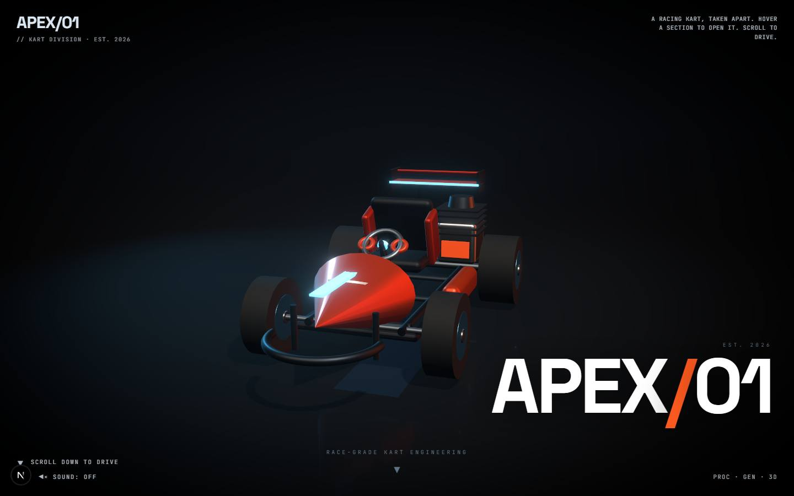

# APEX/01 Kart Teardown

`/apps/kart-showcase` · Websites · live · shows as: section of App Builder › Website Redesigner › Showcase (`MERGED_INTO` → `website-redesigner` → `app-builder`; played there in a frame)

> Interactive 3D showcase

A cinematic, interactive 3D racing-kart teardown in the style of a luxury brand site. The kart
turns on a lit stage; hover a section to explode it into labelled parts with names and specs, click
a part to isolate it, then scroll down to drop into a first-person, scroll-driven ride through a neon
tunnel with a live speed and gear readout. It is now a reference piece in Website Redesigner's
Showcase — "app ideas worth building again".

## Features — every one of these must still exist after your change

The owner asked for each of these. Removing, hiding or "simplifying away" one is a regression,
even if the code looked unused. If a change needs one gone, ask first.

**Teardown**

- **Kart on a lit stage, slowly orbiting** — the camera circles on its own with pointer parallax, slowing on hover; pushes in on an isolated part. `src/components/kart/CameraController.tsx`, `src/components/kart/Scene.tsx`
- **Hover to explode a region** — Front, Cockpit, Powertrain, Wheels, Aero; that region's parts fly out to their exploded positions. `src/lib/kart/parts.ts` (`REGIONS`), `src/components/kart/Part.tsx`
- **Click to isolate a part** — the rest dim to 10%; click again to release. 12 parts: nose, bumper, seat, steering, engine, exhaust, four wheels, wing, floor. `Part.tsx`, `src/lib/kart/parts.ts` (`PARTS`), `src/components/kart/KartParts.tsx`
- **Leader-line callouts** — name + spec labels at each part's exploded anchor, fading in with a small stagger (igloo.inc technical-annotation look). `src/components/kart/Annotations.tsx`
- **Region readout** HUD for the hovered region. `src/components/kart/Hud.tsx` (`RegionReadout`)

**The scroll story** (scroll phases in `src/lib/kart/store.ts` `PHASE`)

- **Hero** — "EST. 2026 · APEX/01 · RACE-GRADE KART ENGINEERING" with a scroll cue. `Hud.tsx` (`HeroIntro`)
- **Philosophy section** — "Every curve is calculated. Every gram is justified." `Hud.tsx` (`MissionSection`)
- **Founder quote** — with "SCROLL TO DRIVE". `Hud.tsx` (`QuoteSection`)
- **Dive into a first-person ride** — scroll-driven run through tunnel arches with floating spinning kart parts. `src/components/kart/RideScene.tsx`
- **Speed + gear HUD** — km/h and GEAR 1–6 computed from scroll position and speed; "Terminal Velocity · First-person · scroll-driven" title card during the ride. `Hud.tsx` (`SpeedHUD`, `RideTitle`), `RideScene.tsx`
- **Outro** — "YOU JUST DID 180 KM/H · NOW IMAGINE BUILDING IT." with a "START YOUR BUILD" button. `Hud.tsx` (`OutroSection`)
- **Smooth scroll** — Lenis over an 800vh page. `src/components/kart/KartShowcase.tsx`

**Extras and fallbacks**

- **Engine sound toggle** — "Sound: On/Off" in the corner HUD; off by default, WebAudio engine bed whose pitch and grit rise with speed. `src/components/kart/useEngineSound.ts`, `Hud.tsx` (`CornerHUD`)
- **"Assembling kart" loader** with a progress bar. `KartShowcase.tsx`
- **Keyboard / screen-reader access** — hidden buttons "Inspect <region>" and "Isolate <part>: <spec>". `KartShowcase.tsx` (`AccessibleParts`)
- **Reduced motion** — native scroll instead of Lenis, no auto-orbit, label "Reduced-motion mode · calm build". `KartShowcase.tsx`, `CameraController.tsx`
- **No WebGL** — the full teardown as a spec sheet (every part name + spec). `KartShowcase.tsx` (`Fallback`)

**In the Showcase**

- **Listed in Website Redesigner › Showcase** (view `?v=showcase`) — plays in place on the PlayShelf, "Open full screen", and **Use this idea** opens App Builder › Build with the idea box prefilled ("Build an app like APEX/01 Kart Teardown: …"). `src/lib/studio-home/builder.ts` (`SHOWCASE`, hue 16), `src/components/redesigner/Showcase.tsx`

## How it looks

- **Look:** its own luxury motorsport art direction, not DESIGN.md (the redesigner's Showcase calls it "APEX/01"); no design-skill record found.
- **Colours / type:** CSS-module tokens in `kart.module.css` — background `#07090c`, ink `#ffffff` / `#9fb4c7` / `#5f7183`, cyan `#57c8ff` (soft `#cfe8ff`), heat orange `#ff5a1f`, gold `#c9a96e`. Fonts Space Grotesk (display) and JetBrains Mono (HUD and body default), both via `next/font`.
- **Layout:** full-screen canvas under fixed HUD corners and centred story overlays on an 800vh scroll track. Phone (≤640 px): smaller wordmark and region index, callouts capped at 150 px, hero badge moved up.
- **Signature pieces:** the exploding kart with leader-line callouts, mono corner HUD, speed/gear gauge, the neon tunnel ride.
- **Motion:** auto-orbit, part explode/return easing, scroll-driven camera dive and ride, overlays fading in by scroll phase; reduced motion keeps the build calm (see above).

## Where the code is

| Part | Path |
|---|---|
| Page | `src/app/apps/kart-showcase/page.tsx` + `KartClient.tsx` (client-only dynamic import) |
| UI | `src/components/kart/` |
| Logic + tests | `src/lib/kart/` (`parts.ts`, `store.ts`) — no tests |
| API | none |
| Saved data | none (zustand store in memory) |

## Owner's rules for this app

- It is a **Showcase piece** in App Builder › Website Redesigner, not a tile of its own; the route is kept only so it can be played in place there and opened full screen.
- Keep the reduced-motion and no-WebGL fallbacks — it must degrade gracefully.

## Described but not found in code

- None found. (Note: the outro's "START YOUR BUILD" button links to `#configure`, and "48 configurations · 12 liveries" is copy only — there is no configurator in this checkout, and none is promised in the catalog.)
