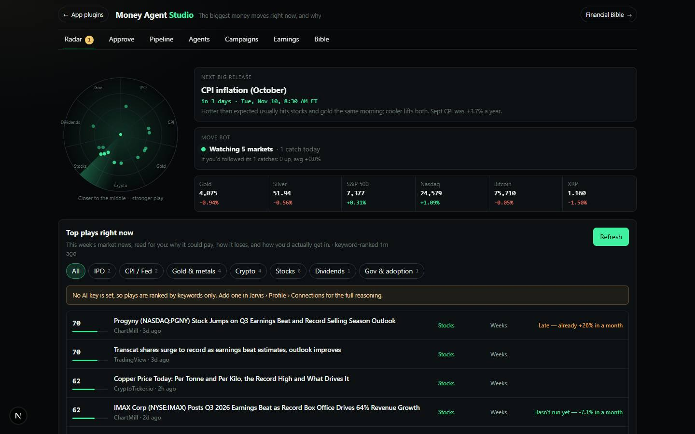

# Money Agent Studio

`/apps/money-agent-studio` · Video · live · shows as: a panel on the Jarvis › Studio wall (spines Clip · Channels · Campaigns). It is in `PLUGIN_SLUGS`, but `studioPlugins()` drops its App plugins card because `onTheWall()` is true. Financial Bible lives inside it as the **Bible** tab.

> Agents that make videos that make money

Standing agents whose only job is income from video: Clippers cut the shareable moments out of long videos, Faceless channels write and voice their own explainers, and Campaign clippers work paid-per-1,000-views clipping campaigns. The owner's PC makes every file, the owner approves every one, Personas Studio posts them, and the money shows in Earnings and in Financial Bible. A Radar tab covers the market side: this week's most lucrative plays, a release calendar, smart companies and a move-alert bot.

## Features — every one of these must still exist after your change

The owner asked for each of these. Removing, hiding or "simplifying away" one is a regression,
even if the code looked unused. If a change needs one gone, ask first.

**Shell**
- **Seven tabs: Radar · Approve · Pipeline · Agents · Campaigns · Earnings · Bible**. The open tab goes into `?tab=` and is remembered on this device (`money-agent-studio:tab`). `src/components/money-agents/MoneyAgentStudio.tsx`
- **Smart landing**: if something is waiting for approval, the studio opens on Approve. Otherwise it opens on the last tab used, or on Radar. `src/components/money-agents/MoneyAgentStudio.tsx`
- **Badges on tabs**: Approve shows how many videos are waiting, and Radar shows today's move-bot catches. `src/components/money-agents/MoneyAgentStudio.tsx`
- **Header**: a "← App plugins" link back to `/apps/jarvis#plugins`, a subtitle that changes per tab, and a "Financial Bible →" button that switches to the Bible tab. `src/components/money-agents/MoneyAgentStudio.tsx`
- **Money hero** (on every tab except Radar and Bible): "Paid this month" on a rolling odometer, plus paid all time (gold), estimated from views (mint) and total views. `src/components/money-agents/MoneyAgentStudio.tsx`
- **Pipeline conveyor**: six stages (Idea → Script → Making → Approve → Sent → Posted) on a lit track. Glowing tokens drift between stages that have work in them. Pressing Approve opens Approve; pressing any other stage filters Pipeline. Stages are defined in `STAGES` in `src/lib/money-agents/types.ts`. `src/components/money-agents/MoneyAgentStudio.tsx`
- **Toasts with Undo** (Undo is offered for Skip). `src/components/money-agents/MoneyAgentStudio.tsx`, `src/lib/money-agents/useMoneyAgents.ts`

**Agents**
- **Three kinds of agent**, each started from a "door" card: Clipper, Faceless channel and Campaign clipper (`AGENT_KINDS`). `src/components/money-agents/AgentsTab.tsx`, `src/lib/money-agents/types.ts`
- **Agent ledger table**: agent, kind, posts as, waiting, live, views, estimated, paid. `src/components/money-agents/AgentsTab.tsx`
- **Agent settings**:
  - who it posts as (a Personas Studio persona) and which of that persona's accounts it uses
  - what it clips, or the channel's niche
  - shape (9:16, 16:9 or 1:1) and the shortest and longest length
  - $ per 1K views
  - voice and the rules every clip or video must follow
  - videos per week
  - pause and delete
  `src/components/money-agents/AgentWorkspace.tsx`
- **Campaign fields**: campaign link, who pays, end date, budget, minimum views before it pays, and the content to clip (one link per line). `src/components/money-agents/AgentWorkspace.tsx`
- **"This agent's work" table** with Make and Skip on each row. `src/components/money-agents/AgentWorkspace.tsx`
- **Find clips (Clipper and Campaign agents)**: paste a podcast, stream or long YouTube link, pick how many clips, then press Find moments. The agent's saved sources and campaign links appear as quick-pick chips. `src/components/money-agents/ClipWork.tsx`
- **Four ways to find moments**, tried best first:
  1. a transcript the owner pasted, or the video's own YouTube captions (`server/transcript.ts`), read by AI
  2. the offline keyword finder when no AI key is set
  3. the AI watching the video by its link (`video_url`)
  4. a plain-English request to paste the transcript

  Each result is labelled with how it was picked. `src/app/api/money-agents/moments/route.ts`, `src/lib/money-agents/server/transcript.ts`, `findMoments` in `src/lib/money-agents/logic.ts`
- **"Or paste the transcript" box**, which opens by itself when the video's words can't be read. `src/components/money-agents/ClipWork.tsx`
- **Moment list**: timestamps, hook, why it works, a quote and a 0–100 score, with a tick box on each. Buttons: Make N on my PC, Keep for later, Discard. `src/components/money-agents/ClipWork.tsx`
- **Faceless ideas**: Get ideas pitches topics for the niche. It is told what the agent already made and how many views those got. Buttons: Keep N, Discard. Shows the "Aiming for N a week" target. With no AI key it uses offline `starterIdeas`. `src/components/money-agents/FacelessWork.tsx`, `src/app/api/money-agents/faceless/route.ts`
- **Script writer**: Write script / Rewrite gives an editable hook, numbered lines each with what is "On screen", a last line, thumbnail words and a caption. Make is locked until a script exists. `src/components/money-agents/FacelessWork.tsx`, `src/app/api/money-agents/faceless/route.ts`

**Make on the PC**
- **Make = one In Queue request per item** in folder `app:money-agent-studio`, built by `clipBrief` or `videoBrief`. Briefs use these skills: link-to-video, embedded-captions, ffmpeg, faceless-explainer. Each brief is at most 4,000 characters and ends with "never post it anywhere". `src/lib/money-agents/logic.ts`, `src/lib/money-agents/useMoneyAgents.ts`
- **Finished videos move to Approve by themselves** (`arrivedFromPc`). "Being made on your PC" shows each item as waiting, making, finished without a video, or left the queue, with a **Send again** button. `src/components/money-agents/ApproveTab.tsx`, `src/lib/money-agents/logic.ts`

**Approve (the owner's gate)**
- **Approve card**: plays the video, shows agent and score, and lets the owner edit the caption and hashtags. Pick Post as (persona), tick the accounts, and set When (leave it empty to post by hand from Personas Studio). Buttons: Approve, Skip, Download. `src/components/money-agents/ApproveTab.tsx`
- **Approve hands the video to Personas Studio**: the video is copied into Personas Studio's media folder (`/api/money-agents/handoff`), and a Ready or Scheduled draft is added to the chosen persona with a `draftId`. Personas Studio's own posting queue does the posting. `src/app/api/money-agents/handoff/route.ts`, `draftFor` in `src/lib/money-agents/logic.ts`
- **Campaign reminder**: "after it posts, submit the post link on the campaign page". There is also a note that links to set up a persona when none exists. `src/components/money-agents/ApproveTab.tsx`

**Pipeline, Campaigns, Earnings**
- **Pipeline table**: every item, newest first. Filter chips by stage (including Skipped), an agent filter, and multi-select with Make / Skip / Clear. Views can be typed by hand. `src/components/money-agents/PipelineTab.tsx`
- **Posted by itself**: an approved item becomes Posted once Personas Studio has its post (`wentLive`). Views come from Personas posts matched by `draftId`, otherwise from views typed by hand (`itemViews`). `src/lib/money-agents/logic.ts`
- **Find paid clipping campaigns**: an optional niche, then a web search (DuckDuckGo) that AI filters down to real campaign pages showing a rate per 1K. Every raw search result is kept too. Buttons: Add, and "Already joined one? Paste its link". The app never signs up for anything. `src/components/money-agents/CampaignsTab.tsx`, `src/app/api/money-agents/campaigns/route.ts`
- **Earnings**: a 30-day paid chart, a By agent table (paid in gold next to estimated in mint), a "Log money that came in" form (agent, amount, date, source: campaign / YouTube / TikTok / sponsor / other, note), and a Payouts list with remove. `src/components/money-agents/EarningsTab.tsx`
- **Estimates are never stored**: views × the agent's rate per 1K, and zero below a campaign's minimum views. `estimate` in `src/lib/money-agents/logic.ts`

**Radar (market side)**
- **Radar dish**: every play is a blip. Its sector is its kind (IPO, CPI/Fed, Gold & metals, Crypto, Stocks, Dividends, Gov & adoption); the nearer the centre, the stronger the play. A sweep lights each blip. Hovering or tapping a blip lights its row. `src/components/money-agents/RadarTab.tsx`
- **Plays feed**: this week's news (Google News, with DuckDuckGo as fallback) read by AI. For each play it gives why it could pay, how it loses, how you'd get in, and timing (early or late, judged from the last month's price run). Has kind chips, ☆ Star and "+ Bot". With no AI key, a keyword scorer is used. The feed is cached for 20 minutes. `src/app/api/money-agents/radar/feed/route.ts`, `src/lib/money-agents/radar.ts`
- **"Build a bot for this"**: files a paper-only backtest request to Trading Studio (In Queue `app:trading-studio`, `botBrief`). `src/components/money-agents/RadarTab.tsx`
- **Next big release / Happening now** box and a **release calendar** of CPI, jobs and Fed dates for the next four months, with countdowns and the markets each one moves. `src/components/money-agents/RadarTab.tsx`, `src/lib/money-agents/radarSeed.ts`
- **Live price tape** (Gold, Silver, S&P 500, Nasdaq, BTC, XRP, ETH, US Dollar). Prices come from Yahoo, then Stooq or CoinGecko, with no key needed. `src/components/money-agents/RadarTab.tsx`, `src/app/api/money-agents/radar/quotes/route.ts`
- **Smart companies** in three buckets: Profit machines, Dividend payers and Growth bets. You can add or remove tickers. `src/components/money-agents/RadarTab.tsx`, `BUCKETS` in `src/lib/money-agents/radar.ts`
- **Move bot**:
  - polls every 60 seconds while the studio is open, on any tab
  - each market has a rule: alert on a daily move %, alert above or below a price level, and a tighter threshold for 2 hours after a CPI, jobs or Fed release; each rule has an on/off switch
  - browser notifications, with an "Alerts on" control
  - a catches table, scored as paper trades ("if you'd followed its catches…"), with Clear

  `src/lib/money-agents/useRadar.ts`, `src/lib/money-agents/radar.ts`, `src/components/money-agents/RadarTab.tsx`
- **Fine print**: "not financial advice, nothing here buys or sells", plus the date the company figures were checked. `src/components/money-agents/RadarTab.tsx`

**Bible (Financial Bible, merged in)**
- **Bible tab** mounts the whole Financial Bible with its four rooms: Build Plans, Deal Scout, Money Plays and Funding. It loads only when the tab is opened. `src/components/money-agents/MoneyAgentStudio.tsx`, `src/components/bible/Bible.tsx`
- **`/apps/financial-bible` redirects** to `?tab=bible` and keeps `?studio=<room>`. `src/app/apps/financial-bible/page.tsx`
- **Money Plays room reads the same board** (`money-agents:v1`): every agent's views and earnings, with links back to the studio. `src/components/bible/rooms/PlaysRoom.tsx`

## How it looks

- **Look:** "a money terminal, not a dashboard of cards". The design skill was interactive-web-studio. The conveyor is the one toy on the Approve, Pipeline, Agents, Campaigns and Earnings tabs; on Radar the radar dish takes its place. Everything else is a dense ledger. There is no `.impeccable/surfaces` record for it.
- **Colours / type:** its own palette, scoped under `.mas` in `money-agents.css`, not DESIGN.md's indigo.
  - Canvas and panels: canvas `#06080a`, panels `#0c1013` / `#11171b`, lines `#1b2329` / `#26313a`.
  - Ink: `#e8efea` / `#9caaa4` / `#66746e`.
  - **Mint `#3ef0a0` means "moving"; gold `#f2c86b` means "paid"**. Red `#ff7a6b`, amber `#ffb547`.
  - Faint mint and gold radial glows sit in the top corners.
  - Fonts: system sans (`--font-sans`), 14px base. Money, numbers, timestamps and scores use mono (`--font-mono`). "Studio" in the title is mint.
- **Layout:**
  - Laptop: max width 1240px; the hero splits into a money column (260–340px) and the conveyor beside it.
  - Phone (≤ 880px): the hero stacks.
  - Phone (≤ 640px): conveyor dots shrink from 54px to 40px and hints hide; tables become stacked rows (`.mas-table.stack`); the header subtitle and link text hide; tabs scroll sideways.
  - Approve cards put the video beside the form, and stack at ≤ 720px.
  - The Bible tab bleeds to full width.
- **Signature pieces:**
  - the odometer (digit reels that roll to the value)
  - the conveyor with drifting mint and gold tokens
  - the radar dish with its sweep and blips
  - the three agent "doors"
  - mint/gold stat tiles and score chips
- **Motion:**
  - `mas-drift` tokens, odometer reels, a springy hover on the stage dots
  - radar sweep, blip pings and the pulse dot
  - rising toasts and a shimmer skeleton

  Under `prefers-reduced-motion`, all `.mas` animations and transitions are switched off, tokens are hidden, and the radar sweep, pings and pulse stop.

## Where the code is

| Part | Path |
|---|---|
| Page | `src/app/apps/money-agent-studio/page.tsx` (reads `?tab=`, `?studio=`) → `src/components/money-agents/Mount.tsx` (browser-only) |
| UI | `src/components/money-agents/` (`MoneyAgentStudio.tsx`, one file per tab, `AgentWorkspace.tsx`, `ClipWork.tsx`, `FacelessWork.tsx`, `money-agents.css`) |
| Logic + tests | `src/lib/money-agents/`: `logic.ts` (moment finder, money maths, PC briefs, Personas hand-off), `radar.ts`, `radarSeed.ts`, `useMoneyAgents.ts`, `useRadar.ts`, `store.ts`, `server/`. Tests: `logic.test.ts`, `radar.test.ts`, `server/transcript.test.ts` |
| API | `src/app/api/money-agents/`: `moments`, `faceless`, `campaigns`, `handoff`, `radar/feed`, `radar/quotes` |
| Saved data | synced key `money-agents:v1` (agents, items, payouts) and `money-agents:radar:v1` (stars, rules, catches, companies), both via `src/lib/sync/appState.ts`. Videos are in In Queue folder `app:money-agent-studio`, then copied into Personas Studio's media bucket. It reads Personas Studio's `social-personas:v1` |

## Owner's rules for this app

- **Nothing posts without the owner's Approve.** Approve only creates a Personas Studio draft; Personas Studio's own posting queue does the posting.
- **The PC makes every file.** Make files In Queue requests, and Claude Code finishes each one with `queue_video_link` + `queue_complete video: true`. The item then moves to Approve by itself.
- Estimates are views × rate, recomputed every time and never stored. Payouts are logged by hand.
- It never signs up for a campaign. The owner opens and joins each one.
- Radar is ideas and alerts only. It never buys or sells, and "Build a bot" is paper-only.
- Financial Bible is the Bible tab here (owner's call, Nov 2026). Keep `/apps/financial-bible` as a redirect, and keep `financial-bible` → `money-agent-studio` in `MERGED_INTO`.
- Owner-only: no public or auth prefix in `src/lib/hubAccess.ts`, so the middleware treats it as owner-only. It is also in `UNPREVIEWABLE` in `src/lib/catalog.ts`, so the hub carousel never frames it.
- Financial Bible › Money Plays reads the same board, so the two apps share one set of numbers. Don't fork the key.

## Described but not found in code

- An **App plugins card** for this app (described in the old CLAUDE.md "Money Agent Studio" row). The app is in `PLUGIN_SLUGS`, but `studioPlugins()` in `src/lib/studio/plugins.ts` skips it because it is on the Studio wall (`PANELS` in `src/lib/studio-home/panels.ts`). The header's back link still says "App plugins".
