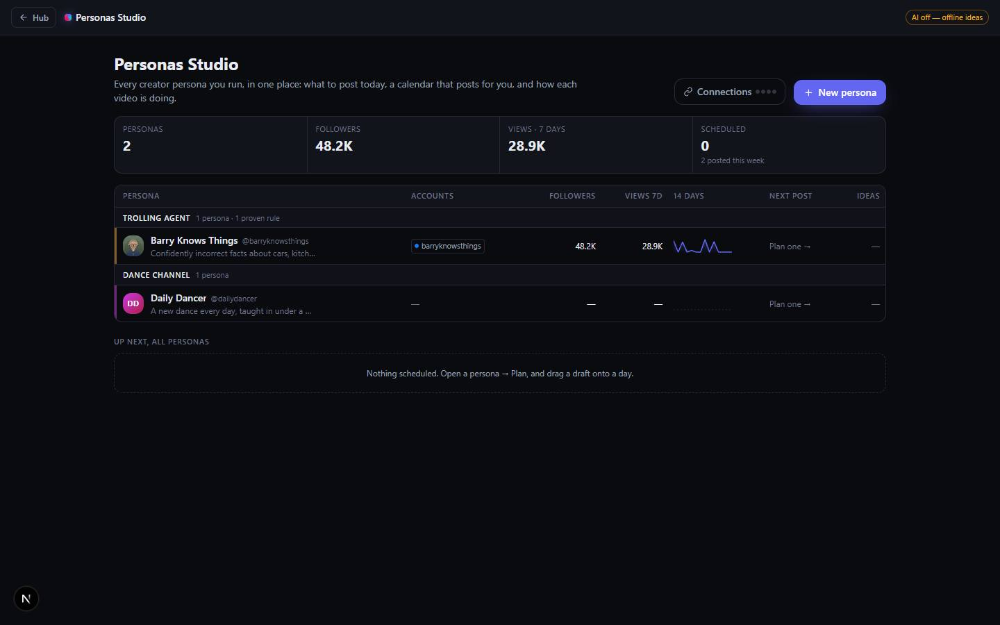

# Personas Studio

`/apps/personas-studio` · AI · live · shows as: Studio wall panel in Jarvis › Studio (spines Personas · Calendar · Analytics) + the Personas pane in Jarvis › Dashboard

> Run every creator persona — ideas, auto-posting, analytics

A content studio for someone running several creator personas at once (a rap channel, an explainer
page, a baby-growth diary). Each persona holds its profile, voice and social accounts; it gets fresh
post ideas every day, a calendar that posts for you through the official APIs, a message inbox, and
analytics that learn what actually works. It is "where the content goes out": every Studio workflow
makes a video, and this is where it meets the persona and account it belongs to — planned at the hour
that persona's own numbers say works, posted for you, then watched view by view so the next
morning's ideas start from what landed. Works offline with template ideas when no AI key is set.

## Features — every one of these must still exist after your change

The owner asked for each of these. Removing, hiding or "simplifying away" one is a regression,
even if the code looked unused. If a change needs one gone, ask first.

**Studio home and personas**
- **Studio home** — totals strip (personas, followers, views 7 days, scheduled + posted this week), one dense table row per persona (accounts, followers, views 7d, 14-day sparkline, next post, ideas waiting), and "Up next, all personas" (soonest 8 scheduled posts). `src/components/social-personas/StudioHome.tsx`
- **Grouped by nickname** — personas are filed under the job they do ("Trolling agent"); the table groups rows under each nickname with its persona count and proven-rule count. `src/lib/social-personas/store.ts` (`nicknameGroups`)
- **New / edit persona** — name, nickname, @username (suggested), profile picture (upload or https URL), niche, profile overview, content types, audience, tone, goals, "Never suggest"; "Start from" presets fill niche/types/audience/tone. `src/components/social-personas/PersonaForm.tsx`, presets `src/lib/social-personas/types.ts` (`PRESETS`)
- **Shipped personas** — the board opens with Barry (six weeks of seeded history for the learning loop) and Daily Dancer (no invented history). `src/lib/social-personas/seed.ts`, `src/lib/social-personas/daily-dancer.ts`
- **Deletion sticks** — deleting a shipped persona records it in `dismissed` so seeding never brings it back; deleting also disconnects its accounts and unschedules its drafts. `src/lib/social-personas/store.ts` (`removePersona`), `src/components/social-personas/SocialPersonas.tsx`
- **Persona workspace** — header band in the persona's own hue with avatar, @username, niche, followers / views 7d / scheduled; ten tabs: Overview · Message inbox · Ideas · Plan & post · Analytics · Learning · Character · Videos · Brainstorm · AI memory. Unread badge on Inbox, red dot on Plan when a post failed. `src/components/social-personas/Workspace.tsx`
- **Overview** — profile overview, content-type chips, Niche/Audience/Voice/Goals/Never rows, and a 5-step setup checklist with progress bar (overview → accounts → sign-ins → connect → first post). `src/components/social-personas/OverviewTab.tsx`
- **AI on / off badge** — header shows "AI on" or "AI off — offline ideas". `src/components/social-personas/SocialPersonas.tsx`

**Accounts, sign-ins and Connect**
- **Accounts per persona** — TikTok, Instagram, YouTube, Facebook and X, each with username and its own sign-in (login email/phone, password, 2FA, recovery notes). Sign-ins are Recall credentials in folder Personas Studio › <persona>, sealed by the vault (also visible in Jarvis › Passwords); passwords never go in the persona blob; copy-password clears the clipboard after 30 s. `src/components/social-personas/Accounts.tsx`
- **One-login Connect** — one platform login asks for sync + auto-post + inbox scopes; the callback silently retries without inbox, then without posting, if the developer app lacks them, and the account says what is still waiting (`canPost`, `canInbox`). "Reconnect to allow posting", "Sync posts now", remove account. `src/app/api/social-personas/oauth/[platform]/callback/route.ts`, `src/components/social-personas/Accounts.tsx`
- **Official connectors** — TikTok Login Kit + Display API, Instagram API with Instagram Login, Facebook Pages (Graph API), YouTube via Google sign-in. Tokens stay server-side (server_docs `social-personas-conn:<connectionId>`). YouTube syncs + gets comments but never auto-posts (`canAutoPost` = TikTok/Instagram/Facebook only). `src/lib/social-personas/server/connectors.ts`, `src/lib/social-personas/types.ts`
- **Connect setup** — "Connections" button (green dots per ready platform) opens a 3-step guide per platform with every value one tap to copy, a link on every step and an official-docs link; the two keys are pasted in-app and saved server-side (no env vars, no redeploy; env vars still win; bad pastes caught). Pressing Connect on an unconfigured platform opens this guide instead of an error. `src/components/social-personas/ConnectSetup.tsx`, `src/lib/social-personas/server/platformKeys.ts`, `src/app/api/social-personas/setup/route.ts`
- **Auto-sync** — connected accounts older than 3 h re-sync quietly on open; every sync records stat snapshots and a daily follower point (the per-video growth history). `src/components/social-personas/SocialPersonas.tsx`, `src/lib/social-personas/studio.ts` (`withFollowerPoint`)

**Ideas, brainstorm, memory**
- **Daily ideas** — a new day's batch of 5 is made by itself the first time Ideas opens that day; day picker for past days; Save / Made it / Skip; copy; "5 more ideas" with an optional steer; "Plan it" turns an idea into a draft; "Develop in Brainstorm". Offline template ideas with no AI key. `src/components/social-personas/tabs.tsx` (`TodayTab`), `src/app/api/social-personas/ideas/route.ts`, `src/lib/social-personas/logic.ts`
- **Hard limits kept visible** — ideas that break a hard rule (engagement-bait wording Facebook demotes, tragedy, politics, fake news, sexual content…) are held back with their reason shown, never silently dropped. `src/lib/social-personas/formats.ts` (`HARD_AVOID`), `src/lib/social-personas/logic.ts`
- **Brainstorm** — niche-aware chat with the persona's creative producer; clear conversation. `src/components/social-personas/tabs.tsx` (`BrainstormTab`), `src/app/api/social-personas/chat/route.ts`
- **AI memory** — "what the AI knows": summary, voice, content pillars, what works, untapped angles; Rebuild, with a "N new since" stale hint. `src/components/social-personas/tabs.tsx` (`BrainTab`), `src/app/api/social-personas/brain/route.ts`
- **Videos** — add a post by link (AI watches TikTok/YouTube video or reads the caption; paste caption for IG/FB), search posts, "watched" badge, "Read N unread" (10 at a time), open/remove. `src/components/social-personas/tabs.tsx` (`ContentTab`), `src/app/api/social-personas/analyze/route.ts`

**Plan & post**
- **Week calendar** — rolling week you drag posts onto; a drop lands at the persona's best hour (6 PM until stats say better) and springs into place; days tinted by how that weekday performs; on a phone, tap a post to pick its time. Unscheduled tray ("Not scheduled yet · drag onto a day"), New post. `src/components/social-personas/PlanTab.tsx`, `src/lib/social-personas/studio.ts` (`scheduleOnDay`)
- **Pipeline view** — switchable Calendar / Pipeline: Idea → Script → Film → Edit → Ready → Scheduled → Posted. `src/components/social-personas/PlanTab.tsx` (`Pipeline`)
- **Post editor** — title, hook, caption, hashtags, outline/shot list, per-platform caption-limit counters, video/photo upload, Post to (accounts), Next best slot, Unschedule, Save & schedule, Post now, post-link field that ties it into Analytics; every field saves as you type. `src/components/social-personas/DraftEditor.tsx`, upload `src/app/api/social-personas/media/route.ts` (bucket `social-personas-media`)
- **Reminders for no-API platforms** — accounts that can't auto-post get "Copy caption & open the app" at the time. `src/components/social-personas/DraftEditor.tsx`, `src/lib/social-personas/types.ts` (`UPLOAD_URL`)
- **Auto-posting queue** — one job per draft+account (never posts twice), locks, backoff, plain-English failures; Instagram reels/photos, Facebook Page video/photo/text, TikTok upload-to-inbox (Direct Post is private-only until TikTok audits the app). `src/lib/social-personas/queue.ts`, `src/lib/social-personas/server/queue.ts`, `src/lib/social-personas/server/publish.ts`, `src/components/social-personas/schedule.ts`
- **Heartbeat** — `/api/social-personas/publish/tick` driven by `.github/workflows/personas-tick.yml` every 15 min (optional `PERSONAS_TICK_TOKEN`, session-exempt in `src/middleware.ts`) and by the open page, which polls every minute and folds job results back into drafts (lost jobs are re-created). `src/app/api/social-personas/publish/tick/route.ts`, `src/components/social-personas/SocialPersonas.tsx`

**Analytics and learning**
- **Analytics** — KPIs, views per day (30 days), followers over time, every video with progress sparkline, +24h, likes, engagement and "vs usual" momentum (breakout pulses, ×-median), platform filter, video detail with full curve + every reading + "Plan a follow-up", best-time heatmap, "What's working, by format". `src/components/social-personas/AnalyticsTab.tsx`, `src/components/social-personas/charts.tsx`, `src/lib/social-personas/studio.ts`
- **Learning loop** — each post scored against the page's own normal per person reached; effects shrunk and ranked by the lower bound of a 90% interval; reserved slots for a lever under test and a never-tried format; versioned, append-only lesson sets with a "what changed" diff; weekly median score chart; "Every lever, ranked" table; re-derives by itself daily / when post count changes; no AI key needed. `src/components/social-personas/Learning.tsx`, `src/lib/social-personas/learn.ts`, format library `src/lib/social-personas/formats.ts`
- **Character document** — `about-me` per persona, versioned with history ("Load this version"), injected verbatim into every generation ahead of the numbers; each idea records the version that made it; unsaved edits survive a reload. `src/components/social-personas/AboutMe.tsx`, `src/lib/social-personas/logic.ts`

**Message inbox**
- **Live inbox** — Instagram (DMs + comments), Facebook Pages (Messenger + comments), YouTube (comments): read + reply on the persona's normal Connect login; source chips glow with unread counts and filter; All / DMs / comments / unread views; search; 24-hour DM reply-window check; plain-English errors with a fix button; examples before anything is connected; refreshes every minute and on focus. `src/components/social-personas/InboxTab.tsx`, `src/lib/social-personas/inbox.ts`, `src/lib/social-personas/server/inbox.ts`, `src/app/api/social-personas/inbox/route.ts`, `/inbox/reply/route.ts`
- **Write as <persona>** — drafts a reply in the persona's voice that types itself into the box; a person reads and sends. `src/components/social-personas/InboxTab.tsx`, `src/app/api/social-personas/inbox/suggest/route.ts`
- **Open inbox tiles** — apps with no message API (TikTok, X, Threads, Messenger, LinkedIn, Reddit, Tinder, Bumble, Hinge, Snapchat, WhatsApp, Telegram, Discord) are tiles the person picks once — never scraped. `src/lib/social-personas/inbox.ts` (`OPEN_APPS`)
- **Messages stay on the device** — threads cached in localStorage; only read-marks and chosen tiles sync (`persona.inbox`). `src/components/social-personas/inboxCache.ts`

**Where else it appears**
- **Jarvis Dashboard pane** — the whole Studio mounted `embedded` as Dashboard › Personas (right after Memory and Profile), with a "Full screen" link. `src/components/new-jarvis/DashboardPanel.tsx`
- **Money Agent Studio hand-off** — approved money-agent videos land as Ready/Scheduled drafts on the chosen persona and post through this queue; Financial Bible › Money Plays reads the board. `src/app/api/money-agents/handoff/route.ts`, `src/components/bible/rooms/PlaysRoom.tsx`
- **Old route** — `/apps/social-personas` redirects here, keeping the query string. `src/app/apps/social-personas/page.tsx`

## How it looks

- **Look:** DESIGN.md's near-black instrument panel, with a per-persona hue. No design-skill record in `.impeccable/surfaces/`.
- **Colours / type:** DESIGN.md tokens unchanged (`--color-canvas #0a0b0f`, `--color-panel #12141c`, `--color-brand #6366f1`, ink tokens; system sans, `tabular-nums` on numbers). Differences: each persona carries `--ps-hue` (header band radial gradient, row left stripe, active-tab underline, unread thread stripe, sent-bubble gradient); the logo mark `.ps-mark` is a conic gradient `#ff0050 → #d62976 → brand → #00cae0`; inbox chips glow in their platform colour (`--src`). Green/amber/red are for machine state only; the Learning tab shows polarity by position against zero, not colour. Charts are hand-drawn SVG, one series in brand colour, no legend (`charts.tsx`). Styles in `src/app/globals.css` (`.ps-*`, "Personas Studio" block).
- **Layout:** laptop — max-w-6xl home with KPI strip + wide table (min 760px, scrolls sideways) + Up next list; workspace = hue band header with a scrolling tab row; calendar 7 columns; Overview two columns (`lg`). Phone — KPI strip 2×2, calendar stacks to one column, pipeline scrolls sideways, tap-to-time instead of drag, "Personas Studio" label hides when a persona is open.
- **Signature pieces:** the dense persona table grouped by nickname, the drag-to-schedule week calendar with heat-tinted days, momentum badges with the pulsing "breakout", the interval-bar lever table, inbox source chips.
- **Motion:** springy and snappy — chips land with an overshoot (`ps-land`), dragged-over days lift, sheets rise (`ps-rise`), sent bubbles spring in (`ps-send`), the AI reply types itself in; only a breakout badge loops (`ps-pulse`). `prefers-reduced-motion` turns all of it off and the AI draft appears instantly.

## Where the code is

| Part | Path |
|---|---|
| Page | `src/app/apps/personas-studio/page.tsx` (redirect: `src/app/apps/social-personas/page.tsx`) |
| UI | `src/components/social-personas/` (shell `SocialPersonas.tsx` exports `PersonasStudio`) |
| Logic + tests | `src/lib/social-personas/` (`logic`, `studio`, `queue`, `inbox`, `learn` tests; server half in `server/`) |
| API | `src/app/api/social-personas/` (ideas, chat, brain, analyze, sync, status, setup, media, schedule, unschedule, queue, disconnect, publish/tick, inbox, inbox/reply, inbox/suggest, oauth/[platform]/start + callback) |
| Saved data | synced key `social-personas:v1` (app_state); posting queue server_docs `social-personas-queue:<uid>`; tokens server_docs `social-personas-conn:<id>`; videos in bucket `social-personas-media`; inbox messages localStorage only |

Keys: `TIKTOK_CLIENT_KEY/SECRET`, `INSTAGRAM_APP_ID/SECRET`, `FACEBOOK_APP_ID/SECRET`, `YOUTUBE_CLIENT_ID/SECRET` (or saved in Connect setup), `SUPABASE_SERVICE_ROLE_KEY` for video storage, optional `PERSONAS_TICK_TOKEN`.

## Owner's rules for this app

- Folder, lib, API routes and the synced key keep the old **Social Personas** name so saved personas survive — never rename them.
- A dense table, not a card grid, on the home screen.
- Never scrape apps that have no message API — they are "Open inbox" tiles.
- Other people's messages never go into the synced persona blob; passwords never go in it either.
- A post never goes out twice (one job per draft+account); YouTube never auto-posts.
- The character document is never summarised or paraphrased — it goes into every prompt word for word.
- A blocked idea is shown with its reason, never dropped quietly.
- Must work with no keys: offline ideas, link import instead of Connect, plain-English "waiting on" states.
- Barry's seed data holds a decoy (most views, worst per viewer) and a one-post fluke that `learn.test.ts` asserts stay demoted — don't edit the seed numbers.

## Described but not found in code

- **App plugins card** — the old CLAUDE.md (slug→folder row) and commit 871669a say Personas Studio has an App plugins card. The slug is in `PLUGIN_SLUGS`, but `studioPlugins()` drops it because it is on the Studio wall (`onTheWall`, `src/lib/studio-home/panels.ts`), so no card is drawn.
- **"Every morning" ideas** — the catalog says each persona gets fresh ideas every morning; there is no scheduled job — the day's batch is made when the Ideas tab is first opened that day (`TodayTab`).
