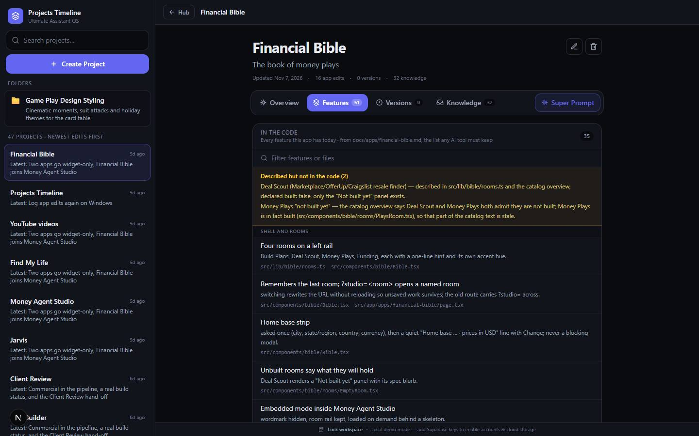

# Projects Timeline

`/apps/projects-timeline` · AI · live · shows as: Toolbox tab (Jarvis › More › Toolbox › Timeline)

> Project intelligence

The single source of truth for every project the owner runs: overview, core and supporting features,
a version timeline with files, and a Knowledge Inbox of notes, AI chats, PDFs and images. An "AI
Project Analyst" proposes updates the owner reviews and applies. Every commit that touches a hub app
shows up here automatically as an "App edit", and a Folders area holds the Cook Connect spades
styling. It was the hub's first app (`README.md` describes it).

## Features — every one of these must still exist after your change

The owner asked for each of these. Removing, hiding or "simplifying away" one is a regression,
even if the code looked unused. If a change needs one gone, ask first.

**Projects**
- **Sidebar** — searchable list of every project (name, one-line summary), Folders section, create project; a drawer on phones. `src/components/Sidebar.tsx`, `src/components/AppShell.tsx`
- **Every hub app is a project** — catalog apps are auto-added (new ones merged in without overwriting edits); hand-written content backfilled onto untouched projects. `src/lib/seed.ts`, `src/lib/seed-content/`
- **Create / Edit / Delete project** — name, one-line summary, overview, detailed explanation. `src/components/modals/CreateProjectModal.tsx`, `src/components/modals/EditProjectModal.tsx`, `src/components/ProjectView.tsx`
- **Project tabs** — Overview, Features, Versions, Knowledge. `src/components/ProjectView.tsx`
- **Features** — Core features (green) and Supporting features (blue). `src/components/FeaturesSection.tsx`
- **Version timeline** — versions in order, expand for summary/date/files; New Version dialog. `src/components/VersionTimeline.tsx`, `src/components/modals/AddVersionModal.tsx`
- **Files per version** — upload, download, delete (PDF, images, video, ZIP, code, `.mq4`/`.ex4`…). `src/components/VersionTimeline.tsx`, `src/lib/repo/supabase.ts`
- **Knowledge Inbox** — notes, ideas, feature requests, AI/Claude/ChatGPT conversations, dev updates, docs, bug reports, brain dumps; delete entries. `src/components/KnowledgeInbox.tsx`, `src/lib/types.ts` (`KnowledgeKind`)
- **Upload & auto-summarise** — PDF, DOCX, TXT, MD, images are read and summarised (editable before saving); offline extractive fallback with no key. `src/components/modals/AddKnowledgeModal.tsx`, `src/app/api/ingest/route.ts`
- **AI Project Analyst** — "Regenerate Project" proposes a new one-liner, overview, core/supporting features and version summaries plus change detection (New Features, Feature Changes, Improvements, Bug Fixes, Missing Documentation); review, then "Apply to Project". Heuristic fallback with no key. `src/components/AIPanel.tsx`, `src/app/api/regenerate/route.ts`, `src/lib/analyst.ts`
- **Super Prompt** — one build-ready prompt from everything known about a project; Copy or Download .md; no AI call. `src/components/modals/SuperPromptModal.tsx`, `src/lib/superprompt.ts`

**App edits (from git)**
- **Every commit that touches an app becomes a row** in `src/lib/timeline/feature-log.json`, written by `scripts/timeline-log.mjs` (`npm run timeline:log`, also `prebuild` with `--quiet-fail`). `scripts/timeline-log.mjs`
- **Laid over saved projects** — apps with no saved project show as virtual `catalog:<slug>` projects, saved for real on first edit; read-only, never overwrites the owner's text. `src/lib/timeline/appEdits.ts` (`overlayAppEdits`)
- **"App edits" list on each project's Features tab** — newest first, Core = app created / Supporting = a change, "Show fewer". `src/components/AppEditsSection.tsx`
- **Feeds Jarvis Improvements** — `recentEditsDigest` → `src/lib/new-jarvis/useIdeas.ts`. `src/lib/timeline/appEdits.ts`
- **Shallow clones don't log fake edits; works on Windows paths.** `scripts/timeline-log.mjs`

**Folders**
- **Game Play Design Styling** — the one place to change how the Cook Connect spades table looks: active theme, holiday/event schedule ("Use this now" turns the schedule off), every word, colour and attack per theme (suit colours, felt, accent, big moments like Spades broken, Trump steal, Nil shield, Getting set, Boston, Renig call), trick-clash intensity Light/Medium/Heavy; saves as you type and syncs. `src/components/GameStylingView.tsx`, `src/lib/cook-connect/gameStyle.ts`; folder list `FOLDERS` in `src/lib/timeline/appEdits.ts`

**Access and storage**
- **Password gate** — `TIMELINE_PASSWORD` locks the app (`/timeline-unlock`); "Lock workspace" in the footer. `src/lib/appGate.ts`, `src/components/AppShell.tsx`
- **Two backends, one UI** — local demo mode (browser storage) with no keys, Supabase when configured; footer says which, with Sign out. `src/lib/repo/index.ts`, `src/lib/repo/local.ts`, `src/lib/repo/supabase.ts`
- **Inside Jarvis** — mounted `chromeless` as Jarvis › Toolbox › Timeline (no hub button, heights fit Jarvis's chrome). `src/components/AppShell.tsx`, `src/components/new-jarvis/NewJarvis.tsx`
- **Linked from Client Review** — approved versions and briefs are written into a linked timeline project. `src/components/client-review/ClientReviewAdmin.tsx`

## How it looks

- **Look:** the hub's DESIGN.md dark system, unchanged (canvas `#0a0b0f`, panel `#12141c`, brand `#6366f1`, ink `#e9ecf3`); Tailwind tokens `bg-panel`, `border-line`, `text-ink-muted`.
- **Colours / type:** Core features green (`core #22c55e`), Supporting blue (`support #3b82f6`); system sans.
- **Layout:** laptop — 320 px sidebar (`w-80`) left, project column right, thin status footer. Phone — sidebar becomes a slide-in drawer (84% width) from a menu button.
- **Signature pieces:** Core/Supporting feature cards, the version timeline, the AI Analyst diff panel.
- **Motion:** drawer fade-in only.

## Where the code is

| Part | Path |
|---|---|
| Page | `src/app/apps/projects-timeline/page.tsx` |
| UI | `src/components/AppShell.tsx`, `Sidebar.tsx`, `ProjectView.tsx`, `FeaturesSection.tsx`, `AppEditsSection.tsx`, `VersionTimeline.tsx`, `KnowledgeInbox.tsx`, `AIPanel.tsx`, `GameStylingView.tsx`, `src/components/modals/` |
| Logic + tests | `src/lib/repo/`, `src/lib/store.ts`, `src/lib/timeline/` (`appEdits.ts` + test, `feature-log.json`), `src/lib/seed.ts`, `src/lib/analyst.ts`, `src/lib/superprompt.ts` |
| API | `src/app/api/regenerate/`, `src/app/api/ingest/`, `src/app/api/timeline-unlock/` |
| Saved data | Supabase tables `projects`, `features`, `versions`, `knowledge_entries`, `files` + bucket `project-files`; local mode `projects-timeline:v1`; styling synced key `game-play-design-styling:v1` |

## Owner's rules for this app

- **Every app edit lands here.** After committing app work, run `npm run timeline:log` and commit `feature-log.json` with it. Write commit subjects as "<App>: <what changed, in plain words>" — the subject becomes the title here and in Jarvis Improvements.
- Hand edits to a log entry's title or description stick; the script never rewrites existing entries.
- Spades table colours, words and attacks live in Game Play Design Styling themes — never hard-code them in the table.

## Described but not found in code

- None found.
