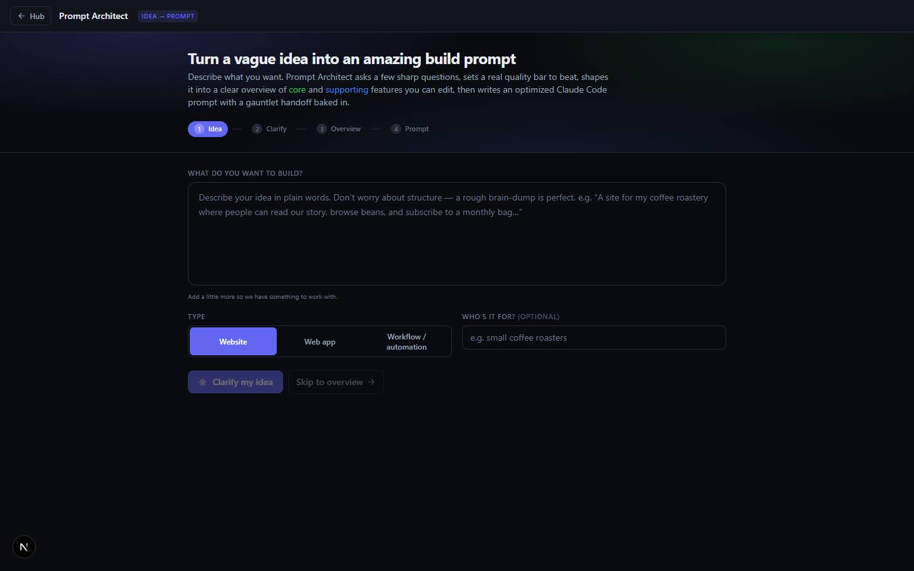

# Prompt Architect

`/apps/prompt-architect` · AI · live · shows as: Toolbox tab (Jarvis › More › Toolbox › **Architect**, `/apps/jarvis#architect`); the route also still works on its own

> Idea → amazing prompt

A four-step helper that turns a rough, half-formed idea into a build-ready prompt for Claude Code.
You type the idea, it asks sharp questions (two rounds), proposes a "quality bar" site to beat,
lays the idea out as an editable overview of core and supporting features, then writes the prompt —
plus a version with a Builder-vs-Critic gauntlet baked in. It works with or without an AI key.

## Features — every one of these must still exist after your change

The owner asked for each of these. Removing, hiding or "simplifying away" one is a regression,
even if the code looked unused. If a change needs one gone, ask first.

**The flow**
- **Four-step rail: Idea → Clarify → Overview → Prompt** — numbered pills with ticks; you can jump back to any step you have already reached, never ahead. `src/components/blueprint/Blueprint.tsx`
- **Idea box** — free-text "What do you want to build?" with a live hint until it has at least 12 characters. `src/components/blueprint/IntakePanel.tsx`
- **Type switch** — Website / Web app / Workflow / automation; it changes the questions and the suggested stack. `src/components/blueprint/IntakePanel.tsx`, `src/lib/blueprint/types.ts` (`KIND_LABELS`)
- **"Who's it for?"** — optional audience field that is carried into the prompt's Context. `src/components/blueprint/IntakePanel.tsx`
- **Skip to overview** — jump straight from the idea to the overview without questions. `src/components/blueprint/IntakePanel.tsx`

**Clarify (adaptive interview)**
- **Round 1 questions** — "Clarify my idea" asks a set of sharp questions; every one is optional and skipped ones become open questions instead of guesses. `src/components/blueprint/ClarifyPanel.tsx`, `src/app/api/blueprint/route.ts` (stage `clarify`)
- **Round 2 "Go deeper (recommended)"** — reads your answers and appends follow-ups under a "Round 2 · going deeper" divider, without duplicating earlier questions. `src/components/blueprint/Blueprint.tsx` (`runDeepen`), API stage `clarify2`
- **Quality bar to beat** — round 2 proposes a real, fetchable site (e.g. linear.app) to beat; editable. `src/components/blueprint/ClarifyPanel.tsx`, `src/lib/blueprint/heuristics.ts` (`suggestQualityBar`)
- **Answered counter** — "N/M answered" next to the buttons. `src/components/blueprint/ClarifyPanel.tsx`

**Overview (editable)**
- **One-liner + purpose** — editable headline and purpose paragraph. `src/components/blueprint/OverviewCanvas.tsx`
- **Design direction + quality bar** fields in one highlighted panel. `src/components/blueprint/OverviewCanvas.tsx`
- **Recommended skills chips** — the idea's vibe routed to the owner's design skills (exploded-showcase, webgl-trail-reveal, capcut-design, website-redesigner, interactive-web-studio), each removable, with the reason on hover. `src/lib/blueprint/skill-router.ts`, `src/components/blueprint/OverviewCanvas.tsx`
- **Core vs Supporting feature columns** — green "Core features" and blue "Supporting features"; add, rename, describe, remove, move up/down, and "Make supporting / Make core" to swap columns. `src/components/blueprint/OverviewCanvas.tsx`, `src/components/blueprint/FeatureCard.tsx`
- **Suggested stack + Open questions** — two editable lists. `src/components/blueprint/OverviewCanvas.tsx`
- **AI draft / Offline draft badge** — says which engine wrote the overview. `src/components/blueprint/OverviewCanvas.tsx` (`EngineBadge`)
- **Needs one core feature** — Generate stays disabled until at least one core feature has a name. `src/components/blueprint/OverviewCanvas.tsx`
- **Stale warning** — editing the overview after generating shows an amber "hit Generate again" banner. `src/components/blueprint/Blueprint.tsx`

**The prompt (deliverable)**
- **Claude Code prompt tab** — fixed structure: Objective, Design direction & quality bar, Recommended approach, Context, Main features (each with a "Done when"), Supporting features, Tech & constraints, Open questions, How to work, Quality gate. `src/lib/blueprint/prompt-template.ts` (`assemblePrompt`), `src/components/blueprint/DeliverablePanel.tsx`
- **For Gauntlet tab + "Copy for Gauntlet"** — the prompt wrapped in an `ultracode /loop` Builder-vs-blind-Critic brief against the quality bar. `src/lib/blueprint/prompt-template.ts` (`assembleGauntletHandoff`)
- **Overview spec tab** — the overview as a portable markdown spec. `src/lib/blueprint/prompt-template.ts` (`overviewToMarkdown`)
- **Portable toggle** — re-writes the prompt without the owner's private skill names or the gauntlet-loop, for sharing. `src/components/blueprint/DeliverablePanel.tsx`, `src/lib/blueprint/skill-router.ts` (`toTechnique`)
- **Copy and Download** — copy the current tab, or download it as `<name>-prompt.md` / `-gauntlet.md` / `-overview.md`. `src/components/blueprint/DeliverablePanel.tsx`, `src/lib/blueprint/client.ts` (`copyText`, `downloadText`)
- **Save to Projects Timeline** — creates a project with the core and supporting features and the prompt saved as an "idea" note; then a "Saved — open in Projects Timeline" link. `src/lib/blueprint/client.ts` (`saveToTimeline`), `src/components/blueprint/DeliverablePanel.tsx`

**Engine**
- **AI with full offline fallback** — every stage tries the shared AI provider and falls back to the built-in question banks and keyword planner on no key or any error, so it never breaks. `src/app/api/blueprint/route.ts`, `src/lib/blueprint/heuristics.ts`
- **Inside Jarvis without its own back button** — mounted `chromeless` as the Toolbox's "Architect" tab (bulb icon), so the "Hub" button is hidden there. `src/components/new-jarvis/NewJarvis.tsx` (`<Blueprint chromeless />`), `src/components/blueprint/Blueprint.tsx`

## How it looks

- **Look:** the hub's standard dark app shell (Tailwind tokens from `src/app/globals.css`); no dedicated design-skill record found.
- **Colours / type:** brand indigo `--color-brand` `#6366f1` (hover `--color-brand-2` `#4f46e5`) for buttons, step pills and chips; core features green `--color-core` `#22c55e`; supporting features blue `--color-support` `#3b82f6`; amber banner for the stale warning. Surfaces `bg-panel`, `bg-panel-2`, `bg-canvas`, borders `border-line`, text `text-ink` / `text-ink-muted` / `text-ink-faint`. Small uppercase tracked labels (`text-[11px] uppercase tracking-wider`); prompt shown in a monospace `<pre>`.
- **Layout:** top bar (Hub button + name + "Idea → Prompt" badge), an "aurora" header (three soft radial gradients: indigo, green, blue) with the title and step rail, then one centred column `max-w-4xl`. Laptop: feature columns and stack/questions sit side by side (`lg:grid-cols-2`). Phone: everything stacks in one column; Hub button shrinks to an arrow.
- **Signature pieces:** the step rail of numbered pills, the core/supporting feature cards with a coloured left bar and "01, 02" numbers, the three-tab deliverable with Portable toggle.
- **Motion:** panels fade in (`animate-fade-in`); spinners on busy buttons. The aurora dims under reduced motion (`motion-reduce:opacity-40`).

## Where the code is

| Part | Path |
|---|---|
| Page | `src/app/apps/prompt-architect/page.tsx` |
| UI | `src/components/blueprint/` |
| Logic + tests | `src/lib/blueprint/` (no tests) |
| API | `src/app/api/blueprint/route.ts` (one POST, `stage` = `clarify` · `clarify2` · `synthesize` · `prompt`) |
| Saved data | Nothing saved while you work (state is in memory). "Save to Projects Timeline" writes a project through `src/lib/repo` (Supabase when signed in, else local) |

## Owner's rules for this app

- Code folder is `blueprint`, not the slug (the old CLAUDE.md "Slug → code folder").
- It lives in Jarvis's Toolbox (`TOOLBOX_SLUGS` in `src/lib/studio/plugins.ts`), so it has no hub tile; keep the catalog entry.
- The skill router mirrors the `prompt-architect` skill's router table — keep the two in sync (`src/lib/blueprint/skill-router.ts` header).
- Every stage must keep working with no AI key (offline fallback), per the repo rule "apps must work with no keys set".

## Described but not found in code

- None found. (The route's header comment still says it "prefers the AI Gateway when AI_GATEWAY_API_KEY is set"; the code actually uses the shared provider `aiKey()`/`aiFetch()` from `src/lib/ai/provider.ts`.)
