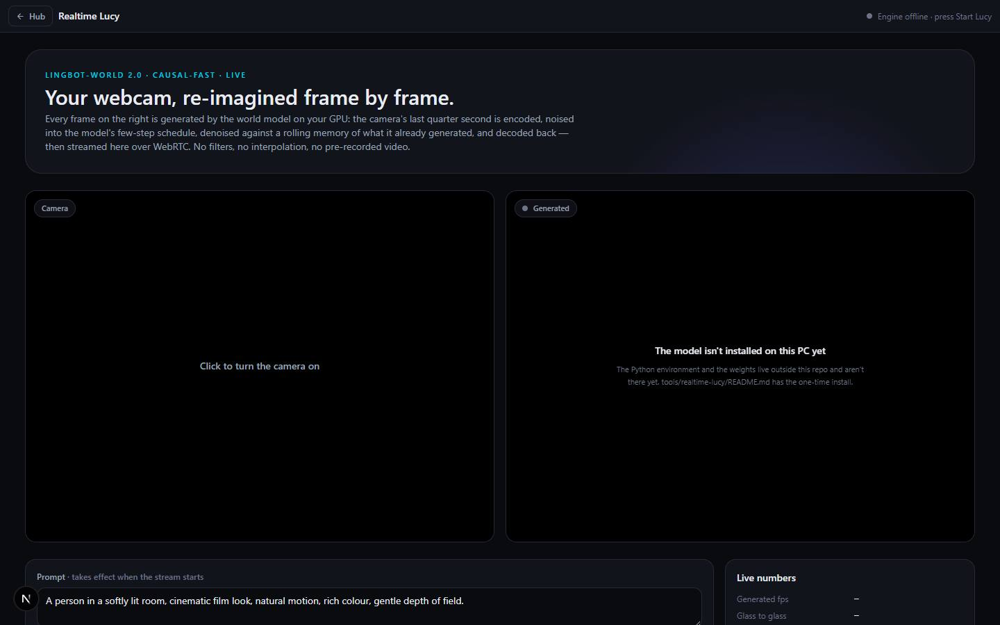

# Realtime Lucy

`/apps/realtime-lucy` · Video · live · shows as: hub tile (`noPreview: true` — the carousel shows its animated icon, never a live frame)

> Your webcam, re-imagined live by a world model

A live video-to-video stream driven by LingBot-World 2.0's causal-fast world model, running on the
owner's own GPU. The webcam goes out over WebRTC; on the PC every quarter second of camera video is
encoded, noised into a four-step schedule, denoised against a rolling memory of what the model already
made, and streamed back. Type a prompt to change the look mid-stream, choose how much of the camera
to keep, hold WASD or the arrow keys to steer the model's own camera, and watch real numbers — it is
real model inference, not a filter.

## Features — every one of these must still exist after your change

The owner asked for each of these. Removing, hiding or "simplifying away" one is a regression,
even if the code looked unused. If a change needs one gone, ask first.

**Start and stop** (`src/components/realtime-lucy/RealtimeLucy.tsx`)

- **One button: Start Lucy** — asks the studio bridge on this PC to start the GPU engine, watches the model load, and goes live by itself (becomes "Go live" if the server is already ready). `RealtimeLucy.tsx`, `src/lib/realtime-lucy/launcher.ts`, `tools/studio-bridge/server.mjs` (`/lucy/start`, `/lucy/status`)
- **Stop** (ends the stream) and **Stop the engine** — unloads the model and hands ~5.2 GB of VRAM back. `RealtimeLucy.tsx`, `launcher.ts` (`stopEngine`), bridge `/lucy/stop`
- **Honest status everywhere** — header dot + text (server online · GPU · model / model loading / starting / offline) and an explanation on the generated pane: engine off, model loading (20–30 s, first uncached prompt ~1 min more), "isn't installed on this PC yet", "Can't reach the launcher", or **"The launcher here is an older build"** (a bridge from before the Lucy routes — the page tells it apart and gives the stop-then-start commands). `RealtimeLucy.tsx`, `launcher.ts` (`BRIDGE_DOWN`, `BRIDGE_STALE`)
- **"What the button does" panel** — explains the bridge, shows `tools\studio-bridge\install-autostart.cmd` (plus `uninstall-autostart.cmd` first for an old build) and the last lines of the engine's log (`tools/studio-bridge/out/lucy.log`). `RealtimeLucy.tsx`

**The two screens**

- **Camera pane** — "Click to turn the camera on", then your live webcam. `RealtimeLucy.tsx`
- **Generated pane** — the model's frames over WebRTC, labelled "Generated · live"; a scan line while connecting; while a new prompt encodes it says the picture holds until it lands. `RealtimeLucy.tsx`, `src/lib/realtime-lucy/client.ts`

**Controls**

- **Prompt** — applies to the live stream on Enter (Shift+Enter = new line) or **Apply prompt**; label warns "edited, not applied — press Enter". `RealtimeLucy.tsx`
- **Six presets that apply on click** — cinematic room, oil painting, neon cyberpunk, hand-drawn anime, claymation, film noir. `src/lib/realtime-lucy/protocol.ts` (`PROMPT_PRESETS`)
- **How much of the camera to keep** — Faithful · Balanced · Dreamy · Free, with a one-line explanation each. `protocol.ts` (`STRENGTHS`)
- **Which part of the frame the prompt may repaint** — Whole frame · Background only · Me only; the region mode runs MediaPipe's selfie segmenter in the browser (CPU delegate, 4 times a second, sent as a 64-cell-wide grid) and says what % it is repainting, or falls back to unmasked if the segmenter fails. `src/lib/realtime-lucy/segmenter.ts`, `RealtimeLucy.tsx`; model files vendored in `public/mediapipe`
- **Drive the model's camera** — hold W/A/S/D, Q/E or the arrow keys while live; on-screen key caps light up. `RealtimeLucy.tsx` (`CAMERA_KEYS`)
- **Re-anchor** — forget the model's memory and restart from the current camera frame. `RealtimeLucy.tsx`
- **Connection settings** (hidden by default) — Lucy server URL (empty = go through this site's proxy), launcher URL (for a second PC with a big GPU), token, and conditioning mode SDEdit · Keyframe · Masked. Saved in localStorage. `RealtimeLucy.tsx`, `launcher.ts` (`LS_BRIDGE`)

**Live numbers**

- **Stats panel** — generated fps (and % of 16 fps), glass-to-glass latency, step time, denoise/stage timings, queue wait, peak VRAM, resolution, chunk, position, region locked %, camera frames, frames sent, plus a note on how latency is measured. `RealtimeLucy.tsx`

**On the PC** (`tools/realtime-lucy/`, not deployed)

- **GPU server** — aiohttp + aiortc WebRTC server running LingBot-World-V2's causal-fast path with SDEdit per chunk, rolling KV cache and streaming VAE; "masked" mode pastes the camera's own latents back outside the region after every denoising step, before the KV-cache write. Warms the six presets' text encodings while idle (cached on disk). Sends `Access-Control-Allow-Private-Network` so an https page can reach localhost. `tools/realtime-lucy/server/server.py`, `server/common.py`, `lingbot/wan/streaming.py`
- **`start.ps1` picks a size that fits the card's VRAM** (288×384 on 6 GB spills to RAM and is ~8× slower). `tools/realtime-lucy/start.ps1`
- **Benchmarks** — `server/bench.py`, results in `tools/realtime-lucy/bench/RESULTS.md`.

## How it looks

- **Look:** DESIGN.md instrument panel unchanged, plus a hero glow; no design-skill record found.
- **Colours / type:** hub Tailwind tokens; cyan `text-accent` eyebrow "LINGBOT-WORLD 2.0 · CAUSAL-FAST · LIVE"; selected chips `border-brand bg-brand/15`. Status dot `#22c55e` (live) / `#f59e0b` (warming) / ink-faint (off). Key caps in mono, lit `--color-brand` when held. Video panes on `#000`. Stats values in mono.
- **Layout:** laptop — hero card, then camera and generated panes side by side (4:3 each), then controls (left) + 360 px "Live numbers" (right), then the help panel. Phone — every pair stacks.
- **Signature pieces:** the two framed panes with floating pill captions; WASD/arrow key caps over the generated pane; the stats definition list.
- **Motion:** only the scan line while connecting (`rl-scan` 2.4 s) and key-cap colour flips; no reduced-motion override exists for the scan line.

## Where the code is

| Part | Path |
|---|---|
| Page | `src/app/apps/realtime-lucy/page.tsx` |
| UI | `src/components/realtime-lucy/` (`RealtimeLucy.tsx`, `realtime-lucy.css`) |
| Logic + tests | `src/lib/realtime-lucy/` (`client.ts`, `protocol.ts`, `launcher.ts`, `segmenter.ts`) — tests live on the Python side (`tools/realtime-lucy/server/test_streaming.py`) |
| API | `src/app/api/realtime-lucy/[...path]/route.ts` — signalling proxy for `/health` and `/offer` only |
| Saved data | browser only: localStorage `lucy.serverUrl`, `lucy.token`, `lucy.bridgeUrl` |
| PC helpers | `tools/realtime-lucy/` (GPU server, vendored `lingbot/`), `tools/studio-bridge/` (launcher on port 42010) |

## Owner's rules for this app

- The page is **only the WebRTC client**; nothing generates until the model runs on the GPU. Media goes browser ↔ GPU box directly; the site only proxies the two signalling calls, and only when `LUCY_SERVER_URL` (optional `LUCY_TOKEN`) is set for a server on another machine.
- The engine is **not** started at login on purpose — it holds ~5.2 GB of VRAM while loaded.
- The vendored `tools/realtime-lucy/lingbot/` keeps its upstream `LICENSE.txt` and `NOTICE.md`: CC BY-NC-SA 4.0, **non-commercial use only**.
- The bridge's Lucy routes (`/lucy/start`, `/lucy/stop`, `/lucy/status`) live in `tools/studio-bridge`, which is local and not deployed.

## Described but not found in code

- None found.
