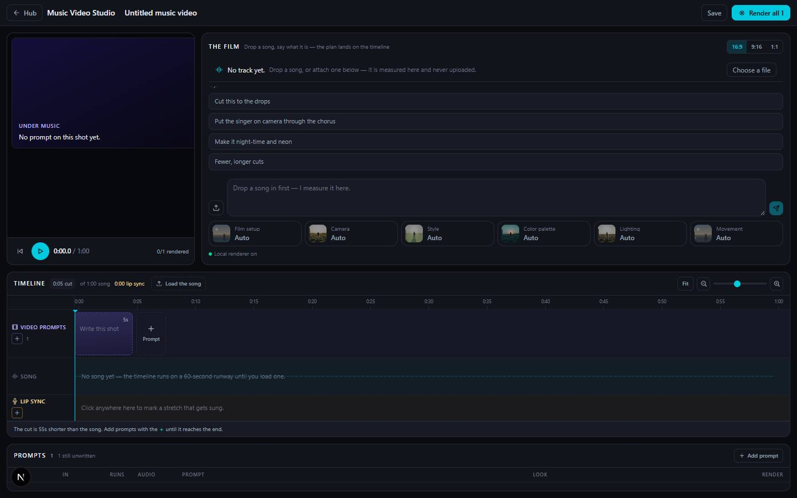

# Music Video Studio

`/apps/seedance-studio` · Video · live · shows as: a panel on the Jarvis › Studio wall (one spine, "Engine"; clip `public/studio/music-video.mp4`). It is in `PLUGIN_SLUGS`, but `studioPlugins()` drops its App plugins card because `onTheWall()` is true (`src/lib/studio-home/panels.ts`), and it is off the hub grid. The slug keeps the old name "Seedance Studio"; the code folder is `seedance`.

> Audio-driven video engine

You drop a song and the film is cut to the song, not just laid over it. The browser measures the track (tempo, bar lines, sections, drops) and a listening model writes down the lyrics with their times. Then the same chat Jarvis Studio uses writes a shot plan where every cut is pinned to a second of the song. That plan becomes a three-lane timeline you can edit. You can render one cut at a time, or render the whole film free on the owner's GPU with the song on top as the master track.

## Features — every one of these must still exist after your change

The owner asked for each of these. Removing, hiding or "simplifying away" one is a regression,
even if the code looked unused. If a change needs one gone, ask first.

**The track (measured in the browser, never uploaded)**
- **Drop a song and it is measured locally**: tempo, key, beat grid, bar lines, sections (intro/verse/build/chorus/bridge/outro guesses) and the loud hits and drops. Free and needs no key. `src/lib/seedance/audio/analyze.client.ts`, `src/lib/seedance/audio/grid.ts`, `src/lib/seedance/audio/timeline.ts`
- **Track strip pinned above the chat** shows what is known and how. MEASURED means tempo, bars and sections. HEARD means a model transcribed the words. PASTED means the owner's own lyrics were spread over the sung sections. It never mixes these up. `src/components/seedance/TrackStrip.tsx`
- **Transcribe the words with their times**: the song is cut into 40-second clips and each one goes to a listening model (Gemini via OpenRouter). The strip says the timings are close, not frame-accurate. If nothing is heard, it says the track may be instrumental. `src/lib/seedance/audio/transcribe.ts`, `src/app/api/seedance/transcribe/route.ts`
- **Paste lyrics** two ways: spread them evenly over the sung sections, or use the button "Use these words and let the model time them" (the model aligns your exact words). `src/components/seedance/TrackStrip.tsx`
- **Six visual modes**: Music video, Lyric video, Story, Voiceover, Reaction and Cinematic audio. The chosen mode goes to the director. `src/lib/seedance/audio/timeline.ts` (`VISUAL_MODES`), `src/components/seedance/TrackStrip.tsx`

**"The film" — the director chat (the only chat in the app)**
- **Same conversation as Jarvis Studio**: it posts to `/api/jarvis/chat` with the measured timeline, and the server adds the score rules (`scoreRules`). `src/components/seedance/SeedanceChat.tsx`, `src/app/api/jarvis/chat/route.ts`
- **@-mentions for workflows and people** from the Photos library (saved characters), **@Subject / @Audio** references to uploads, **#camera-move** autocomplete, and attachments by drag-drop or picker. `src/components/seedance/SeedanceChat.tsx`
- **Starter chips**: "Cut this to the drops", "Put the singer on camera through the chorus", "Make it night-time and neon", "Fewer, longer cuts". `src/components/seedance/SeedanceChat.tsx` (`STARTERS`)
- **Studio forms** the director can ask you to fill in, answered inside the chat. `src/components/seedance/SeedanceChat.tsx` (uses `../jarvis/StudioFormCard`)
- **Aspect ratio switch**: 16:9 / 9:16 / 1:1. `src/components/seedance/SeedanceChat.tsx`, `src/lib/seedance/constants.ts`
- **Film-wide camera deck** (`CinemaBar`) under the composer. Every block inherits it. `src/components/seedance/SeedanceChat.tsx`, `src/lib/seedance/prompt.ts` (`mergedCinema`)
- **Local renderer status dot**: "Local renderer on · N queued" or "off", checked every 20 s. `src/components/seedance/SeedanceChat.tsx`

**The score (shot plan pinned to the song)**
- **Plan lands on the timeline**: each of the score's cuts becomes a video-prompt block, and its lip-sync ranges fill the lip-sync lane (`applyScore`). The plan's logline becomes the reel's direction. `src/components/seedance/SeedanceStudio.tsx`
- **Cuts snapped to measured bar lines and drops**. The director is told the exact bar times it may cut on, and a cut that misses its bar shows up as a "FIX" note. `src/lib/seedance/score.ts` (`scoreRules`, `scoreNotes`)
- **Lip sync outranks the prompt**: on a shot that sings, the woven prompt puts the performer on camera mouthing those exact words, and the visual idea becomes the world around them. `src/lib/seedance/score.ts` (`shotPrompt`)
- **Printed shot-plan sheet** (same format as Smart Shot Videos). It shows cut count, % of the track covered, and a shared-choices strip (aspect, lighting, lens, palette swatches + grade, world). Section 1 is cast and wardrobe. Section 2 is the song map and locations (sections, drops, every cut drawn on the track). Section 3 is the storyboard. Section 4 covers genre and treatment, style, story, logline, lighting and sound. Everything can be edited in place. `src/components/seedance/ScoreSheet.tsx`
- **Cut cards**: each shows its time on the track, lens | aperture | length | move | framing, an editable title/action/"because", and the sung words in italics. The card turns amber and shows a SINGS badge when that cut sings. `src/components/seedance/ScoreSheet.tsx` (`CutCard`)
- **Second board of just the singing cuts** ("Section 3B: Lip sync — N of M cuts"). `src/components/seedance/ScoreSheet.tsx`
- **Draw frames**: draw one cut's storyboard frame, or "Draw N frames" (three at a time). Frames are drawn from the whole plan, with the chat's reference faces. `src/components/seedance/ScoreSheet.tsx`, `src/lib/studio/panels.ts`
- **Render one cut before committing** (play button on a cut card). A rendered clip replaces that cut's frame. `src/components/seedance/ScoreSheet.tsx`, `src/components/seedance/SeedanceStudio.tsx` (`renderOne`)
- **The timeline wins**: the sheet always reads lip sync from the timeline (`liveScore`), so dragging a range changes which cuts sing everywhere. `src/components/seedance/SeedanceStudio.tsx`

**Make the film (free, on the owner's GPU)**
- **"Make the film"** renders every cut on the local studio bridge and lays the song over it as the master. The song plays at full level, unlooped, the clips' own audio is dropped, and each clip is trimmed back to its planned slot. `src/components/seedance/SeedanceChat.tsx` (`makeFilm`, `audioMode: "master"`), `src/lib/studio/film.ts`, `tools/studio-bridge/server.mjs`
- **Film progress with Cancel and Save .mp4**. `src/components/seedance/SeedanceChat.tsx` (uses `../jarvis/FilmProgress`)

**The cutting room — three lanes, always on screen**
- **Three lanes**: Video prompts (on top), Song with its real waveform (middle), Lip sync (bottom). The song lane has "Load the song" and a remove-song chip. The toolbar shows cut length, song length and lip-sync seconds. `src/components/seedance/Spine.tsx`, `src/components/seedance/SongBar.tsx`, `src/lib/seedance/client.ts` (`decodeSong`)
- **Zoom**: zoom in/out buttons, a log-scale zoom slider, and Fit. A zoom you picked yourself survives a window resize. `src/components/seedance/Spine.tsx`
- **Video prompt blocks**: add with "+" (at the end, or after any block), drag to reorder (neighbours slide closed), drag the right edge to trim (1–15 s, default 5 s), Delete key to remove. A block wears its first reference image as artwork until it has a rendered clip. `src/components/seedance/Blocks.tsx`, `src/lib/seedance/reel.ts`
- **Lip-sync ranges**: plain ranges with no prompt (1–30 s, default 5 s). Drag, trim, nudge with ←/→, delete, or click the lane to drop one at that second. Any block a range lands on turns amber and lip-syncs. `src/components/seedance/Blocks.tsx` (`LipRangeView`), `src/components/seedance/SeedanceStudio.tsx`
- **Prompt sheet** for a block: prompt text with #camera-move tokens (their order is the shot), the block's own camera deck rails (Film setup genre/era/tempo, Camera, Movement, Style, Color palette, Lighting) layered over the reel's, reference images, duration, and a collapsible "What Seedance reads" preview of the woven prompt. Buttons: Render this shot, Add the next prompt, Duplicate, Delete. `src/components/seedance/PromptSheet.tsx`, `src/lib/seedance/prompt.ts` (`composePrompt`), `src/lib/studio/cinema.ts`
- **Lip-sync sheet**: start/length steppers, how many shots it covers, Delete. `src/components/seedance/PromptSheet.tsx`
- **Stage**: the shot under the playhead (rendered clip, artwork, or a graded colour stand-in), Play/Pause, Rewind, "Open this shot's prompt", and a rendered-count. Selecting a block moves the playhead to it. `src/components/seedance/Stage.tsx`, `src/components/seedance/SeedanceStudio.tsx`
- **Shot list**: every prompt in order with its image, words and deck summary, plus a Render / done / failed cell per row. `src/components/seedance/ShotList.tsx`
- **Top rail**: Hub link, editable reel name, Save, "Render all N". Keys: Space plays/pauses, Esc closes the sheet. `src/components/seedance/SeedanceStudio.tsx`
- **Seedance 2 via the Vercel AI Gateway** for single blocks (image-to-video when the block has an image). Needs `AI_GATEWAY_API_KEY` (model `AI_VIDEO_MODEL`, default `bytedance/seedance-2.0`). Without the key, or if a render fails, it returns a graded colour placeholder so the editor still works offline. `src/app/api/seedance/route.ts`, `src/lib/seedance/client.ts`

## How it looks

- **Look:** the hub's Night Console (`DESIGN.md`) with the hub's own tokens: `bg-canvas`, `bg-panel`, `border-line`, `text-ink*`, and `accent` = `#00cae0` cyan (`src/app/globals.css`). No separate impeccable surface record.
- **Colours / type:** a strict three-colour rule (`src/lib/seedance/constants.ts`): **cyan** = the song and the playhead, **amber** (hue 36, text `hsl(40 96% 78%)`) = lip sync and any block it lands on, **indigo** (hue 246) = a block playing under the music. Hub system fonts and tiny uppercase lane labels (11px, 0.1em tracking), with tabular numbers for times. The score sheet reuses Smart Shot's paper sheet classes (`src/components/smart-shot/smart-shot.css`: Anton display, JetBrains Mono, paper `#f7f6f2`) plus `src/components/seedance/score-sheet.css`. Note that those `--ss-*` variables are declared on `.ss`, and this page does not wrap the sheet in `.ss`.
- **Layout:** laptop: a top rail, then Stage + "The film" chat side by side (capped at 420px tall), then the timeline, the score sheet and the shot list stacked below, with the prompt sheet docked as a 400px right column. Phone: everything stacks in one scrolling column, the "Render all" label shrinks to an icon, and the prompt sheet opens full screen.
- **Signature pieces:** the three-lane timeline with the waveform in the middle, amber lip-sync ranges lining up with amber blocks, blocks that show their reference image like a storyboard, and the paper shot-plan sheet with its song map.
- **Motion:** blocks slide closed after a drag (`.sd-slide`), a light sweep crosses a block while it renders (`.sd-render`), the sheet slides in (`.sd-sheet`), and a sheen moves on the film progress bar. With `prefers-reduced-motion` all of these are off (`src/app/globals.css`).

## Where the code is

| Part | Path |
|---|---|
| Page | `src/app/apps/seedance-studio/page.tsx` |
| UI | `src/components/seedance/` (shell `SeedanceStudio.tsx`) |
| Logic + tests | `src/lib/seedance/` (`reel.ts`, `score.ts`, `prompt.ts`, `audio/*`; tests `reel.test.ts`, `score.test.ts`, `audio/grid.test.ts`, `audio/transcribe.test.ts`) |
| API | `src/app/api/seedance/` (`route.ts` = one clip, `transcribe/route.ts` = lyrics); the director is `src/app/api/jarvis/chat/route.ts` |
| Saved data | synced key `seedance-studio:v3` (reels, structure only: no song, refs or clips; `src/lib/seedance/repo.ts`) · synced key `seedance-chat:v1` (the conversation + visual mode; `SeedanceChat.tsx`). The score itself is not saved; it lives in this session only. |

Also used: the shared Studio pieces in `src/components/jarvis/` (CinemaDeck, MentionMenu, StudioFormCard, FilmProgress, ReferenceTile) and `src/lib/studio/` (cinema, film, render, storyboard, panels). The film render is the PC bridge in `tools/studio-bridge/`. Env keys: `AI_GATEWAY_API_KEY`, `AI_VIDEO_MODEL`, `SEEDANCE_LISTEN_MODEL` / `MUSIC_LISTEN_MODEL`, and OpenRouter for transcription.

## Owner's rules for this app

- The song is the master. Cuts land on measured bar lines and drops, and a clip that comes back longer than its slot is trimmed, never allowed to push later cuts out of sync (`score.ts` header).
- Lip sync outranks the prompt. On a singing cut the performer and the words are the subject, and the idea becomes the world around them.
- Only three lanes, and prompts live only in video blocks. The lip-sync lane never carries a prompt (feature log, 23 Sep 2026).
- The colour rule never changes: cyan = song, amber = lip sync, indigo = plays under the music.
- There is exactly one chat in this app ("The film"). Never add a second director box.
- The song never leaves the browser. Only its measurements (and 40-second clips, if transcription is asked for) are sent. Lyric timings are approximate, and the UI must say so.
- The timeline is the source of truth for lip sync. The sheet and the film read it from there.
- Save structure only, never the heavy media (song, reference images and clips are session-only).

## Described but not found in code

- "Move a cut, split it, lock it, toggle whether it sings" and "Snap to bars" — catalog overview. The code exists in `src/components/seedance/ScoreBoard.tsx` (views All / Sings / Both, split, lock, sing toggle, snap), but nothing imports that file, so none of it is on screen. The mounted `ScoreSheet.tsx` only edits text in place and changes singing through the lip-sync lane.
- "Rewrite the woven prompt" — catalog overview. The mounted UI shows the woven prompt read-only ("What Seedance reads" in `PromptSheet.tsx`). You can edit a cut's action/title, but there is no field to rewrite the woven prompt itself.
- "The original three-lane cutting room is still there behind a toggle" — catalog overview. There is no toggle: the three-lane timeline (`Spine.tsx`) is always shown, with the score sheet below it.
