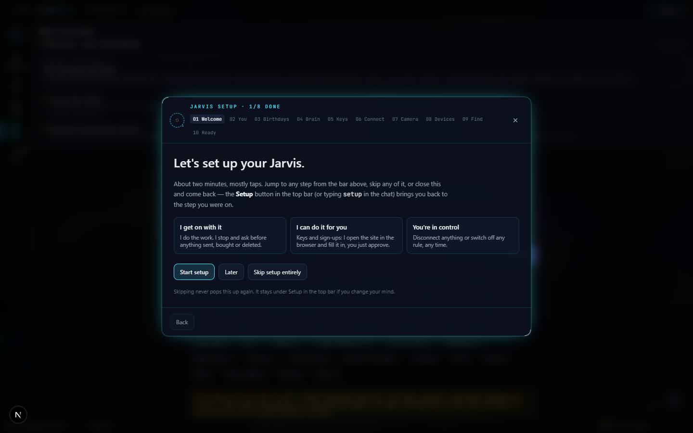

# Skills Library

`/apps/skills-library` · — (no catalog entry) · live · shows as: Toolbox tab (Jarvis › More › Toolbox › **Skills**, `/apps/jarvis#skills`)

> (No catalog tag line — Skills Library is not in `src/lib/catalog.ts` `PROJECTS`. The page heading reads "My Skills": "Your Claude Code skills, synced and searchable by name, nickname or category.")

The owner's library of every skill they have — their own Claude Code skills, plugin skills, the
Studio agents and a few built-in ones — in one searchable list. It shows how to call each skill,
its nicknames and categories, how often it gets called, and what it costs, and lets the owner cap a
skill's weekly spend or fix which model it runs on. It used to be its own app; since 2026-09-21 it
is a tab inside Jarvis, and the old route just redirects there.

## Features — every one of these must still exist after your change

The owner asked for each of these. Removing, hiding or "simplifying away" one is a regression,
even if the code looked unused. If a change needs one gone, ask first.

**Where it lives**

- **A tab in Jarvis's Toolbox** — Toolbox › Skills mounts the library with no Hub bar (`chromeless`). `src/components/new-jarvis/NewJarvis.tsx` (tab `skills`, `<SkillsLibrary chromeless />`)
- **Old link still works** — `/apps/skills-library` redirects to `/apps/jarvis#skills`. `src/app/apps/skills-library/page.tsx`
- **"Skills on every device" card** — above the list, shows whether skill sync is set up on this device and the next step. `src/components/jarvis/SyncStatusPanel.tsx` (mounted in `NewJarvis.tsx`)

**Where the skills come from**

- **Auto-sync on open + Sync button** — opening the library re-reads every skill source; the Sync button does it on demand and says how many synced. `src/components/skills/SkillsLibrary.tsx` (`runSync`) → `src/lib/skills/store.ts` `syncFromClaudeCode` → `src/app/api/skills/scan/route.ts`
- **Five sources merged, newest copy wins** — committed project pack `.claude/skills/`, the repo mirror `skills/<name>/SKILL.md`, Jarvis's skill store (Supabase `jarvis_memories` rows with `source = "skill"`, written by the connector's `save_skill` and by `skill-sync.mjs`), the live `~/.claude/skills/` on this machine, and installed plugin skills under `~/.claude/plugins/cache/`. Precedence lowest→highest: pack, repo, store, personal, plugins. `src/app/api/skills/scan/route.ts`
- **Works when deployed** — personal SKILL.md files are mirrored into `skills/` so the hosted site shows the same skills as the PC (change log 2026-09-24). `src/app/api/skills/scan/route.ts` (`scanRepo`)
- **Studio agents appear as skills** — every Studio workflow's skill file is served as a library record. `src/app/api/skills/studio/route.ts`, loaded by `src/lib/skills/store.ts` (`studioSkills`)
- **Built-in "featured" skills** — read-only skills that ship with the app (e.g. `github:scroll-world`); a synced or hand-added skill with the same slug/title replaces it. `src/lib/skills/seed-skills.ts`, `src/lib/skills/store.ts` (`withFeatured`)
- **Screenshot of a prompt → a skill** — a photo of a prompt filed from the Dashboard photo inbox becomes a Skills Library record, transcribed word for word. `src/lib/dashboard/destinations/skillsLibrary.ts` (registered in `src/lib/dashboard/destinations/registry.ts`)

**Finding a skill**

- **All skills / ★ Favorites switch** — starred skills in one folder; stars sync across devices (key `skills-favorites:v1`, keyed by slug so a re-sync keeps the star). `src/components/skills/SkillsLibrary.tsx`, `src/lib/skills/favorites.ts`
- **Search by name, nickname or category.** `src/lib/skills/categories.ts` (`matchesQuery`)
- **Category bar, always on screen** — pinned while you scroll, lists all 19 standard categories with counts (empty ones shown dimmed so chips never move). `src/components/skills/SkillsLibrary.tsx`, `src/lib/skills/categories.ts` (`CATEGORY_ORDER`, `categoriesIn`)
- **Web Design tagging from the design roster** — every skill in `src/lib/redesigner/design-skills.json` is tagged Web Design (the roster is appended to by `scripts/sync-design-skills.mjs`). `src/lib/skills/categories.ts`
- **Source filter** — All / Personal / each plugin name, Personal first. `src/components/skills/SkillsLibrary.tsx` (`origins`)
- **Sort row** — Recommended, Most used, Most spend, Newest, Oldest, Recently updated, A–Z. `src/lib/skills/sort.ts` (`SORTS`, `sortSkills`)
- **"Added" window** — Any time, Last 7 days, Last 30 days, This year. `src/lib/skills/sort.ts` (`ADDED`, `addedWithin`)
- **Sort, Added and Usage choices remembered per browser** (localStorage `skills-library:sort:v1`). `src/components/skills/SkillsLibrary.tsx` (`readView`/`pickView`)
- **Usage filter** — Any · Top 10 · Used · Never used · Retire? (never called, or idle 45+ days), each with its count. `src/lib/skills/usage.ts` (`USAGE_FILTERS`, `RETIRE_DAYS`), `src/lib/skills/spend.ts` (`retireCandidates`)
- **Nickname clash warning** — an amber banner when two skills answer to the same nickname. `src/lib/skills/categories.ts` (`nicknameClashes`), shown in `SkillsLibrary.tsx`

**Each skill row**

- **Name, source badge, categories, up to 4 nicknames, "Added <date>"**. `src/components/skills/SkillRow.tsx` (`OriginBadge`, `addedLabel` from `src/lib/skills/sort.ts`)
- **Usage badge** — "N calls · used X ago", #1–#3 most-used lit (rank is among all skills, whatever filter is on). `src/components/skills/SkillRow.tsx` (`UsageBadge`), `src/lib/skills/usage.ts`
- **Spend badge** — this week's cost/tokens (hover: lifetime cost and runs), amber at 80% of its cap, red when over. `src/components/skills/SkillRow.tsx` (`SpendBadge`)
- **Star, edit, delete** from the row. `src/components/skills/SkillRow.tsx`

**Skill detail and editing**

- **Detail window** — how to call it (`/name`) and its nicknames (or a hint to add "Nicknames: …" to the description), the full markdown prompt, **Copy prompt**, **View on GitHub** when it has a source link, star, Edit, Delete. `src/components/skills/SkillDetailModal.tsx`
- **Weekly dollar cap + model pin per skill** — set a weekly $ cap (over it the skill runs on the free model "till Monday") and pin a tier (Free / Cheap / Best model) or leave it to Jev. `src/components/skills/SkillDetailModal.tsx` → `PATCH /api/skills/spend` (needs sign-in) `src/app/api/skills/spend/route.ts`
- **Add a skill by pasting markdown** — title and overview fill themselves from the frontmatter as you paste. `src/components/skills/SkillEditorModal.tsx`, `src/lib/skills/parse.ts`
- **Editing a built-in makes your own copy** that takes its place; deleting that copy brings the built-in back (worded as "Discard your edits"). `src/lib/skills/store.ts` (`forkSkill`, `isBuiltIn`), `src/components/skills/SkillsLibrary.tsx` (`handleSave`, `handleDelete`)
- **Delete with confirm** ("This can't be undone"). `src/components/skills/SkillsLibrary.tsx`
- **Web design guide dropdown** — collapsible "which web design skill?" list: one paragraph + "best for" per skill, a Yours / Anthropic / Added badge, Open (if in the library) or a GitHub link. `src/components/skills/DesignGuide.tsx`, `src/lib/skills/design-guide.ts`

**Usage counting (how the call counts are made)**

- **Counts every skill call** — Claude Code on the PC/VPS (Skill tool + typed `/<skill>`, via the silent `skill-sync.mjs usage` hook → `/api/jarvis/skills/usage`, token; `pull` installs the hooks and backfills past calls once per machine), the connector's `get_skill` (`src/app/api/jarvis/memory/mcp/route.ts`), and Jarvis Studio workflow runs in `src/app/api/jarvis/chat/route.ts` (keys `studio:<id>`). Stored in one `app_state` row `jarvis:skill-usage`, no migration. `src/lib/skills/server/usageStore.ts`, `scripts/skill-sync.mjs`
- **Matching a call to a skill** — keys are call names (`felix`, `superpowers:brainstorming`, `studio:<id>`); `usageFor` matches by slug, then bare plugin name, then title. `src/lib/skills/usage.ts`
- **Updates by itself** — the page re-reads counts every minute. `src/lib/skills/useSkillUsage.ts` (`REFRESH_MS = 60_000`) → `src/app/api/skills/usage/route.ts`
- **Usage summary line** — "N calls across X of Y skills — from Claude Code on your computers, the Jarvis connector and Studio." `src/components/skills/SkillsLibrary.tsx`

**Spend and Jev model routing**

- **Weekly spend line** — this week's $ and tokens across skills, how many are over cap, and what Jev routed (runs, average ms, cost, runs sent to a cheaper model). `src/components/skills/SkillsLibrary.tsx` (`spendTotals`), `src/lib/skills/useSkillSpend.ts`
- **Jarvis runs are metered** — `recordCall` adds a call's cost to the skill when the call's `task.skill` is set (Jarvis Studio runs set it). `src/lib/ai/spend.ts` → global doc `skill-spend` next to `ai-spend`, writes batched. `src/lib/skills/server/spendStore.ts`
- **Claude Code runs are metered (estimates)** — Stop hook `skill-sync.mjs usage-cost` reads only new transcript lines and posts tokens per skill to `/api/jarvis/skills/usage` (`spend`), priced from the model catalogue at API rates. `scripts/skill-sync.mjs`, `src/lib/skills/server/priceTokens.ts`
- **Jev picks free/cheap/best per skill run** — `provider.ts` `planCall` → `routeSkill` (1.5 s ceiling; only when the router is choosing). Tier order: pin › cap › Jev › router. `src/lib/ai/provider.ts`, `src/lib/skills/server/routeSkill.ts`, `src/lib/skills/spend.ts` (`chooseTier`, `addSpend`, `capState`, `bySpend`, `retireCandidates`)

**Storage**

- **Per-user cloud storage with a local fallback** — Supabase `skills` table with per-user RLS when configured; otherwise localStorage, and the stand-alone header shows a "Local mode" badge. `src/lib/skills/store.ts` (`isCloudBacked`), `supabase/migrations/20260831000200_skills_library.sql`

## How it looks

- **Look:** the hub's standard "Night Console" dark app chrome (see `DESIGN.md`); no app-specific design skill recorded.
- **Colours / type:** hub tokens only — `bg-canvas` `#0a0b0f`, `bg-panel` `#12141c`, `bg-panel-2` `#181b25`, borders `line` `#262a38`, text `ink` `#e9ecf3` / `ink-muted` `#9aa3b5` / `ink-faint` `#6b7385`, accent `brand` `#6366f1` (active chips `bg-brand/15 text-brand`, primary button `bg-brand`, hover `brand-2` `#4f46e5`). Success text `core` `#22c55e`; amber for the nickname-clash banner, red for errors and over-cap. System sans for text, JetBrains Mono for counts and badges.
- **Layout:** one centred column (`max-w-3xl`) on a laptop: heading, All/Favorites segmented switch, search + Sync + Add skill, then filter rows (Category, Source, Sort, Added, Usage), the spend line, the Web design guide, and the skill rows stacked as rounded cards. On a phone the same column; filter rows scroll sideways instead of wrapping, and the Sync/Add buttons drop their labels to icons. Inside Jarvis the Hub bar is hidden.
- **Signature pieces:** the sticky blurred Category chip bar (`bg-canvas/95 backdrop-blur`), pill-shaped filter chips (dimmed when empty), the "N calls · used X ago" usage badge with #1–#3 lit, the spend badge, the amber nickname-clash banner.
- **Motion:** minimal — the Sync icon spins while syncing (`animate-spin`); colour transitions on hover. No large animation, so no reduced-motion branch is needed.

## Where the code is

| Part | Path |
|---|---|
| Page | `src/app/apps/skills-library/page.tsx` (redirect to `/apps/jarvis#skills`); mounted in `src/components/new-jarvis/NewJarvis.tsx` |
| UI | `src/components/skills/` (`SkillsLibrary.tsx`, `SkillRow.tsx`, `SkillDetailModal.tsx`, `SkillEditorModal.tsx`, `DesignGuide.tsx`) |
| Logic + tests | `src/lib/skills/` (`store.ts`, `categories.ts`, `sort.ts`, `usage.ts`, `spend.ts`, `favorites.ts`, `parse.ts`, `design-guide.ts`, `seed-skills.ts`, `server/{usageStore,spendStore,routeSkill,priceTokens}.ts`; tests `*.test.ts`) |
| API | `src/app/api/skills/` (`scan`, `studio`, `usage`, `spend`) · `src/app/api/jarvis/skills/usage/` (token, from `skill-sync.mjs`) |
| Saved data | Supabase `skills` table (per-user RLS) or localStorage `skills-library:v1` · Jarvis skill store = `jarvis_memories` rows `source = "skill"` · synced key `skills-favorites:v1` · `app_state` row `jarvis:skill-usage` · server doc `skill-spend` · per-browser view `skills-library:sort:v1` |

## Owner's rules for this app

- **Jarvis is the one home for every skill.** Creating or changing a skill = write the full SKILL.md and save it with the jarvis-memory connector's `save_skill` (`src/lib/jarvis/server/skills.ts`); writing files under `skills/` alone does not reach other devices. PC/VPS sync with `npm run skills:setup` / `scripts/skill-sync.mjs` — see `docs/skill-sync.md`.
- It is a Jarvis Toolbox tab, not a hub tile and not a catalog app. Don't give it a second door.
- Built-in (featured / Studio) skills are read-only; edits make a copy, never change the original.
- Hand-added skills are never overwritten by sync.
- Claude Code spend figures are estimates at API prices — on a subscription they cost nothing extra; the number exists to show which skills are heavy.
- Changing caps or model pins requires being signed in.

## Described but not found in code

- None found.
