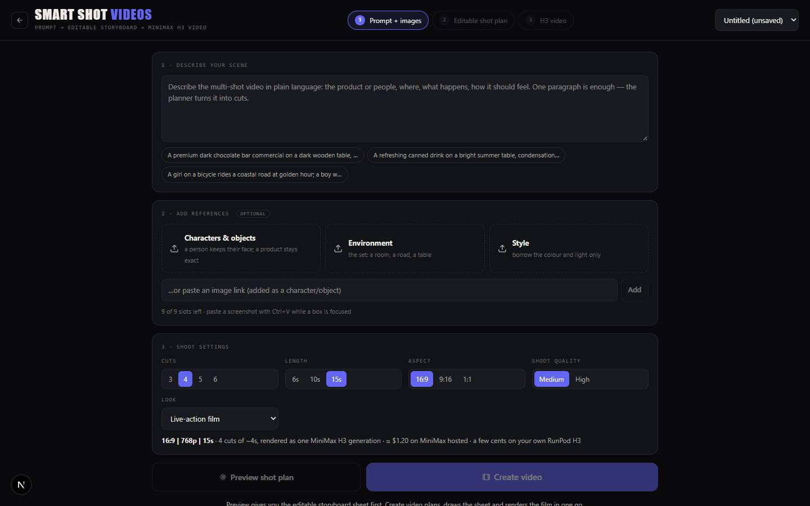

# Smart Shot Videos

`/apps/smart-shot-videos` · Video · live · shows as: hub tile

> Prompt → editable storyboard → H3 video

A recreation of OpenArt's Smart Shot inside the hub. The owner writes one paragraph about a short film or ad, adds reference photos, and gets a full production sheet with character sheets, set plates, a floor plan, one storyboard frame per cut and lighting references. Everything on the sheet can be edited or redrawn. When the sheet looks right, MiniMax H3 renders the whole film as one video.

## Features — every one of these must still exist after your change

The owner asked for each of these. Removing, hiding or "simplifying away" one is a regression,
even if the code looked unused. If a change needs one gone, ask first.

**The app around the sheet**
- **Three-step header**: 1 Prompt + images · 2 Editable shot plan · 3 H3 video. Steps 2 and 3 stay locked until a plan exists. `src/components/smart-shot/SmartShot.tsx`
- **Projects**: a picker in the header (up to 20 saved, newest first), "+ New project", and delete with a confirm prompt. `src/components/smart-shot/SmartShot.tsx`, `src/lib/smart-shot/repo.ts`
- **Picks up where you left off**: renders still running when the page closed keep checking when it reopens. A panel or take cut off halfway is cleaned up on load. `src/components/smart-shot/studio.tsx`, `src/lib/smart-shot/repo.ts`
- **Error and notice banner** with a dismiss button. Examples: "planned locally", or a planner failure that fell back to the offline planner. `src/components/smart-shot/SmartShot.tsx`

**Step 1 — Prompt + images**
- **Scene box with three example prompts**: chocolate commercial, summer drink, girl on a bicycle. `src/components/smart-shot/Brief.tsx`
- **Tagged references, up to 9 (H3's limit)**. Three drop zones: Characters & objects, Environment, Style. Each image can be re-tagged Character / Environment / Product-object / Style, given a name and a note, or removed. `src/components/smart-shot/Brief.tsx`, `src/lib/smart-shot/constants.ts`
- **Every way in**: click to pick, drag a file, drag an image from another page, paste a screenshot (Ctrl+V on a focused box), or paste an image link. iPhone HEIC photos are converted, and images are shrunk to 1024 px. `src/components/smart-shot/Brief.tsx`, `src/lib/smart-shot/media.ts`
- **Shoot settings**: Cuts 3/4/5/6 · Length 6/10/15 s · Aspect 16:9 / 9:16 / 1:1 · Quality Medium 768p / High 2K · Look (Live-action film, Commercial, Documentary, Anime, 3D animation). A summary line shows seconds per cut and an estimated cost. `src/components/smart-shot/Brief.tsx`, `src/lib/smart-shot/constants.ts`
- **Two buttons**: "Preview shot plan" plans the film and draws the sheet. "Create video" plans, draws and renders the film in one go. `src/components/smart-shot/Brief.tsx`, `src/components/smart-shot/studio.tsx`
- **The planner looks at your photos**, so a character drawn from a photo is described as that person. With no AI key, or when the model fails, an offline planner builds the sheet instead, so a sheet always comes back. `src/app/api/smart-shot/plan/route.ts`, `src/lib/smart-shot/plan/heuristic.ts`, `src/lib/smart-shot/plan/prompt.ts`, `src/lib/smart-shot/plan/schema.ts`

**Step 2 — the shot-plan sheet** (paper-white, in OpenArt's layout)
- **Shared choices strip**: cut count, aspect, a Lighting label, a Lens label, the palette as colour swatches plus a note, and an "environment fingerprint" (one line that pins down the setting). All editable. `src/components/smart-shot/Sheet.tsx`
- **Section 1, character reference**: a six-panel turnaround for each character (front, three-quarter and back views, two portraits, a wardrobe close-up) drawn from the uploaded photo, with palette swatches and editable Look and Wardrobe text. `src/components/smart-shot/Sheet.tsx`, `src/lib/smart-shot/panels.ts`
- **Section 1, product / hero object**: a product sheet labelled with five views (front, three-quarter, side/edge, macro detail, in context), palette swatches, an editable description and notes you can add. The heading changes to Character / Character + Product / Product to match. `src/components/smart-shot/Sheet.tsx`, `src/lib/smart-shot/panels.ts`
- **Section 2, set design**: a picture of each location, editable Set Notes and Props, and a top-down floor plan with a numbered camera marker for every cut. The legend lists each cut and its camera move. `src/components/smart-shot/Sheet.tsx`, `src/lib/smart-shot/panels.ts`
- **Side elevation** of the last cut's camera path (for example a crane move), drawn as three heights. `src/lib/smart-shot/panels.ts`, `src/components/smart-shot/Sheet.tsx`
- **Section 3, storyboard**: one frame per cut, captioned with lens (mm), aperture, seconds, move, framing and angle. Each frame is drawn from that cut's character sheets and set plate so faces and places match. `src/components/smart-shot/Sheet.tsx`, `src/components/smart-shot/studio.tsx`
- **Cut editing**: move a cut earlier or later, add a cut (8 at most), or delete one (at least 1 stays). The pencil opens lens, aperture, move (14 kinds), framing, angle, seconds, set, who is in the shot, action, dialogue (H3 lip-syncs it) and where it sits on the floor plan. `src/components/smart-shot/Sheet.tsx`, `src/lib/smart-shot/constants.ts`
- **Section 4, lighting, mood and style**: always four lighting reference pictures, each tied to a real light source in the scene, with editable captions. Also mood keywords, a one-line style essence, cinematography notes, and Sound (ambience + music). `src/components/smart-shot/Sheet.tsx`, `src/lib/smart-shot/plan/schema.ts`
- **Edit any word in place**: click any text on the sheet, then click away or press Enter to save. `src/components/smart-shot/Sheet.tsx` (`Editable`)
- **Redraw any picture**: each panel has a "Recreate image" / "Draw" button that redraws it from the current text. A toolbar button draws any missing panels, and a status shows how many are still drawing. Panels made with no image key are marked "offline preview". `src/components/smart-shot/Sheet.tsx`, `src/app/api/smart-shot/panel/route.ts`, `src/lib/smart-shot/placeholder.ts`
- **Drawing order**: characters, products and sets first, then the floor plan, elevation and cuts, then lighting. At most 4 pictures draw at a time, with one automatic retry on a low-credit error. `src/components/smart-shot/studio.tsx`
- **Download the sheet** as a single JPG made from every panel. The same image is attached to the film render. `src/lib/smart-shot/sheetImage.ts`, `src/components/smart-shot/Sheet.tsx`
- **AI director chat**, docked beside the sheet. Say what to change, or tap a starter ("Make it night-time with moonlight"…). The whole plan is rewritten, and only the panels whose content changed are redrawn. With no AI key it says so and points you to hand editing. `src/components/smart-shot/DirectorChat.tsx`, `src/app/api/smart-shot/revise/route.ts`, `src/lib/smart-shot/plan/revise.ts`
- **Next-step bar**: "Edit with AI" (puts the cursor in the chat), "Create video", and "View last video" once a film exists. `src/components/smart-shot/Sheet.tsx`

**Step 3 — H3 video**
- **One H3 generation for the whole film**: one compiled prompt with a [Shot N] block per cut. The character and product sheets, set plates, the composed sheet and one style image go in as references, and the length is capped at 4–15 s. `src/lib/smart-shot/h3prompt.ts` (`composeFullH3Prompt`), `src/components/smart-shot/studio.tsx`
- **H3 brief in H3's reference format**: subject_definitions, summary, retention_analysis, detailed_description, overall_soundscape and non_diegetic_music. Camera moves are written as sentences with an amplitude and a speed. Lens and depth of field are written as words, and the angle is named unless it is eye-level. Dialogue gets speaker ids. At most 9 images. `src/lib/smart-shot/h3prompt.ts`
- **Player + Download MP4**, plus a "Shot plan" download, "Recreate video", and a take picker once there are several films. `src/components/smart-shot/VideoStage.tsx`
- **Which video service is on**: shows the active backend and the cost estimate. With no backend it says which keys to add and renders a stand-in animatic. Renders go through `/api/auteur/generate`, which picks your own H3 on RunPod, MiniMax hosted, the AI Gateway, or the stand-in. `src/components/smart-shot/VideoStage.tsx`, `src/lib/smart-shot/client.ts`, `src/lib/auteur/server/video/index.ts`
- **Advanced, folded away**: the full H3 prompt, which can be copied, edited by hand, saved or reset. Each cut also has its own H3 prompt (same edit/reset), its own render (at least 4 s, with its storyboard frame attached), retakes and an mp4 download. `src/components/smart-shot/VideoStage.tsx`, `src/lib/smart-shot/h3prompt.ts` (`composeH3Prompt`)

## How it looks

- **Look:** "a dark studio around a paper-white sheet": a black workspace with a printed production document in the middle. Its own look, scoped under `.ss`. It does not use DESIGN.md's Night Console tokens. No design-skill record in `.impeccable/`.
- **Colours / type:** studio `--ss-bg #0a0a0c`, panels `#121317` / `#191a20`, lines `#26272f`, ink `#ecebe6` / `#a8a8a3` / `#6f6f6c`. Paper `--ss-paper #f7f6f2` / `#ecebe5`, paper lines `#cfcdc4`, paper ink `#1b1b1b` / `#4a4a48`. Primary buttons and the "VIDEOS" in the wordmark are indigo `--ss-brand #6366f1`. Errors red `#e5533d`, OK green `#5fc98a`. Type: the condensed display stack "Anton", Oswald, Bebas Neue, Impact for the wordmark and section titles. JetBrains Mono for labels, specs and prompts. "Inter"/system-ui on the sheet. Georgia italic for mood words. Anton and Inter are not loaded by the app, so the display falls back to an installed font such as Impact.
- **Layout:** laptop: a sticky blurred header (wordmark, step buttons, project picker). The storyboard page is the sheet beside a 340 px sticky AI director column. On the sheet, Sections 1 and 2 sit side by side, cuts in a grid of cards at least 200 px wide, and lighting four across. At ≤1100 px the chat drops below the sheet (460 px tall) and the paired sections stack. At ≤640 px the floor plan and elevation stack and lighting goes two across. The video page is centred at 1100 px max. Each Advanced cut row is frame · prompt · take, stacked on narrow screens.
- **Signature pieces:** the paper sheet with "SECTION 1–4" headings and the "SHARED CHOICES" strip. Panels with a "Recreate image" corner button. Colour swatches. The cut spec line ("50mm anamorphic | f/2 | 4s | DOLLY-IN | MEDIUM | LOW"). The docked AI DIRECTOR chat.
- **Motion:** almost none: a spinning loader and a pulsing "drawing" dot. There is no reduced-motion rule in `smart-shot.css`.

## Where the code is

| Part | Path |
|---|---|
| Page | `src/app/apps/smart-shot-videos/page.tsx` |
| UI | `src/components/smart-shot/` (`SmartShot.tsx` shell, `Brief.tsx`, `Sheet.tsx`, `DirectorChat.tsx`, `VideoStage.tsx`, `studio.tsx` = all state changes, `smart-shot.css`) |
| Logic + tests | `src/lib/smart-shot/` (`plan/` planner + schema + revise, `panels.ts` image prompts, `h3prompt.ts`, `sheetImage.ts`, `constants.ts`, `repo.ts`, `media.ts`; tests `smart-shot.test.ts`, `revise.test.ts`) |
| API | `src/app/api/smart-shot/` (`plan`, `panel`, `revise`); video goes through `src/app/api/auteur/generate/route.ts` |
| Saved data | This device only, not synced: localStorage `smart-shot:v1` (last 20 projects) and IndexedDB `smart-shot-media` / `blobs` (panel images, the sheet, video clips). No Supabase table or bucket. |

Keys: `OPENROUTER_API_KEY` or `AI_GATEWAY_API_KEY` for planning, drawing and the chat. Optional `SMART_SHOT_MODEL` (falls back to `AI_MODEL`) and `SMART_SHOT_IMAGE_MODEL` (default `google/gemini-3.1-flash-image`). Video: `RUNPOD_API_KEY` + `RUNPOD_ENDPOINT_ID`, `MINIMAX_API_KEY`, or `AI_GATEWAY_API_KEY`. `AUTEUR_VIDEO_BACKEND` pins one service.

## Owner's rules for this app

- It copies OpenArt Smart Shot, checked against OpenArt's demo video. Keep the sheet layout, the "Preview shot plan" / "Create video" pair and the single-generation film.
- The film is ONE H3 generation (4–15 s) with the composed sheet attached. Per-cut renders are only for retakes, under Advanced.
- It must work with no keys at all: offline planner, "offline preview" panels, stand-in animatic. It never fails to produce a sheet.
- Lens and depth of field go into the H3 prompt as words H3 reads ("long lens", shallow depth), not only as numbers like "f/2". Every cut carries an angle.
- Editing a cut changes the H3 prompt immediately. The picture only changes when you press Redraw. The AI director redraws only the panels it changed.
- `smart-shot.css` is also imported by Music Video Studio's score sheet (`src/components/seedance/ScoreSheet.tsx`). A style change here can show up there.
- How the storyboard is made is written up in the owner's `shot-plan-storyboard` skill. The Video Studio Arena H3 engine lists `smart-shot` as a companion skill (`src/lib/video-studio/methods/h3/meta.ts`).

## Described but not found in code

- "Play the cuts back to back" (catalog overview): the video page plays one film, the single H3 generation. Per-cut takes each have their own player under Advanced. Nothing plays the cuts one after another.
