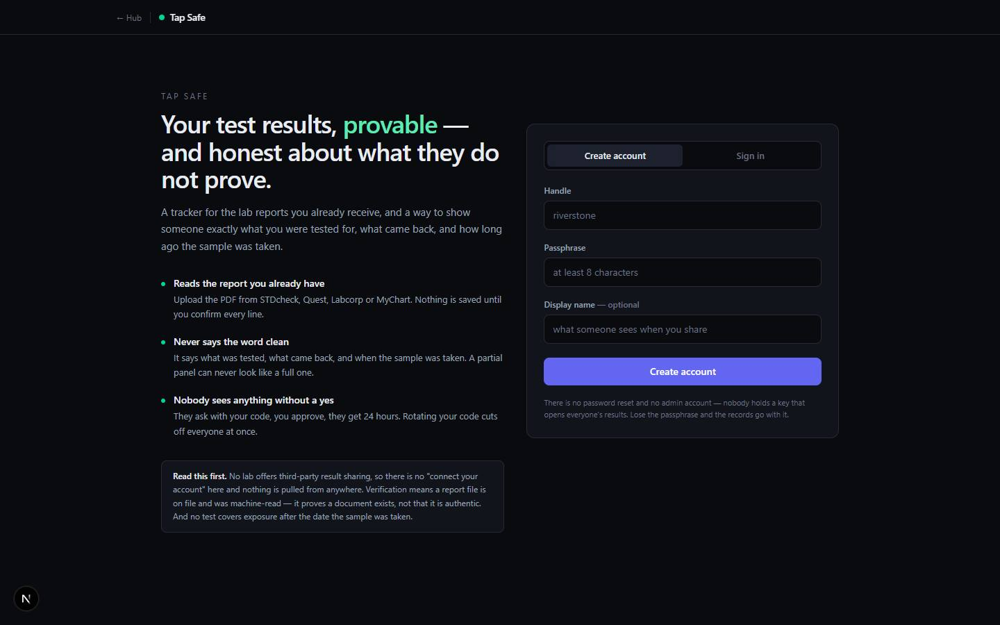

# Tap Safe

`/apps/std-safe` · Apps · live · shows as: hub tile

> Provable results, honest about what they don't prove

A tracker for the STD lab reports a person already gets, and a way to show someone else what they were tested for, what came back, and how old each sample is. You upload the lab PDF (or a photo), check every line on a review screen, and then share your card in person with a six-character code. The app never says "clean" and always shows what a result cannot prove. The slug, routes and storage keep the old name "STD Safe" so existing reports and share codes still work. The code folder is `stdsafe`.

## Features — every one of these must still exist after your change

The owner asked for each of these. Removing, hiding or "simplifying away" one is a regression,
even if the code looked unused. If a change needs one gone, ask first.

**Account**

- **Own sign-up / sign-in** — handle (3–24 chars) + password + display name. This is separate from the hub login. Before it asks for anything, the screen shows three promises ("Reads the report you already have", "Never says the word clean", "Nobody sees anything without a yes"). `src/components/stdsafe/AuthPanel.tsx`, `src/app/api/std-safe/auth/route.ts`, `src/lib/stdsafe/store.ts`
- **Short session** — HMAC-signed cookie `stdsafe_session`, 14 days. Deleting a user revokes it. There is no admin role on purpose. `src/lib/stdsafe/session.ts`
- **Sign out** — in the top bar, with your @handle beside it. `src/components/stdsafe/StdSafe.tsx`

**Adding results**

- **Drop a lab report** — drag and drop or click to add a PDF or image, up to 20MB. It accepts reports from STDcheck, Quest, Labcorp and MyChart, and is read on the server. `src/components/stdsafe/UploadFlow.tsx`, `src/app/api/std-safe/parse/route.ts`
- **Careful PDF reader** — cuts off the reference range before reading the result, so "Non Reactive" in the range is never mistaken for the answer. Lines it cannot read go into an "ambiguous" list instead of being guessed. `src/lib/stdsafe/parse.ts`
- **AI help, optional** — a vision model reads a phone photo or screenshot. A text model takes a second pass when the PDF reader comes back thin. With no key, it says so and falls back to typing it in by hand. `src/lib/stdsafe/ai.ts`
- **Enter by hand** — "No file — enter the results by hand", given the same weight as uploading and saved as self-reported. `src/components/stdsafe/UploadFlow.tsx`
- **Review screen before anything is saved** — lab, panel, collection date (required) and reported date. All ten infections get a row (HIV, syphilis, chlamydia, gonorrhea, hep B, hep C, HSV-1, HSV-2, trich, M. gen), each defaulting to "Not tested" with Negative / Positive / Inconclusive. Lines it could not read are printed word for word. It is labelled LAB DOCUMENT or SELF-REPORTED, and nothing saves without at least one test marked. `src/components/stdsafe/DraftReview.tsx`, `src/lib/stdsafe/types.ts`
- **Treatment context on positives** — Treated & cleared, In treatment, Managed — undetectable, On suppressive therapy, Not yet treated. `CONTEXT_LABELS` in `src/lib/stdsafe/types.ts`, chosen in `src/components/stdsafe/DraftReview.tsx`

**Your card (status)**

- **Status per infection, not per record** — every row has its own sample date and age ("12 days ago"). Freshness is fresh up to 30 days, aging up to 90, stale after that. `src/lib/stdsafe/status.ts`, `src/components/stdsafe/StatusCard.tsx`
- **Untested rows stay visible in grey** — "X of 10 tested" and "Not covered: …" sit in the card, so a two-test panel never looks like a full workup. `src/components/stdsafe/StatusCard.tsx`
- **Positives handled fairly** — a managed positive (for example undetectable) shows amber, not red. An untreated positive shows red. `rowTone` in `src/components/stdsafe/StatusCard.tsx`
- **Evidence chips** — LAB DOC or SELF on each row, and a footer saying whether every result, some results or none are backed by a document. `VerificationChip` in `src/components/stdsafe/StatusCard.tsx`
- **"What this does not tell you"** — three standing caveats on every card and in the side panel: a result only covers exposure before the sample date; a file on record proves a document exists, not that it is authentic; window periods vary. `STANDING_CAVEATS` in `src/lib/stdsafe/status.ts`

**Records**

- **Records timeline** — every record, newest first, with its note, a "View document" link to the attached file (served only to its owner), and Delete with a "Delete for good" confirm. `src/components/stdsafe/RecordTimeline.tsx`, `src/app/api/std-safe/records/route.ts`, `src/app/api/std-safe/report/route.ts`, `src/lib/stdsafe/reports.ts`

**Sharing (in-person handshake)**

- **Your code** — a six-character code with no I/1/O/0, shown large in monospace, with a Copy button. `CodeChip` in `src/components/stdsafe/StdSafe.tsx`, code made in `src/lib/stdsafe/store.ts`
- **Rotate code** — gives you a new code and cuts off everyone who can currently see your card, after a confirm. `CodeChip` in `src/components/stdsafe/StdSafe.tsx`, `src/app/api/std-safe/me/route.ts`
- **Ask someone** — type their six characters. Input is upper-cased and stripped as you type. `src/components/stdsafe/AskPanel.tsx`, `src/app/api/std-safe/requests/route.ts`
- **Requests inbox** — "Asking you": "Preview what they'd see" (the exact same card component), Deny, Approve. An approval opens your card for 24 hours, with a countdown and Revoke. "You asked": View, once approved. `src/components/stdsafe/RequestInbox.tsx`, grant rules in `src/lib/stdsafe/store.ts` (`GRANT_TTL_MS`)
- **Silent denials** — a denied request simply stops appearing for the asker. A refusal never shows up as a refusal. `src/components/stdsafe/RequestInbox.tsx`
- **Shared view overlay** — the other person's card plus "Where this came from" (date, lab, panel, document or self-reported) and the expiry time. Report files are never shared. `ViewOverlay` in `src/components/stdsafe/StdSafe.tsx`, `src/app/api/std-safe/view/route.ts`
- **Live prompts while standing together** — the dashboard polls every 6 s. An amber banner ("Someone is asking to see your card · Answer →") and a count on the Requests tab show what is waiting. `src/components/stdsafe/StdSafe.tsx`

**Honesty about storage**

- **"Nothing here will be kept." banner** — shown when the server cannot store data permanently. `src/components/stdsafe/StdSafe.tsx`, `src/lib/stdsafe/store.ts`

## How it looks

- **Look:** the hub's DESIGN.md "near-black instrument panel", used unchanged (Tailwind tokens `bg-canvas`, `bg-panel`, `border-line`, `text-ink`/`ink-muted`/`ink-faint`, `bg-brand`, `support`). No design skill is recorded for it.
- **Colours / type:** colour only marks state. Emerald for negative and fresh, amber for aging, inconclusive, managed positives and pending requests, rose for untreated positives, stale and errors, grey at 55% opacity for untested rows. `support` blue is the LAB DOC chip. The share code is in monospace at 3xl with wide tracking. Row dates are in mono 11px. The brand mark is an emerald dot plus "Tap Safe".
- **Layout:** sticky top bar ("← Hub" | ● Tap Safe | @handle, Sign out). On a laptop: max-w-6xl, a two-column grid (`lg:grid-cols-[1fr_320px]`) with the tabs (Your card / Records / Requests) on the left and the code chip and "Always true" caveats on the right. On a phone: one column with the code chip first. Row dates and evidence chips are hidden below `sm`. The sign-in page is a two-column hero with a form.
- **Signature pieces:** `StatusCard.tsx` (one component for your view, the approval preview and the shared view), the big code chip, the amber "asking" banner.
- **Motion:** almost none. Colour transitions on hover, and `animate-fade-in` on the preview and shared overlay.

## Where the code is

| Part | Path |
|---|---|
| Page | `src/app/apps/std-safe/page.tsx` |
| UI | `src/components/stdsafe/` |
| Logic + tests | `src/lib/stdsafe/` |
| API | `src/app/api/std-safe/` (`auth`, `me`, `parse`, `records`, `report`, `requests`, `view`) |
| Saved data | server_docs doc `.std-safe.json` (locally a file under `STDSAFE_DATA_DIR` or the working dir); report files in the private Supabase Storage bucket `std-safe-reports` (`std-safe-reports/<user>/<file>`, migration `supabase/migrations/20260905000300_std_safe_reports_bucket.sql`) |

## Owner's rules for this app

- The app is called **Tap Safe**, but the slug `std-safe`, the routes and the Supabase bucket keep the old name so existing reports and share codes survive. Do not rename them.
- The word **"clean" appears nowhere**, and there is no "clean" field in the data model.
- Status is per infection, never one overall date. Untested infections are always shown, never left out.
- Positives carry treatment context. An undetectable/managed positive is not shown as a red alarm.
- Nothing parsed is saved until the person confirms every line.
- Sharing is a live handshake: a code, a preview, an approval for 24 hours. Denials are silent, and rotating the code cuts everyone off.
- Report files (legal name, date of birth) are never shared. Only the owner's session can reach them.
- Every result page carries the two things it cannot prove: that the document is real, and that nothing has happened since the sample.
- Every rule is enforced on the server (`store.ts`), never only in the UI.

## Described but not found in code

- None found.
