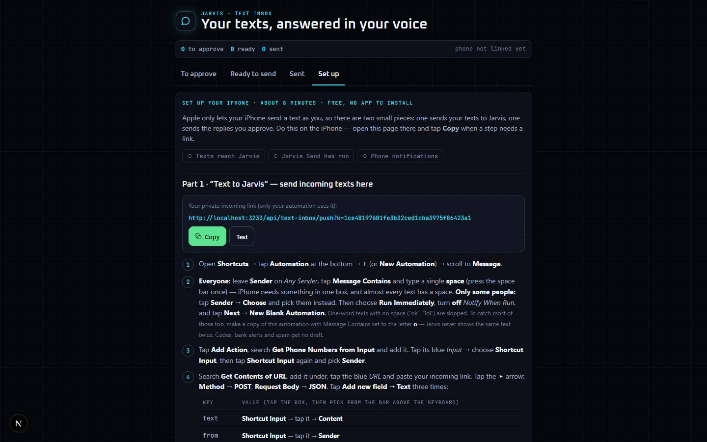

# Text Inbox

`/apps/text-inbox` · AI · live · shows as: Dashboard widget — the **Texts half of the one "iPhone" widget** (`src/components/iphone-hub/IphoneWidget.tsx`, widget id `iphone`), shared with iPhone Notes; also a Home Screen web app ("Texts")

> Your texts, answered in your voice — you approve every reply

An iPhone Shortcut automation sends each incoming text here, and Jarvis drafts a reply in your voice — your own words
about how you text, plus every reply you rewrite. Nothing is sent until you approve it. Approve on the iPhone and it
sends at once through your own Messages app; approve on a computer and your phone buzzes so one tap sends it.

## Features — every one of these must still exist after your change

The owner asked for each of these. Removing, hiding or "simplifying away" one is a regression,
even if the code looked unused. If a change needs one gone, ask first.

**The iPhone widget (shared with iPhone Notes)**
- **Texts half of the iPhone card** — count of texts to approve, the two newest (avatar initial, sender, text, "writing a reply…" / "reply ready to approve"); tapping it opens the sheet on Texts. `src/components/iphone-hub/IphoneWidget.tsx`
- **"Send N approved texts" button** on the card when on an iPhone with replies ready. `src/components/iphone-hub/IphoneWidget.tsx`
- **Sheet with a Notes / Texts switch** mounting `TextInboxApp embedded`. `src/components/iphone-hub/IphoneWidget.tsx` (`IphoneExpanded`)

**Drafting**
- **AI draft in your voice** — uses your "How you text" line plus the replies you rewrote (style examples); a short safe starter when there is no key, the daily cap is spent or the call fails. `src/lib/text-inbox/server/brain.ts`, `src/lib/text-inbox/engine.ts` (`systemPrompt`)
- **Learns from rewrites** — every reply you edit before approving becomes a style example ("it also learns from every reply you rewrite (N so far)"). `src/lib/text-inbox/engine.ts`, `src/components/text-inbox/TextInboxSetup.tsx`
- **Skips codes and alerts** — one-time codes, 5–6 digit short codes, spam/ads go straight to declined ("Skipped — looks automated") with no AI draft or notification; a question is never treated as automated. `src/lib/text-inbox/engine.ts`
- **No duplicates** — the same incoming text is deduped. `src/lib/text-inbox/engine.ts`
- **Status flow** drafting → waiting → ready → sent / declined; "typing" dots while drafting. `src/lib/text-inbox/engine.ts`, `src/components/text-inbox/TextInboxApp.tsx`

**Approving (tabs: To approve · Ready to send · Sent · Set up)**
- **Conversation strip per text** — their grey bubble on the left, your draft as an editable bubble on the right, one action bar. `src/components/text-inbox/TextInboxApp.tsx` (`Draft`)
- **Approve** (on iPhone: **Approve & send**) — on the iPhone it opens the "Jarvis Send" Shortcut (`shortcuts://x-callback-url/run-shortcut?name=Jarvis%20Send`, returns to the page); on a computer it moves the reply to Ready and pushes "Reply ready — tap to send" to the phone. `src/components/text-inbox/TextInboxApp.tsx`, `src/lib/text-inbox/client.ts` (`sendFromPhone`, `onIphone`), `src/lib/text-inbox/engine.ts`
- **Redo** — "Just redo", or say what it should say ("say no nicely, ask what time") and Rewrite; a fresh draft never overwrites a box you are mid-edit in. `src/components/text-inbox/TextInboxApp.tsx`
- **Decline** any draft. `src/components/text-inbox/TextInboxApp.tsx`
- **Ready to send** — on the iPhone "Send N now"; on a computer a tip plus **Buzz my phone again**; **Undo** puts a reply back in To approve. `src/components/text-inbox/TextInboxApp.tsx`
- **Banner** when replies are ready and you're on another tab ("Send N approved replies now" / "N approved — waiting for your phone"). `src/components/text-inbox/TextInboxApp.tsx`
- **Opened from the notification** (`?send=1`) with replies waiting → hands them to the phone at once. `src/components/text-inbox/TextInboxApp.tsx`
- **Sent tab** — sent and declined texts, **Send again**, **Remove**. `src/components/text-inbox/TextInboxApp.tsx`
- **Summary meter** — to approve / ready / sent counts, "phone checked in x ago". `src/components/text-inbox/TextInboxApp.tsx`
- **Try it with a pretend text** — From + Message → "Draft a reply", for when nothing is linked yet. `src/components/text-inbox/TextInboxApp.tsx`
- **First run opens on Set up** when no texts have ever arrived. `src/components/text-inbox/TextInboxApp.tsx`

**Set up (about 8 minutes)**
- **Part 1 · "Text to Jarvis"** automation — exact taps, your private link with Copy and Test, including the **everyone** option (Any Sender + a single space in Message Contains) or chosen contacts. `src/components/text-inbox/TextInboxSetup.tsx`
- **Part 2 · "Jarvis Send"** Shortcut — exact taps, no Key box needed. `src/components/text-inbox/TextInboxSetup.tsx`
- **Part 3 · Notifications** — Add to Home Screen from Safari, then **Turn on notifications** and **Send a test**; checklist of what's done. `src/components/text-inbox/TextInboxSetup.tsx`
- **Notification switches** — "Buzz me when a new text has a draft ready", "Buzz my phone when I approve on the computer". `src/components/text-inbox/TextInboxSetup.tsx`
- **How you text** — one line of tone, saved for every new draft. `src/components/text-inbox/TextInboxSetup.tsx`
- **Privacy** — finished texts forgotten after 30 days (`KEEP_DAYS`); **New links** (old Shortcuts stop working); **Delete all texts** (confirm). `src/components/text-inbox/TextInboxSetup.tsx`, `src/lib/text-inbox/engine.ts`
- **Step screenshots slot** — pictures listed per step id (`in-1…in-5`, `out-1…out-6`, `push-1…push-3`) show under each step. `src/lib/text-inbox/tutorial.ts`, `public/text-inbox/tutorial/`

**iPhone plumbing**
- **Incoming door** `POST /api/text-inbox/push?k=` `{text, from, number}`. `src/app/api/text-inbox/push/route.ts`
- **Outbox** `GET /api/text-inbox/outbox?k=` — Jarvis Send reads each `{to, text}`; `claimReady` hands each approved reply out once. `src/app/api/text-inbox/outbox/route.ts`, `src/lib/text-inbox/engine.ts`
- **Home Screen app** — own manifest (name "Jarvis — Text Inbox", short name "Texts", standalone, scope `/apps/text-inbox`) and service worker so iOS delivers push. `src/app/apps/text-inbox/manifest.webmanifest/route.ts`, `public/text-inbox-sw.js`, `src/app/apps/text-inbox/page.tsx`
- **Web push** via `sendWebPush`. `src/lib/text-inbox/server/brain.ts`, `src/lib/client-review/push.ts`

## How it looks

- **Look:** Jarvis HUD via interactive-web-studio — a messaging strip, not a table. Does **not** use DESIGN.md's tokens; own `--txi-*` set (same family as iPhone Notes).
- **Colours / type:** canvas `#05060a`, panels `#0c0f17` / `#121623` / `#181d2c`, lines `rgb(120 220 255 / .12–.26)`, ink `#eef3fb` / `#a3adc2` / `#6f7a93`, HUD cyan `#3be3ff`, go green `#5be38f`, bad `#ff6b5e`. Their message is a grey bubble; your draft a cyan-edged bubble you type into. Fonts: Oxanium + JetBrains Mono (`--font-nj-display` / `--font-nj-mono`, loaded in `page.tsx`).
- **Layout:** single column, max 760px, same on laptop and phone; bubbles max 88% wide. Phone first: 16px inputs, 44px targets.
- **Signature pieces:** the their-bubble / your-draft strip, big Approve button, Ready banner, the three-part setup.
- **Motion:** row entry (`txi-in`) and typing dots (`txi-dot`); stop under `prefers-reduced-motion`.

## Where the code is

| Part | Path |
|---|---|
| Page | `src/app/apps/text-inbox/page.tsx` (+ `manifest.webmanifest/route.ts`) |
| UI | `src/components/text-inbox/` (`TextInboxApp.tsx`, `TextInboxSetup.tsx`, `text-inbox.css`) + widget `src/components/iphone-hub/IphoneWidget.tsx` |
| Logic + tests | `src/lib/text-inbox/` (`engine.ts` + `engine.test.ts`, `client.ts`, `tutorial.ts`, `server/brain.ts`, `server/store.ts`) |
| API | `src/app/api/text-inbox/route.ts` (approve, decline, unapprove, sendAgain, remove, clear, redo, add, tone, settings, push.*, buzz, key.rotate) · `push/route.ts` · `outbox/route.ts` |
| Saved data | server_docs `.text-inbox.<uid>.json` (texts, drafts, style, push devices) + `.text-inbox-keys.json` (Shortcut key → account); no migration |

## Owner's rules for this app

- **Nothing is sent without the owner's Approve, and the website never sends** — Apple only lets the iPhone/Mac send a text as you. Only the "Jarvis Send" Shortcut reading the outbox sends.
- Widget only (owner's call, Oct 28 2026): **one iPhone widget for Notes + Texts, no App plugins cards, no hub tiles.** Both slugs stay in `WIDGET_SLUGS` in `src/lib/studio/plugins.ts`; the route stays for the Home Screen app and push.
- Push from a computer approve needs Text Inbox added to the iPhone Home Screen (Safari only delivers web push there); native push comes once the App Store app ships.
- `/api/text-inbox/push` and `/api/text-inbox/outbox` are session-exempt in `src/middleware.ts` with a per-account key.
- Messages are personal: in `UNPREVIEWABLE` in `src/lib/catalog.ts`; page is `noindex`.

## Described but not found in code

- The owner's real step screenshots (the old CLAUDE.md: "owner's step screenshots: `public/text-inbox/tutorial/`") — the slot exists, but `TUTORIAL_IMAGES` in `src/lib/text-inbox/tutorial.ts` is empty and the folder holds only `README.md`.
