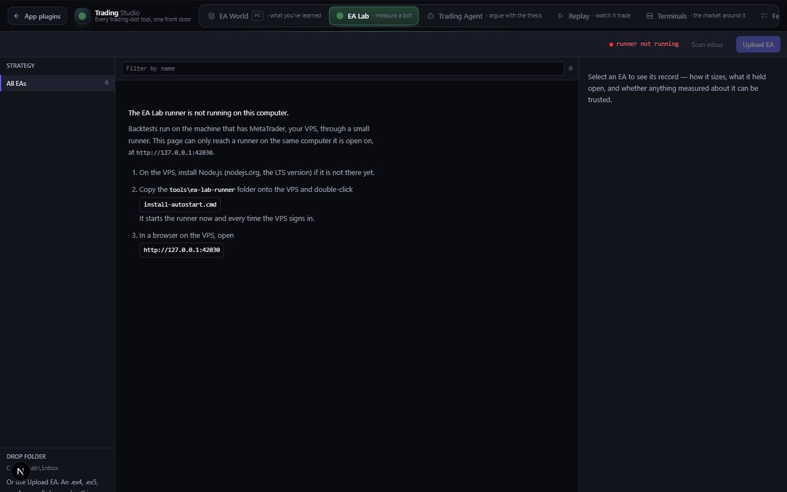

# Trading Studio

`/apps/trading-studio` · Utilities · live · shows as: App plugins card (Jarvis › App plugins; it is in `PLUGIN_SLUGS` in `src/lib/studio/plugins.ts`, so it is **not** a hub tile). It is the home that EA World, EA Lab, EA Feature List and Multi-Order Calculator are merged into (`MERGED_INTO` in the same file).

> Every trading-bot tool, one front door

Every trading-bot tool behind one switcher, the way Jarvis Audio Studio holds its three studios. Each section is
still the app it used to be and has its own accent colour. The owner uses it to replay a bot against a real past
New York session, test bots on the PC, argue with a trade idea, open the outside market terminals, copy an EA
spec into a build, and price a basket of gold orders.

## Features — every one of these must still exist after your change

The owner asked for each of these. Removing, hiding or "simplifying away" one is a regression,
even if the code looked unused. If a change needs one gone, ask first.

**The shell (one front door)**

- **Seven sections, in this order** — EA World · EA Lab · Trading Agent · Replay · Terminals · Feature List · Calculator, each with a label, hint, icon and accent hue (45, 150, 320, 205, 175, 265, 20). `src/lib/studio-home/trading.ts` (`TRADING_SECTIONS`)
- **Sliding-thumb switcher** — a tab bar whose highlight slides to the open section and scrolls sideways on a phone; the whole home's glow changes to the section's hue. `src/components/studio-home/StudioHome.tsx`, `src/components/studio-home/studio-home.css`
- **`?section=` in the address and last section remembered** — the address updates with `history.replaceState`; with no `?section=` it reopens the last section used on this device (localStorage key `trading-studio:section`); a first visit lands on Replay. `StudioHome.tsx`, `src/app/apps/trading-studio/page.tsx`, `trading.ts` (`TRADING_DEFAULT`, `TRADING_REMEMBER`)
- **One section's code at a time** — each section is loaded only when opened (Replay's chart library is never downloaded by someone checking a basket), with a skeleton while it loads. `src/components/trading-studio/TradingStudio.tsx` (`COMPONENTS`)
- **"On your PC" panel for EA World** — a plain-English panel saying EA World isn't on the website yet, with one button, "Ask Claude Code to bring it in", that files an In Queue request in folder `app:trading-studio`. `trading.ts` (`pending`), `StudioHome.tsx` (`PendingSection`), `src/lib/studio-home/fileRequest.ts`
- **Old links land in the right section** — `/apps/ea-feature-list` → Feature List, `/apps/multi-order-calculator` → Calculator, `/apps/ea-world/replay` → Replay, `/apps/ea-world/terminals` → Terminals, `/apps/ea-lab` → EA Lab (redirect pages); `/apps/ea-world` and `/apps/ea-lab` also redirect from `next.config.mjs` `redirects()`. `src/app/apps/{ea-feature-list,multi-order-calculator,ea-lab}/page.tsx`, `src/app/apps/ea-world/{replay,terminals}/page.tsx`, `next.config.mjs`

**EA Lab section** — full detail in [ea-lab.md](ea-lab.md)

- **The testing bench, mounted embedded** — no wordmark of its own inside the studio, but it keeps the runner status and its buttons. `src/components/ea-lab/EaLab.tsx` (`embedded`)

**Trading Agent section**

- **"Reads setups. Places nothing." banner** — always at the top, even embedded (the component has no `embedded` prop on purpose): no broker connection, no order path. `src/components/trading-agent/TradingAgent.tsx`
- **The setup form** — instrument, long/short, timeframe, entry, stop, target, account size and risk per trade %. `TradingAgent.tsx`
- **The arithmetic, computed in the browser** — risk and reward per unit, reward:risk, breakeven win rate, position size, and expectancy at assumed win rates 30–70 %; works with no key and no network. `src/lib/trading-agent/setup.ts` (`numbersFor`, `expectancy`), `TradingAgent.tsx` (`WIN_RATES`)
- **Flaw checks** — warns when prices don't agree with each other (e.g. entry equals stop) before anything is asked. `setup.ts` (`flawsIn`)
- **"Read it back to me"** — a model restates the bet without the reasons, then lists What it assumes · What would kill it before your stop does · Where the argument is weakest · What you did not say. It is handed the figures already computed and never asked to do sums. `TradingAgent.tsx`, `src/app/api/trading-agent/read/route.ts`, `src/lib/trading-agent/prompt.ts`
- **Three refusals** — no verdict on taking the trade, no price/probability forecast, no mention of orders, brokers or platforms. `src/lib/trading-agent/prompt.ts` (`readSystem`)
- **No-key fallback** — with no AI key the route answers `offline` and the left-side numbers still work. `src/app/api/trading-agent/read/route.ts` (`aiConfigured`)

**Replay section**

- **Real past ticks** — pick a symbol (EUR/USD, GBP/USD, AUD/USD, USD/JPY, Gold, US30, NAS100, S&P 500, Bitcoin), a New York day (or an older one by date), and a window, then Load tape; real Dukascopy bid **and** ask, fetched hour by hour, with missing hours listed. `src/components/ea-replay/ReplayStudio.tsx`, `src/lib/ea-replay/instruments.ts`, `src/app/api/ea-replay/ticks/route.ts`, `src/lib/ea-replay/dukascopy.ts`
- **Session windows** — NY peak 08:00–11:00, NY open 09:30–11:30, London/NY overlap, Data drop 08:25–09:00, NY full, or Custom HHMM. `src/lib/ea-replay/session.ts` (`SESSION_PRESETS`)
- **Simulated MT4 broker** — balance, leverage, round-turn commission, latency, stop slippage, stop level, margin with a 50 % stop-out; all editable in the Broker panel. `src/lib/ea-replay/broker.ts`, `ReplayStudio.tsx`
- **Playback** — restart, play/pause, one tick, jump to next fill; speeds 1x, 5x, 20x, 60x, 300x and max; a scrubber (seeking back replays from the start so the result is exact); keyboard Space / → / Shift+→. `ReplayStudio.tsx` (`SPEEDS`, key handler)
- **Chart with the bot's orders on it** — TradingView lightweight-charts candles (5s / 15s / 1m / 5m), gray tape with the bot's buy/sell orders in colour, HUD, legend, follow button. `src/components/ea-replay/chartController.ts`, `ReplayStudio.tsx` (`TIMEFRAMES`)
- **Account panel** — equity, balance, closed trades, win rate, max drawdown, and an equity sparkline. `ReplayStudio.tsx`
- **Ledgers** — tabs Trades (click a row to replay from just before that entry) · Working · Events · Stats (profit factor, expectancy, average spread…) · Bot log. `ReplayStudio.tsx`, `src/lib/ea-replay/stats.ts`
- **Built-in bots** — HFT Secret v2 (wave + HFT, the default), HFT Secret (rebuild), NY Opening Range Breakout, each with grouped editable inputs remembered per pair; 45-minute warm-up so v2's 34-SMA channel is formed. `src/lib/ea-replay/strategies/{index,hftSecretV2,hftSecret,openingRange}.ts`, `ReplayStudio.tsx` (`WARMUP_MS`)
- **The EA sources to download** — `HFT_Secret_Rebuild.mq4` (v1) and `HFT_Secret_v2.mq4` (v2: 34-SMA high/low wave + HFT, breakeven, flatten at session end, daily target, distances in price), twins of the replay bots. `public/ea-world/experts/`
- **Bring a bot** — drop or paste an `.mq4` and "Port with AI" (the model lists what it could not carry over), or write one by hand from a template; code is shown and checked before it can be saved; an `.ex4` is refused with the reason. `src/components/ea-replay/BotBench.tsx`, `src/app/api/ea-replay/port/route.ts`, `src/lib/ea-replay/{custom,portPrompt}.ts`
- **Fingerprint the original** — drop an MT4 statement or Strategy Tester report; it measures stop, target, trail step, pending-order use, lots, side and NY hours, then applies them to HFT Secret v2 with the reason for each. `src/components/ea-replay/FingerprintPanel.tsx`, `src/lib/ea-replay/statement.ts`
- **Your own ticks / demo tape** — load a Dukascopy, MT5 or plain time,bid,ask CSV (with an MT5 server-offset box), or a Demo tape; the same offers appear when a window has no tape. `ReplayStudio.tsx` (`TapeFallbacks`), `src/lib/ea-replay/{csv,demo}.ts`

**Terminals section**

- **Three outside terminals in one table** — OpenTerminal (localhost:3400), Vibe-Trading (localhost:8899), Fincept Terminal (desktop app), each with what it adds, what it needs and a live up/down check (Check again). `src/components/ea-replay/TerminalsStudio.tsx`, `src/lib/ea-replay/terminals.ts`
- **Start and open them** — "Copy start command" for PowerShell, "Open in a tab", and "Show here" (OpenTerminal framed inside the page); an Open Replay link. `TerminalsStudio.tsx`
- **PC install/start scripts** — install once, start every time; installs to `%USERPROFILE%\Projects\ea-terminals`, outside the repo. `tools/ea-terminals/{install.ps1,start.ps1,README.md}`

**Feature List section**

- **Every dictated EA spec** — searchable (title, tags, spec text) with tag chips that combine, a count, and a row per spec. `src/components/ea/EaFeatureList.tsx`, `src/components/ea/EaFeatureRow.tsx`, `src/lib/ea-features/features.ts` (`filterFeatures`, `allTags`)
- **Spec window with Copy spec** — the full verbatim spec, one click to the clipboard, with the date it was added. `src/components/ea/EaFeatureDetailModal.tsx`
- **Specs live in code** — added by appending to `EA_FEATURES`, so they ship on every device with no database. `src/lib/ea-features/features.ts`

**Calculator section**

- **Basket of orders** — buy/sell rows with lots and entry; add, duplicate, delete; per-order P/L. `src/components/calculator/Calculator.tsx`, `src/components/calculator/OrderRow.tsx`
- **Two modes** — Target exit → P/L, or Desired profit → the exit price that makes it. `Calculator.tsx` (`Mode`), `src/lib/calculator/engine.ts` (`solveExitPriceForPnl`)
- **Basket settings** — target exit, current price, spread, commission/lot, swap/lot, account currency; symbol XAUUSD (100 oz/lot). `Calculator.tsx`, `src/lib/calculator/symbols.ts`
- **Profit curve** — P/L across prices with Break-even, Target and Current-price markers and a hover crosshair tooltip. `src/components/calculator/ProfitChart.tsx`
- **Results** — gross P/L, commission, swap, spread cost, total and net lots, weighted average entry, break-even price, $ per point / pip, distance to target. `Calculator.tsx`, `engine.ts` (`evaluateBasket`)
- **Saved baskets** — save, load, rename, duplicate, delete; synced to every device. `Calculator.tsx`, `src/lib/calculator/storage.ts`
- **Export** — CSV and JSON downloads. `storage.ts` (`ordersToCsv`, `downloadFile`)

## How it looks

- **Look:** the shared Studio home shell (generalised from Jarvis Audio Studio); no `.impeccable` record for this app. Each section keeps its own original look.
- **Colours / type:** DESIGN.md tokens (`#0a0b0f` canvas, `#12141c` panel, `#e9ecf3` ink, system sans, JetBrains Mono for numbers). Accent is a hue, not a colour: `--sh-accent: oklch(0.74 0.15 var(--sh-hue))`, per section. Replay's own rule: "the tape is gray, the bot is in colour" — buy `#3b82f6`, sell `#f59e0b`, win `#22c55e`, loss `#f87171`, playhead `#e3bb4f` (`src/components/ea-replay/replay.css`). Calculator chart: target `#6366f1`, now `#f59e0b`, break-even `#9aa3b5`. Trading Agent: amber lock, emerald/rose expectancy.
- **Layout:** laptop — one bar (brand, switcher) over a full-height stage; Replay is a top strip, chart + right rail, ledgers at the bottom; Agent is a 420px arithmetic column + reasoning pane; Calculator is 2/3 orders + chart, 1/3 results. Phone — the switcher wraps to its own full-width row and scrolls sideways (≤900px), hints and the brand subtitle drop (≤560px); Replay stacks with a 56vh chart (≤900px); Agent and Calculator stack to one column.
- **Signature pieces:** the sliding-thumb switcher with hue glow, Replay's gray-tape chart with coloured orders, the "Reads setups. Places nothing." banner.
- **Motion:** the hue glides (520ms) and the glow slides when switching; stage fades in. `prefers-reduced-motion` turns off shell transitions and the stage animation (`studio-home.css`) and Replay transitions (`replay.css`).

## Where the code is

| Part | Path |
|---|---|
| Page | `src/app/apps/trading-studio/page.tsx` |
| UI | `src/components/trading-studio/` (shell) · `src/components/studio-home/` · `src/components/ea-lab/` · `src/components/trading-agent/` · `src/components/ea-replay/` (Replay + Terminals) · `src/components/ea/` (Feature List) · `src/components/calculator/` |
| Logic + tests | `src/lib/studio-home/trading.ts` (+ `sections.test.ts`) · `src/lib/ea-lab/` · `src/lib/trading-agent/` · `src/lib/ea-replay/` · `src/lib/ea-features/` · `src/lib/calculator/` |
| API | `src/app/api/trading-agent/read/` · `src/app/api/ea-replay/{ticks,port}/` |
| PC helpers | `tools/ea-terminals/` (outside terminals) · `tools/ea-lab-runner/` (EA Lab runner) |
| Saved data | synced keys `ea-replay:bots` (your bots), `moc:scenarios:v1` (saved baskets); localStorage only: `ea-replay:prefs`, `trading-studio:section`. EA Lab's records live on the runner's PC (`C:\EA-Lab`) |

## Owner's rules for this app

- **Never create `src/app/apps/ea-world/page.tsx` from a cloud session.** EA World's code is only on the owner's PC (uncommitted). `/apps/ea-world` redirects in from `next.config.mjs`, not from a file. The same rule was set for `src/app/apps/ea-lab/`; EA Lab has since been brought in (commit 30052bb) and its `page.tsx` is now a committed redirect — still do not add anything else there.
- Wiring EA World in is one edit in `TradingStudio.tsx` (the comment gives the exact `dynamic(() => import("../ea-world/EaWorld")…)` line) plus deleting `pending` on `world` in `trading.ts` — and only with the PC's code committed.
- A section is either pending or mounted, never both.
- The Trading Agent has no order path and no broker connection, by design; it is named `trading-agent`, never `money-agent` (that is Money Agent Studio).
- Every section mounts with `embedded`; each still works standalone at its old look.
- In Queue folder for this app: `app:trading-studio`.

## Described but not found in code

- The catalog overview says "Six trading tools" and that EA Lab runs only on the PC "once its code is brought onto the website"; the code has seven sections and EA Lab is mounted (stale text in `src/lib/catalog.ts` and CLAUDE.md's "Where things live" row, which still calls `lab` pending).
- EA World itself (Analyze · Vault · Bench) — described in `src/lib/catalog.ts`; only the pending panel exists here. See [ea-world.md](ea-world.md).
