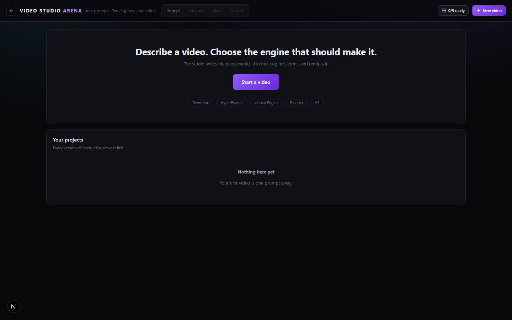

# Video Studio Arena

`/apps/video-studio-arena` · Video · live · shows as: hub tile

> One prompt, five engines, one finished video

The one place to make a video instead of an app per engine. You describe the video, pick how it gets
made (Remotion, HyperFrames, Unreal Engine, Blender or H3 — or let the AI Director mix them), read and
fix a scene-by-scene plan, then render it. H3 renders on the website's server; the other four render on
the owner's PC through a small "studio runner" program, and every engine says plainly what it is missing.

## Features — every one of these must still exist after your change

The owner asked for each of these. Removing, hiding or "simplifying away" one is a regression,
even if the code looked unused. If a change needs one gone, ask first.

**The flow (Prompt → Method → Plan → Preview)**
- **Step bar in the header** — Prompt / Method / Plan / Preview buttons, each unlocked only once the step before it has something in it. `src/components/video-studio/VideoStudio.tsx`
- **Home screen** — "Describe a video. Choose the engine…" hero with a Start a video button and a row of engine names coloured by their real status. `src/components/video-studio/VideoStudio.tsx`
- **Your projects table** — every project and version, newest first, with method, status, last updated, open (click or double-click) and delete. `src/components/video-studio/VideoStudio.tsx`
- **"N/5 ready" button and New video button** in the header. `src/components/video-studio/VideoStudio.tsx`
- **Error banner and busy line** — plain-English error you can dismiss; a "Writing the production plan…" style line while work runs. `src/components/video-studio/VideoStudio.tsx`, `src/components/video-studio/studio.tsx`

**Step 1 · The brief**
- **Big prompt box with four example prompts** you can click to fill it. `src/components/video-studio/Brief.tsx`
- **Optional details** — subject, duration (slider 3–120 s plus a number box up to 300 s), visual style, audience, aspect ratio, narration choice, voice (tone/accent/pace, off when narration is none), music, "Burn in captions" tick box, other creative instructions. `src/components/video-studio/Brief.tsx`, rules in `src/lib/video-studio/brief.ts`
- **Can't go on until the prompt is at least a sentence** ("Describe the video you want in a sentence or two."). `src/lib/video-studio/brief.ts` `briefProblem`

**Step 2 · Choose creation method**
- **Five engine cards, no ranking, no "recommended" badge** — each shows Best for, description, strengths, workflow, where it runs (server or your PC), its skill, output format, and a live status badge. `src/components/video-studio/Methods.tsx`
- **"Use this method" stays clickable even when the engine isn't ready**, so the plan can still be written and read; the card says what is missing. `src/components/video-studio/Methods.tsx`
- **AI Director card** — "Let the director choose": every scene routed to the engine that suits it. `src/components/video-studio/Methods.tsx`, routing rules `src/lib/video-studio/plan.ts` `routeScene`
- **Five engines, each a plugin folder** with card copy (`meta.ts`), its skill + engine-specific rewrite prompt (`skill.ts`) and a real machine check (`server.ts`): Remotion → `remotion-best-practices`, HyperFrames → `hyperframes`, Unreal Engine → `unreal-cinematics`, Blender → `blender-studio`, H3 → `h3-scroll-world`. `src/lib/video-studio/methods/<id>/`, list in `src/lib/video-studio/registry.ts`

**Step 3 · Production plan**
- **Engine-agnostic plan written by AI** in the owner's language, with an offline planner as fallback that says so in a note ("written offline"). `src/lib/video-studio/server/plan.ts` `buildPlan`, `src/lib/video-studio/plan.ts` `heuristicPlan`
- **Every field editable** — project title, logline, each scene's title, end second, description and narration; remove a scene or "Add a scene". `src/components/video-studio/Plan.tsx`
- **Per-scene engine picker in AI Director mode** (override the director's choice). `src/components/video-studio/Plan.tsx`
- **"How it will be made" panel** — selected method, skill, and (Director) the engines in this plan; tells you each scene is rewritten in the engine's own terms before rendering. `src/components/video-studio/Plan.tsx`
- **Engine directive per scene** — the rewritten instruction shown under a fold once written. `src/components/video-studio/Plan.tsx`, rewrite in `src/lib/video-studio/server/plan.ts` `optimisePlan`
- **Save without rendering** and **Create Video** (nothing renders until pressed). `src/components/video-studio/Plan.tsx`, `src/components/video-studio/studio.tsx`
- **Render refused up front if an engine isn't ready**, with the reason on screen. `src/lib/video-studio/server/run.ts` `startRender`

**Step 4 · Preview / workspace**
- **Video player** sized to the project's aspect ratio; shows the first finished scene until the whole video exists. `src/components/video-studio/Workspace.tsx`
- **Render again, Edit plan, Edit prompt, change-method dropdown, Export (download MP4)**. `src/components/video-studio/Workspace.tsx`
- **Render status list** — the real state of every step (○ ⟳ ✓ ✕ –), written by the server loop or the PC runner, never a fake progress bar. `src/components/video-studio/Workspace.tsx`, `src/lib/video-studio/server/run.ts`
- **Scenes panel** — Regenerate one scene without redoing the rest, Download clip per scene, attempt count, per-scene error. `src/components/video-studio/Workspace.tsx`, API `src/app/api/video-studio/projects/[id]/route.ts` (`render-scene`)
- **Method comparison** — "Try this plan with:" any other engine or AI Director makes a copy (Version A, B, C…); click a version chip to play it side by side, double-click to open it. "No scores, no winner." `src/components/video-studio/Workspace.tsx`, `src/lib/video-studio/server/store.ts` `duplicateProject`
- **Production record** — prompt, skill used, companion skills it routes to, created/updated. `src/components/video-studio/Workspace.tsx`
- **Generation history** — every brief edit, method change, duplicate and render, newest first (last 100 kept). `src/components/video-studio/Workspace.tsx`
- **Live polling** — an open, rendering project is re-read every 3 s (this also drives server-side H3 renders); engine status re-checked every 20 s. `src/components/video-studio/studio.tsx`

**Rendering**
- **H3 renders on the server** using the hub's video stack: own H3 on RunPod, then MiniMax hosted, then AI Gateway, then an animatic placeholder (which it says plainly). Each shot chains off the previous scene's last frame. `src/lib/video-studio/methods/h3/server.ts`, `src/lib/video-studio/server/run.ts` `lastFrameOf`
- **Remotion, HyperFrames, Unreal, Blender render on the PC** — jobs are queued; the runner claims one, runs Claude Code with that engine's skill, and uploads each scene clip as it finishes. `src/lib/video-studio/server/run.ts` `jobPayload`, `tools/video-studio-runner/runner.mjs`, routes `src/app/api/video-studio/runner/`
- **Assembly** — scenes joined into one MP4 with ffmpeg (concat filter, works across engines in Director mode); without ffmpeg the scenes stay individual and the status line says why. `src/lib/video-studio/server/run.ts` `assemble`
- **Big uploads** — signed Supabase Storage link on the deployed hub, 8 MB chunks locally, up to 1 GB. `src/lib/video-studio/server/store.ts`, `src/app/api/video-studio/runner/clip/route.ts`

**Integrations page ("N/5 ready")**
- **Connect your PC** — runner online/offline/no-token badge, last seen, "Create a runner token" (shown once, Copy button), three setup steps, Re-check. `src/components/video-studio/Integrations.tsx`, `src/app/api/video-studio/runner-token/route.ts`
- **Per-engine requirements table** — each requirement ✓ / ✕ / – optional with what it is and how to get it (runner, installs, MCPs, skills, keys, GPU, ffmpeg), plus a docs link. `src/components/video-studio/Integrations.tsx`, probes `src/lib/video-studio/server/detect.ts`

## How it looks

- **Look:** "a dark production studio" — its own scoped palette under `.vsa`, not DESIGN.md's tokens. Design skill not recorded (no `.impeccable/surfaces` file for it).
- **Colours / type:** background `#08080b` with a violet glow top-right (`rgba(139,92,246,.14)`) and a faint sky-blue glow top-left; panels `#101017` / `#16161f`; lines `#24242f` / `#32323f`; ink `#eceaf4` / `#9a99a8` / `#6a6a78`; brand violet `#8b5cf6` / `#c084fc`; status green `#4ade80`, amber `#fbbf24`, red `#f87171`. Base text 13px; body font is the hub's sans (`--font-sans`); skills, keys, times and code in a mono stack (`ui-monospace`, JetBrains Mono…). All in `src/components/video-studio/video-studio.css`.
- **Layout:** laptop — sticky frosted header (brand "VIDEO STUDIO ARENA", tag line, step bar, ready/New video), engine cards in an auto-fill grid (min 330px), workspace panels auto-fit (min 340px), two players side by side when comparing. Phone (≤860px) — tag line hidden, step bar drops to its own full-width row, everything one column, requirement tables stack.
- **Signature pieces:** `MethodMark` (a two-hue conic-gradient tile per engine, `src/components/video-studio/ui.tsx`), `CapabilityBadge` status pills, the ○⟳✓✕ render status list, version chips.
- **Motion:** essentially none — no keyframes or transitions in the stylesheet; glass only on the header. `prefers-reduced-motion` turns any animation/transition off anyway.

## Where the code is

| Part | Path |
|---|---|
| Page | `src/app/apps/video-studio-arena/page.tsx` |
| UI | `src/components/video-studio/` (shell `VideoStudio.tsx`, state hook `studio.tsx`) |
| Logic + tests | `src/lib/video-studio/` (engines `methods/<id>/`, registry `registry.ts` + `server/registry.ts`, test `plan.test.ts`) |
| API | `src/app/api/video-studio/` (`methods`, `plan`, `projects`, `projects/[id]`, `projects/[id]/video`, `runner/{claim,clip,progress,fail}`, `runner-token`) |
| PC runner | `tools/video-studio-runner/` (`npm run runner`, `runner:once`, `start-runner.cmd`; env `HUB_URL`, `HUB_TOKEN`, `VIDEO_STUDIO_WORK_DIR`, `RUNNER_MODEL`, `OPENROUTER_API_KEY`) |
| Saved data | server doc `video-studio` (projects, job queue, hashed runner tokens, per account) via `docStore` in `src/lib/video-studio/server/store.ts`; clips/videos in Storage bucket `video-studio` (local disk when no Supabase). Not `app_state`. |

Env keys read: `RUNPOD_API_KEY` + `RUNPOD_ENDPOINT_ID`, `MINIMAX_API_KEY`, `AI_GATEWAY_API_KEY`, `OPENROUTER_API_KEY` (H3 + plan writing), `VIDEO_STUDIO_MODEL` / `AI_MODEL`, `HYPERFRAMES_API_KEY` (optional), `MESHY_API_KEY` (optional), `BLENDER_PATH`, `BLENDER_MCP_PORT`, `UNREAL_ENGINE_DIR`, `FFMPEG_PATH`, `CLAUDE_CONFIG_PATH`, `VIDEO_STUDIO_DATA_DIR`.

## Owner's rules for this app

- **Never report an engine "ready" optimistically.** `detect()` must look at the machine; a green tick over a missing install is the failure (`src/lib/video-studio/methods/README.md`).
- **Honesty in the runner:** a missing engine, MCP or key is reported by name and the job fails — no swapping engines, no placeholder passed off as the video; a session that writes no video is a failure (`tools/video-studio-runner/README.md`). The H3 animatic placeholder is allowed only because it is labelled as one.
- **No ranking of engines** — no "recommended" badge, no scores or winner in the comparison.
- **The plan is in the owner's words**; engine-specific wording only ever appears as the rewritten directive.
- **Adding an engine is a folder plus two one-line registrations** (`registry.ts`, `server/registry.ts`) — never touch the UI, routes or run loop for it.
- Changing the method on a project wipes its old directives and render; editing the brief (server `brief` action) wipes the plan, because both would otherwise render the wrong video.

## Described but not found in code

- None found. Every catalog claim is in the code. Two caveats: joining scenes into one file needs ffmpeg on the server (without it you get separate scene clips), and the workspace's "Edit prompt" opens the brief screen but the browser never calls the server's `saveBrief` (`src/lib/video-studio/client.ts`), so an edited brief is not saved onto an existing project.
