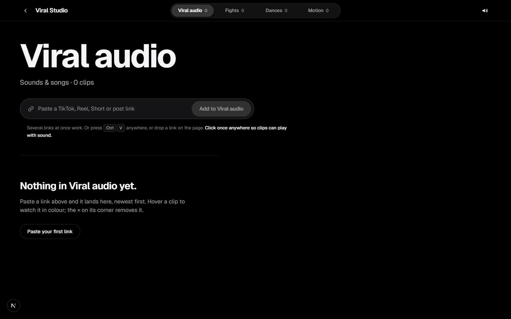

# Viral Studio Content

`/apps/viral-studio-content` · Video · live · shows as: App plugins card

> Paste it, hover it, keep it

Four boards for the clips worth saving: Viral audio (sounds and songs), Fights, Dances and Motion (surfing, hoops, rap performances, anything that moves). The owner pastes a link from TikTok, Instagram, YouTube, X, Facebook or anywhere else, and it lands in the open tab, newest first. Hover a tile and it plays. The clips are real reference footage for video workflows. It replaced Dance Vault, and `/apps/tiktok-dances` redirects here (`?tab=dances`).

## Features — every one of these must still exist after your change

The owner asked for each of these. Removing, hiding or "simplifying away" one is a regression,
even if the code looked unused. If a change needs one gone, ask first.

**Boards and getting clips in**
- **Four tabs**: Viral audio · Fights · Dances · Motion, each with its own hint line and clip count. A sliding segmented switcher sits in the top bar. On a phone it shows short labels. `src/components/viral-studio/ViralStudio.tsx`, `src/lib/viral-studio/types.ts` (`TABS`)
- **Tab in the link**: the open tab is kept in `?tab=` and read back on load. Keys 1–4 switch tabs. `src/components/viral-studio/ViralStudio.tsx`
- **Paste box** ("Paste a TikTok, Reel, Short or post link"). It accepts several links at once, and its button reads "Add to <tab>". `src/components/viral-studio/ViralStudio.tsx`, `src/lib/viral-studio/board.ts` (`extractLinks`)
- **Ctrl/⌘+V anywhere** on the page (outside a text box) adds the pasted link(s). `src/components/viral-studio/ViralStudio.tsx`
- **Drag a link onto the board**. A full-page "Drop to add to <tab>" overlay shows while dragging. `src/components/viral-studio/ViralStudio.tsx`
- **No duplicates per tab**: a link already in the tab is not added again. The existing tile flashes and scrolls into view, and the toast says "Already in <tab>". This includes short links that resolve to the same video. `src/lib/viral-studio/board.ts` (`findDuplicate`, `linkKey`, `clipKey`)
- **Newest first** ordering. The newest clip goes large (2×2, 2-wide or normal), sized so the wall plus the add tile ends on a full row. `src/lib/viral-studio/board.ts` (`addClip`, `leadSize`)
- **"Getting the video…" tile** for each link still resolving, with × to cancel it. `src/components/viral-studio/ClipTile.tsx` (`PendingTile`)
- **"Add a link to <tab>" tile** at the end of the wall. Clicking it focuses the paste box. `src/components/viral-studio/ViralStudio.tsx`
- **Works offline**: if the server can't be reached, the link is still kept, as an embed-only tile with a note. `src/components/viral-studio/ViralStudio.tsx`, `src/lib/viral-studio/board.ts` (`offlinePlayback`)
- **Empty states**: "Nothing in <tab> yet" with "Paste your first link", and "No clips match those filters" with "Clear filters". `src/components/viral-studio/ViralStudio.tsx`

**Playing and deleting**
- **Hover to play**: after a 60 ms delay (so sweeping the mouse doesn't start every tile), the tile under the pointer plays. On touch, tap to play or stop. Escape stops. `src/components/viral-studio/ViralStudio.tsx`, `src/components/viral-studio/ClipTile.tsx`
- **Saved video file when signed in**: the clip is downloaded once into the owner's private storage, so it plays instantly and survives the post being taken down. Posters are saved too. `src/lib/viral-studio/server/resolveLink.ts`, `src/lib/viral-studio/server/storage.ts`, `src/app/api/viral-studio/add/route.ts`
- **Network player fallback**: when the file can't be saved, the clip plays in YouTube's, TikTok's or Instagram's own embed, and the tile says so in a note. Instagram shows "Tap the clip to play — Instagram asks first". YouTube is never downloaded. `src/lib/viral-studio/playback.ts` (`embedUrl`, `playbackLimit`), `src/lib/viral-studio/types.ts` (`Playback`)
- **Sound toggle per tab** in the top bar. Viral audio starts unmuted and the other tabs start muted. The choice is remembered on the device (localStorage `viral-studio:sound`). Until the page has been clicked once, a "Click once anywhere so clips can play with sound" hint shows. `src/components/viral-studio/ViralStudio.tsx`
- **One-tap delete with Undo**: × on the tile's corner, or Delete/Backspace on the hovered tile. A toast offers Undo for 6 s. The stored files are freed only after the Undo window closes, or when the tab closes. `src/components/viral-studio/ViralStudio.tsx`, `src/app/api/viral-studio/media/route.ts` (DELETE)
- **Open on <site>** corner button links to the original post. `src/components/viral-studio/ClipTile.tsx`
- **Tile caption**: title, site, @handle, view count, and when it was added ("3h ago"). `src/components/viral-studio/ClipTile.tsx`

**Song finder (Viral audio tab, Shazam-style)**
- **Song under the title**: a released song shows "Artist — Song" under the clip's title (linked to a play page when known). An original sound shows nothing. `src/lib/viral-studio/song.ts` (`judgeSound`, `songFromCredit`, `songLine`), `src/components/viral-studio/ClipTile.tsx`
- **The post's own sound credit first** (tikwm `music_info`, yt-dlp `track`/`artist`), **then AudD fingerprinting** of the audio. AudD is free for about 10 lookups a day, and unlimited with `AUDD_API_TOKEN`. Errors come back in plain English. `src/lib/viral-studio/server/songFinder.ts`, `src/app/api/viral-studio/song/route.ts`
- **Find song button** ("Listening…", "Original sound · check again"). Audio clips with no answer yet are checked quietly one at a time, and this stops when the daily limit is hit. A song found by listening adds the "Song" category unless the tags were set by hand. `src/components/viral-studio/ViralStudio.tsx`, `src/components/viral-studio/ClipTile.tsx`

**Filters and tags (every tab)**
- **Order**: Newest / Hot now. `src/lib/viral-studio/filters.ts` (`applyFilter`, `heatScore`), `src/components/viral-studio/ViralStudio.tsx`
- **Mood** filter (Hype, Funny, Chill, Feel-good, Sad, Romantic, Dark, Motivational, Epic, Satisfying). `src/lib/viral-studio/filters.ts` (`MOODS`)
- **Popularity** filter: Trending now · Rising · Popular · Classic. It is worked out from views per day since posting, not a raw view count (`heatOf`). A note in the tray explains this. `src/lib/viral-studio/filters.ts`
- **The tab's own categories**: Type & genre (audio) · Fight style · Dance style · Sport & move (motion). `src/lib/viral-studio/filters.ts` (`CATEGORIES`)
- **Filter trays show counts** per option. Options with no clips are dimmed. "Clear" resets them, and the count reads "x of y". `src/components/viral-studio/ViralStudio.tsx`, `src/lib/viral-studio/filters.ts` (`optionCounts`)
- **Auto-tags on add**: one AI call tags a batch with mood and category. With no AI key, a keyword guess fills in. `src/lib/viral-studio/server/tagger.ts`, `src/lib/viral-studio/filters.ts` (`guessTags`)
- **Backfill**: clips saved before tags existed are tagged quietly, 20 at a time, and missing TikTok view counts are filled in. `src/app/api/viral-studio/tag/route.ts`, `src/components/viral-studio/ViralStudio.tsx`
- **Edit tags by hand** ("+ Tags" / "Edit" chip opens a Mood + Category sheet). Hand-set tags are marked `byHand`, and the auto-tagger never overwrites them. `src/components/viral-studio/ViralStudio.tsx` (`TagSheet`)
- **Chips on each tile**: a heat chip plus up to three mood/category chips. `src/components/viral-studio/ClipTile.tsx`

**Clips with no video (login-only Facebook/Instagram)**
- **Upload the video** on the tile: pick it from the phone or computer (mp4/mov/webm, up to 500 MB). It goes straight to storage through a signed upload link, shows a progress bar, then plays on the tile. `src/components/viral-studio/ClipTile.tsx` (`StuckFixes`), `src/lib/viral-studio/stuck.ts`, `src/app/api/viral-studio/upload/route.ts`
- **Connect Facebook / Instagram sheet**: steps for the Jarvis Record extension ("Connect Facebook & Instagram"), or on a phone, paste cookies. It watches for the connection, closes itself, and refetches every stuck clip from that site. Only the owner can connect. `src/components/viral-studio/ViralStudio.tsx` (`ConnectSheet`), `/api/social-import/cookies`
- **Try again** on the tile. Stuck clips are also retried quietly once the site has been connected somewhere else (Cook Connect, the extension, another device). `src/components/viral-studio/ViralStudio.tsx` (`retryClip`), `src/lib/viral-studio/stuck.ts` (`retryAfterConnect`, `mergeRetry`)
- **Facebook share links** (`/share/r/…`) are followed to the real reel before downloading. `src/lib/social-import/videoDownload.ts` (shared with other apps)

**Saving**
- **Follows the user between devices**: the board is saved locally and synced to the account under `viral-studio:v1`, and it updates when another device changes it. `src/lib/viral-studio/store.ts`, `src/components/viral-studio/ViralStudio.tsx` (`useRemotePull`)
- **Each account sees only its own files**: every stored key starts with the owner's id, and the media, upload and delete routes refuse anyone else's. `src/lib/viral-studio/server/storage.ts` (`ownsKey`), `src/app/api/viral-studio/media/route.ts`

## How it looks

- **Look:** "Streaming-grade gallery where colour is earned", with an Apple TV+ craft bar. Made with `impeccable` plus `webgl-trail-reveal`. The design record is `.impeccable/surfaces/src-components-viral-studio-viralstudio-tsx.md`. It is deliberately **not** the hub's DESIGN.md (Night Console): the owner chose a separate look for this app.
- **Colours / type:** tokens on `.vsc` in `viral-studio.css`: ground `#000`, raised surfaces `#0e0e10` / `#1c1c1e`, hairlines white 9% / 16%, ink `#f5f5f7` / `#a1a1a6` / `#8b8b91`, warn `#e5b94e`, delete `#ff453a` (delete hover only). White is the only accent and the clips supply all the colour. There is no per-tab colour and no glows. Font: Geist Sans (`geist/font/sans`, passed from `page.tsx`). Display titles 52–92px/700/-0.04em (48px on a phone), body 15–16px, meta 13px. One easing curve, `cubic-bezier(0.16, 1, 0.3, 1)`. 14px artwork radius and pill buttons.
- **Layout:** laptop: a sticky translucent top bar (back arrow, "Viral Studio" wordmark, the four-segment switcher in the centre, sound on the right). Below it, a hero with the tab name at display size, the hint and count, and the paste box, lit by a blurred copy of the newest clip's poster. Then a filter row that sticks under the bar, and the wall of 3:4 posters: 4 columns above 1180px, 3 above 860px, 2 below. Phone (≤860px): the switcher drops to its own row with short labels, the grid is 2 columns, the lead tile is 4:5, and the keyboard tips are hidden. On touch, the corner buttons are always visible on a dark shade.
- **Signature pieces:** clips rest in **black and white** (grayscale, slightly darkened). On hover, a WebGL trail (24-point ring buffer, thin RGB-split edge) scans colour in where the pointer goes, then floods to full colour as the clip plays (`TrailReveal.tsx`, logic `trail.ts`). Only one WebGL context and one player exist at a time. Real thumbnails come from our own domain via `/api/viral-studio/poster` (YouTube maxres → hq). Letterbox bars and blurred side copies are trimmed off each still in the browser (`contentRegion`, `sharpRegion`). The lifted tile tilts slightly with a sheen that follows the pointer.
- **Motion:** 220ms controls and a 450–500ms lift. The trail takes about 0.8 s to scan and 0.8 s to flood. With `prefers-reduced-motion`, animations and transitions drop to near zero, the lifted tile doesn't tilt, and the sheen is hidden.

## Where the code is

| Part | Path |
|---|---|
| Page | `src/app/apps/viral-studio-content/page.tsx` (+ redirect `src/app/apps/tiktok-dances/page.tsx`) |
| UI | `src/components/viral-studio/` (`ViralStudio.tsx`, `ClipTile.tsx`, `TrailReveal.tsx`, `viral-studio.css`) |
| Logic + tests | `src/lib/viral-studio/` (`board`, `filters`, `song`, `stuck`, `trail` + `*.test.ts`; server: `resolveLink`, `songFinder`, `tagger`, `storage`) |
| API | `src/app/api/viral-studio/` (`add`, `media`, `poster`, `song`, `tag`, `upload`) |
| Saved data | synced key `viral-studio:v1` (Supabase `app_state`); clip and poster files in the private Storage bucket `viral-studio` (local disk when Supabase Storage isn't configured); env `AUDD_API_TOKEN` (optional) |

## Owner's rules for this app

- Nothing is seeded. Every clip was put there by the owner. The old Dance Vault board (`dances:v1`, about 200 seeded dances) was **not** carried over: the owner asked for all of them gone (`src/lib/viral-studio/store.ts`).
- The wall rests in black and white, and colour arrives on hover. Use big cinematic tiles, about 4 across on a laptop. It must not look plain or template-y, and adding and deleting must stay obvious.
- Use real thumbnails only, never stand-in art. Keep one WebGL context at a time. The app must work with no keys (embeds when the file can't be saved). Keyboard and touch are both first-class.
- Never download YouTube. Its embed autoplays, and datacenter IPs get bot-walled.
- An original sound gets no subtitle. Only a real song shows "Artist — Song".
- Every failure is a plain sentence, never a code. A bad link never gives a server error.
- Hand-set tags always win over the auto-tagger.
- The old drifting-wall code in `src/lib/dances/` is no longer mounted. `dance-studio` is the separate AI dance generator. Don't wire either back into this app.

## Described but not found in code

- The **"Studio view in Dance Vault"** (put a saved character into a dance video with MiniMax H3), from the change log on 2026-09-13. Its components exist in `src/components/dances/studio/` (`DanceStudio.tsx` …), but no page in this app mounts them.
