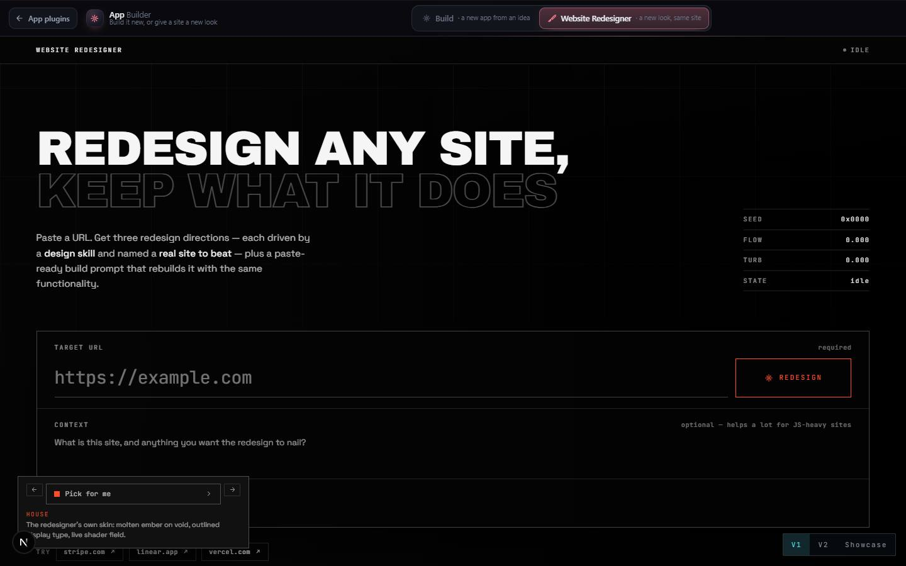

# Website Redesigner

`/apps/website-redesigner` · Websites · live · shows as: section of App Builder (`/apps/app-builder?section=redesign`)

> URL → redesign + build prompt

Paste any website address and get a fresh redesign that keeps everything the site does. It reads the
real page, lists the functionality to preserve, proposes three directions (restrained, expressive,
experimental) each driven by a design skill, and writes a paste-ready build prompt for Claude Code.
A second view ("bake-off") has three design skills actually build the redesign side by side on the
PC. It now lives inside App Builder; the old route only redirects (`MERGED_INTO` in
`src/lib/studio/plugins.ts`: `website-redesigner → app-builder`).

## Features — every one of these must still exist after your change

The owner asked for each of these. Removing, hiding or "simplifying away" one is a regression,
even if the code looked unused. If a change needs one gone, ask first.

**Where it lives**
- **Redirect keeps the view** — `/apps/website-redesigner` → `/apps/app-builder?section=redesign`, carrying `?v=2` and `?v=showcase`. `src/app/apps/website-redesigner/page.tsx`
- **Three views behind a docked toggle** — V1 (redesigner), V2 (bake-off), Showcase; the toggle never moves. `src/components/redesigner/WebsiteRedesigner.tsx`, `src/components/redesigner/v2/VersionToggle.tsx`

**V1 — the redesigner**
- **Form** — Target URL (required), Context ("What is this site…"), Ownership (my own site + "Source path or repo" so the rebuild edits real source and only restyles). `src/components/redesigner/Layouts.tsx`
- **Three directions** — restrained / expressive / Experimental WebGL, each with palette, type, layout, "real site to beat", functionality to preserve and a "Copy build prompt". `src/lib/redesigner/engine.ts`, `src/components/redesigner/Layouts.tsx`
- **AI with offline fallback** — the route reads the page and asks the AI; with no key or an error it returns an "Offline draft" heuristic. `src/app/api/redesign/route.ts`, `src/lib/redesigner/engine.ts`
- **Design-skill picker in the dock** — every website design skill in the roster (34 today), several can be pinned per direction, "Pick for me". `src/components/redesigner/Redesigner.tsx`, `src/lib/redesigner/design-skills.json`
- **The page wears the skill you hover** — hovering or picking a skill rebuilds the whole page in that skill's look: seven compositions (console, sheet, editorial, atelier, workbench, reel, lab), each with its own palette, fonts, radius, motion; click to keep. `src/lib/redesigner/skins.ts`, `src/components/redesigner/Layouts.tsx`
- **Step through skills with `[` and `]`** (Previous / Next buttons too). `src/components/redesigner/Redesigner.tsx`
- **URL fingerprint field** — a WebGL background seeded by the typed URL (seed, flow, turbulence readout), reacts to keystrokes and clicks. `src/components/redesigner/FingerprintField.tsx`, `src/lib/redesigner/fingerprint.ts`
- **Pointer effects** — trailing cursor ring and other rAF-driven interactions. `src/components/redesigner/interactions.tsx`
- **Roster auto-grows** — any website design skill installed in `~/.claude/skills` is appended by `scripts/sync-design-skills.mjs`. `src/lib/redesigner/design-skills.json`

**V2 — the bake-off (`?v=2`)**
- **Four kinds of target** — New app (describe it), One of my apps (rebuilt from its real Projects Timeline feature list), a URL (keep what it does, replace how it looks), A hub page (reskin one page in place). `src/components/redesigner/v2/BakeOff.tsx`, `src/lib/redesigner/v2/facts.ts`
- **One brief per lane** — identical except the design skill named as sole authority; facts and constraints only, never a palette. `src/lib/redesigner/v2/brief.ts`
- **Three real builds** — each skill gets its own git worktree and port via the local bridge; pick at least two skills; choose the harness (Claude Code or DeepSeek). `src/lib/redesigner/v2/useBakeOff.ts`, `src/components/redesigner/v2/BakeOff.tsx`
- **Lanes side by side** — live state, Restart preview, "told to continue N×", a failed lane keeps its place with its error. `src/components/redesigner/v2/BakeOff.tsx`
- **Declare a winner / Land it** — lands that branch, discards the others; "Which skill keeps winning" leaderboard (wins / ran). `src/components/redesigner/v2/BakeOff.tsx` (`declareWinner`, `leaderboard`)
- **Works with the PC off** — no local agent still produces copyable briefs. `src/components/redesigner/v2/BakeOff.tsx`
- **Scrape-only route** for V2. `src/app/api/redesign/scrape/route.ts`
- **The Forge** — a 3D crucible whose three ingots glow with real lane state (burning = thinking, half heat = waiting at a gate, dark = finished, cracked grey = died). `src/components/redesigner/v2/Forge.tsx`

**Showcase (`?v=showcase`)**
- **App ideas worth building again** — EMBER Reveal (`fire-reveal`) and the APEX/01 Kart Teardown (`kart-showcase`) play in place on a PlayShelf, Open full screen, and "Use this idea" opens App Builder › Build with `?idea=` prefilled. `src/components/redesigner/Showcase.tsx`, `src/lib/studio-home/builder.ts` (`SHOWCASE`, `showcaseIdea`)

## How it looks

- **Look:** "Experimental WebGL" house look (interactive-web-studio), re-skinned live by whichever design skill is picked.
- **Colours / type:** house palette `--void #050505`, `#F5F5F5`, signal `--sig #ff4d2e` (`redesigner.css`); each skin re-points CSS variables on `.rdx`. Six faces loaded only here (`fonts.ts`): Inter, Syne, Space Grotesk, Archivo Black, Instrument Serif, JetBrains Mono. Bake-off: dark steel greys with cyan `#4fd8e8` (`bakeoff.css`).
- **Layout:** V1 — the dock (skill picker, stepper) fixed to the viewport while the page reorganises around it; the composition changes per skin. V2 — the crucible on top, lane console docked beneath, HUD labels in the corners.
- **Signature pieces:** FingerprintField, the hover-to-rebuild page, the Forge crucible (Blender asset from `tools/forge-crucible/build.py`).
- **Motion:** one authored arrival per layout (rise, cut, blur, lift, snap, wipe, mask); nothing animates through React state. No WebGL or reduced motion → static ember gradient; pointer effects off on touch.

## Where the code is

| Part | Path |
|---|---|
| Page | `src/app/apps/website-redesigner/page.tsx` (redirect only); mounted by `src/components/app-builder/AppBuilderHome.tsx` |
| UI | `src/components/redesigner/` (+ `v2/`) |
| Logic + tests | `src/lib/redesigner/` (+ `v2/`) |
| API | `src/app/api/redesign/route.ts`, `src/app/api/redesign/scrape/route.ts` |
| Saved data | none server-side; the roster is `src/lib/redesigner/design-skills.json` |

## Owner's rules for this app

- The skill dropdown/dock never moves; hovering a skill rebuilds the page around it (a skin is a whole composition, not a colour swap).
- Every skill in the roster must have a skin (`skins.test.ts`); tools that build sites but are not styles stay out of the roster.
- V2 never authors a design — the skill decides every aesthetic choice.
- Assume the bridge is off: nothing 500s, briefs are still produced.
- Showcase pieces keep their own routes alive so they can play in place.

## Described but not found in code

- None found.
