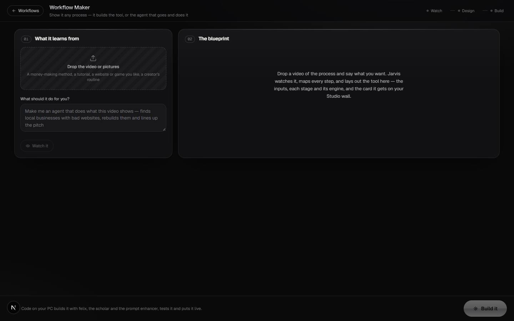

# Workflow Maker

`/apps/workflow-maker` · Video · live · shows as: App plugins card (in `PLUGIN_SLUGS`, not on the Studio wall) + a Studio card in Jarvis › Studio on the "Special skills" shelf (`WORKFLOWS` in `src/lib/studio/workflows.ts`)

> Show it any process — it builds the working tool

The owner's "rea to workflow". Drop a video or pictures of any process — a way people make money
clipping videos, a creator's routine, a tutorial, a website, game or app you like — and say what
you want. Jarvis watches it and lays out a blueprint you can edit: what it will make (a workflow,
an agent that goes and makes money, an app, a website or a game), every input as an upload slot,
every step with the engine that does it, the result, and the card as it will look. Press **Build it**
and Claude Code on the owner's PC builds the real thing with the `rea-to-workflow` skill.

## Features — every one of these must still exist after your change

The owner asked for each of these. Removing, hiding or "simplifying away" one is a regression,
even if the code looked unused. If a change needs one gone, ask first.

**Ways in**
- **Studio card** — pick "Workflow Maker" in Jarvis › Studio (Special skills) and send the line + video/pictures, or name `@workflow-maker` in the Studio chat; the screen opens and starts watching at once. `src/components/jarvis/StudioTab.tsx`, `src/components/jarvis/ChatTab.tsx` (`FLOW_SCREENS`), `src/lib/studio/workflow-maker/useWorkflowMaker.ts` (`startFromSeed`)
- **Own page** — `/apps/workflow-maker`, full height, its "← Workflows" button goes back to `/apps/jarvis#studio`. `src/components/jarvis/video-swap/Pages.tsx` (`WorkflowMakerPage`)

**01 — What it learns from**
- **Drop the video or pictures** — click or drag up to 6 files; each shows a thumbnail with its length or "picture" and a remove button. `src/components/jarvis/workflow-maker/WorkflowMaker.tsx` (`Source`), `src/lib/studio/workflow-maker/useWorkflowMaker.ts` (`addFiles`)
- **"What should it do for you?"** box + **Watch it / Watch again** button. `src/components/jarvis/workflow-maker/WorkflowMaker.tsx`
- **Watching animation** — the video's frames scroll past under a glowing scan line; the blueprint area shows skeletons. `src/components/jarvis/workflow-maker/WorkflowMaker.tsx` (`wm-scan`, `Empty`), `src/components/jarvis/workflow-maker/workflow-maker.css`
- **The watcher** — one vision-model call told to do the video-analyzer + rea pass (every step, tool, input and output), the Felix pass (end goal, goal beyond it, an outside judge) and the Scholar pass (what a 40-year master does that the video doesn't show), and to pick what to make; agents for anything about making money. Up to 16 frames, 4.4 MB. `src/app/api/studio/workflow-maker/route.ts`
- **Works with no AI** — no key, a model error or an unreadable answer gives the built-in draft for the field the request matches, with a plain notice. `src/lib/studio/workflow-maker/blueprint.ts` (`draftBlueprint`, `TEMPLATES`), `src/app/api/studio/workflow-maker/route.ts`

**02 — The blueprint (everything editable in place)**
- **Card preview** — the card exactly as it will sit on the Studio wall (hue, grid, "New" badge, name, one-line blurb), tilted in 3D on a laptop. `src/components/jarvis/workflow-maker/WorkflowMaker.tsx` (`wm-card`)
- **Name, card line, end goal, goal beyond it, and what was watched.** `src/components/jarvis/workflow-maker/WorkflowMaker.tsx` (`BlueprintView`)
- **What it makes** — Workflow · Agent · App · Website · Game; switching to Agent brings a starter kit for its field. `src/lib/studio/workflow-maker/blueprint.ts` (`MAKE_KINDS`, `kindOf`), `src/lib/studio/workflow-maker/useWorkflowMaker.ts` (`setKind`)
- **Where it lives** — Agent (agents only) · Studio card · App plugin · Widget. **Recreate it / Change it** switch. `src/components/jarvis/workflow-maker/WorkflowMaker.tsx` (`HOMES`)
- **Goes in → What it does → Comes out** pipeline — inputs (up to 8; tap the icon to cycle video/image/text/audio/link), steps (up to 10; engine, runs on Your PC / Cloud / Browser, on/off switch, move up/down), the one result, and "Where the money is". `src/components/jarvis/workflow-maker/WorkflowMaker.tsx` (`InputRow`), `src/lib/studio/workflow-maker/useWorkflowMaker.ts`
- **The master's craft** and **How we'll know it works** — numbered editable lists (up to 8). `src/components/jarvis/workflow-maker/WorkflowMaker.tsx` (`EditableList`)
- **The agent's kit** (Agent only) — role, measurable goal, tools it uses (each marked ready ✓ or "to set up" 🔑, kind skill/app/api/model/site, with a "N to set up" count), websites & resources (with an open-link button for safe URLs), when it works, accounts you connect once (chips), asks you first, keeps score on (earnings go to Financial Bible), first moves. `src/components/jarvis/workflow-maker/WorkflowMaker.tsx` (`AgentPanel`, `ChipList`), `src/lib/studio/workflow-maker/blueprint.ts` (`coerceAgent`, `safeUrl`)
- **Starter kits** — agents: Clip Engine, Site Flipper, Game Forge; workflows: Recast, Avatar Agent, Fitness Reels, ASMR Kitchen; generic "My Workflow". `src/lib/studio/workflow-maker/blueprint.ts` (`TEMPLATES`, `GENERIC`)
- **Fields that grow with their words** (CSS `field-sizing`, JS fallback for iPhone Safari). `src/components/jarvis/workflow-maker/WorkflowMaker.tsx`, `src/components/jarvis/workflow-maker/workflow-maker.css` (`.wm-grow`)

**Build it**
- **Checks before it goes** — name, ≥1 input, ≥2 steps on, an output, a judge; an agent needs a goal, a tool and what it asks first. The first problem shows in the dock and Build it stays off. `src/lib/studio/workflow-maker/blueprint.ts` (`checkBlueprint`)
- **Build it** — files one In Queue request in folder `flow:workflow-maker`: a brief in the prompt-enhancer's shape (goal, context, request, requirements, mastery, standard, success criteria) ending `BLUEPRINT JSON: {…}`, ≤ 3,700 chars (prose shortens first, never the JSON's structure), + 4 key frames; "Build it with the rea-to-workflow skill on this PC" heads it. `src/lib/studio/workflow-maker/blueprint.ts` (`buildBrief`, `BRIEF_ROOM`), `src/lib/studio/queueText.ts`, `src/lib/studio/workflow-maker/useWorkflowMaker.ts` (`send`)
- **Build tracker** — Filed → Your PC picks it up → Built and tested (latest agent note) → Live on your Studio wall, read live from In Queue; copy button for "work my Jarvis queue"; Back to the blueprint / Make another. `src/components/jarvis/workflow-maker/WorkflowMaker.tsx` (`BuildJob`)
- **Your builds** menu — last 12 builds, Queued / Building / Built, newest first. `src/components/jarvis/workflow-maker/WorkflowMaker.tsx` (`BuildsMenu`)
- **Watch → Design → Build** progress dots in the top bar. `src/components/jarvis/workflow-maker/WorkflowMaker.tsx`
- **Kept on this device** — request, thumbs + 3 frames per item, blueprint and view survive a reload. `src/lib/studio/workflow-maker/useWorkflowMaker.ts` (`KEY`, `keep`)

## How it looks

- **Look:** taste-skill "Cold Luxury" — the same system as Custom Video Swap (it imports `../video-swap/video-swap.css` and adds `workflow-maker.css`). Not DESIGN.md.
- **Colours / type:** `.vs` tokens — background `#09090a` with faint radial glows, panels `#111113` / `#18181b`, hairlines `rgba(255,255,255,.075/.14)`, ink `#f3f3f1` / `#b3b3b8` / `#75757c`, the one accent platinum `#e7e8ea` and a chrome gradient (`#fbfbfa → #d9dadd → #a9abb0 → #eeeeef`) for pressed pills, step numbers, the title and Build it; warning `#f2b37a`. Fonts Geist + Geist Mono via `next/font` (`src/components/jarvis/video-swap/fonts.ts`); mono for numbers and engines.
- **Layout:** laptop — 12-column grid, "01 What it learns from" (4 cols) beside "02 The blueprint" (8 cols); the pipeline reads left to right in three columns (from 900 px) with arrows between; fixed dock at the bottom with the next problem and Build it. Phone — one column, pipeline stacked, kind switch scrolls sideways, no card tilt or shine.
- **Signature pieces:** tilted live card preview with shine sweep; numbered pipeline steps joined by a thread; editable fields that look like plain text until touched; the agent's kit panel with a chrome bot badge; frame-scan strip while watching.
- **Motion:** panels rise in (`vs-rise`), card shine every 5 s, frame drift + scan line while watching, Build it light sweep. `prefers-reduced-motion` turns every animation inside `.vs` off.

## Where the code is

| Part | Path |
|---|---|
| Page | `src/app/apps/workflow-maker/page.tsx` → `WorkflowMakerPage` in `src/components/jarvis/video-swap/Pages.tsx` |
| UI | `src/components/jarvis/workflow-maker/` (`WorkflowMaker.tsx`, `workflow-maker.css`; shares `../video-swap/video-swap.css` and `fonts.ts`) |
| Logic + tests | `src/lib/studio/workflow-maker/` (`blueprint.ts` + `blueprint.test.ts`, `useWorkflowMaker.ts`) |
| API | `src/app/api/studio/workflow-maker/route.ts` |
| Saved data | localStorage `jarvis.workflow-maker.v1` (this device); builds are In Queue requests in folder `flow:workflow-maker` (per-account server doc via `/api/new-jarvis/requests`) |

Also: Studio card `workflow-maker` in `src/lib/studio/workflows.ts`; Studio skill text `src/lib/studio/skills/workflow-maker.md` (for when the screen isn't available); queue skill map `PC_SKILLS` in `src/lib/studio/queueText.ts`; "Test the Workflow Maker" task in `src/lib/new-jarvis/tasks.ts`.

## Owner's rules for this app

- It is not only for videos: the blueprint must always say what it makes — workflow, **agent**, app, website or game.
- An agent never posts, messages people, spends or publishes without the owner's yes ("Asks you first" is required before Build it).
- Never promise income or invent a rate, platform or earnings figure; the card gets an ORIGINAL name, never a product's name from the video.
- Free and local first: the PC (WanGP/Pinokio, MiniMax H3, Viggle, ffmpeg, Remotion/HyperFrames) before paid cloud.
- The blueprint JSON is the contract — it always goes in whole; only prose is trimmed to fit.
- Claude Code builds it on the PC with `rea-to-workflow` (whose file map is the Custom Video Swap layout); this screen never renders anything itself (`studio_queue`, never `studio_generate`).

## Described but not found in code

- None found.
