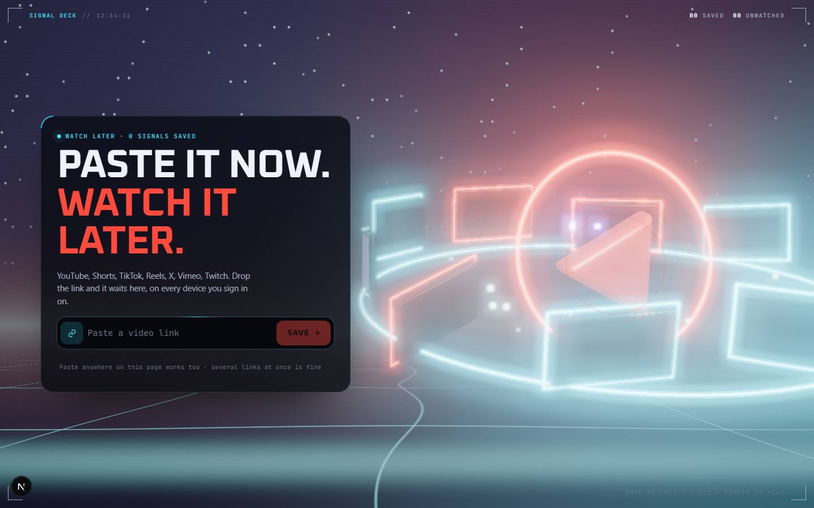

# YouTube videos

`/apps/youtube-videos` · AI · live · shows as: Dashboard widget (Jarvis › Dashboard, widget id `youtube`; also opens on its own page)

> Paste a video link now, watch it later

A watch-later list for video links from any app: paste a YouTube, Shorts, TikTok, Instagram, Facebook, X, Vimeo,
Twitch or Reddit link and it lands at the top of the list with its title, channel and thumbnail filled in. For you
suggests what to watch next from what you save. It lives on the Jarvis Dashboard as a widget, and the same app also
runs on its own page.

## Features — every one of these must still exist after your change

The owner asked for each of these. Removing, hiding or "simplifying away" one is a regression,
even if the code looked unused. If a change needs one gone, ask first.

**Saving links**
- **Paste box ("command bar")** — paste a link and press Save; it recognises the platform and shows a preview (thumbnail, platform, kind) before you save. `src/components/youtube-videos/YouTubeVideosApp.tsx`
- **Paste anywhere on the page** — pasting while not typing in another box saves at once. `src/components/youtube-videos/YouTubeVideosApp.tsx`
- **Several links at once** — a blob of text with many links (even with no `https://`) saves each one. `src/lib/youtube-videos/links.ts` (`extractUrls`, `parsePaste`)
- **Every platform understood** — YouTube (videos, Shorts, live, `?t=` start time), TikTok, Instagram, Facebook, X, Vimeo, Twitch, Reddit, Snapchat, Pinterest; unknown sites still save as "Link". `src/lib/youtube-videos/links.ts`
- **No duplicates** — the same video in any spelling (youtu.be, `?si=` tracking, etc.) gets one dedupe key; re-pasting moves it back to the top. `src/lib/youtube-videos/links.ts`, `src/lib/youtube-videos/library.ts`
- **Newest first** — a fresh save always goes to the top. `src/lib/youtube-videos/library.ts`
- **Titles, channels and thumbnails fill in by themselves** — looked up through each platform's public oEmbed (allowlisted endpoints only; never fails loudly). `src/app/api/youtube-videos/meta/route.ts`, `src/lib/youtube-videos/useLibrary.ts`
- **Plain-English bad-paste message** — "That doesn't look like a link…". `src/components/youtube-videos/YouTubeVideosApp.tsx`

**The library (Saved tab)**
- **Saved / For you tabs** — segmented switch with a sliding pill and a saved count. `src/components/youtube-videos/YouTubeVideosApp.tsx`
- **Filter chips** — Unwatched (with count) and one chip per platform you have saved (with counts); on a phone they swipe sideways with a fade. `src/components/youtube-videos/YouTubeVideosApp.tsx`, `ytv.css`
- **Holo tiles** — thumbnail, platform tag, title, channel, "x ago"; tilt + glare + scan sweep on hover; Watched badge. `src/components/youtube-videos/YouTubeVideosApp.tsx`
- **Expand in place into a player** — clicking a tile opens a full-row player with details (FLIP animation); Collapse, Esc, or opening another tile closes it; the opened tile scrolls clear of the sticky tabs. `src/components/youtube-videos/YouTubeVideosApp.tsx`
- **In-app players** — YouTube (no-cookie, keeps start time), Vimeo, TikTok, Instagram, X, Facebook, Twitch; Shorts/TikToks/Reels play vertical; other platforms say they can't embed and open the link. `src/lib/youtube-videos/links.ts` (`embedFor`, `isTall`)
- **Mark watched / not watched** — toggle on every tile. `src/lib/youtube-videos/library.ts` (`toggleWatched`)
- **Open on <platform>** — link out on every tile and in the player. `src/components/youtube-videos/YouTubeVideosApp.tsx`
- **Delete with Undo** — a toast with Undo holds the deleted row for ~6 seconds. `src/components/youtube-videos/YouTubeVideosApp.tsx`, `src/lib/youtube-videos/library.ts`
- **Empty / loading states** — "Loading your list…", "Nothing matches that filter.", "No signals yet." `src/components/youtube-videos/YouTubeVideosApp.tsx`
- **Synced on every device** — one per-account synced blob, so phone and laptop show the same list. `src/lib/youtube-videos/useLibrary.ts`

**For you**
- **Three tiers, works with no keys** — `YOUTUBE_API_KEY` → real YouTube videos with thumbnails; else an AI reads your saved titles and suggests searches with a one-line reason; else local taste (repeated words and channels) → YouTube searches. `src/lib/youtube-videos/recommend.ts`, `src/app/api/youtube-videos/recommend/route.ts`
- **Picks refresh by themselves** when what you save changes; already-saved videos are left out; a real pick can be saved with one tap. `src/components/youtube-videos/YouTubeVideosApp.tsx`
- **"Connect a free YouTube key" guide** — numbered steps, each with a button to the exact Google page, shown while picks are only searches; inside Jarvis it switches to Profile › Connections in place (`/apps/jarvis#connections/<capability>`). `src/components/youtube-videos/YouTubeVideosApp.tsx`, `src/lib/new-jarvis/keySetup.ts` (`YOUTUBE_API_KEY`)

**The hero ("Holo Deck")**
- **3D ring of screens** — Blender-modeled glass screens round a play-prism core, glowing frames, orbit rings; each screen wears one of your newest saves. `src/components/youtube-videos/ReelHero.tsx`, `tools/youtube-videos-hero/build_hero.py`
- **Drag / swipe to spin** with inertia, slow idle "attract" spin; a vertical swipe on a phone stops the spin. `src/components/youtube-videos/ReelHero.tsx`
- **Hover a screen** — it lifts, its frame flares, and a HUD callout names the video. `src/components/youtube-videos/ReelHero.tsx`
- **Click a screen to play** that video; an empty screen focuses the paste box. `src/components/youtube-videos/ReelHero.tsx`, `YouTubeVideosApp.tsx`
- **Saved link flies into the ring** from the paste box. `src/components/youtube-videos/ReelHero.tsx` (`feed`)
- **Scroll** — the camera pulls back and the ring tips away into the list; the copy fades up. `src/components/youtube-videos/ReelHero.tsx`, `ytv.css` (`--ytv-p`)
- **HUD** — corner brackets, live clock, saved / unwatched counts, per-platform tallies, "DRAG TO SPIN · CLICK A SCREEN TO PLAY" (touch: "SWIPE TO SPIN · TAP A SCREEN TO PLAY"). `src/components/youtube-videos/YouTubeVideosApp.tsx` (`Hud`)
- **Magnetic Save button** (follows a mouse pointer). `src/components/youtube-videos/YouTubeVideosApp.tsx`
- **Robust hero** — poster image (16:9 and phone 9:16) while loading and when there is no WebGL / context lost; pauses offscreen and in hidden tabs; bloom on desktop GPUs only. `src/components/youtube-videos/ReelHero.tsx`, `public/youtube-videos/`

**Dashboard widget**
- **Compact card** — its own paste box that saves on the spot, a strip of the four newest thumbnails (they share the card's width so a phone never overflows), status line; tap the card for the full app in the widget sheet; "Own tab" link to `/apps/youtube-videos`. `src/components/youtube-videos/YouTubeVideosWidget.tsx`
- **Widget sheet** mounts the full app (`embedded`). `src/components/youtube-videos/YouTubeVideosWidget.tsx` (`YouTubeVideosExpanded`), mounted in `src/components/new-jarvis/Deck.tsx`

**Phone**
- **Phone layout** — ring in its own swipeable band with a hint, copy and paste box under it, saved list starts inside the first screen; two even tile columns; 16 px paste box so iPhone doesn't zoom; Shorts/Reels open short enough to see Collapse. `src/components/youtube-videos/ytv.css`, `YouTubeVideosApp.tsx`

## How it looks

- **Look:** "Holo Deck" — interactive-web-studio with scroll-craft layering and a blender-to-web hero, in Jarvis's HUD language. Does **not** use DESIGN.md's tokens; it has its own `--ytv-*` set.
- **Colours / type:** canvas `#05060a`, surfaces `#0e111a` / `#151926` (glass `rgb(14 17 26 / .72)`), lines `rgb(120 220 255 / .12–.22)`, ink `#eef3fb` / `#a3adc2` / `#69738a`, HUD cyan `#3be3ff`, coral "play" accent `#ff4b3e`, violet `#a67bff`, ok `#5be38f`, amber `#ffb547`. Each platform has a hue (`PLATFORM_HUE`: YouTube `#ff4b3e`, TikTok `#23f0c7`, Instagram `#ff4b8b`, Facebook `#5b8cff`, Vimeo `#3be3ff`, Twitch `#a67bff`…). Fonts: Oxanium (display) + JetBrains Mono (every number and label) loaded in `page.tsx` as `--font-nj-display` / `--font-nj-mono`.
- **Layout:** laptop (≥860px) — sticky full-height hero with copy + command bar on the left and the ring shifted right, then sticky tabs and an auto-fill tile grid (min 250px). Phone — ring band on top, copy and paste box below, two-column tiles. The app owns its own scroll container (`100dvh`, or `100%` when `embedded`).
- **Signature pieces:** the 3D ring of screens, HUD brackets/clock/telemetry, the command bar with live preview, holo tiles that expand into a player.
- **Motion:** ring spin/inertia/bloom, link fly-in, tile tilt/glare/scan, FLIP expand, toast; CSS motion is transform/opacity. Reduced motion: no idle motion or flights, frames drawn on demand, CSS animations stop (`@media (prefers-reduced-motion: reduce)` in `ytv.css`).

## Where the code is

| Part | Path |
|---|---|
| Page | `src/app/apps/youtube-videos/page.tsx` |
| UI | `src/components/youtube-videos/` (`YouTubeVideosApp.tsx`, `ReelHero.tsx`, `YouTubeVideosWidget.tsx`, `ytv.css`) |
| Logic + tests | `src/lib/youtube-videos/` (`links.ts`, `library.ts`, `recommend.ts`, `useLibrary.ts`, `youtube-videos.test.ts`) |
| API | `src/app/api/youtube-videos/` (`meta/route.ts` oEmbed lookups, `recommend/route.ts` For you) |
| Hero asset | `tools/youtube-videos-hero/build_hero.py --direction holo` → `public/youtube-videos/hero-holo.glb` (+ `.webp` posters, `draco/`) |
| Saved data | synced key `youtube-videos:v1` (per-account app_state) |

## Owner's rules for this app

- Widget only (owner's call, Nov 2026): **no App plugins card and no hub tile**. The slug stays in `WIDGET_SLUGS` in `src/lib/studio/plugins.ts` — removing it would put the hub tile back. The route stays live for the widget's expanded view and its own tab.
- One component, two homes: the widget sheet mounts `YouTubeVideosApp` with `embedded`; never fork it.
- Build-checklist rules enforced in `library.ts`: newest first, no duplicates, deletes can be undone.
- Must work with no keys: For you falls back AI → local taste. `YOUTUBE_API_KEY` is pasted in Jarvis › Profile › Connections, not on this page.
- `/api/youtube-videos/meta` may only call the allowlisted oEmbed endpoints — never fetch the pasted URL itself.
- In `UNPREVIEWABLE` in `src/lib/catalog.ts` (the hub carousel never frames it).

## Described but not found in code

- "Scrolling deals the tiles into the grid" (v1 hero, commit d3226f9 / feature-log 2026-10-20) — the v2 Holo Deck replaced it; scroll now pulls the camera back and tips the ring away (`ReelHero.tsx`).
- "App plugins card `/apps/youtube-videos`" (the old CLAUDE.md "Where things live" row) — removed on purpose 2026-11-02 (commit f0f7bcb); now widget-only.
